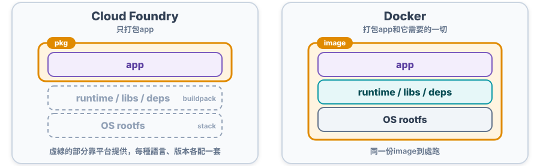
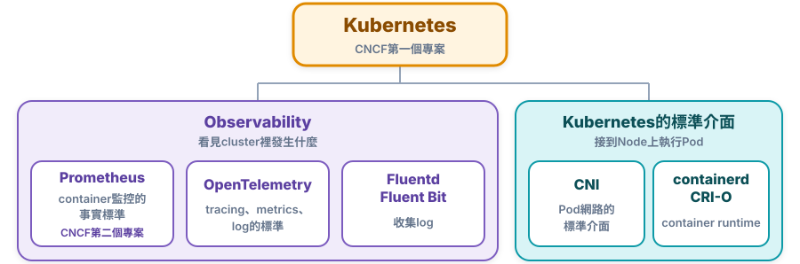
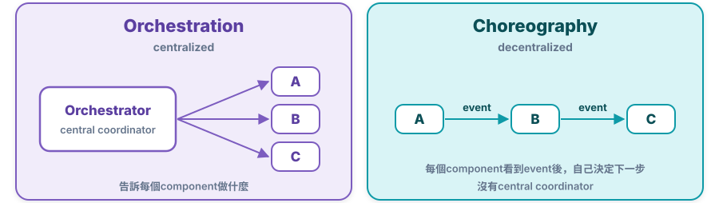
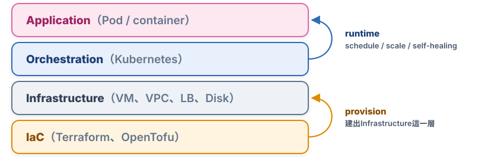

# Chap-0 History

**目錄**

- [從PaaS到container](#從paas到container)
- [Docker為什麼贏過Cloud Foundry](#docker為什麼贏過cloud-foundry)
- [從Docker到Kubernetes](#從docker到kubernetes)
- [Kubernetes的起源和生態](#kubernetes的起源和生態)
- [IaC vs Orchestration vs Choreography](#iac-vs-orchestration-vs-choreography)

## 從PaaS到container

*雲端剛普及的時候，大家怎麼deploy app？container又改變了什麼？*

### ☁️ 1. PaaS：從實體機器到雲端VM

VM和雲端運算普及之後，常見的做法是：***租一批AWS或OpenStack的VM，再像以前管實體server一樣，用手動操作或script在這些VM上deploy app***。

PaaS（Platform as a Service）專案，例如Cloud Foundry，受歡迎的主要原因是它提供了「**應用託管**」的能力：開發者只要把app交給平台，平台負責把它跑起來，不用自己管VM。

### 📦 2. Container：以container為核心的基礎設施

接下來的轉變，是從***以實體機器和VM為主***的開發和ops，轉向***以container為核心***的基礎設施。

這個轉變的learning curve很陡：網路、storage、scheduling、OS、分散式系統，每一塊都要用container的方式重新理解。其中有兩個概念貫穿整個Kubernetes：

- **Linux的process模型**：container本質上是一個被隔離的process，見[Chap-1](chap-1-container-namespace-cgroups.md)。
- **controller模式**：Kubernetes幾乎所有功能，都是一個個controller在做「把實際狀態調整成期望狀態」，見[控制器模式](chap-5-container-orchestration-controller.md#控制器模式)。

## Docker為什麼贏過Cloud Foundry

*兩者都用namespace和cgroups做隔離，Docker贏在哪裡？*

***勝負關鍵是打包方式***：Cloud Foundry打包的是app，Docker打包的是app加上它需要的一切。

| 面向                                                  | Cloud Foundry（PaaS）                                                            | Docker                                                | 誰贏                          |
| ----------------------------------------------------- | -------------------------------------------------------------------------------- | ----------------------------------------------------- | ----------------------------- |
| **隔離機制**                                    | 呼叫OS的namespace + cgroups，建立sandbox                                         | 同樣的方式                                            | 🟡 平手：sandbox就是container |
| **打包內容**                                    | app的執行檔 + start / stop script                                                | 完整的OS rootfs + app                                 | 🟢 Docker                     |
| **打包成本**                                    | 每種語言、framework、版本都要維護一個pkg，沒有固定的方法，反覆trial and error    | `docker build`之後`docker run`，同一份image到處跑 | 🟢 Docker                     |
| **local和雲端一致** | local能跑，上了PaaS還要改config、反覆試錯；`cf push`表面上一鍵，實際打包很麻煩 | image和local開發、測試時的OS完全一樣，不用任何修改    | 🟢 Docker（決勝點）           |

image現在的標準格式是OCI（Open Container Initiative）image，Docker build出來的image也是這個格式，containerd、CRI-O都能直接執行。

> [!TIP]
> 💡 **一句話總結**
>
> ***Docker贏在image***：把app連同整個OS rootfs打包，local能跑，到哪裡都能跑。

## 從Docker到Kubernetes

*有了container之後，下一個問題是什麼？*

***container本身沒有太大價值，有價值的是container orchestration***：自動管理大量container的lifecycle和執行狀態。例如：

| 類別                   | orchestration要處理的事                  |
| ---------------------- | ---------------------------------------- |
| **排程和擴縮**   | scheduling、scaling、self-healing        |
| **服務**         | service discovery、networking、routing   |
| **config和資源** | config、Secret、storage、resource管理    |
| **發佈**         | rolling update、rollback                 |
| **可靠性**       | fault tolerance、HA（High Availability） |
| **維運**         | observability、monitoring、backup        |

這些正是後面每一章要講的內容：Pod見[Chap-4](chap-4-container-orchestration-pod.md)，controller、rolling update見[Chap-5](chap-5-container-orchestration-controller.md)，storage見[Chap-8](chap-8-volume.md)。

## Kubernetes的起源和生態

*Kubernetes從哪裡來？為什麼能長成整個生態？*

### 🏛️ 1. 起源：Borg和Omega

Kubernetes源自Google內部的Borg和Omega系統。這些系統的設計，後來落到Kubernetes上，就是Pod、sidecar等功能和設計模式。

Google在2014年發表Kubernetes，2015年發佈1.0。同一年，Linux Foundation底下成立了**CNCF**（Cloud Native Computing Foundation），Google把Kubernetes捐給CNCF，成為它的第一個專案。CNCF以Kubernetes為基礎，建立cloud native的生態。

### 🌱 2. 生態

CNCF底下現在有很多專案，常見的例如：

CNI和container runtime怎麼接到Kubernetes上，見[Chap-3的架構](chap-3-kubernetes-architecture-operations.md#-1-kubelet與各個interface)；實際裝一個CNI plugin，見[Chap-3的Step 5](chap-3-kubernetes-architecture-operations.md#-step-5deploy-cni-plugin)。

### 🧩 3. 開放的擴展機制

Kubernetes能長成整個生態，靠的是它對**開發者開放**：

- **靈活的擴展性**：從API到container runtime，每一層都有***可以擴展的介面***：CRI、CNI、CSI、Device Plugin，見[Chap-3的架構圖](chap-3-kubernetes-architecture-operations.md)。
- **用程式碼介入每一個階段**：可以用[CRD](chap-7-crd-operator.md#manualcrd和controller)加入自己的object、用自訂controller讓它做事，也可以用[admission webhook](chap-6-declarative-api.md#api-server怎麼處理request)在object寫進etcd之前檢查或修改它。

## IaC vs Orchestration vs Choreography

*這幾個詞常常一起出現，差在哪裡？*

### 🎼 1. Orchestration vs Choreography

|  | Orchestration | Choreography |
| --- | --- | --- |
| **怎麼運作** | 有一個central coordinator，告訴每個component做什麼 | event-driven，每個component自己決定下一步 |
| **優點** | workflow看得見，好debug | loose coupling，scalability好 |
| **缺點** | orchestrator是single point of failure | 整體workflow難trace |

Kubernetes兩種都有：使用者看到的是orchestration（交給Kubernetes管理container），但內部每個controller各自watch API Server、各做各的，更接近choreography，見[自訂controller的Informer](chap-7-crd-operator.md#-5a-informercontroller怎麼知道network變了)。

### 🤖 2. Orchestration vs Automation

- **Automation**：把***單一task***自動化，例如一個deploy script。
- **Orchestration**：把***多個automation task***串起來協調，處理它們之間的順序、deps和failure。

### 🏗️ 3. Orchestration vs IaC（Infrastructure as Code）

IaC是用code描述infrastructure，例如用Terraform、OpenTofu、Pulumi建立VM、network、Load Balancer。它和Kubernetes的[聲明式API](chap-6-declarative-api.md#命令式和聲明式)是同一個想法：***寫下desired state，交給工具去達成***。

兩者管的是不同層：***IaC負責建出Infrastructure***，例如VM、VPC、Load Balancer、disk；***Kubernetes跑在這些機器上，在runtime管理上面的app***，負責schedule、scale、self-healing。

> [!TIP]
> 💡 **一句話總結**
>
> ***Automation做單一task，Orchestration協調多個task，Choreography讓component靠event自己協作***；Kubernetes對外是orchestration，內部的controller更像choreography。
