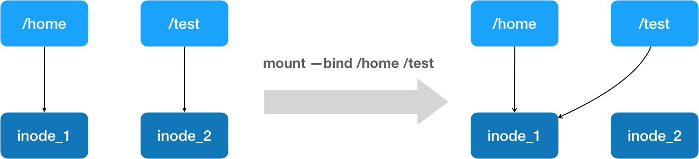
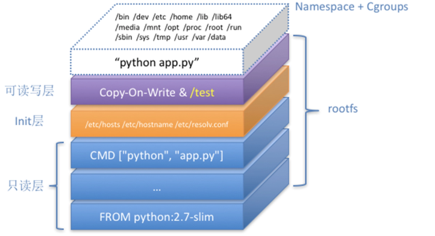

# Chap-1 Container Basics

**目錄**

- [Container為什麼能seamless deploy](#container為什麼能seamless-deploy)
- [Image能不能跨OS運行](#image能不能跨os運行)
- [Container隔離的limit與solution](#container隔離的limit與solution)
- [mount基本命令](#mount基本命令)
- [mount --bind技術](#mount---bind技術)
- [mount point與mount tree](#mount-point與mount-tree)
- [pivot_root工作原理](#pivot_root工作原理)
- [pivot_root在container中如何工作](#pivot_root在container中如何工作)
- [最小container實作：mini_container.c](#最小container實作mini_containerc)
- [UnionFS與Docker的Layered rootfs](#unionfs與docker的layered-rootfs)
- [setns：加入另一個process的namespace](#setns加入另一個process的namespace)
- [延伸：Pod、container與process](#延伸podcontainer與process)
- [簡寫對照](#簡寫對照)

## Container為什麼能seamless deploy

*Container如果只做了cgroup資源限制和namespace障眼法是不夠的，還需要什麼才可以seamless deploy到remote？*

如果Container只是Linux Kernel上的「**資源限制（`cgroups`）**」與「**障眼法（`Namespace`）**」，為什麼我們能把在local開發好的container，完全seamless地搬到remote的AWS、GCP或任何一台server上直接執行，且保證「***在我的電腦能跑，在remote就能跑***」？

答案在於：Container的真正威力，是「***隔離機制***」搭配了「***打包標準與UnionFS（RootFS + Image）***」。

### 1. 關鍵核心：它打包了完整的「RootFS」

當我們在傳統server上deploy程式時，常常因為local與remote的`libc`版本不一致、Python / Java dep lib版本不同、或是缺少某個特定Dynamic Link Library（`.so`）而導致deploy失敗。

但Container Image不僅僅是打包你的程式碼，它是直接把OS的**User Space所有檔案**完整抓了下來：

- ✅ **包含了**：所有的dep pkg、env var、config、系統C lib（如`glibc`）、甚至是`/bin/bash`。
- ❌ **不包含**：Linux Kernel。

當你把這個Image送到remote時，remote host透過**mount namespace**和[`pivot_root`](#pivot_root在container中如何工作)，把container的根目錄`/`替換成Image裡載入的RootFS。對container內的process來說，它看到的完全是local開發時那一套**一模一樣的檔案結構**，根本感受不到底層硬體或host OS變了。

### 2. ABI的穩定性

> [!NOTE]
> **ABI**是 **Application Binary Interface** ，意思是「 ***編譯好的binary程式之間，在machine code level怎麼互相call***」的規範

你可能會問：「**container借用了remote host的Kernel**，難道不同Kernel不會出事嗎？」

這歸功於Linux Kernel廣為人知的設計鐵律——***"Never break userspace"***。

**Linux的sys call**（如`open`、`read`、`socket`）**interface非常穩定**。只要remote server的Linux Kernel版本沒有old到不支援container所需的sys call（例如kernel≥**3.10**），container內部的user space程式碼就能毫無障礙地透過sys call與remote kernel對話。

### 3. Copy-on-Write與layering（OverlayFS / UnionFS）

如果每次deploy都要傳送幾GB的完整OS，那網路會被塞爆，也談不上seamless。

container利用了**Union Filesystem**（如Linux中的`overlay2`），把RootFS切分成***多個******Read-Only Layers***：

| 層               | 內容                                 |
| ---------------- | ------------------------------------ |
| **Base層** | Ubuntu / Alpine OS基本環境           |
| **Dep層**  | 安裝Node.js / Python / Java等Runtime |
| App層            | 你的App程式碼與Config                |

seamless運送的關鍵在於：

- **incremental傳輸**：remote server如果已經有Ubuntu基底層，deploy新版程式時只需要下載**幾MB的應用層**，幾秒鐘就能完成更新。
- **Copy-on-Write**：container執行時，所有修改只會寫在最頂層的「暫存writable層」（`UpperDir`），**絕不破壞**底下read-only的Image。詳見[UnionFS與Docker的Layered rootfs](#unionfs與docker的layered-rootfs)。

### 4. 統一的OCI（Open Container Initiative）標準

Docker社群推動了**OCI標準**，規範了：

- **Image Spec**：檔案怎麼打包、Layer怎麼疊加、Manifest檔長怎樣。
- **Runtime Spec**：底層工具（如`runc`）拿到Image（rootfs + `config.json`）後，要建立哪些namespace、mount哪些filesystem、怎麼config cgroup，以及`create` / `start` / `delete`的生命週期。

這意味著，不論你在Mac（Docker Desktop）上Build，還是在CI/CD pipeline（GitHub Actions）上Build，產出的Image**都符合同一套規格**。送到remote的AWS ECS、Kubernetes或是平價VPS上，底層的Container Runtime（如`containerd`或`cri-o`）都能用完全相同的邏輯把它剖析並跑起來。

> [!TIP]
> **總結**
>
> - **`Namespace` + `cgroups`**：讓process在執行時有了孤立的「包廂」。
> - **OCI Image + `OverlayFS`**：把包廂裡的「家具、裝潢與工具（RootFS）」全部壓縮封箱，做成了標準化貨櫃。
>
> 正因為「障眼法環境」和「看到的檔案內容」被一併完整打包搬移了，container才能做到極致的***seamless跨環境deploy***。

## Image能不能跨OS運行

*OS A的Image，可以deploy到OS B中運行嗎？*

簡單來說：

- A與B都屬於**Linux家族**，且**CPU架構相同** → ✅ **可以**。
- A與B是**完全不同的OS家族**（例如Linux與Windows） → ❌ **不能直接運行**。

### 1. Linux distro之間：完全可以

> 例：Ubuntu Image → CentOS host

如果你在local用Ubuntu作為Base Image打包了一個container，把它deploy到remote CentOS/Debian的server上，是可以seamless執行的。

- **原因**：container**不包含**OS Kernel，只包含**User Space的檔案與lib**（`libc`等）。所有的Linux distro***共享相同的Linux Kernel API / sys calls***。
- **運作機制**：CentOS host的Linux Kernel會直接接管並執行Ubuntu Image裡面的應用程式與sys call。
- **比喻**：kernel像引擎，container像車身。CentOS和Ubuntu的kernel版本、調校可以不同，就像引擎不一樣，但***引擎接口（sys call ABI）相同***，所以Ubuntu的車身裝到CentOS的引擎上照樣能跑。原因見[ABI的穩定性](#2-abi的穩定性)。

### 2. 跨不同OS：不能直接運行

> 例：Linux Image → 原生Windows host

如果你打包了一個Linux container Image，想直接把它放到Windows Server或macOS的原生Kernel上執行，是無法直接執行的。

- **原因**：不同OS的***Kernel API和ABI完全不同***。Linux程式編譯出來的sys call（例如`epoll`、`clone`）在Windows Kernel裡根本不存在，Windows無法直接解析並執行Linux的binary檔案。
- **例外（virtualization層）**：macOS / Windows上的Docker Desktop之所以能跑Linux container，是因為Docker在背景悄悄啟動了一台**輕量級Linux VM**（macOS的HyperKit / VFKit，Windows的WSL2 / Hyper-V）。container實際上是跑在那個**Linux VM的Kernel**之上，而不是直接跑在Host OS上。

### 3. 跨CPU架構：不能直接運行

> 例：`x86_64` Image → `arm64`server

除了OS Kernel外，**ISA**（Instruction Set Architecture）也是硬性限制。

如果你在Intel / AMD（`x86_64`）的電腦上Build出Image，直接拿到Apple Silicon（M1 / M2 / M3）或AWS Graviton（`arm64`）server上，Kernel會因為無法解析CPU instruction set而報錯：`exec format error`。

### 總結對照表

| A（Image來源）      | B（deploy host）   | CPU架構 | 能否直接deploy？                      | 關鍵原因                             |
| ------------------- | ------------------ | ------- | ------------------------------------- | ------------------------------------ |
| Ubuntu              | CentOS / RHEL      | 相同    | ✅ **可以**                     | 共享相同的Linux Kernel sys call      |
| Linux               | Windows Server     | 相同    | ❌ **不行**（除非開WSL2 VM）    | Kernel API完全不同（POSIX vs Win32） |
| Linux（`x86_64`） | Linux（`arm64`） | 不同    | ❌ **不行**（除非用Multi-arch） | CPU機器instruction set不相容         |

## Container隔離的limit與solution

*container靠namespace做隔離，為什麼說這種隔離「不徹底」？業界又是怎麼補強的？*

> [!NOTE]
> **簡答**：namespace只隔離了「**視圖**」，所有container仍***共用同一個Linux kernel***，所以kernel或runtime的任何一個漏洞，都可能讓攻擊者逃出container。要接近VM等級的隔離，必須在namespace之外**疊加其他機制**（gVisor、Kata、Firecracker等），而不是靠優化namespace本身。這個問題在***多租戶K8s、AI agent、GPU叢集***共享等場景下尤其關鍵。

### 🔍 1. 根本原因：隔離的是「視圖」，不是kernel

namespace只是把kernel的某些資源做成各container各自看到的版本（PID、network interface、mount point等），但所有container**共用同一個Linux kernel**。

|                                | container                          | VM                                   |
| ------------------------------ | ---------------------------------- | ------------------------------------ |
| **Kernel**               | 與host及其他container共用          | 每個VM有獨立的guest kernel           |
| **隔離邊界**             | kernel的軟體機制                   | hypervisor，由硬體virtualization強制 |
| **攻擊者要碰到其他租戶** | 突破**一個**kernel漏洞即可能 | 先打穿guest kernel，再突破hypervisor |

### 🧨 2. 「不徹底」的具體表現

- **Kernel漏洞是全域性風險**：漏洞打的是所有container共用的kernel本身，例如**Dirty Pipe**這類漏洞，就可能繞過namespace隔離逃出container。
- **runtime本身也是attack surface**：container runtime（如`runc`）的漏洞同樣可能導致逃逸，例如曾出現透過**覆寫host上`runc`binary檔**的逃逸漏洞。這類問題不來自kernel，但同樣說明container的隔離邊界比VM脆弱。
- **sys call attack surface巨大**：container能呼叫的sys call與host上的原生程式**基本一樣多**。namespace不負責限縮這件事，那是`seccomp`、AppArmor等額外機制的工作。

### 🛡️ 3. 業界如何補強

namespace的隔離有天生上限，所以做法是**疊加機制，或換架構**：

| 方案                         | 做法                                                                                                                         | 隔離強度來源          | 主要限制                                                                                                                  |
| ---------------------------- | ---------------------------------------------------------------------------------------------------------------------------- | --------------------- | ------------------------------------------------------------------------------------------------------------------------- |
| **gVisor（Google）**   | 在user space攔截所有sys call，由**Sentry**（用Go寫的、mem安全的模擬kernel）處理，縮小暴露給host kernel的attack surface | 攔截層                | 並未實作全部Linux sys call，相容性不是100%；依賴特殊sys call的應用（如某些debugger、高效能I/O場景）可能無法執行或效能下降 |
| **Kata Containers**    | 每個Pod跑在一個輕量**microVM**裡，有獨立guest kernel，對K8s而言仍是一般container                                       | KVM硬體virtualization | 有mem開銷與啟動延遲                                                                                                       |
| **Firecracker（AWS）** | 專為microVM設計的輕量VMM，開機約**100–200ms**，是AWS Lambda / Fargate背後的技術                                       | KVM硬體virtualization | 功能刻意精簡                                                                                                              |

使用Kata或Firecracker時，攻擊者要逃逸必須先攻破guest kernel，再突破hypervisor，**兩層**都要打穿。

- **較輕量的前置手段**：在考慮上述方案前，通常先做`seccomp`、AppArmor / SELinux、移除不必要的capabilities、user namespace與rootless container。這些成本低，能縮小attack surface，但***不改變「共用kernel」的本質***。

### 🤖 4. 為什麼對LLM infra特別重要

- 🖥️ **多租戶GPU叢集**：讓不同團隊或客戶共用同一批GPU節點跑推理或訓練時，「共享kernel」是必須面對的設計決策。
- 🧪 **AI agent執行不可信程式碼**：讓LLM agent執行使用者提供的程式碼，本質上就是執行**不可信workload**，標準container的隔離強度不夠，這是gVisor、Kata目前很熱門的應用場景。
- ⚖️ **實務限制**：GPU搭配gVisor或Kata時，會遇到GPU直通、驅動支援與效能損耗等問題，選型時需要一併評估。

### 🎤 5. 面試應答思路

被問到「怎麼做多租戶隔離」時，可以分層回答：

1. **基礎層**：namespace + cgroup，提供資源與視圖隔離。
2. **加固層**：`seccomp`、AppArmor / SELinux、capabilities限制、rootless。
3. **強隔離層**：面對adversarial multi-tenancy，考慮gVisor或Kata。
4. **取捨**：說明相容性、效能、成本與GPU支援的代價。

這樣能展現對問題層次的理解，而不只是回答K8s RBAC這類表層做法。

> [!TIP]
> 💡 **一句話總結**
>
> namespace本身的隔離有上限，解法不是「原地優化namespace」，而是在其上***疊加gVisor / Kata / Firecracker***這類獨立技術，並依**威脅模型與成本**取捨。

## mount基本命令

### 🧭 1) `source target`：基本用法

```bash
mount [-t類型] [-o選項] <source> <target>
```

| 情境                     | 指令                                     |
| ------------------------ | ---------------------------------------- |
| **掛磁碟分割區**   | `mount /dev/sdb1 /mnt/usb`             |
| **用UUID**         | `mount UUID=1234-abcd /mnt/usb`        |
| **掛ISO / 映像檔** | `mount -o loop disk.iso /mnt/iso`      |
| **mem filesystem** | `mount -t tmpfs tmpfs /mnt/ram`        |
| **NFS**            | `mount -t nfs server:/export /mnt/nfs` |
| **ReadOnly Mount** | `mount -o ro /dev/sdb1 /mnt/usb`       |

**相關指令**：

```bash
umount /mnt/usb          # 卸載（writable mount點或裝置）
findmnt                  # 樹狀查看所有掛載
findmnt /dev             # 查單一路徑
mount -a                 # 掛載/etc/fstab裡尚未掛載的項目
```

***開機restart auto mount的內容***要寫進`/etc/fstab`：

```
UUID=1234-abcd   /data   ext4   defaults   0   2
```

### 📁 2) 常用目錄

| 目錄                | 角色                                                                                                  |
| ------------------- | ----------------------------------------------------------------------------------------------------- |
| `/dev`            | devtmpfs，裝置節點（`/dev/sda1`、`/dev/null`），kernel每次開機重建，常作為mount的**source** |
| `/mnt`            | 管理員**手動temporary mount**的慣例目錄，本身只是普通空目錄，也常當chroot的新根                 |
| `/media`          | 桌面環境**自動mount**的USB、光碟（部分distro用`/run/media`）                                  |
| `/proc`、`/sys` | 虛擬filesystem，chroot時通常也要綁進去                                                                |
| `/etc/fstab`      | 開機自動mount的設定檔                                                                                 |

> [!NOTE]
> **判斷方法**：用`findmnt <路徑>`看它是不是***自己有一個mount point***。有獨立掛載、FSTYPE是devtmpfs / proc / sysfs等的，才是「filesystem」；只是出現在`/`底下的普通目錄或檔案，屬於根filesystem的內容而已。

### 🔁 3) mount propagation

建立new mount namespace時（例如用`unshare -m`，或啟動container），新namespace會**複製**一份host的mount tree（只複製mount tree，不複製dir tree）。複製出來之後，兩邊的mount point之間可能還保持著「同步關係」，關係是哪一種，就由propagation類型決定：

| 類型                 | 意思                                               |
| -------------------- | -------------------------------------------------- |
| **shared**     | 雙向同步：任何一邊新掛載或卸載，另一邊也會跟著變化 |
| **private**    | 完全不同步：各自掛載、各自卸載，互不影響           |
| **slave**      | 單向同步：host的變化會傳進來，這邊的變化不會傳出去 |
| **unbindable** | private，而且不能被`--bind`綁定到別處            |

### 🥞 4) mount stacking：同一個位置掛好幾層

同一個目錄可以作為target被不同的src**連續mount好幾次**。每一次mount都疊在上一層上面，***看到的永遠是最上面那一層***；下面的內容沒有消失，只是被蓋住了。

**先看懂這行指令**：

```bash
mount -t tmpfs layer1 /mnt/demo
```

| 部分          | 意思                                                                                                             |
| ------------- | ---------------------------------------------------------------------------------------------------------------- |
| `-t tmpfs`  | filesystem類型。tmpfs放在mem裡，不需要磁碟，卸載後內容就消失                                                     |
| `layer1`    | source。tmpfs沒有真正的裝置，這裡填什麼都可以，只是一個名字，會顯示在`findmnt`的`SOURCE`欄，方便分辨是哪一層 |
| `/mnt/demo` | mount point                                                                                                      |

每執行一次，kernel就建立一個**全新的、空的**tmpfs掛上去。所以下面的例子用`layer1`、`layer2`兩個名字掛兩次，才看得出疊加的效果。

```bash
mkdir -p /mnt/demo && echo "原本的檔案" > /mnt/demo/orig.txt

mount -t tmpfs layer1 /mnt/demo           # 第1層：蓋住orig.txt
echo "第1層" > /mnt/demo/a.txt

mount -t tmpfs layer2 /mnt/demo           # 第2層：蓋住第1層
echo "第2層" > /mnt/demo/b.txt

ls /mnt/demo                              # 只看到b.txt
```

疊起來的樣子：

```
/mnt/demo
├── layer2（tmpfs）   <-- 最上層：看得到，只有b.txt
├── layer1（tmpfs）   <-- 被蓋住：a.txt還在
└── 原本的目錄         <-- 被蓋住：orig.txt還在
```

用`findmnt`可以看到同一個位置有兩筆掛載紀錄，後掛的排在下面：

```bash
findmnt /mnt/demo
# TARGET     SOURCE  FSTYPE
# /mnt/demo  layer1  tmpfs
# /mnt/demo  layer2  tmpfs
```

`umount`一次只拆**最上面**那一層，像剝洋蔥一樣：

```bash
umount /mnt/demo && ls /mnt/demo          # 拆掉第2層 → 看到a.txt
umount /mnt/demo && ls /mnt/demo          # 拆掉第1層 → 看到orig.txt
```

- **被蓋住的內容還在**：不是刪除，也不是覆寫。卸載後原本的檔案會原封不動地回來。
- **正在使用的程式不受影響**：疊上新的一層之前就已經開著的檔案，或者`cd`在裡面的shell，仍然指向舊的那一層，可能會看到和`ls`不一樣的內容。
- **常見的意外**：把USB掛到一個原本就有檔案的目錄上，那些檔案會「看起來消失」；卸載後就會回來，不是被刪掉了。

> [!TIP]
> 💡 **一句話記憶**
>
> 同一個位置可以疊好幾層mount，***看到最上層，拆時也從最上層開始***。`pivot_root(".", ".")`就是讓舊根疊在新根上面，再用`umount2`把上面那層拆掉。

> [!TIP]
> 🧠 **一句話記憶**
>
> - **普通mount**：把「裝置 / 虛擬來源」的filesystem拼進目錄樹
> - `/dev`是來源，`/mnt`是暫放的目標，***`fstab`讓掛載持久化***

## mount --bind技術

### 🔗 `--bind`：把「已在unified view tree上的目錄」再接到另外一個位置（讓目錄樹變成圖）

```bash
mount --bind /home/me/data /srv/data      # 同一份內容多一個入口
mount --rbind /dev /mnt/dev               # Recursive bind：把目錄綁定到另一個位置時，
                                          # 連同它底下所有的子mount point一起帶過去
mount -o remount,bind,ro /srv/data        # 把這個入口改成read-only
```

- source是**已存在的dir或file**，***不產生新的filesystem***
- 預設不是recursive，僅僅bind最外一層；要子掛載用`--rbind`
- ***重開機後消失***

#### 加`--bind`和不加的差別

`mount`加`--bind`（或`-o bind`）和不加的核心差別在於：***操作的來源是「目錄 / 檔案」，還是「區塊裝置 / filesystem」***。

| 特性                        | 普通mount                                                       | Bind mount                                       |
| --------------------------- | --------------------------------------------------------------- | ------------------------------------------------ |
| **Source**            | device + fstype（含`tmpfs`、`proc`等沒有device的pseudo fs） | 目前namespace中看得到的dir / file                |
| **本質操作**          | 把filesystem的**root dentry**接到mountpoint               | 把**任意一個已可見的dentry**接到mountpoint |
| **Superblock**        | 新建；device已經掛過時重用                                      | 一定重用source的                                 |
| **適用範圍**          | disk、USB、ISO、NFS、tmpfs、proc                                | 讓某個dir / file多一個入口；target可以在任何fs上 |
| **跨mount namespace** | ❌ 只作用在當前namespace，要靠propagation才會傳出去             | ❌ 同左                                          |

### 🪞 Self bind：把目錄bind到自己身上

```bash
mount --bind /new_root /new_root          # 來源和目標是同一個目錄
```

***self bind會在mount tree裡新增一個mount node***：self bind就是來源和目標相同的`--bind`。目錄裡的內容***完全不變***，只是這個目錄多了一筆掛載紀錄，從「普通目錄」變成「mount point」。

- **怎麼確認**：用`findmnt`看前後的差別。

```bash
findmnt /new_root                          # 之前：沒有輸出，它只是根filesystem裡的普通目錄
mount --bind /new_root /new_root
findmnt /new_root                          # 之後：多出一筆
# TARGET     SOURCE               FSTYPE
# /new_root  /dev/sda2[/new_root] ext4
```

> [!TIP]
> self bind不改內容，只是***把普通目錄變成mount point***，讓`pivot_root`、remount、修改propagation這些「只能對mount point做」的操作可以進行。

### 🧬 Bind mount機制

Docker的volume用的掛載技術，就是Linux的**bind mount**：把一個file/dir掛到指定的目錄上。之後在mount point上的任何操作，都只發生在被掛載的目錄或檔案上；原本mount point的內容***被隱藏，但不受影響***（[mount stacking](#-4-mount-stacking同一個位置掛好幾層)）。

要理解它，先分清楚kernel裡的三種物件：

| 物件                        | 角色                                                     | 比喻                              |
| --------------------------- | -------------------------------------------------------- | --------------------------------- |
| **inode**             | 存放檔案內容與metadata的「物件」                         | 倉庫裡的貨物                      |
| **dentry**            | 從path component指到inode的「pointer」                   | 貨架上的標籤                      |
| **mount（vfsmount）** | 「走到這個dentry時，改跳到另一個filesystem的某個dentry」 | 標籤上貼一張「請改去B區」的便利貼 |

以`mount --bind /home /test`為例，前後的指向關係：



圖上是路徑解析的**結果**：執行後走到`/test`會到達inode_1。實際上`/test`的dentry和inode_2都沒有被改動，只是被上面疊的mount蓋住，。

> [!TIP]
> 💡 **重點**
>
> bind mount＝***遮罩＋轉向，不是替換***；資料永遠只存在source那一份inode上。
>
> `mount --bind /home /test`實際上是[mount stacking](#-4-mount-stacking同一個位置掛好幾層)：在mount table加一筆記錄，把`/home`疊在`/test`這個mount point上方。`/test`的dentry、`/test → inode_2`這條路徑，以及inode_2本身**都沒有被改動**，只是被蓋住。路徑解析走到`/test`時，`__lookup_mnt()`會跳到最上層的mount，也就是`/home`的dentry和inode；`umount`則是拿掉最上層，inode_2自然重新露出來。kernel怎麼實作這個疊加，見[Q6](#-q6-mount-stack是怎麼實現的是用stack資料結構嗎)。

## mount point與mount tree

### 📍 Q1. mount point是什麼？和普通目錄有什麼區別與聯繫？

> [!NOTE]
> **簡答**：mount point本質上就是directory tree裡一個**普通的目錄**，只是被賦予了「連接另一個filesystem」的特殊任務：***上面剛好掛了另一個filesystem***。任何目錄都可以在被掛載的那一刻成為mount point。

### 🌲 Q2. filesystem為什麼是「兩層樹」？directory tree、mount tree和Linux unified view有什麼區別與聯繫？

> [!NOTE]
> **簡答**：Unix File System由兩種Tree交織而成的**unified view**。1) 各filesystem內部的**directory tree**，2) 記錄「filesystem之間怎麼接合」的**mount tree**。**unified view = mount tree + dir tree(s)**

#### (a) 三者的比較

|                    | Directory tree                                                                                 | Mount tree                                           | Unified Tree View                                        |
| ------------------ | ---------------------------------------------------------------------------------------------- | ---------------------------------------------------- | -------------------------------------------------------- |
| **節點**     | dentry / inode                                                                                 | kernel的`struct mount`                             | 目錄與檔案，來自多棵dir tree                             |
| **單位**     | 一個superblock                                                                                 | 一個mount namespace                                  | 一個process的根`(vfsmount, dentry)`                    |
| **數量**     | 很多：ext4、proc、sysfs、tmpfs，每個container一個overlay……<br />（每個存儲設備一個dir tree） | 每個mount ns一棵：<br />host 1棵，每個container再1棵 | 每個mount namespace至少1個，`chroot`還能再切出不同的根 |
| **邊代表**   | 目錄包含子項                                                                                   | 子掛載掛在父掛載的某個位置上                         | 路徑上的父子關係，走到mount point時跳進子掛載            |
| **誰建立**   | `mount -t xxx`或kernel內部                                                                   | `clone` / `unshare(CLONE_NEWNS)`                 | 由mount tree拼接dir tree                                 |
| **查看工具** | `ls`、`tree`                                                                               | `findmnt`、`/proc/self/mountinfo`                | 在某個process裡`ls`、`tree`                          |

**聯繫**：每個mount節點記錄兩個指向目錄樹的位置：

- **`mnt_root`**：它自己的filesystem（或subtree）的根目錄。
- **`mnt_mountpoint`**：它掛在父filesystem的哪個目錄上。

#### (b) 實例：三個src dir和四次bind mount

假設有三個來源目錄，裡面預先建好要當mount point的空目錄（mount point必須是已經存在的目錄）：

- **`Dir_A`**：`fileA.txt`、空目錄`dirB/`、空目錄`dirC_bind/`。
- **`Dir_B`**：`fileB.txt`、空目錄`dirC/`。
- **`Dir_C`**：`fileC.txt`。

依序執行四次bind mount：

```bash
mount --bind /path/to/Dir_A /mnt/root             # Parent
mount --bind /path/to/Dir_B /mnt/root/dirB        # Child 1
mount --bind /path/to/Dir_C /mnt/root/dirC_2      # Child 2
mount --bind /path/to/Dir_C /mnt/root/dirB/dirC   # Grandchild
```

第4行的`/mnt/root/dirB/dirC`解析時會先經過Child 1，所以實際上是掛在`Dir_B`的`dirC/`上，成為Child 1的子節點。

#### \(c) Dir tree：filesystem裡實際存的內容

mount之前，三個來源目錄原本的樣子：

```
Dir_A/
├── fileA.txt
├── dirB/          (空目錄，之後當mount point)
└── dirC_2/        (空目錄，之後當mount point)

Dir_B/
├── fileB.txt
└── dirC/          (空目錄，之後當mount point)

Dir_C/
└── fileC.txt
```

***mount完全不會改動這些內容***：`dirB/`、`dirC_bind/`、`dirC/`仍然是空目錄，只是被蓋住。

#### (d) mount tree：kernel記錄的掛載關係

節點是掛載實例，不是普通目錄（見[Q3](#-q3-有幾棵mount-tree節點只有mount-point還是也包含普通目錄)）：

```
[Parent]  (/mnt/root → Dir_A)
├── [Child 1]  (/mnt/root/dirB → Dir_B)
│   └── [Grandchild]  (/mnt/root/dirB/dirC → Dir_C)
└── [Child 2]  (/mnt/root/dirC_bind → Dir_C)
```

- **Parent**：`/mnt/root`，1個。它本身也是掛在`/mnt`所在的那個mount下面，這裡只畫出這棵subtree。
- **Child**：`/mnt/root/dirB`和`/mnt/root/dirC_bind`，2個。
- **Grandchild**：`/mnt/root/dirB/dirC`，1個，掛在Child 1下面。

#### (e) Unified Tree : VFS縫合後的single view

在這個mount namespace裡`tree /mnt/root`看到的結果：

```
/mnt/root/              <-- [Parent] 對應Dir_A
├── fileA.txt           (來自Dir_A)
├── dirB/               <-- [Child 1] 蓋住Dir_A裡原本的dirB/
│   ├── fileB.txt       (來自Dir_B)
│   └── dirC/           <-- [Grandchild] 蓋住Dir_B裡原本的dirC/
│       └── fileC.txt   (來自Dir_C)
└── dirC_2/             <-- [Child 2] 對應Dir_C
    └── fileC.txt       (來自Dir_C)
```

#### (f) 從這個例子看出的三件事

- **同一份內容可以出現在多個位置**：`Dir_C`被Child 2和Grandchild兩個mount節點引用，所以`fileC.txt`在視圖裡出現兩次，***但它在dir tree裡只有一份***，從任一個路徑修改，另一邊都會看到。
- **mount看的是「從哪條路徑走過來」**：hash table的key是（父mount, 目錄），見[Q4](#-q4-mount-tree怎麼記錄節點之間的連結mount之間有哪些關係)。Grandchild掛在（Child 1, `dirC`）上，所以從`/mnt/root/dirB/dirC`走過去會看到`fileC.txt`；直接從`/path/to/Dir_B/dirC`走過去，經過的是原本的mount，查不到Grandchild，***看到的仍然是空目錄***。
- **bind mount的節點可以只指向一棵subtree**：如果三個來源目錄都在同一個ext4上，它們其實屬於同一棵dir tree，每個mount節點的`mnt_root`各自指向其中一個子目錄。

> [!TIP]
> 💡 **一句話總結**
>
> dir tree存內容，mount tree記接法，***unified tree照著mount tree把dir tree縫起來的結果***（Virtual File System呈現給user的view）。(比喻，dir tree是小島，mount tree是小島之間連結的橋，unified tree是兩者和)

### 🔢 Q3. 有幾棵mount tree？節點只有mount point，還是也包含普通目錄？

***一個mount namespace對應一棵mount tree。***

```
host ns A ──→ mount tree A
container ns B   ──→ mount tree B   （clone時是A的複製品，之後各自演變）
```

```bash
ls -l /proc/self/ns/mnt     # 編號相同＝同一個namespace＝同一棵tree
lsns -t mnt                 # 列出系統上所有mount namespace
```

***mount tree裡只有「掛載實例」，沒有普通目錄***。精確地說：節點是mount，而mount point是這個mount在父filesystem裡的位置。`/etc`、`/home`這類普通目錄不會出現在mount tree裡，它們屬於`[ext4 /]`這個節點內部的目錄樹。

| 樹                       | 包含什麼                                               |
| ------------------------ | ------------------------------------------------------ |
| **Directory tree** | 所有目錄與檔案，包括剛好是mount point的那些目錄        |
| **Mount tree**     | 只有掛載實例，是一張精簡的「filesystem如何接合」的地圖 |

以[mini_container.c](#最小container實作mini_containerc)的container為例，步驟6結束後，它的mount tree只有7個節點：

```
[rootfs /]
 ├─ [proc  /proc]
 ├─ [sysfs /sys]
 └─ [tmpfs /dev]
      ├─ [bind /dev/null]
      ├─ [bind /dev/zero]
      ├─ [bind /dev/urandom]
      └─ [bind /dev/tty]
```

container裡`ls /`看到的幾十個目錄，全都是`[rootfs /]`這一個節點內部的普通目錄。

### 🔗 Q4. mount tree怎麼記錄節點之間的連結？mount之間有哪些關係？

> [!NOTE]
> **簡答**：每個`struct mount`都存著指向父掛載與子掛載的pointer，另外有一張全域hash table，專門用來快速查「某個目錄上掛了誰」。

#### (a) 節點裡存的連結（簡化）

| 欄位                           | 意義                                  |
| ------------------------------ | ------------------------------------- |
| `mnt_parent`                 | 父掛載                                |
| `mnt_mountpoint`             | 掛在父filesystem的哪個dentry          |
| `mnt_mounts` / `mnt_child` | 子掛載串列 / 兄弟串列                 |
| `mnt.mnt_root`               | 自己的filesystem（或subtree）的根目錄 |
| `mnt.mnt_sb`                 | 所屬的superblock                      |
| `mnt_ns`                     | 所屬的mount namespace                 |

#### (b) 反向查詢用的hash table 【hash(parent, target) => src】

路徑解析走到一個目錄時，kernel需要問：「有沒有mount掛在這個目錄上？」做法是：

1. **先看flag**：每個被掛載的dentry上有一個`DCACHE_MOUNTED`flag，沒有flag就直接略過，速度很快。
2. **再查表**：有flag才去全域hash table查，key是（父掛載, mount point目錄），value是掛在那裡的子掛載。（***hash(parent，target) ==> src：用於快速從view中的一個mount point定位到實際的dir以及內容***）

**例子**：用[Q2](#-q2-filesystem為什麼是兩層樹directory-treemount-tree和linux-unified-view有什麼區別與聯繫)的四次bind mount，假設`/mnt`在根掛載`[ext4 /]`上。四次mount之後，hash table有4筆：

```
key（父掛載, mnt point/target）     value（子掛載）    ← value.mnt_root（src）
([ext4 /],  /mnt/root)          →   [Parent]            ← Dir_A
([Parent],  Dir_A/dirB)         →   [Child 1]           ← Dir_B
([Parent],  Dir_A/dirC_2)       →   [Child 2]           ← Dir_C
([Child 1], Dir_B/dirC)         →   [Grandchild]        ← Dir_C
└─────────── key ──────────┘     └─── value ──┘    └─ 不在hash table裡，─┘ 
                                                    是value的mnt_root field
```

路徑解析查到`[Parent]`之後，就從`[Parent].mnt_root`，也就是`Dir_A`，繼續往下走。

解析`/mnt/root/dirB/dirC/fileC.txt`時，每走到一個有flag的目錄就查一次表：

```
走到/mnt/root：  查([ext4 /], /mnt/root)     → [Parent].mnt_root      → 進入Dir_A
走到dirB：       查([Parent], Dir_A/dirB)    → [Child 1].mnt_root     → 進入Dir_B
走到dirC：       查([Child 1], Dir_B/dirC)   → [Grandchild].mnt_root  → 進入Dir_C
走到fileC.txt：  沒有flag，直接在Dir_C裡找到
```

#### \(c) 直接看到這些連結

```bash
cat /proc/self/mountinfo
```

```
26 1  8:2  / /         rw,relatime      shared:1 - ext4     /dev/sda2 rw
27 26 0:6  / /dev      rw,nosuid        shared:2 - devtmpfs devtmpfs  rw
28 27 0:24 / /dev/pts  rw,nosuid,noexec shared:3 - devpts   devpts    rw
29 26 0:25 / /proc     rw,nosuid,nodev  shared:4 - proc     proc      rw
```

- **前兩欄就是這棵樹的邊**：第1欄是mount ID，第2欄是parent ID。上例中28的parent node是27，27的parent node是26，所以`/dev/pts`是`/dev`的子掛載。根掛載沒有真正的parent node。

照第1、2欄把節點接起來，就是這4行對應的mount tree：

```
[26] ext4  /                     (parent 1：namespace建立時的初始根，不在這份列表裡)
├── [27] devtmpfs  /dev          (parent 26)
│   └── [28] devpts  /dev/pts    (parent 27)
└── [29] proc  /proc             (parent 26)
```

### 🥞 Q5. 一個mount point（mount target path）可以掛多個目錄嗎？pivot_root(".", ".")就是這樣嗎？

***可以，這叫mount stacking或overmounting***。同一個位置連續mount多次，後掛的蓋住先掛的，路徑解析只會走到最上面那層。tmpfs的例子見[4) mount stacking](#-4-mount-stacking同一個位置掛好幾層)，這裡換成bind mount：

```bash
mkdir /tmp/a /tmp/b && echo A > /tmp/a/f && echo B > /tmp/b/f
mount --bind /tmp/a /mnt
mount --bind /tmp/b /mnt
cat /mnt/f        # B（最上層）
umount /mnt
cat /mnt/f        # A（被遮住的下一層露出來）
umount /mnt
ls /mnt           # 最底下原本的目錄內容
```

***`pivot_root(".", ".")`正是堆疊的實例。*** `new_root`和`put_old`是同一個位置，所以舊根被疊在新根上面：

```
/這個位置（由上到下）
  ┌─ 頂層：舊根（host）   <-- cd /此時看到的是它
  └─ 底層：新根（container）     <-- 被遮住，無路徑可達
        ↓ umount2(".", MNT_DETACH)卸掉頂層
  └─ 新根露出來，成為唯一的/
```

這也是***不umount就沒有隔離***的原因：被遮住的舊根仍然存在於mount tree裡。

> [!WARNING]
> 不要和overlayfs混淆：
>
> |                | mount stacking   | overlayfs              |
> | -------------- | ---------------- | ---------------------- |
> | **內容** | 上層完全遮蓋下層 | 多層內容合併成一個視圖 |
> | **層數** | 任意多次mount    | 一個upper + 多個lower  |
> | **本質** | 掛載關係         | 一個filesystem類型     |

### ⚙️ Q6. mount stack是怎麼實現的？是用stack資料結構嗎？

***不是傳統的stack。*** kernel沒有陣列或push / pop結構，它靠[Q4](#-q4-mount-tree怎麼記錄節點之間的連結mount之間有哪些關係)講的mount tree加上hash table實現，堆疊其實是一條父子鏈，效果上像是用linked list模擬stack。

- **掛載時**：如果目標位置上已經有mount，新mount不會掛在原目錄上，而是掛在目前最上層那個mount的根目錄上，成為它的子節點。

```
mount tree：
[ext4 /]  ──→  [sdb1 /mnt]  ──→  [sdc1 /mnt]
(26)           (40)              (41，最上層)

mountinfo：
40 26 8:17 / /mnt rw - ext4 /dev/sdb1 rw    <-- 先掛，parent node是26
41 40 8:33 / /mnt rw - ext4 /dev/sdc1 rw    <-- 後掛，parent node是40，不是26
```

兩個節點顯示的mount point都是`/mnt`，但第二個的parent ID是第一個的mount ID。

- **路徑解析時**：kernel反覆查hash table，直到查不到為止，最後停在的就是堆疊頂端。簡化的偽代碼：

```c
while (dentry有DCACHE_MOUNTED flag) {
    m = hash_lookup(path.mnt, path.dentry);  // 誰掛在這裡？
    if (!m) break;
    path.mnt = m;
    path.dentry = m->mnt_root;               // 跳進去，再查一次
}
```

- **卸載時**：`umount /mnt`解析出來的是頂層節點，把它從樹上摘掉，下面那層自然重新成為頂端。這就是「後進先出」的效果，但它是***路徑解析順著鏈走的結果***，不是stack結構的功能。

### 🗂️ Q7. 堆疊mount時，hash table如何更新？

> [!NOTE]
> **簡答**：堆疊的新mount不會修改任何既有的hash項目，而是用不同的key另外插入一筆。

舉例：依序把`sdb1`和`sdc1`都掛到`/mnt`：

```bash
mount /dev/sdb1 /mnt
mount /dev/sdc1 /mnt
```

下面用`[ext4 /]`代表根掛載，`[sdb1]`、`[sdc1]`代表兩個新掛載，`sdb1:/`代表sdb1 filesystem自己的根目錄。

#### 第一次：mount /dev/sdb1 /mnt

1. 查`([ext4 /], /mnt)`→ 沒有mount，所以`/mnt`是最上層。
2. 為`/mnt`建立`struct mountpoint`，並對`/mnt`這個dentry設`DCACHE_MOUNTED`flag。
3. `[sdb1]`的parent設為`[ext4 /]`，mountpoint設為`/mnt`。
4. 插入hash：`([ext4 /], /mnt) → [sdb1]`。

#### 第二次：mount /dev/sdc1 /mnt

1. 查`([ext4 /], /mnt)`→ 找到`[sdb1]`，代表這裡已經有人。
2. 把掛載目標改成`[sdb1]`的根，也就是`([sdb1], sdb1:/)`，重新查一次。`sdb1:/`是sdb1這個filesystem自己的根目錄，也就是mount sdb1之後，走到`/mnt`時看到的剩下的dir path
3. 查`([sdb1], sdb1:/)`→ 沒有，所以`sdb1:/`是最上層。
4. 為`sdb1:/`建立`struct mountpoint`，並對`sdb1:/`設`DCACHE_MOUNTED`flag。
5. `[sdc1]`的parent設為`[sdb1]`，mountpoint設為`sdb1:/`。
6. 插入hash：`([sdb1], sdb1:/) → [sdc1]`。

第1、2步是kernel在`lock_mount()`裡做的迴圈：只要目標位置上已經有mount，就改為掛到那個mount的根上，直到找到沒人掛的位置。

兩次之後的hash table：

```
([ext4 /], /mnt)    → [sdb1]   <-- 第一次插入，之後完全沒動
([sdb1],  sdb1:/)   → [sdc1]   <-- 第二次新增
```

所以更新只是「插入一筆新項目」，加上對`sdb1:/`設flag。***不需要搬移或改寫舊項目，也不需要任何stack結構***。這也解釋了為什麼mountinfo裡sdc1那一行的parent ID，是sdb1那一行的mount ID：key裡的「父mount」就是`[sdb1]`。

#### 路徑解析如何走到頂端

```
走到/mnt：flag有 → 查([ext4 /], /mnt)  → [sdb1] → 位置變成([sdb1], sdb1:/)
走到sdb1:/：flag有 → 查([sdb1], sdb1:/) → [sdc1] → 位置變成([sdc1], sdc1:/)
走到sdc1:/：沒有flag → 停止，結果是[sdc1]
```

每一步都是查一次hash，鏈有多長就查幾次，所以才說堆疊是「一條由key串起來的父子鏈」。

#### 卸載時如何更新

`umount /mnt`會解析到最上層的`[sdc1]`：

1. 從hash刪除`([sdb1], sdb1:/) → [sdc1]`。
2. `sdb1:/`上的mountpoint計數歸零 → 清除`sdb1:/`的`DCACHE_MOUNTED`flag，釋放mountpoint。
3. 路徑解析現在走到`sdb1:/`就停，最上層變回`[sdb1]`。

再`umount /mnt`一次，就刪除`([ext4 /], /mnt) → [sdb1]`，並清掉`/mnt`的flag，`/mnt`回復成普通目錄。

### 📋 總表

| 問題                               | 答案                                                                                       |
| ---------------------------------- | ------------------------------------------------------------------------------------------ |
| **mount point是什麼**        | 父filesystem裡被掛了東西的目錄或檔案，與普通目錄是同一種東西                               |
| **兩層樹**                   | 目錄樹（每個filesystem一棵）與mount tree（每個namespace一棵）                              |
| **mount tree的節點**         | 只有掛載實例，沒有普通目錄                                                                 |
| **看到的目錄樹**             | VFS照著mount tree把各個dir tree縫起來的結果；同一份內容可以出現在多個位置                  |
| **連結怎麼存**               | `mnt_parent`、`mnt_mountpoint`、子節點串列，加上全域hash table與`DCACHE_MOUNTED`flag |
| **同一位置掛多個**           | 可以，形成一條父子鏈，只有最上層可達                                                       |
| **堆疊的實作**               | 不是stack結構，是mount tree的鏈，加上路徑解析時的迴圈查詢                                  |
| **`pivot_root(".", ".")`** | 舊根疊在新根上，需要再`umount2`才算換根完成                                              |

## pivot_root工作原理

> [!NOTE]
> **簡答**：`pivot_root`把當前mount namespace的**根mount point**換成另一個目錄，舊的根被移到新根底下的一個子目錄。之後再把舊根卸載掉，container裡的process就***完全看不到host的filesystem***。container runtime就是用它來切換到Image的RootFS。

### 📜 函式原型

```c
int pivot_root(const char *new_root, const char *put_old);
```

| 參數         | 意思                                                   |
| ------------ | ------------------------------------------------------ |
| `new_root` | 要成為新根目錄的路徑，**必須是一個mount point**  |
| `put_old`  | 舊根目錄要被移到哪裡，**必須在`new_root`底下** |

> [!WARNING]
> glibc沒有提供`pivot_root()`這個包裝函式，實際程式裡要寫成`syscall(SYS_pivot_root, new_root, put_old)`。下面的範例為了好讀，仍然寫成`pivot_root(...)`。

### 🌳 1. 執行前的初始狀態

假設在執行`pivot_root`之前，整體的filesystem長這樣：

```
/  (Old Root)
├── a.txt
├── bin/                   <-- 舊的系統工具
├── lib/                   <-- 舊的lib
└── new_root/              <-- 新根目錄的mount point
    ├── app                <-- 新root裡特有的檔案或程式
    └── .old_root/         <-- 預先建立好、準備用來收容舊root的空資料夾
```

`pivot_root`要求`new_root`必須是mount point，常用的做法是先[self bind](#-self-bind把目錄bind到自己身上)：`mount --bind /new_root /new_root`。

### ⚙️ 2. 執行指令

```c
chdir("/new_root");
pivot_root("/new_root", "./.old_root");
```

1. **`chdir("/new_root")`**：先把工作目錄移到新根裡，這樣後面可以用相對路徑`./.old_root`指定`put_old`。
2. **`pivot_root(...)`**：kernel把`/new_root`這個mount point變成新的`/`，再把原本的根mount point移到新根底下的`.old_root`。

### 🔄 3. 執行後的新根目錄

`pivot_root`成功後，原本的`new_root`直接變成了全新的`/`：

```
/  (New Root，即原本的/new_root)
├── app                    <-- 原本新root裡的東西保留著
└── .old_root/             <-- 舊的根目錄被完整掛載在這裡
    ├── a.txt              <-- 來自舊root的a.txt
    ├── bin/               <-- 來自舊root的bin/
    ├── lib/               <-- 來自舊root的lib/
    └── new_root/          <-- 來自舊root的new_root目錄
        ├── app            <-- /app和/.old_root/new_root/app內容一樣
        └── .old_root/     <-- 當時預先建好的空資料夾
```

### 🧹 4. 卸載舊根

```c
chdir("/");
umount2("/.old_root", MNT_DETACH);  // 卸載舊根目錄
rmdir("/.old_root");                // 刪除這個mount point目錄
```

- **`MNT_DETACH`**：lazy unmount，先把舊根從目錄樹上拆下來；如果還有東西在使用它，等用完才真正釋放。
- **`rmdir`**：舊根卸載後，`/.old_root`只剩一個空目錄，順手刪掉。

最終的新根目錄結構：

```
/  (New Root)
└── app                    <-- 原本新root裡的檔案保留著，.old_root已經刪掉
```

`/.old_root`已經被`umount2`卸載，而且透過`rmdir`從檔案樹中刪除了，所以根目錄下已經找不到`.old_root`這個資料夾。***從這一刻起，host的filesystem在這個namespace裡完全不可見。***

> [!WARNING]
> `pivot_root`不會產生任何檔案：新根裡原本有什麼，切換後就只有什麼。這個例子的新根裡只有`app`，所以切換後連`/bin/sh`都沒有。實際的container裡，`bin/`、`lib/`等檔案要***事先放在新根裡***，這正是Image的RootFS提供的東西。

### 🆚 pivot_root和chroot的差別

|                        | `chroot`                        | `pivot_root`                               |
| ---------------------- | --------------------------------- | -------------------------------------------- |
| **改變的是**     | 這個**process**看到的根路徑 | 整個**mount namespace**的根mount point |
| **舊根還在嗎**   | 還掛在原處，只是看不到            | 被移到`put_old`，可以卸載掉                |
| **能不能逃出去** | 有root權限時有已知的逃逸方法      | 舊根卸載後，路徑上已經不存在                 |
| **典型用途**     | 救援系統、建置環境                | container runtime（例如`runc`）            |

> [!TIP]
> 🧠 **一句話記憶**
>
> - **`unshare -m`**：拿到一棵屬於自己的mount tree
> - **`make-rprivate`**：切斷和host的同步
> - **`pivot_root` + `umount`**：把根換成Image的RootFS，***再把host的根拆掉***

## pivot_root在container中如何工作

> [!NOTE]
> **簡答**：以最常見的**containerd + runc**為例（Docker和Kubernetes底下都是這一套）。containerd先用overlayfs把Image疊成一個目錄，runc在新的mount namespace裡把需要的filesystem掛進這個目錄，再用`pivot_root`把它換成`/`，***最後把host的根卸載掉***，才執行container的程式。最小可執行的實作見[mini_container.c](#最小container實作mini_containerc)。

### 🗺️ 整體流程

```
docker run / kubelet
└─ containerd ── 準備rootfs（overlayfs）
   └─ containerd-shim
      └─ runc create / start
         ├─ ① clone出新process + 新的namespace（mnt / pid / net / uts / ipc …）
         ├─ ② 在新的mount namespace裡設定propagation
         ├─ ③ 把rootfs bind到自己身上，讓它變成mount point
         ├─ ④ 在rootfs裡掛好/proc /dev /sys和volumes
         ├─ ⑤ pivot_root：把/換成rootfs，再拆掉host的根
         ├─ ⑥ 安全設定：read-only路徑、遮蔽路徑、capabilities、seccomp
         └─ ⑦ execve container的entrypoint
```

### 📦 0. new_root從哪裡來

`pivot_root`需要一個「新根」，在container裡，它就是**Image的RootFS**，由containerd用overlayfs疊出來：

```
lowerdir = Image的各個read-only層（Ubuntu基底層、dep layer、應用層）
upperdir = 這個container專屬的writable層
merged/  = 疊起來的結果  <-- 這個目錄就是new_root
```

所以`merged/`裡已經有完整的`bin/`、`lib/`、`etc/`。***`pivot_root`本身不產生檔案，檔案是Image事先準備好的。***

### 🧬 ① 建立namespace

runc用`clone()`產生container的第一個process（`runc init`），同時帶上`CLONE_NEWNS`等flag。

***`clone`之後，舊的mount tree（host的整棵mount tree）會被複製到新的mount namespace裡***。從這一刻起，這個process有了一份**複製出來的**mount tree：這時它看到的`/`還是host的根，只是一份copy。之後在新namespace裡的掛載和卸載，只改這份copy；但copy和原本的mount point之間可能還保持著同步關係，所以下一步要設定propagation。

```
host的mount namespace           新的mount namespace（container）
/                                 /                    <-- 複製出來的copy
├── proc/                         ├── proc/
├── sys/                          ├── sys/
├── dev/                          ├── dev/
└── var/lib/.../merged/           └── var/lib/.../merged/   <-- 之後的new_root
```

### 🆚 unshare()和clone()的差別

兩者都能建立新的namespace（用同一組`CLONE_NEW*` flag），差別只在於**哪個process**會進入新的namespace：

| 比較項目               | `unshare()`                                                           | `clone()`                                                                    |
| ---------------------- | ----------------------------------------------------------------------- | ------------------------------------------------------------------------------ |
| **作用對象**     | 針對「**現有的**」current process                                 | 針對「**新建立的**」child process                                        |
| **對自身的影響** | 會讓**當前process**直接脫離原本的Namespace，進入全新的Namespace。 | parent process保持不變，只有**新生成的子process**會進入全新的Namespace。 |

### 🔁 ② 設定propagation

```c
mount("", "/", NULL, MS_SLAVE | MS_REC, NULL);   // 不做mount，僅僅修改屬性：
                                                 // propagation改為slave（recursive，runc預設rslave）
```

- **為什麼是slave**：host之後掛上的東西還能傳進來，container裡的動作不會傳出去。OCI設定裡的`rootfsPropagation`可以改成`private` / `shared`。各種類型的差別見[mount propagation](#-3-mount-propagation)。
- **上一層也要private**：runc還會確保rootfs的上一層mount point是private，這也是`pivot_root`的要求。

### 🔗 ③ 讓rootfs從普通目錄變成為mount point

```c
mount(rootfs, rootfs, "bind", MS_BIND | MS_REC, NULL);
```

這一步是為了下一步的`pivot_root`：它要求`new_root`***必須是mount point***，但`merged/`這類目錄不一定是。把一個目錄bind mount到它自己身上（[self bind](#-self-bind把目錄bind到自己身上)），內容完全不變，只是讓它多了一個mount point的身份，就能滿足這個要求。對應[mini_container.c](#最小container實作mini_containerc)的步驟5a。

### 🧱 ④ 在新根裡掛好要用的filesystem

此時還沒切換根，所以路徑都是**host視角**的`rootfs/...`：

| mount point                                         | 類型                          | 作用                                                       |
| --------------------------------------------------- | ----------------------------- | ---------------------------------------------------------- |
| `rootfs/proc`                                     | 新的`proc`                  | 配合新的PID namespace，`ps`只看得到container裡的process  |
| `rootfs/dev`                                      | `tmpfs`                     | 只放需要的裝置：`null`、`zero`、`random`、`tty` … |
| `rootfs/dev/pts`                                  | `devpts`（`newinstance`） | container自己的終端機，不和host共用                        |
| `rootfs/dev/shm`、`mqueue`                      | `tmpfs`、`mqueue`         | 共享mem、訊息佇列                                          |
| `rootfs/sys`                                      | `sysfs`（read-only）        | 系統資訊                                                   |
| `rootfs/data` …                                  | bind mount                    | 使用者指定的volume（`-v /host:/data`）                   |
| `rootfs/etc/hosts`、`resolv.conf`、`hostname` | bind mount                    | 由runtime產生的網路設定檔                                  |

***container需要的host資源（volume、設定檔等），都必須在這一步、`pivot_root`之前掛載進來***。一旦切換完成，host的路徑就再也看不到了。

### 🔄 ⑤ pivot_root：runc的特殊寫法

[pivot_root工作原理](#pivot_root工作原理)的例子要先建立一個`.old_root`目錄。runc不這樣做，它用的是`pivot_root(".", ".")`的技巧（`libcontainer/rootfs_linux.go`的`pivotRoot`函式）：

```c
int oldroot = open("/", O_DIRECTORY | O_RDONLY);    // 先抓住舊根
int newroot = open(rootfs, O_DIRECTORY | O_RDONLY);

fchdir(newroot);
pivot_root(".", ".");                                // 新根和放舊根的位置都是「這裡」
                                                     // step1）把cur dir切換成新根
                                                     // step2）把舊根mount到cur dir上
                                                     // 實際效果：old root覆蓋在new root之上

fchdir(oldroot);                                     // 回到舊根（它現在疊在新根上面）
mount("", ".", NULL, MS_SLAVE | MS_REC, NULL);       // 確保卸載不會傳回host
umount2(".", MNT_DETACH);                            // 把舊根拆掉
chdir("/");
```

- **`pivot_root(".", ".")`**：舊根被掛在**新根的同一個位置**，兩層疊在一起，上面那層是舊根。
- **不需要`.old_root`**：不用在Image裡建立任何多餘的目錄，Image可能是read-only的，或根本沒有這個目錄。
- **`umount2(..., MNT_DETACH)`**：把上面那層舊根拆掉，露出底下的新根。從此***host的整棵檔案樹在這個container裡消失了***。
- **對應實作**：[mini_container.c](#最小container實作mini_containerc)的步驟5b、6就是這段程式碼。

### 🛡️ ⑥ ⑦ 收尾，然後執process式

- **遮蔽和read-only**：把`/proc/kcore`、`/proc/keys`等敏感路徑mask，把`/proc/sys`等設成read-only。
- **權限**：設定hostname、丟掉不需要的capabilities、套用seccomp、切換到指定的UID。
- **執行**：`execve`container的entrypoint，例如`/bin/sh`。這時它找到的`/bin/sh`，是Image裡的那一個。

### 🧩 延伸重點

- **為什麼不直接用`chroot`**：`chroot`只改變「這個process看到的根路徑」，host的mount tree整棵還在，有root權限時有已知的逃逸方法。`pivot_root` + `umount`是把舊根從namespace裡**真正移除**。完整比較見[pivot_root和chroot的差別](#-pivot_root和chroot的差別)。

> [!TIP]
> 💡 **一句話總結**
>
> container的「根目錄」= ***Image疊出來的overlayfs + `pivot_root`把它換成`/` + 把host的根卸載掉***。前面要先用`unshare` / `clone`拿到自己的mount tree，再用rslave / private切斷和host的同步，這三件事加起來，才是container「看起來像一台獨立機器」的filesystem部分。

## 最小container實作：mini_container.c

> [!NOTE]
> **簡介**：`mini_container.c`用約130行C程式實作一個最小container：建立新namespace、關閉掛載傳播、掛`/proc`、`/sys`、`/dev`，再用`pivot_root`換根並卸載舊根。***前面講的每一步，這裡都有對應的程式碼。***

### 🛠️ 編譯與執行

測試環境：用multipass建立一台Ubuntu 24.04 VM：

```bash
multipass launch 24.04 --name test --cpus 2 --memory 2G --disk 10G
multipass shell test
```

在VM裡安裝工具、準備rootfs。需要root權限，以及一個內含`/bin/sh`的rootfs目錄：

```bash
sudo apt install -y build-essential busybox-static
file $(which busybox)                      # 確認是statically linked

mkdir -p ~/rootfs/bin
cp $(which busybox) ~/rootfs/bin/
cd ~/rootfs/bin
for c in $(./busybox --list | grep -vx busybox); do
    rm -f "$c"
    ln -s busybox "$c"                     # 相對路徑的symlink
done
cd ~
# 或者：docker export $(docker create alpine) | tar -C ~/rootfs -xf -

gcc -o mini_container mini_container.c
sudo ./mini_container ~/rootfs
```

symlink見[symlink、hard link與bind mount的差別](#-補充symlinkhard-link與bind-mount的差別)。

> [!WARNING]
> 不要用`./busybox --install -s .`建立指令：它建立的[symlink](#-補充symlinkhard-link與bind-mount的差別)通常指向busybox在host上的**絕對路徑**（例如`/home/ubuntu/rootfs/bin/busybox`）。`pivot_root`之後container裡沒有這個路徑，`sh`、`ls`等指令全部會失效。上面的迴圈用`ln -s busybox`建立***相對路徑的[symlink](#-補充symlinkhard-link與bind-mount的差別)***，換根之後仍然有效。

### 📄 原始碼

```c
// mini_container.c - minimal container: new namespaces + private mounts + pivot_root
//
// build:  gcc -o mini_container mini_container.c
// run:    sudo ./mini_container /path/to/rootfs
//
// rootfs內至少要有/bin/sh（例如busybox靜態版，或docker export解出來的目錄）

#define _GNU_SOURCE
#include <errno.h>
#include <fcntl.h>
#include <sched.h>
#include <signal.h>
#include <stdio.h>
#include <stdlib.h>
#include <string.h>
#include <sys/mount.h>
#include <sys/stat.h>
#include <sys/syscall.h>
#include <sys/types.h>
#include <sys/wait.h>
#include <unistd.h>

#define STACK_SIZE (1024 * 1024)
static char container_stack[STACK_SIZE];

static int die(const char *msg)
{
    perror(msg);
    return 1;
}

static int my_pivot_root(const char *new_root, const char *put_old)
{
    return syscall(SYS_pivot_root, new_root, put_old);
}

/* 把host的/dev/<name> bind到新根的dev/<name>（此時還在host視角） */
static void bind_dev(const char *name)
{
    char src[64], dst[64];
    snprintf(src, sizeof src, "/dev/%s", name);
    snprintf(dst, sizeof dst, "dev/%s", name);
    int fd = open(dst, O_CREAT | O_WRONLY, 0666);   /* 先建空檔當mount point */
    if (fd >= 0)
        close(fd);
    if (mount(src, dst, NULL, MS_BIND, NULL) < 0)
        perror(dst);
}

static int container_main(void *arg)
{
    const char *rootfs = arg;

    printf("Container - inside the container! (pid=%d)\n", getpid());
    sethostname("container", 9);

    /* 2. 關閉掛載傳播：container內的mount / umount不會傳回host */
    if (mount(NULL, "/", NULL, MS_REC | MS_PRIVATE, NULL) < 0)
        return die("make / private");

    /* 5a. pivot_root要求new_root本身是mount point：自己bind自己 */
    if (mount(rootfs, rootfs, NULL, MS_BIND | MS_REC, NULL) < 0)
        return die("bind rootfs");

    /* 先留一個指向「舊根」的fd，等一下要靠它回去卸載 */
    int oldroot = open("/", O_DIRECTORY | O_RDONLY);
    if (oldroot < 0)
        return die("open old root");

    if (chdir(rootfs) < 0)
        return die("chdir rootfs");

    /* 4. 在新根底下掛/proc /sys /dev（此時路徑相對於rootfs） */
    mkdir("proc", 0555);
    mkdir("sys", 0555);
    mkdir("dev", 0755);

    if (mount("proc", "proc", "proc", MS_NOSUID | MS_NODEV | MS_NOEXEC, NULL) < 0)
        return die("mount proc");
    if (mount("sysfs", "sys", "sysfs",
              MS_NOSUID | MS_NODEV | MS_NOEXEC | MS_RDONLY, NULL) < 0)
        return die("mount sys");
    if (mount("tmpfs", "dev", "tmpfs", MS_NOSUID, "mode=755") < 0)
        return die("mount dev");

    /* 只暴露少量裝置，而不是整個host的/dev */
    bind_dev("null");
    bind_dev("zero");
    bind_dev("urandom");
    bind_dev("tty");

    /* 5b. 換根：new_root與put_old都用"."，舊根會疊在新根上面 */
    if (my_pivot_root(".", ".") < 0)
        return die("pivot_root");

    /* 6. 卸載舊根：先回到舊根裡（cwd指向舊根），再umount "." */
    if (fchdir(oldroot) < 0)
        return die("fchdir oldroot");
    close(oldroot);

    if (mount("", ".", "", MS_SLAVE | MS_REC, NULL) < 0)   /* 確保卸載不外傳 */
        return die("make old root slave");
    if (umount2(".", MNT_DETACH) < 0)
        return die("umount old root");

    /* 確保cwd在新根內，避免chroot式的".."逃脫 */
    if (chdir("/") < 0)
        return die("chdir /");

    char *const args[] = {"/bin/sh", NULL};
    char *const envp[] = {"PATH=/bin:/sbin:/usr/bin:/usr/sbin", "HOME=/root",
                          "TERM=xterm", NULL};
    execve(args[0], args, envp);
    return die("execve /bin/sh");
}

int main(int argc, char **argv)
{
    if (argc != 2) {
        fprintf(stderr, "usage: %s <rootfs>\n", argv[0]);
        return 1;
    }
    if (geteuid() != 0) {
        fprintf(stderr, "need root (CAP_SYS_ADMIN)\n");
        return 1;
    }

    printf("Parent - start a container!\n");

    /* 1. 新的mount / pid / uts namespace */
    int pid = clone(container_main, container_stack + STACK_SIZE,
                    CLONE_NEWNS | CLONE_NEWPID | CLONE_NEWUTS | SIGCHLD,
                    argv[1]);
    if (pid < 0)
        return die("clone");

    waitpid(pid, NULL, 0);
    printf("Parent - container stopped!\n");
    return 0;
}
```

### 🗺️ 步驟與程式對照

| 步驟                            | 程式中的對應                                                                              |
| ------------------------------- | ----------------------------------------------------------------------------------------- |
| **1. 新namespace**        | <code>clone(... CLONE_NEWNS  CLONE_NEWPID  CLONE_NEWUTS ...)</code>                       |
| **2. 設為private**        | <code>mount(NULL, "/", NULL, MS_REC  MS_PRIVATE, NULL)</code>                             |
| **3. 準備rootfs**         | 由命令列參數傳入的目錄（不用overlay，保持最小）                                           |
| **4. 掛proc / sys / dev** | `mount("proc"...)`、`mount("sysfs"...)`、`mount("tmpfs", "dev"...)`，再bind少量裝置 |
| **5. 換根**               | `bind rootfs`後`pivot_root(".", ".")`                                                 |
| **6. 卸舊根**             | `fchdir(oldroot)` → `umount2(".", MNT_DETACH)` → `chdir("/")`                     |

- **為什麼先`open("/")`**：`pivot_root(".", ".")`之後，舊根疊在新根上面，***已經沒有任何路徑能可靠地指到它***。所以換根前先用fd留住舊根，換根後`fchdir`回去，讓`"."`指向舊根，再`umount2(".")`。這也是runc的做法。
- **private還是slave**：步驟2這裡用`MS_PRIVATE`，比較簡單；runc預設用`MS_SLAVE`，好讓host之後的掛載還能傳進container。兩者都能滿足`pivot_root`的要求。

### ✅ 驗證

進入container後：

```sh
ls /                      # 只看到rootfs的內容，沒有host的/home、/var
cd / && cd .. && pwd      # 仍然是/
ps                        # 只有自己，pid從1開始（因為CLONE_NEWPID）
cat /proc/self/mountinfo  # 只有container自己的掛載
hostname                  # container
```

另外開一個host的終端：

```bash
findmnt | grep rootfs     # host的mount樹裡，沒有container內那些proc / sys / dev
```

### 👀 在container裡實際看到的

在multipass的Ubuntu 24.04 VM（2 CPU、2G mem）裡，先看根目錄：

```sh
ls /                      # → bin  dev  proc  sys
```

- **`bin/`**：準備rootfs時放進去的busybox和那些[symlink](#-補充symlinkhard-link與bind-mount的差別)。
- **`dev/`、`proc/`、`sys/`**：`mini_container.c`在換根之前用`mkdir`建立、再掛上`tmpfs`、`proc`、`sysfs`的目錄。
- **沒有其他東西**：host的`/home`、`/etc`、`/var`一個都沒有，***`pivot_root`加上卸載舊根真的生效了***。

再執行`top`和`nproc`：

```
Mem: 1638108K used, 364028K free, 1144K shrd, 86744K buff, ...
CPU:   0% usr   0% sys   0% nic 100% idle   0% io ...
Load average: 0.01 0.02 0.00 1/125 3
  PID  PPID USER     STAT   VSZ %VSZ %CPU COMMAND
    1     0 0        S     2148   0%   0% /bin/sh
    3     1 0        R     2148   0%   0% top
```

```sh
nproc                     # → 2
```

- **PID隔離有效**：只看得到`/bin/sh`（PID 1）和`top`自己，***host上的process一個都看不到***。`/bin/sh`是這個PID namespace裡的第一個process，所以是PID 1。
- **PID是3不是2**：PID 2被之前執行過的指令用掉了，PID只會往上遞增。
- **USER顯示0**：rootfs裡沒有`/etc/passwd`，`top`查不到UID 0對應的名字，就直接顯示數字。
- **mem和CPU數字是host的**：`Mem`加起來約2G、`nproc`回答`2`，都是整台VM的數字。這個最小container***沒有用cgroup限制資源***，而`/proc/meminfo`、`/proc/stat`這類資訊本來就反映整台機器，不會因為namespace而改變。
- **Docker也一樣**：在一般的Docker container裡跑`top`或`free`，看到的同樣是host的總量；要讓container「看到」自己的配額，需要額外的工具，例如lxcfs。

### 🚧 刻意省略的功能

沒有`devpts`（所以shell沒有完整的job control）、user namespace、cgroup資源限制、網路namespace、overlay layer，也沒有capability與seccomp的收緊。***這些就是Docker、runc在這個骨架之上加的功能。***

## UnionFS與Docker的Layered rootfs

> [!NOTE]
> **結論**：Union File System把多個directory合併成同一個view；Docker用它把image的多個***read-only layer加上一個writable layer***，疊成container的rootfs。

### 🔍 1. UnionFS的核心功能

UnionFS最主要的功能，是把多個不同位置的directory，以union mount的方式mount到同一個directory下。

假設有兩個directory`A`和`B`，各有兩個file：

```
.
├── A/
│   ├── a
│   └── x
└── B/
    ├── b
    └── x
```

用OverlayFS(Linux的UnionFS)把它們mount到公共的directory`C`。`upper`和`work`是OverlayFS需要的writable layer和內部暫存directory：

```bash
mkdir C upper work
sudo mount -t overlay overlay -o lowerdir=./A:./B,upperdir=./upper,workdir=./work ./C
tree ./C
```

```
./C
├── a
├── b
└── x
```

- **合併**：`C`裡有`a`、`b`、`x`三個file，而且`x`只有一份。
- **同名file誰優先**：兩個lower directory都有`x`時，`lowerdir`裡***左邊的優先***，這裡是`A`的`x`。
- **copy-up**：在`C`裡修改file，不會動到`A`、`B`，而是先把file複製到`upper`，再在`upper`裡修改。

```bash
echo "new" >> ./C/a
ls ./upper                      # → a：被copy-up到upper的那一份
```

> [!TIP]
> 💡 **重點**
>
> lower永遠是read-only，所有的create、modify、delete都發生在upper。***這是多個container能共用同一個image的基礎。***

### 🐍 2. Python app例子：Dockerfile如何變成layers

image的read-only layers來自build image用的Dockerfile。以一個Python app為例：

```dockerfile
# 使用官方提供的Python開發image作為base image
FROM python:2.7-slim

# 將工作目錄切換為/app
WORKDIR /app

# 將當前目錄下的所有內容複製到/app下
ADD . /app

# 使用pip命令安裝這個應用所需要的dep
RUN pip install --trusted-host pypi.python.org -r requirements.txt

# 允許外界訪問container的port 80
EXPOSE 80

# 設定env var
ENV NAME World

# 設定container process為：python app.py，即：這個Python應用的啟動命令
CMD ["python", "app.py"]
```

`docker build`由上往下執行每條指令，每條指令的結果疊成一層：

| 指令                                      | 產生的layer                                                   |
| ----------------------------------------- | ------------------------------------------------------------- |
| `FROM python:2.7-slim`                  | base image自己的那幾層，放在最下面                            |
| `ADD . /app`                            | 有內容：app的程式碼                                           |
| `RUN pip install …`                    | 有內容：安裝好的Python pkg                                    |
| `WORKDIR`、`EXPOSE`、`ENV`、`CMD` | 只改image的metadata，在`docker history`裡顯示為`0B`的空層 |

- **只有`RUN`、`ADD`、`COPY`會產生有內容的layer**：其他指令只記錄設定，不改filesystem。
- **`FROM`省掉了什麼**：不用`FROM python:2.7-slim`的話，就要從`ubuntu`開始自己裝Python：

  ```dockerfile
  FROM ubuntu:latest
  RUN apt-get update -y
  RUN apt-get install -y python-pip python-dev build-essential
  ...
  ```
- **layer可以共用**：很多image都基於同一個`python:2.7-slim`，host上只存一份，pull時也只下載一次。

```bash
docker history {image_name}           # 由上到下列出每一層，以及它是哪條指令產生的、有多大
```

整個container疊起來的樣子：Dockerfile產生的read-only layers在最下面，往上是Init layer和writable layer，三者合起來是rootfs；最上面是執行中的`python app.py`，外面再套上namespace + cgroups。每一層的細節見下一節[Container rootfs的三個部分](#-3-container-rootfs的三個部分)。



> [!TIP]
> 💡 **一句話總結**
>
> Dockerfile的每條指令疊成一層read-only layer；加上Init layer和Writable layer，就是container的rootfs，***再套上namespace + cgroups，才是一個執行中的container***。

### 🗂️ 3. Container rootfs的三個部分

Docker（`overlay2` storage driver）用OverlayFS，把container的rootfs疊成三個部分：

```
+---------------------------------------------+
| Writable layer   (upperdir)                 |  rw
+---------------------------------------------+
| Init layer       ({layer_id}-init)          |  ro
+---------------------------------------------+
| Image layer N                               |  ro
| ...                                         |  ro   (lowerdir)
| Image layer 1                               |  ro
+---------------------------------------------+
        |
        v  OverlayFS merge
+---------------------------------------------+
| merged = container的rootfs                  |
+---------------------------------------------+
```

下面的例子裡，`{container_id}`是container ID；`{layer_id}`是overlay2替每個layer產生的ID，也就是`/var/lib/docker/overlay2/`底下的目錄名稱，怎麼找見[實例](#-4-實例docker如何使用overlayfs)。

#### 📌 第一部分：Read-only layers

這是rootfs最下面的幾層，對應image的layer，以read-only的方式mount。每個layer都以incremental的方式，包含image的一部分。以ubuntu image為例：

```bash
ls /var/lib/docker/overlay2/{layer_a}/diff      # → etc  sbin  usr  var
ls /var/lib/docker/overlay2/{layer_b}/diff      # → run
```

這些layer怎麼從Dockerfile產生，見[Python app例子](#-2-python-app例子dockerfile如何變成layers)。

#### 📌 第二部分：Writable layer

這是rootfs最上面的一層，也就是`upperdir`，mount方式為`rw`。還沒寫入file之前，這個directory是空的；一旦在container裡寫入，修改的內容就會以incremental的方式出現在這一層。

container在merged裡做的每個檔案操作，OverlayFS都照下面的規則處理，這就是Copy-on-Write：

| 操作                        | OverlayFS做什麼                                             | 結果                                                                           |
| --------------------------- | ----------------------------------------------------------- | ------------------------------------------------------------------------------ |
| **讀檔**              | 從upper開始往下逐層找，用第一個找到的                       | ***不複製***，多個container讀的是lower裡同一份檔案，連page cache也共用 |
| **修改lower裡的檔案** | 先**copy-up**，把整個檔案複製到upper，再在upper裡修改 | 之後都讀upper那一份，lower不變                                                 |
| **新增檔案**          | 直接寫到upper                                               | lower完全不知道                                                                |
| **刪除lower裡的檔案** | 在upper建立whiteout                                         | lower的檔案被遮住，看起來像被刪掉                                              |

實際看一次copy-up：

```bash
docker exec {container_id} sh -c 'echo "# demo" >> /etc/bash.bashrc'
docker diff {container_id}                    # → C /etc
                                              #   C /etc/bash.bashrc
sudo ls /var/lib/docker/overlay2/{layer_id}/diff/etc
                                              # → bash.bashrc：copy-up到upper的那一份
```

**如果要刪除read-only layer裡的file呢？** OverlayFS會在writable layer建立一個**whiteout**，把read-only layer裡的file遮蔽起來：

- **刪除file**：在upper建立一個同名的character device（device number為`0, 0`），遮住lower的file。
- **刪除directory**：把upper的同名directory標記為**opaque**，lower的內容全部不可見。

```bash
docker exec {container_id} rm /etc/issue
sudo ls -l /var/lib/docker/overlay2/{layer_id}/diff/etc/
# → c---------  1 root root 0, 0 ...  issue   # 這就是whiteout
```

`docker diff`列出的就是upper裡的內容：`C`是修改（copy-up過的），`A`是新增，`D`是刪除（whiteout）。

所以最上面這個writable layer，專門存放修改rootfs之後產生的delta，create、modify、delete都發生在這裡。用完之後，可以用`docker commit`把這個writable layer存成新的image layer，再`docker push`到Docker Hub給其他人使用；原先read-only layer的內容不會有任何變化。***這就是incremental rootfs的好處。***

Docker靠這套機制得到三個好處：

- **啟動快**：建立container時不複製image，只建立一個空的upper，所以幾GB的image也能秒起。
- **省空間**：同一個image跑100個container，lower只存一份，每個container只多出自己改過的部分。
- **image不會被改壞**：所有修改都留在upper，刪掉container就整層丟掉。

代價是第一次寫入時要複製整個檔案，大量寫入的資料應該放volume，見[常見誤解](#-5-常見誤解)。

#### 📌 第三部分：Init layer

這是一個以`-init`結尾的layer，夾在read-only layers和writable layer之間。它是Docker單獨產生的內部layer，專門存放`/etc/hosts`、`/etc/resolv.conf`、`/etc/hostname`這類和container本身有關的file的mount point。

- **為什麼需要這一層**：這些file本來屬於read-only的image，但Docker啟動container時需要寫入指定的值，例如hostname、DNS設定。這些修改只對當前的container有效，不希望執行`docker commit`時，把它們連同writable layer一起提交。
- **Docker的做法**：把它們放在獨立的init layer。`docker commit`只會提交writable layer，所以不包含init layer的內容。

最終，這些layer都被union mount到`merged`目錄，表現為一個完整的Ubuntu供container使用。

> [!TIP]
> 💡 **重點**
>
> Init layer的存在，是為了讓***只屬於這個container的設定，不會被`docker commit`帶進image***。

### 🧱 4. 實例：Docker如何使用OverlayFS

用一個ubuntu container，把[三個部分](#-3-container-rootfs的三個部分)實際找出來。

#### Step 1：確認storage driver

```bash
docker info | grep -i "storage driver"     # → Storage Driver: overlay2
```

#### Step 2：啟動container

```bash
docker run -d --name demo ubuntu:latest sleep 3600
```

Docker會先從Docker Hub pull `ubuntu:latest`到local，再用它建立名為`demo`的container。

#### Step 3：看image有幾個layer

```bash
docker image inspect ubuntu:latest --format '{{json .RootFS.Layers}}'
# → ["sha256:f49017d4d5ce9c0f544c..."]
```

`ubuntu:latest`通常只有1個layer；image越複雜，這裡的項目越多，例如[Python app例子](#-2-python-app例子dockerfile如何變成layers)的image會有好幾個。

這裡的`sha256:…`是layer***內容的hash***（diff ID），用來辨識和共用layer。它***不是***磁碟上的目錄名稱：Docker另外替每個layer產生一個隨機layerID，當作`/var/lib/docker/overlay2/`底下的目錄名。

#### Step 4：找出demo的四個目錄

```bash
docker inspect demo --format '{{json .GraphDriver.Data}}' | python3 -m json.tool
```

```
{
    "LowerDir":  "/var/lib/docker/overlay2/6e3be5d2ec...-init/diff:/var/lib/docker/overlay2/a1b2c3d4e5.../diff",
    "UpperDir":  "/var/lib/docker/overlay2/6e3be5d2ec.../diff",
    "WorkDir":   "/var/lib/docker/overlay2/6e3be5d2ec.../work",
    "MergedDir": "/var/lib/docker/overlay2/6e3be5d2ec.../merged"
}
```

出現了兩個目錄ID：

- **`6e3be5d2ec...`**：Docker替`demo`container產生的layer ID。container自己的init layer、writable layer、merged都在這個ID底下。
- **`a1b2c3d4e5...`**：`ubuntu:latest`中的那個layer（內容：`sha256:f49017…`），在本機對應的目錄，本機為這個layer random生成的layer ID
- **`LowerDir`為什麼有2個路徑**：它是用`:`隔開的read-only層清單，***由上到下排列***：第1個是init layer（`6e3be5d2ec...-init`），第2個是`ubuntu:latest`唯一的那個layer（`a1b2c3d4e5...`）。所以數量是「1個init layer + image有幾層就幾個」，這裡剛好是1 + 1 = 2個。

對照[三個部分](#-3-container-rootfs的三個部分)：

| 欄位               | 路徑                        | 對應                                                        |
| ------------------ | --------------------------- | ----------------------------------------------------------- |
| `LowerDir`第1項  | `6e3be5d2ec...-init/diff` | Init layer                                                  |
| `LowerDir`其餘項 | `a1b2c3d4e5.../diff`      | Read-only layers（image layers，每個`RootFS.Layers`一項） |
| `UpperDir`       | `6e3be5d2ec.../diff`      | Writable layer                                              |
| `MergedDir`      | `6e3be5d2ec.../merged`    | 合起來的rootfs                                              |
| `WorkDir`        | `6e3be5d2ec.../work`      | OverlayFS內部使用                                           |

#### Step 5：看看每個目錄裡有什麼

```bash
sudo ls /var/lib/docker/overlay2/a1b2c3d4e5.../diff     # image layer：完整的Ubuntu
# → bin  boot  dev  etc  home  lib  ...  usr  var
sudo ls /var/lib/docker/overlay2/6e3be5d2ec.../diff     # writable layer：還沒寫入，是空的
sudo ls /var/lib/docker/overlay2/6e3be5d2ec.../merged   # rootfs：上面幾層合起來的結果
# → bin  boot  dev  etc  home  lib  ...  usr  var
```

每個layer目錄的結構：

```
/var/lib/docker/overlay2/
├── a1b2c3d4e5.../         (image layer)
│   ├── diff/            <-- 這個layer的file內容
│   └── link             <-- 文本文件, 本layer path的暱稱, 例如：DEF，對應l/底下的symlink
├── 6e3be5d2ec...-init/    (init layer) <-- 同樣有 dIFF/ link/ (例如：GHI)
├── 6e3be5d2ec.../         (container layer)
│   ├── diff/            <-- writable layer
│   └── link             <-- 文本文件, 本layer path的暱稱, 例如：JKL，對應l/底下的symlink
│   ├── merged/          <-- rootfs，container啟動時才mount
│   ├── work/            <-- OverlayFS內部工作使用
│   └── lower            <-- 下面各層的清單（l/底下的短名稱）
└── l/                   <-- 縮短路徑用的symlink
    ├── DEF  ->  ../a1b2c3d4e5.../diff          (ubuntu的image layer)
    ├── GHI  ->  ../6e3be5d2ec...-init/diff     (demo的init layer)
    └── JKL  ->  ../6e3be5d2ec.../diff          (demo的writable layer)
```

symlink見[symlink、hard link與bind mount的差別](#-補充symlinkhard-link與bind-mount的差別)。

- **`lower`**：也是一個普通文字檔。它的內容是***這一層下面所有層的暱稱，用`:`串成一行，由上到下排列***。以`demo`的例子來看：

  ```bash
  cat /var/lib/docker/overlay2/6e3be5d2ec...-init/lower
  # → l/DEF                    (下面只有ubuntu那1層)

  cat /var/lib/docker/overlay2/6e3be5d2ec.../lower
  # → l/GHI:l/DEF              (下面先是init layer，再來是ubuntu那層)
  ```

  最底層的`a1b2c3d4e5.../`下面沒有任何層，所以沒有`lower`檔案。Docker mount container時，直接讀`lower`的內容當作`lowerdir=`的值。

#### Step 6：用mount資訊確認

```bash
grep overlay /proc/mounts
```

```
overlay /var/lib/docker/overlay2/6e3be5d2ec.../merged overlay rw,relatime,
  lowerdir=/var/lib/docker/overlay2/l/GHI...:/var/lib/docker/overlay2/l/DEF...,
  upperdir=/var/lib/docker/overlay2/6e3be5d2ec.../diff,
  workdir=/var/lib/docker/overlay2/6e3be5d2ec.../work 0 0
```

和Step 4是同一件事，只是`lowerdir`改用`l/`底下的短名稱：`l/GHI...`指向init layer，`l/DEF...`指向image layer。用短名稱是因為layer多的時候，完整路徑會超過mount參數的長度上限。

> [!TIP]
> 💡 **重點**
>
> `docker inspect`的`GraphDriver.Data`***一次列出三個部分的位置***：`LowerDir`最左邊是init layer，其餘是image layers；`UpperDir`是writable layer；`MergedDir`就是container的rootfs。

### ⚠️ 5. 常見誤解

- **修改merged會改到image**：不會，修改只發生在`upperdir`，lower不變。
- **刪除file會讓image變小**：不會，whiteout只是遮蔽，lower的file仍然佔空間。
- **copy-up沒有成本**：修改一個1GB file的1 byte，也會先把整個file複製到upper，所以***大量寫入的資料要放volume***。

### ✅ 6. 驗證指令

```bash
docker info | grep -i "storage driver"
docker inspect {container_id} --format '{{json .GraphDriver.Data}}'
mount -t overlay | grep {layer_id}
sudo ls -l /var/lib/docker/overlay2/{layer_id}/diff
```

## setns：加入另一個process的namespace

> [!NOTE]
> **簡答**：一個process可以用`setns()`這個sys call，***加入另一個process已經存在的namespace***，從而「進入」那個process所在的container。這正是`docker exec`的實作原理。[最小container實作](#最小container實作mini_containerc)用`clone()`***建立***新的namespace；`setns()`則是***加入***已經存在的namespace。

### 📜 1. setns()函式說明

```c
#define _GNU_SOURCE
#include <sched.h>

int setns(int fd, int nstype);
```

| 參數       | 意思                                                                                                                       |
| ---------- | -------------------------------------------------------------------------------------------------------------------------- |
| `fd`     | 指向某個namespace的fd。最常見的來源是`open("/proc/{pid}/ns/{type}", O_RDONLY)`，也就是「某個process目前所在的namespace」 |
| `nstype` | 要加入的namespace類型，用來檢查`fd`是不是預期的類型。`0`表示不檢查，任何類型都接受                                     |

`nstype`可以填的值：

| 值                  | namespace | 對應的file                |
| ------------------- | --------- | ------------------------- |
| `0`               | 不檢查    | 任何一個                  |
| `CLONE_NEWNET`    | network   | `/proc/{pid}/ns/net`    |
| `CLONE_NEWNS`     | mount     | `/proc/{pid}/ns/mnt`    |
| `CLONE_NEWPID`    | PID       | `/proc/{pid}/ns/pid`    |
| `CLONE_NEWUTS`    | hostname  | `/proc/{pid}/ns/uts`    |
| `CLONE_NEWIPC`    | IPC       | `/proc/{pid}/ns/ipc`    |
| `CLONE_NEWUSER`   | user      | `/proc/{pid}/ns/user`   |
| `CLONE_NEWCGROUP` | cgroup    | `/proc/{pid}/ns/cgroup` |

- **回傳值**：成功回傳`0`；失敗回傳`-1`，並設定`errno`。例如`EINVAL`表示`fd`的類型和`nstype`不符，`EPERM`表示權限不足。
- **權限**：需要`CAP_SYS_ADMIN`，所以一般要用`sudo`執行。
- **一次只加入一種namespace**：`/proc/{pid}/ns/`底下每個file代表一種。要完整「進入」一個container，就要對每種namespace各呼叫一次`setns()`，`docker exec`就是這樣加入container的mnt、pid、net、uts、ipc等namespace。
- **PID namespace比較特別**：`setns()`之後，***目前的process本身不會換PID namespace***，之後`fork()`出來的子process才會在新的PID namespace裡。
- **呼叫完通常接`exec`**：`setns()`只改變目前這個process所在的namespace，接著`execvp()`一個shell或指令，它才會在新的namespace裡執行。

`/proc/{pid}/ns/`底下的file長這樣：

```bash
ls -l /proc/25686/ns/
# → net -> net:[4026532281]
#   mnt -> mnt:[4026532279]
#   pid -> pid:[4026532282]
#   uts -> uts:[4026532280]
#   ...
```

每個file是一個[symlink](#-補充symlinkhard-link與bind-mount的差別)，`[]`裡的數字是namespace的ID。***兩個process的ID相同，就代表它們在同一個namespace裡***。

#### 🔗 補充：symlink、hard link與bind mount的差別

三者都能讓「同一份內容從另一個路徑看得到」，但實作的層級完全不同：

|                            | symlink                      | hard link                                       | bind mount                                         |
| -------------------------- | ---------------------------- | ----------------------------------------------- | -------------------------------------------------- |
| **本質**             | 一個存著「目標路徑」的小檔案 | 目錄裡多一個名字，指向***同一個inode*** | mount tree裡多一個節點，把一個dentry接到另一個位置 |
| **存在哪裡**         | 磁碟上（是一個檔案）         | 磁碟上（目錄項目）                              | ***只在mem***（kernel的mount table）       |
| **重開機後**         | 還在                         | 還在                                            | 消失，除非寫進`/etc/fstab`                       |
| **能指向目錄嗎**     | ✅                           | ❌                                              | ✅                                                 |
| **能跨filesystem嗎** | ✅                           | ❌                                              | ✅                                                 |
| **原檔刪掉後**       | 變成斷掉的捷徑               | 內容還在（inode的link count還沒歸零）           | 仍然指向原本的dentry                               |

- **symlink**：「去那個路徑找」，***每次打開時才照著路徑去找***。
- **hard link**：「同一個檔案的另一個名字」，兩個名字地位完全相同。
- **bind mount**：「路徑走到這裡時，改接到那邊」，***mount時就決定好接到哪個dentry***。

**為什麼container的volume用bind mount，不用symlink**：symlink是在container的view裡解析路徑，`pivot_root`之後，container裡的`/data`已經不是host的`/data`，所以會找不到或找錯；hard link不能用於目錄，也不能跨filesystem。bind mount則是在`pivot_root`之前，從host的view把dentry接進rootfs，換根之後仍然有效，見[④ 在新根裡掛好要用的filesystem](#-④-在新根裡掛好要用的filesystem)。

### 🔑 2. 範例程式：set_ns.c

下面這段小程式把`open()`和`setns()`串起來：

```c
// set_ns.c
#define _GNU_SOURCE
#include <fcntl.h>
#include <sched.h>
#include <unistd.h>
#include <stdlib.h>
#include <stdio.h>

#define errExit(msg) do { perror(msg); exit(EXIT_FAILURE); } while (0)

int main(int argc, char *argv[])
{
    int fd = open(argv[1], O_RDONLY);    // 打開要加入的namespace file
    if (setns(fd, 0) == -1)              // 把目前的process加入這個namespace
        errExit("setns");
    execvp(argv[2], &argv[2]);           // 在這個namespace裡執行指定的程式
    errExit("execvp");
}
```

它接收兩個參數：

| 參數        | 意思                          | 例子                   |
| ----------- | ----------------------------- | ---------------------- |
| `argv[1]` | 要加入的namespace file的路徑  | `/proc/25686/ns/net` |
| `argv[2]` | 要在這個namespace裡執行的程式 | `/bin/bash`          |

程式裡`setns(fd, 0)`的`nstype`填`0`，所以`argv[1]`傳哪一種namespace file都可以。

### 🌐 3. 加入container的network namespace

假設有一個container，它的process在host上的PID是`25686`。編譯並執行這個程式，加入它的network namespace，並啟動一個新的`bash`：

```bash
gcc -o set_ns set_ns.c
sudo ./set_ns /proc/25686/ns/net /bin/bash
ifconfig                    # 在新的bash裡執行
```

```
eth0      Link encap:Ethernet  HWaddr 02:42:ac:11:00:02
          inet addr:172.17.0.2  Bcast:0.0.0.0  Mask:255.255.0.0
          ...
lo        Link encap:Local Loopback
          inet addr:127.0.0.1  Mask:255.0.0.0
          ...
```

看得到的網卡「變少」了，只剩兩個；host上至少有四個。***這兩個網卡正是那個Docker container裡的網卡***：新的`bash`加入了container process（PID 25686）的network namespace，所以它看到的網路設備和container裡一樣。

### 🔍 4. 從host確認兩個process共用同一個namespace

process加入另一個namespace之後，在host的namespace file上也看得到。先在host上找出`set_ns`啟動的那個`bash`的PID：

```bash
ps aux | grep /bin/bash     # 在host上執行
# → root  28499  0.0  0.0  19944  3612 pts/0  S  14:15  0:00 /bin/bash
```

再比較兩個process的`ns/net`：

```bash
ls -l /proc/28499/ns/net
# → /proc/28499/ns/net -> net:[4026532281]
ls -l /proc/25686/ns/net
# → /proc/25686/ns/net -> net:[4026532281]
```

兩者指向***同一個***`net:[4026532281]`，說明這兩個process共用同一個network namespace。

### 🐳 5. Docker的--net參數

Docker也提供了參數，讓新的container直接加入另一個container的network namespace：

```bash
docker run -it --net container:{container_id} busybox ifconfig
```

- **`--net container:{container_id}`**：新container不建立自己的network namespace，而是加入`{container_id}`那個container的。`{container_id}`可以用`docker ps`查到。
- **`--net host`**：直接使用host的network namespace，不做網路隔離。

> [!TIP]
> 💡 **一句話總結**
>
> `/proc/{pid}/ns/`底下的每個file代表一個namespace；***用`setns()`加入它，就等於「進入」那個container***，`docker exec`和`--net container:`都是這個原理。

## 延伸：Pod、container與process

### 🌳 1. Pod、container與process的關係

```
Pod                                ← 一組container
├── pause container                ← 建立並持有Pod共用的net / ipc / uts ns
├── container A                    ← 例如nginx
│   └── process（PID 1）              ← nginx master
│       └── process（fork出來的）      ← nginx worker
├── container B                    ← sidecar，例如envoy，加入pause的ns
│   └── process（PID 1）              ← envoy
└── container C                    ← kubectl debug建立的ephemeral container
    └── process（PID 1）              ← 例如busybox的sh，用自己image的rootfs，加入A的pid ns

kubectl exec啟動的bash              ← 不屬於任何process tree，從Pod外面新開，
                                       透過setns()加入container A的全部ns
```

- **fork出來的process**：由主process自己建立，屬於container A的process tree，例如nginx worker。
- **`kubectl exec`**：***新開一個process，不是新container***。它和container A的process tree沒有fork關係，透過`setns()`加入A的ns，也被放進A的cgroup；它用的是A的rootfs，不會出現在Pod物件的定義裡。
- **ephemeral container**（`kubectl debug`）：***在既有Pod裡新增一個container***，寫進Pod的`spec.ephemeralContainers`。它有自己image的rootfs，所以可以帶除錯工具；結束後不會重啟，Pod重建後就消失。
- **sidecar**：Pod建立時就一起建立的container，加入pause持有的ns，和app container共用網路。

### 🤝 2. Pod中的container共用什麼

| Namespace                  | Pod裡的container | 說明                                                                                                                    |
| -------------------------- | ---------------- | ----------------------------------------------------------------------------------------------------------------------- |
| **Network（net）**   | ✅ 共用          | 同一個IP、同一組port，彼此用`localhost`連線；兩個container不能同時listen同一個port                                    |
| **IPC（ipc）**       | ✅ 共用          | 可以用System V IPC、POSIX message queue、`/dev/shm`互相溝通                                                           |
| **UTS（uts）**       | ✅ 共用          | 同一個hostname，也就是Pod名稱                                                                                           |
| **Mount（mnt）**     | ❌ 獨立          | 每個container有自己image的rootfs；要共用檔案，就要mount同一個volume                                                     |
| **PID（pid）**       | ⚙️ 預設獨立    | 設定`shareProcessNamespace: true`後共用：看得到彼此的process，PID 1變成pause                                          |
| **Cgroup（cgroup）** | ❌ 獨立          | 每個container看到的cgroup根，是自己的那一層                                                                             |
| **User（user）**     | ⚠️ 預設不使用  | 預設不建立user ns，所有container都用host的user ns。設定`hostUsers: false`後，整個Pod一個user ns，Pod裡的container共用 |

ns以外，Pod裡也共用這些：

| 共用的                    | 說明                                                                                      |
| ------------------------- | ----------------------------------------------------------------------------------------- |
| **volume**          | 在Pod層級定義，各container分別bind mount到自己的rootfs裡，所以看得到同一批檔案            |
| **Pod層級的cgroup** | 每個container有自己的cgroup，但都在同一個Pod cgroup底下，Pod的資源上限會限制全部container |
| **生命週期與排程**  | 一起被排程到同一個node，一起建立、一起刪除                                                |

***Pod裡的container共用network、IPC、UTS***，就像在同一台機器上；***各自有自己的mount和cgroup***，也就是各自有自己的filesystem和資源計量；PID和user看設定。

> [!TIP]
> 💡 **一句話總結**
>
> Pod是一組container，container是一組共用ns和cgroup的process；***`kubectl exec`新開一個process加入既有的ns，`kubectl debug`則新增一個container***。檔案要從另一個路徑看得到時，container用的是bind mount，不是symlink，見[symlink、hard link與bind mount的差別](#-補充symlinkhard-link與bind-mount的差別)。

## 簡寫對照

全文的技術名詞統一用簡寫：

| 全寫        | 簡寫     |
| ----------- | -------- |
| system call | sys call |
| memory      | mem      |
| library     | lib      |
| dependency  | dep      |
| package     | pkg      |
