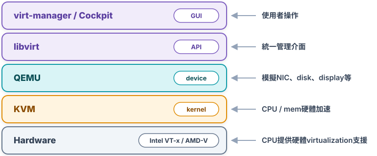
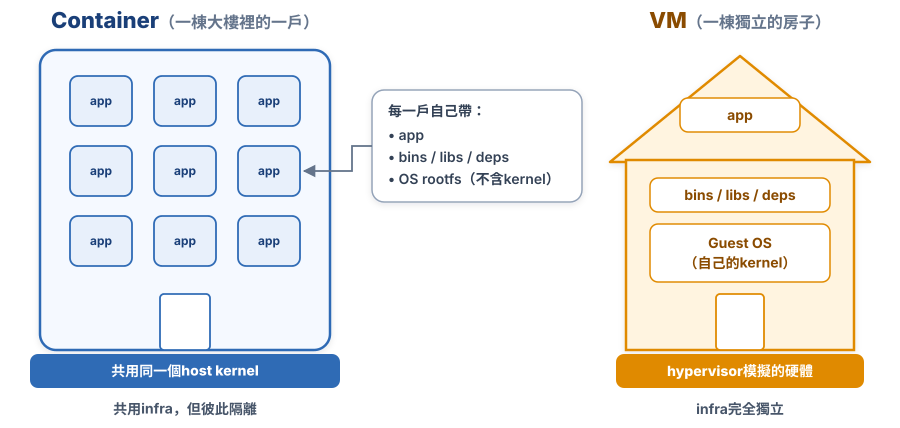
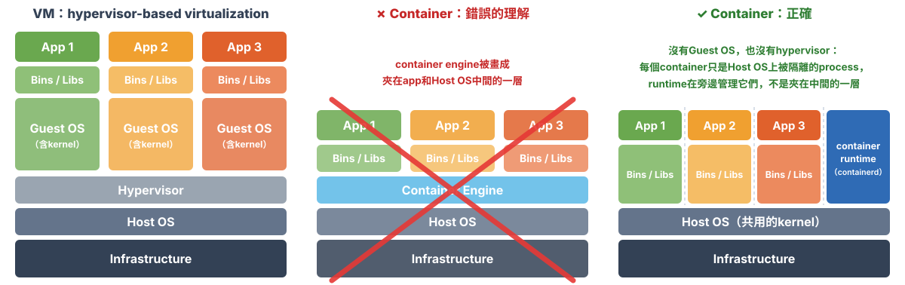
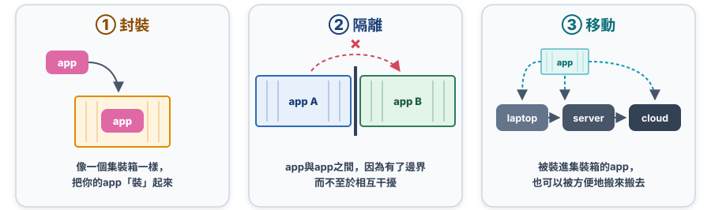
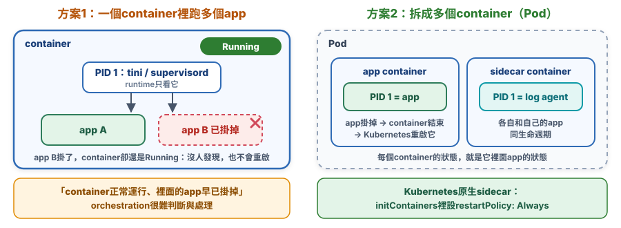
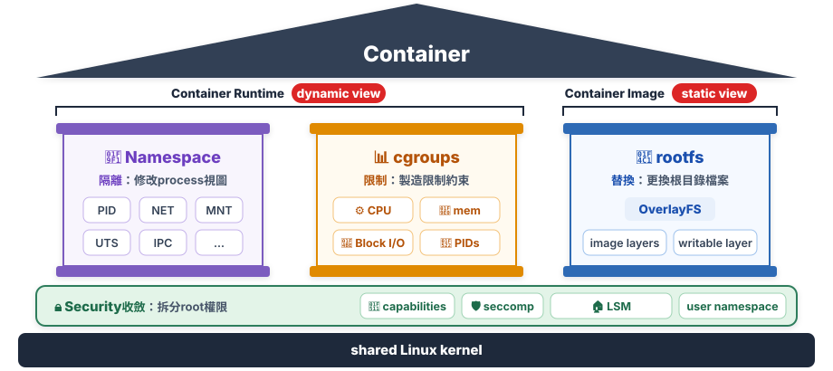
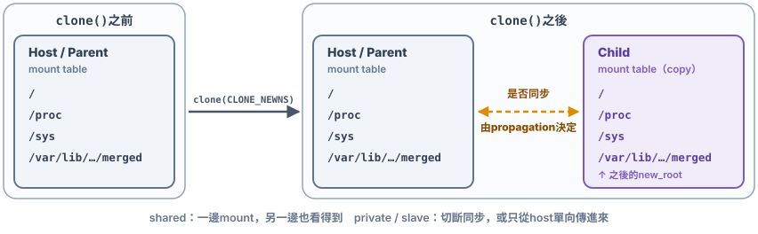
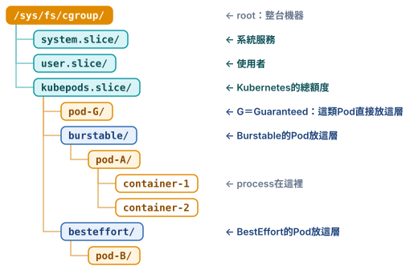
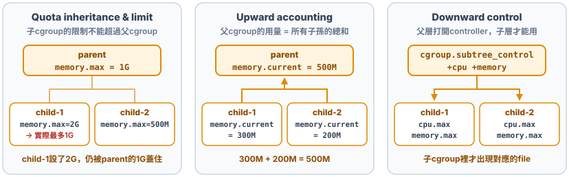

# Chap-1 Container基礎：Namespace / Cgroups

**目錄**

- [VM vs Container](#vm-vs-container)
- [Container](#container)
- [3大pillar + Security](#3大pillar--security)
- [Namespace](#namespace)
- [setns：加入另一個process的namespace](#setns加入另一個process的namespace)
- [Cgroups](#cgroups)
- [延伸：Pod、container與process](#延伸podcontainer與process)

## VM vs Container

*container，其實是一種特殊的process而已。*

### 🖥️ 1. Hypervisor：exposed as a virtual hardware

- 透過**硬體virtualization**功能，模擬出了運行OS需要的各種硬體，如CPU、mem、I/O設備等。
- 在模擬出的virtual hardware上安裝了一個新的OS，即Guest OS。

| 角色 | 正確名稱 | 主要職責與作用 |
| --- | --- | --- |
| **Hypervisor**（核心驅動） | **KVM**（Kernel-based Virtual Machine） | CPU與mem的hardware-accelerated virtualization |
| **硬體模擬**（設備模擬） | **QEMU**（Quick Emulator） | 模擬其他peripheral device |
| **管理介面**（API層） | **libvirt**（非virlib） | 統一API |
| **圖形介面**（GUI控制器） | **virt-manager** / Cockpit等 | 圖形化管理介面 |



### 🐳 2. Docker：exposed as an isolated env / a lightweight sandbox

- container是一個「單process」模型。





中間那一欄是常見的***錯誤理解***：container runtime（例如containerd）不是夾在app和Host OS中間的一層。container啟動後，就是Host OS上一個被namespace和cgroups隔離的process，見[延伸：Pod、container與process](#延伸podcontainer與process)。隔離不像VM那麼徹底，見[Container隔離的limit與solution](chap-2-container-fs-security.md#container隔離的limit與solution)。

> [!TIP]
> 💡 **一句話總結**
>
> ***VM用hypervisor模擬整套硬體，每台VM有自己的Guest OS和kernel；container只是Host OS上被隔離的process，大家共用同一個kernel***。

## Container

### 💡 1. Design Philosophy

- container本身沒有價值，有價值的是「***container orchestration***」。
- **封裝、隔離、移動**：container其實是一種sandbox技術。



### 🧱 2. Boundary / Sandbox

**program vs process**：


### 🔄 3. Container / app同生命週期



- **方案1：共用的PID=1（tini、supervisord）**
  - container的本質是個process，app就是container裡PID=1的process；它fork出來的process都是它的子孫，孤兒process也會交給它回收。
  - 一個container***不適合***同時跑兩個不同app，除非先用tini、supervisord等作為公共的PID=1。
- **方案2：container設計模式**
  - 方案1只是workaround，container的設計初衷是讓***container和app同生命週期***。
  - 更好的做法是用***container設計模式***（如[sidecar](chap-4-container-orchestration-pod.md#-2-sidecar和app一起執行)）拆成多個container。
  - 同生命週期對orchestration很重要：否則出現「***container正常運行、裡面的app早已掛掉***」時，orchestration系統很難判斷與處理。
  - Kubernetes也有原生的sidecar container：在`initContainers`裡設`restartPolicy: Always`，它會比app先啟動，一直跑到app結束。

## 3大pillar + Security

*container由哪幾項技術組成？各自負責什麼？*



container由***3大pillar***撐起來，底下再墊一層Security：

- **3大pillar**：***Namespace***（隔離視野）、***cgroups***（限制資源）、***rootfs***（替換根目錄）。
- **兩個視角**：3大pillar可以「一分為二」地看待：
  - **Dynamic view：Container Runtime**：第1、2根pillar ***Namespace + cgroups***。它們是process執行時才存在的isolation環境，決定container***跑起來的樣子***：能看見什麼、能用多少。
  - **Static view：Container Image**：第3根pillar ***rootfs***。它是一組用OverlayFS聯合mount的目錄，位置在`/run/containerd/io.containerd.runtime.v2.task/k8s.io/<id>/rootfs`。這是container***本身的內容***，也就是app和它的deps，container不跑的時候也存在。見[UnionFS與Docker的Layered rootfs](chap-2-container-fs-security.md#unionfs與docker的layered-rootfs)。
- **Security**：不算pillar，是墊在pillar底下的hardening層，由***capabilities、seccomp、LSM***（AppArmor / SELinux）和user namespace組成。它限制container process能對shared kernel做什麼，見[Chap-2的Security](chap-2-container-fs-security.md#security)。

| 概念 | 解決的問題 | 核心含義 | 比喻 |
| --- | --- | --- | --- |
| **Namespace**<br />視野隔離 | **Visibility**<br />看見什麼 | 只能看到自己namespace裡的process、network、mount等資源 | 房間的牆壁和窗戶（看不到隔壁） |
| **cgroups**<br />資源限制 | **Quantity**<br />能用多少 | 限制process / container***最多能使用多少CPU、mem等資源*** | 水電表和限額（用量上限） |
| **rootfs**<br />可見檔案 | **Filesystem**<br />配套檔案 | container擁有獨立的根目錄`/`（自己的`/bin`、`/lib`、`/etc`），看不到host的檔案 | 房間裡的家具與裝潢 |
| **Security**<br />權限切分 | **Privilege**<br />能做什麼 | 把root的全能權限細分，process只保留essential的部分 | 住戶手上的鑰匙串（只給需要的那幾把） |

## Namespace

*container怎麼拿到自己的namespace？*

Linux目前有8種namespace，同一個kernel讓不同的process看到不同的「世界」。建立時用對應的`CLONE_NEW*` flag（`CLONE_NEWTIME`只能用`unshare()`或`clone3()`）：


### 🧬 1. 建立namespace

runc用`clone()`產生container的第一個process（`runc init`），同時帶上`CLONE_NEWNS`等flag。一次建立7種namespace的寫法：

```c
int flags = CLONE_NEWPID | CLONE_NEWNS  | CLONE_NEWNET |
            CLONE_NEWIPC | CLONE_NEWUTS | CLONE_NEWUSER |
            CLONE_NEWCGROUP | SIGCHLD;   // SIGCHLD：child結束時通知parent，不是namespace

int pid = clone(main_function, stack_top, flags, NULL);
```

`CLONE_NEWTIME`不能傳給`clone()`，要用`unshare()`或`clone3()`。完整可執行的例子見[Chap-2的mini_container.c](chap-2-container-fs-security.md#最小container實作mini_containerc)。

`CLONE_NEWNS`的意思是new mount namespace。名字這麼籠統，是因為mount namespace是***第一個***加入Linux的namespace，當時沒預料到之後還會有其他種類。所以8種namespace裡，只有它的flag和`/proc/{pid}/ns/`底下的file名稱（`mnt`）對不上。

***`clone`之後，舊的mount tree（host的整棵mount tree）會被複製到新的mount namespace裡***。從這一刻起，這個process有了一份**複製出來的**mount tree：這時它看到的`/`還是host的根，只是一份copy。之後在新namespace裡的掛載和卸載，只改這份copy；但copy和原本的mount point之間可能還保持著同步關係，所以下一步要設定propagation，見[Chap-2的② 設定propagation](chap-2-container-fs-security.md#-②-設定propagation)。



### 🆚 2. unshare()和clone()的差別

兩者都能建立新的namespace（用同一組`CLONE_NEW*` flag），差別只在於**哪個process**會進入新的namespace：

| 比較項目               | `unshare()`                                                           | `clone()`                                                                    |
| ---------------------- | ----------------------------------------------------------------------- | ------------------------------------------------------------------------------ |
| **作用對象**     | 針對「**現有的**」current process                                 | 針對「**新建立的**」child process                                        |
| **對自身的影響** | 會讓**當前process**直接脫離原本的Namespace，進入全新的Namespace。 | parent process保持不變，只有**新生成的子process**會進入全新的Namespace。 |

## setns：加入另一個process的namespace

> [!NOTE]
> 一個process可以選擇***加入已經存在的namespace***，而不是建立新的：
>
> - **做法**：用`setns()`這個sys call，加入另一個process已經存在的namespace。[`clone()`](#-1-建立namespace)則是***建立***新的namespace。
> - **效果**：加入之後，這個process看到的network、filesystem、process等，都和那個container一樣，等於「進入」了那個container。
> - **用途**：`docker exec`、`kubectl exec`就是用一個新的process加入container的namespace，再執行`bash`、`ps`、`ip`這些指令來debug。Pod裡的sidecar也是：建立時由runtime用`setns()`加入pause container的network、IPC、UTS namespace，見[Pod中的container共用什麼](#-2-pod中的container共用什麼)。

### 📜 1. setns()函式說明

```c
#define _GNU_SOURCE
#include <sched.h>

int setns(int fd, int nstype);
```

| 參數       | 意思                                                                                                                       |
| ---------- | -------------------------------------------------------------------------------------------------------------------------- |
| `fd`     | 指向某個namespace的fd。最常見的來源是`open("/proc/{pid}/ns/{type}", O_RDONLY)`，也就是「某個process目前所在的namespace」 |
| `nstype` | 要加入的namespace類型，用來檢查`fd`是不是預期的類型。`0`表示不檢查，任何類型都接受                                     |

`nstype`填`0`表示不檢查，任何一種都接受；要檢查的話，就填該namespace的`CLONE_NEW*` flag（見[8種namespace](#namespace)）。每種namespace對應`/proc/{pid}/ns/`底下的一個file：

| namespace | PID | Mount | Network | IPC | UTS | User | Cgroup | Time |
| --- | --- | --- | --- | --- | --- | --- | --- | --- |
| **file名稱** | `pid` | `mnt` | `net` | `ipc` | `uts` | `user` | `cgroup` | `time` |

- **Return value**：成功return `0`；失敗return `-1`，並設定`errno`。例如`EINVAL`表示`fd`的類型和`nstype`不符，`EPERM`表示權限不足。
- **權限**：需要`CAP_SYS_ADMIN`，所以一般要用`sudo`執行。
- **一次只加入一種namespace**：`/proc/{pid}/ns/`底下每個file代表一種。要完整「進入」一個container，就要對每種namespace各呼叫一次`setns()`，`docker exec`就是這樣加入container的mnt、pid、net、uts、ipc等namespace。
- **PID namespace比較特別**：`setns()`之後，***目前的process本身不會換PID namespace***，之後`fork()`出來的子process才會在新的PID namespace裡。
- **呼叫完通常接`exec`**：`setns()`只改變目前這個process所在的namespace，接著`execvp()`一個shell或指令，它才會在新的namespace裡執行。

`/proc/{pid}/ns/`底下的file長這樣：

```bash
ls -l /proc/25686/ns/
# → net -> net:[4026532281]
#   mnt -> mnt:[4026532279]
#   pid -> pid:[4026532282]
#   uts -> uts:[4026532280]
#   ...
```

每個file是一個[symlink](#-補充symlinkhard-link與bind-mount的差別)，`[]`裡的數字是namespace的ID。***兩個process的ID相同，就代表它們在同一個namespace裡***。

#### 🔗 補充：symlink、hard link與bind mount的差別

三者都能讓「同一份內容從另一個路徑看得到」，但實作的層級完全不同：

|                            | symlink                      | hard link                                       | bind mount                                         |
| -------------------------- | ---------------------------- | ----------------------------------------------- | -------------------------------------------------- |
| **本質**             | 一個存著「目標路徑」的小檔案 | 目錄裡多一個名字，指向***同一個inode*** | mount tree裡多一個節點，把一個dentry接到另一個位置 |
| **存在哪裡**         | 磁碟上（是一個檔案）         | 磁碟上（目錄項目）                              | ***只在mem***（kernel的mount table）       |
| **重開機後**         | 還在                         | 還在                                            | 消失，除非寫進`/etc/fstab`                       |
| **能指向目錄嗎**     | ✅                           | ❌                                              | ✅                                                 |
| **能跨filesystem嗎** | ✅                           | ❌                                              | ✅                                                 |
| **原檔刪掉後**       | 變成斷掉的捷徑               | 內容還在（inode的link count還沒歸零）           | 仍然指向原本的dentry                               |

- **symlink**：「去那個路徑找」，***每次打開時才照著路徑去找***。
- **hard link**：「同一個檔案的另一個名字」，兩個名字地位完全相同。
- **bind mount**：「路徑走到這裡時，改接到那邊」，***mount時就決定好接到哪個dentry***。

**為什麼container的volume用bind mount，不用symlink**：symlink是在container的view裡解析路徑，`pivot_root`之後，container裡的`/data`已經不是host的`/data`，所以會找不到或找錯；hard link不能用於目錄，也不能跨filesystem。bind mount則是在`pivot_root`之前，從host的view把dentry接進rootfs，換根之後仍然有效，見[④ 在新根裡掛好要用的filesystem](chap-2-container-fs-security.md#-④-在新根裡掛好要用的filesystem)。

### 🔑 2. 範例程式：set_ns.c

下面這段小程式把`open()`和`setns()`串起來：

```c
// set_ns.c
#define _GNU_SOURCE
#include <fcntl.h>
#include <sched.h>
#include <unistd.h>
#include <stdlib.h>
#include <stdio.h>

#define errExit(msg) do { perror(msg); exit(EXIT_FAILURE); } while (0)

int main(int argc, char *argv[])
{
    int fd = open(argv[1], O_RDONLY);    // 打開要加入的namespace file
    if (setns(fd, 0) == -1)              // 把目前的process加入這個namespace
        errExit("setns");
    execvp(argv[2], &argv[2]);           // 在這個namespace裡執行指定的程式
    errExit("execvp");
}
```

它接收兩個參數：

| 參數        | 意思                          | 例子                   |
| ----------- | ----------------------------- | ---------------------- |
| `argv[1]` | 要加入的namespace file的路徑  | `/proc/25686/ns/net` |
| `argv[2]` | 要在這個namespace裡執行的程式 | `/bin/bash`          |

程式裡`setns(fd, 0)`的`nstype`填`0`，所以`argv[1]`傳哪一種namespace file都可以。

### 🌐 3. 加入container的network namespace

假設有一個container，它的process在host上的PID是`25686`。編譯並執行這個程式，加入它的network namespace，並啟動一個新的`bash`：

```bash
gcc -o set_ns set_ns.c
sudo ./set_ns /proc/25686/ns/net /bin/bash
ifconfig                    # 在新的bash裡執行
```

```
eth0      Link encap:Ethernet  HWaddr 02:42:ac:11:00:02
          inet addr:172.17.0.2  Bcast:0.0.0.0  Mask:255.255.0.0
          ...
lo        Link encap:Local Loopback
          inet addr:127.0.0.1  Mask:255.0.0.0
          ...
```

看得到的網卡「變少」了，只剩兩個；host上至少有四個。***這兩個網卡正是那個Docker container裡的網卡***：新的`bash`加入了container process（PID 25686）的network namespace，所以它看到的網路設備和container裡一樣。

### 🔍 4. 從host確認兩個process共用同一個namespace

process加入另一個namespace之後，在host的namespace file上也看得到。先在host上找出`set_ns`啟動的那個`bash`的PID：

```bash
ps aux | grep /bin/bash     # 在host上執行
# → root  28499  0.0  0.0  19944  3612 pts/0  S  14:15  0:00 /bin/bash
```

再比較兩個process的`ns/net`：

```bash
ls -l /proc/28499/ns/net
# → /proc/28499/ns/net -> net:[4026532281]
ls -l /proc/25686/ns/net
# → /proc/25686/ns/net -> net:[4026532281]
```

兩者指向***同一個***`net:[4026532281]`，說明這兩個process共用同一個network namespace。

### 🐳 5. Docker的--net參數

Docker也提供了參數，讓新的container直接加入另一個container的network namespace：

```bash
docker run -it --net container:{container_id} busybox ifconfig
```

- **`--net container:{container_id}`**：新container不建立自己的network namespace，而是加入`{container_id}`那個container的。`{container_id}`可以用`docker ps`查到。
- **`--net host`**：直接使用host的network namespace，不做網路隔離。

> [!TIP]
> 💡 **一句話總結**
>
> `/proc/{pid}/ns/`底下的每個file代表一個namespace；***用`setns()`加入它，就等於「進入」那個container***，`docker exec`和`--net container:`都是這個原理。

## Cgroups

*namespace管「看得見什麼」，cgroups管「能用多少」。*

namespace不能阻止process吃光mem，那是cgroups（Linux Control Group）的工作：***限制一組process能用的資源上限***，例如CPU、mem、disk I/O、process數量。

### 🔍 1. 三個核心概念

- **Controller**：`cpu`、`memory`、`io`、`pids`等，每個controller負責一種資源。
- **Hierarchy**：用樹狀結構組織，每個process屬於樹上的某一個節點（cgroup）。
- **Interface**：透過cgroupfs這個filesystem提供介面，mount在`/sys/fs/cgroup/`。***一個目錄就是一個cgroup***，裡面的file就是它的參數。

### 🌳 2. Hierarchy：一棵cgroup樹



`kubepods.slice/`底下再依Pod的***QoS class***分層。QoS class不是自己設定的，而是Kubernetes依Pod裡每個container的`resources`自動判斷：

| QoS class | 條件 | cgroup位置 | mem不夠時 |
| --- | --- | --- | --- |
| **Guaranteed** | ***每個***container的CPU和mem都設了`requests`和`limits`，而且兩者相等 | 直接放在`kubepods.slice/`底下 | 最後才被趕走或OOM kill |
| **Burstable** | 不符合Guaranteed，但至少一個container設了CPU或mem的`requests`或`limits` | `burstable/`底下 | 用量超過`requests`的先被處理 |
| **BestEffort** | 所有container都***沒有***設CPU和mem的`requests`、`limits` | `besteffort/`底下 | 最先被趕走或OOM kill |

- **為什麼要分層**：同一層的Pod共用上一層的額度。kubelet只要設定`burstable/`、`besteffort/`整層的上限，就能保護Guaranteed的Pod不被其他Pod擠掉。
- **mem不夠時的順序**：kubelet依QoS決定先趕走哪些Pod（eviction）；kernel的OOM killer也會參考它，因為kubelet替不同QoS的process設了不同的`oom_score_adj`。

樹的上下層有三條規則：



### 🛠️ 3. 實際建立一個cgroup

```bash
# 列出已mount的cgroup v2（只有一個統一的mount point）
mount -t cgroup2
# → cgroup2 on /sys/fs/cgroup type cgroup2

# 這棵樹支援哪些controller
cat /sys/fs/cgroup/cgroup.controllers
# → cpuset cpu io memory hugetlb pids

# 前置：在父層打開controller，子cgroup才會產生對應的file
echo "+cpu +memory +pids" > /sys/fs/cgroup/cgroup.subtree_control

# 建立一個cgroup：建目錄就好，kernel自動產生裡面的參數file
mkdir /sys/fs/cgroup/demo

# 設定資源限制
echo "100000 100000" > /sys/fs/cgroup/demo/cpu.max   # 每100ms最多用100ms：1顆CPU
echo 256M > /sys/fs/cgroup/demo/memory.max            # mem上限256MB
echo 50 > /sys/fs/cgroup/demo/pids.max                # 最多50個process

# 把process放進這個cgroup，限制才會對它生效
echo <pid> > /sys/fs/cgroup/demo/cgroup.procs
```

用量超過`memory.max`時，kernel會觸發***OOM kill***。`docker run -m 256m`底層做的就是這件事。

> [!WARNING]
> - **cgroup的限制不會反映在`/proc`、`/sys`**：`free`、`top`讀的是`/proc/meminfo`、`/proc/stat`，`nproc`讀的是CPU數量，看到的都是***host的值***，不是cgroup的限制。
>   - **解法：LXCFS**：在host上用FUSE動態產生「container視角」的`/proc`檔案，再用bind mount蓋到container的`/proc/meminfo`等路徑上。
>   - **FUSE**：kernel把filesystem的請求，delegate給user-space的程式處理。
> - **不要和cgroup namespace混淆**：[cgroup namespace](#namespace)只是讓container看到的`/proc/self/cgroup`路徑變短，***不負責限制***。限制是cgroups本身做的。

## 延伸：Pod、container與process

### 🌳 1. Pod、container與process的關係

```
Pod                                ← 一組container
├── pause container                ← 建立並持有Pod共用的net / ipc / uts ns
├── container A                    ← 例如nginx
│   └── process（PID 1）              ← nginx master
│       └── process（fork出來的）      ← nginx worker
├── container B                    ← sidecar，例如envoy，加入pause的ns
│   └── process（PID 1）              ← envoy
└── container C                    ← kubectl debug建立的ephemeral container
    └── process（PID 1）              ← 例如busybox的sh，用自己image的rootfs，加入A的pid ns

kubectl exec啟動的bash              ← 不屬於任何process tree，從Pod外面新開，
                                       透過setns()加入container A的全部ns
```

- **fork出來的process**：由主process自己建立，屬於container A的process tree，例如nginx worker。
- **`kubectl exec`**：***新開一個process，不是新container***。它和container A的process tree沒有fork關係，透過`setns()`加入A的ns，也被放進A的cgroup；它用的是A的rootfs，不會出現在Pod物件的定義裡。
- **ephemeral container**（`kubectl debug`）：***在既有Pod裡新增一個container***，寫進Pod的`spec.ephemeralContainers`。它有自己image的rootfs，所以可以帶除錯工具；結束後不會重啟，Pod重建後就消失。
- **sidecar**：Pod建立時就一起建立的container，加入pause持有的ns，和app container共用網路。

### 🤝 2. Pod中的container共用什麼

| Namespace                  | Pod裡的container | 說明                                                                                                                    |
| -------------------------- | ---------------- | ----------------------------------------------------------------------------------------------------------------------- |
| **PID（pid）**       | ⚙️ 預設獨立    | 設定`shareProcessNamespace: true`後共用：看得到彼此的process，PID 1變成pause                                          |
| **Mount（mnt）**     | ❌ 獨立          | 每個container有自己image的rootfs；要共用檔案，就要mount同一個volume                                                     |
| **Network（net）**   | ✅ 共用          | 同一個IP、同一組port，彼此用`localhost`連線；兩個container不能同時listen同一個port                                    |
| **IPC（ipc）**       | ✅ 共用          | 可以用System V IPC、POSIX message queue、`/dev/shm`互相溝通                                                           |
| **UTS（uts）**       | ✅ 共用          | 同一個hostname，也就是Pod名稱                                                                                           |
| **User（user）**     | ⚠️ 預設不使用  | 預設不建立user ns，所有container都用host的user ns。設定`hostUsers: false`後，整個Pod一個user ns，Pod裡的container共用 |
| **Cgroup（cgroup）** | ❌ 獨立          | 每個container看到的cgroup根，是自己的那一層                                                                             |

ns以外，Pod裡也共用這些：

| 共用的                    | 說明                                                                                      |
| ------------------------- | ----------------------------------------------------------------------------------------- |
| **volume**          | 在Pod層級定義，各container分別bind mount到自己的rootfs裡，所以看得到同一批檔案            |
| **Pod層級的cgroup** | 每個container有自己的cgroup，但都在同一個Pod cgroup底下，Pod的資源上限會限制全部container |
| **生命週期與排程**  | 一起被排程到同一個node，一起建立、一起刪除                                                |

***Pod裡的container共用network、IPC、UTS***，就像在同一台機器上；***各自有自己的mount和cgroup***，也就是各自有自己的filesystem和資源計量；PID和user看config。

> [!TIP]
> 💡 **一句話總結**
>
> Pod是一組container，container是一組共用ns和cgroup的process；***`kubectl exec`新開一個process加入既有的ns，`kubectl debug`則新增一個container***。檔案要從另一個路徑看得到時，container用的是bind mount，不是symlink，見[symlink、hard link與bind mount的差別](#-補充symlinkhard-link與bind-mount的差別)。
