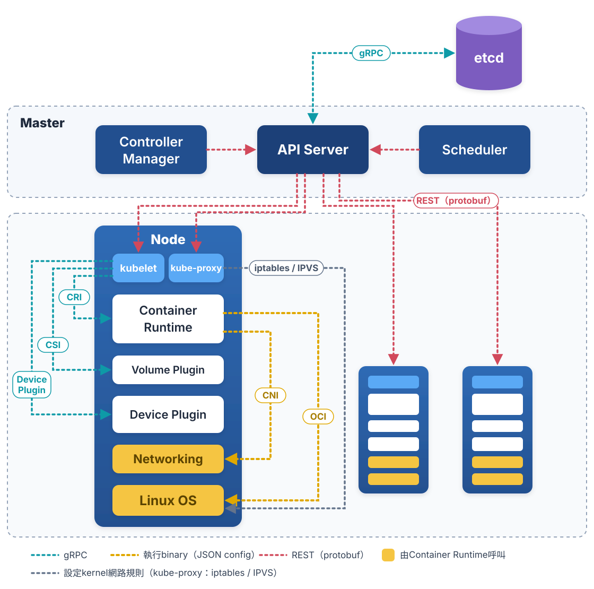
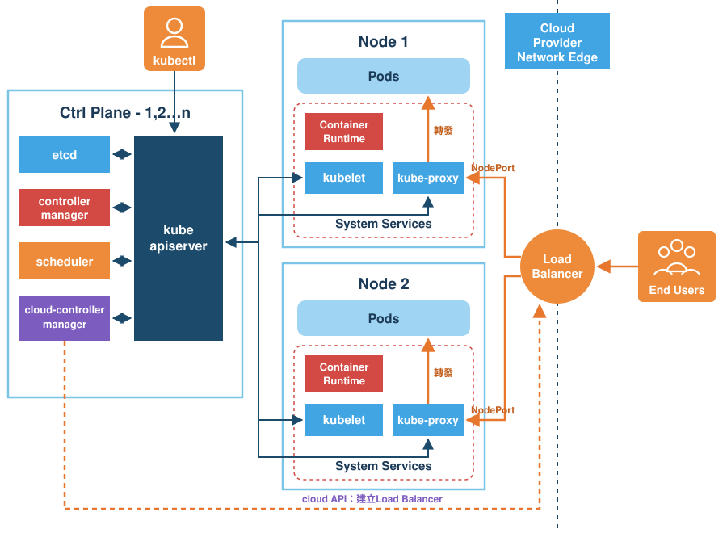
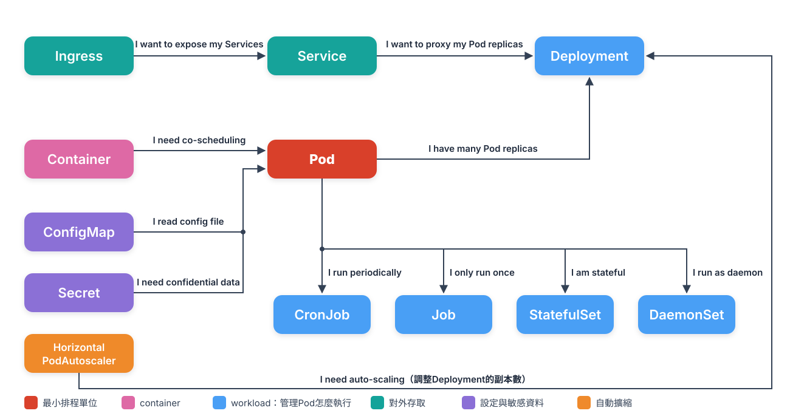

# Chap-2 Kubernetes Architecture

**目錄**

- [Kubernetes的架構](#kubernetes的架構)
- [聲明式API](#聲明式api)

## Kubernetes的架構



### 🧩 1. kubelet與各個interface

kubelet是Node上最核心的組件。它本身不直接操作container：Node上的元件透過一組***標準interface***互動，其中CRI、CSI、Device Plugin是kubelet直接呼叫的，CNI、OCI則由container runtime呼叫：

| interface                                      | 做什麼                                                                                                              | 通訊方式與呼叫者                                                                                                                          | 例子                    |
| ---------------------------------------------- | ------------------------------------------------------------------------------------------------------------------- | ----------------------------------------------------------------------------------------------------------------------------------------- | ----------------------- |
| **CRI**<br />Container Runtime Interface | 和container runtime互動：啟動、停止container，以及啟動container需要的所有參數                                       | *✅ gRPC，透過unix socket*，例如`/run/containerd/containerd.sock`<br />**kubelet → container runtime**                         | containerd、CRI-O       |
| **CSI**<br />Container Storage Interface | 呼叫儲存plugin，替container設定持久化儲存                                                                           | *✅ gRPC，透過unix socket*<br />**kubelet → CSI node plugin**                                                                    | AWS EBS、Ceph           |
| **Device Plugin**                        | 管理GPU等host上的實體設備                                                                                           | *✅ gRPC，透過unix socket*：plugin先向kubelet註冊，kubelet再呼叫它<br />**kubelet ↔ device plugin**                              | NVIDIA Device Plugin    |
| **CNI**<br />Container Network Interface | 呼叫網路plugin，替container設定網路                                                                                 | *🔶 執行plugin binary*，config以JSON從stdin傳入，結果以JSON從stdout傳回<br />**container runtime → CNI plugin**                    | Calico、Flannel、Cilium |
| **OCI**<br />Open Container Initiative   | container runtime依OCI規格呼叫runc，由runc和Linux互動：把CRI請求翻譯成對Linux的操作，例如建立namespace、設定cgroups | *🔶 執行`runc` binary*，container的config（process、ns、mounts、cgroups等）寫在`config.json`<br />**container runtime → runc** | runc                    |

***Device Plugin特別重要***：它是Kubernetes管理GPU的主要方式，做機器學習訓練、高效能運算時一定要關注。

✅ gRPC　🔶 執行binary

```
kubelet
   │ CRI
   ▼
container runtime（containerd）
   │ OCI
   ▼
runc
   │ sys call
   ▼
Linux（namespace、cgroups）
```

#### kube-proxy在哪裡、做什麼

| 項目                 | 說明                                                                                                            |
| -------------------- | --------------------------------------------------------------------------------------------------------------- |
| **位置**       | 每個Node各一個。通常以DaemonSet的形式執行，所以每台機器都會有一個kube-proxy Pod                                 |
| **和誰溝通**   | ***直接和API Server溝通***，用REST watch監看Service和EndpointSlice的變化。它***不經過kubelet*** |
| **做什麼**     | 把「Service的虛擬IP（ClusterIP）→ 後端Pod IP」的轉發規則，寫進Node的Linux kernel                               |
| **怎麼寫規則** | 預設用iptables，也可以用IPVS或nftables，都是設定kernel的netfilter                                               |

所以比喻裡的「Service = 部門總機」，負責替總機設定轉接規則的，就是每台Node上的kube-proxy；真正轉接電話（轉發封包）的，是kernel的netfilter。

```
API Server
   │ REST（watch Service / EndpointSlice）
   ▼
kube-proxy
   │ iptables / IPVS規則
   ▼
Linux kernel（netfilter）
```

#### kube-proxy和Networking（CNI）的差別

|                  | CNI plugin                                          | kube-proxy                                       |
| ---------------- | --------------------------------------------------- | ------------------------------------------------ |
| **負責**   | Pod本身的網路：替Pod建立網卡、分配IP，讓Pod之間互通 | Service的網路：把送到Service IP的流量轉給後端Pod |
| **誰呼叫** | container runtime，建立、刪除Pod時各執行一次        | 自己一直在跑，監看API Server                     |

另外，有些CNI會***取代kube-proxy***，例如Cilium用eBPF直接處理Service轉發。這時cluster裡就不需要kube-proxy。

### 🔗 2. Kubernetes真正要解決的問題：任務之間的關係

> [!TIP]
> **「執行在大規模cluster中的各種task之間，實際上存在著各種各樣的relationships。這些關係的處理，才是作業編排和管理系統最困難的地方。」**

任務之間的關係隨處可見：

- web app和DB之間的存取關係；
- load balancer和它的後端服務之間的proxy關係；
- 入口app和授權組件之間的呼叫關係。

container只是***最細的粒度***，在它之上還有各種組合和關係。Kubernetes最主要的設計思想，是**從更宏觀的角度，用統一的方式來定義任務之間的各種關係**，並且為將來支援更多種關係留有餘地。

#### 親密關係：Pod

有些container之間需要非常頻繁的互動和存取，或者直接透過local file交換資訊。傳統上，它們會**被deploy在同一台機器上**。

Kubernetes用**Pod**把這些container包在一起：Pod裡的container共用同一個network namespace和同一組volume，所以能有效率地交換資訊。詳細的共用規則見[Pod中的container共用什麼](chap-1-container-basics.md#-2-pod中的container共用什麼)。

可以把***Pod想成一台模擬的VM***：同一個Pod裡的多個container，就是**deploy在同一台機器**上的多個process。

#### 存取關係：Service

更常見的是web app和DB之間的存取關係。這兩個app通常**故意不deploy在同一台機器上**，這樣即使web app所在的機器當機了，DB也完全不受影響。

問題是：container的IP等資訊不是固定的，web app要怎麼找到DB container所在的Pod？Kubernetes的答案是**Service**。

#### 比喻：公司組織

- **container = 一位員工**：最小的工作單位，每個人做自己的事。
- **Pod = 一個小組**：成員需要頻繁合作，所以**坐在同一間辦公室**。他們共用同一支電話分機（network namespace），共用同一塊白板（volume），整組一起搬家、一起解散。
- **Service = 部門總機**：要找DB的人，不需要知道DB現在是哪位員工、坐在哪裡，打總機號碼就好。就算換了人、搬了辦公室，總機號碼也不變。

**Kubernetes管的不是一個個員工，而是「誰要和誰坐在一起、誰要透過什麼找到誰」這些關係。**

### 🌐 3. Node的組成與外部流量

前面的架構圖畫的是cluster內部的元件怎麼互動；下面這張圖畫的是***外部使用者的流量怎麼進到Pod***：End Users先連到雲端廠商的Load Balancer，再到各Node，由kube-proxy寫進kernel的規則轉發給Pod。Load Balancer是cloud-controller-manager呼叫雲端API建立的。



#### System Services

圖裡的System Services，指的是***讓一台機器能成為Kubernetes Node的那些常駐程式***。它們不是你deploy的app，而是Node本身運作需要的元件。

| 元件                                             | 負責什麼                              | 通常怎麼執行                                                   |
| ------------------------------------------------ | ------------------------------------- | -------------------------------------------------------------- |
| **kubelet**                                | 和API Server溝通，管理這個Node上的Pod | ***systemd service***，直接跑在host上                  |
| **container runtime**（containerd、CRI-O） | 實際建立和執行container               | ***systemd service***，直接跑在host上                  |
| **kube-proxy**                             | 把Service的轉發規則寫進kernel         | 通常是DaemonSet的Pod（kubeadm的做法），也可以是systemd service |

之所以叫「system services」，是因為kubelet和container runtime通常是由Linux的systemd啟動和管理的服務：

```bash
systemctl status kubelet
systemctl status containerd
```

kubelet和container runtime不能是Pod：Pod要靠它們才能建立起來，如果它們自己也是Pod，就會變成「要先有Pod，才能建立Pod」的循環。

#### 一個Node上有幾個container runtime

***通常只有一個high-level runtime***，也就是只有一個CRI的實作。但它可以搭配***好幾個low-level runtime***：

| 層級                                          | 有幾個                                                                                         | 例子                                                           |
| --------------------------------------------- | ---------------------------------------------------------------------------------------------- | -------------------------------------------------------------- |
| **high-level runtime**<br />（實作CRI） | 1個：kubelet設定的container runtime endpoint（`containerRuntimeEndpoint`）只能指向一個socket | containerd、CRI-O                                              |
| **low-level runtime**<br />（實作OCI）  | 可以有好幾個：在containerd裡設定成不同的handler，再用`RuntimeClass`讓每個Pod自己選           | runc（預設）、runsc（gVisor）、kata-runtime（Kata Containers） |

```
kubelet
   │ CRI（只連一個）
   ▼
containerd
   ├── runc           <-- 一般Pod
   ├── runsc          <-- runtimeClassName: gvisor的Pod
   └── kata-runtime   <-- runtimeClassName: kata的Pod
```

所以[Chap-1](chap-1-container-basics.md#container隔離的limit與solution)講的gVisor和Kata，可以和一般的runc混用在同一個cluster，甚至同一個Node上。

- **containerd-shim**：每個Pod或container都有一個自己的shim process。它是輔助的process，不是另一個runtime。
- **Node上裝了Docker**：可以和containerd並存。Kubernetes 1.24之後kubelet不再內建支援Docker，所以不會影響Pod；如果真的要用Docker，要另外裝cri-dockerd。

## 聲明式API

*用API object描述你要的狀態*

在Kubernetes裡，管理一個app分成兩步：

1. **用「orchestration object」描述app本身**：例如Pod、Job、CronJob，說明要執行什麼、怎麼執行。
2. **再為它加上「service object」**：例如Service、Secret、Horizontal Pod Autoscaler，負責**具體的平台級功能**。

| 類型                           | 例子                                       | 負責什麼                                                                |
| ------------------------------ | ------------------------------------------ | ----------------------------------------------------------------------- |
| **orchestration object** | Pod、Job、CronJob                          | 描述要管理的app：跑哪些container、跑幾次、什麼時候跑                    |
| **service object**       | Service、Secret、Horizontal Pod Autoscaler | Platform功能：讓別人找得到它、提供password等敏感資料、依負載自動增減Pod數量 |

常見的API object，以及它們和Pod之間的關係：



這種用法就是所謂的**聲明式API**：你只描述「***想要的狀態***」，例如「這個app要有3個Pod，並且可以透過這個Service存取」，Kubernetes會自己想辦法讓實際狀態符合它。orchestration object和service object都是Kubernetes裡的**API object**。

回到[公司的比喻](#比喻公司組織)：你不用親自安排每位員工坐哪裡、轉接哪通電話，只要寫一份「***組織規劃***」交給Kubernetes，它就會照著安排。
