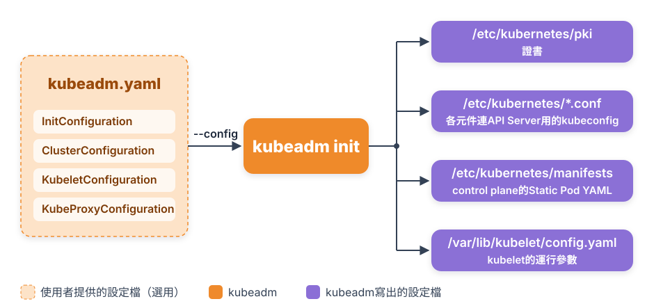
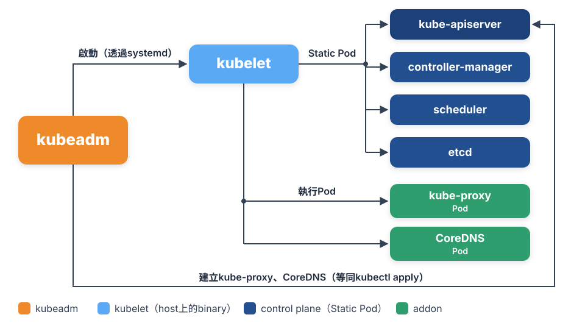
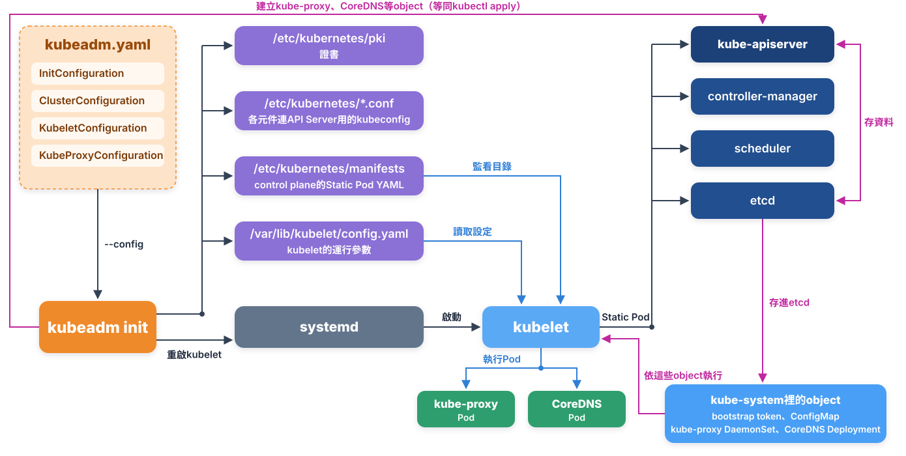

# Chap-3-Kubernetes operations

**目錄**

- [用kubeadm deploy Kubernetes](#用kubeadm-deploy-kubernetes)

## 用kubeadm deploy Kubernetes

*kubeadm是Kubernetes官方提供的cluster初始化工具：`kubeadm init`建立Master，`kubeadm join`把其他Node加進來。*

### 🤔 為什麼需要kubeadm

Kubernetes是Go寫的，每個元件編譯好就是一個完整的binary，不用像Python那樣還需要安裝lang層級的dep。但除了binary之外，還需要每個元件的config、設定開機自動啟動、替kube-apiserver準備certs和token等AuthZ & AuthN等文件……這些Ops工作很繁瑣，kubeadm就是把它們自動化的工具。

#### kubeadm和SaltStack、Ansible、Terraform的差別

|                              | Terraform                                                     | SaltStack / Ansible                        | kubeadm                                                 |
| ---------------------------- | ------------------------------------------------------------- | ------------------------------------------ | ------------------------------------------------------- |
| **是什麼**             | 建立basic infra的工具                                         | 通用的config management工具                | Kubernetes官方的cluster初始化工具                       |
| **負責什麼**           | 建立VM、網路、Load Balancer，或直接建立EKS / GKE等託管cluster | 自動化任何運維步驟，步驟要自己寫成playbook | 只負責在機器上把Kubernetes初始化起來                    |
| **跟著Kubernetes升級** | —                                                            | Kubernetes一改，playbook要自己跟著改       | 步驟和Kubernetes版本一起維護，也提供`kubeadm upgrade` |

***三者不衝突，常見的是分工合作***：

```
Terraform
   │ 建立VM、網路
   ▼
Ansible
   │ 設定OS、安裝containerd / kubeadm / kubelet
   ▼
kubeadm
   │ 初始化cluster（init / join）
   ▼
Kubernetes cluster
```

[Kubespray](https://github.com/kubernetes-sigs/kubespray)就是這樣：它是一組Ansible playbook，底層呼叫kubeadm。

### 🫀 kubelet：每個Node的「心臟」

**每個Node上都一定有一個kubelet（包括master和worker nodes）**，它是Node的「心臟」，從cluster建立開始，到日常運作都靠它：

**a）建立cluster時**

- **啟動Master元件**：kubeadm把API Server、Scheduler、Controller Manager、etcd寫成[Static Pod](#static-pod)的YAML，由kubelet讀取並啟動。也就是說，***連Control Plane都是kubelet跑起來的***。
- **把Node加入cluster**：`kubeadm join`時，kubelet用[bootstrap token](#bootstrap-token)向API Server申請證書、註冊這個Node，之後這台機器才會出現在`kubectl get nodes`裡。

**b）cluster運作時**

- **聽API Server的指示**：API Server把Pod排到這個Node之後，由kubelet負責把它跑起來。
- **管理這個Node上的所有Pod**：透過CRI叫container runtime建立Pod和container（網路由runtime再呼叫CNI設定），透過CSI設定volume。
- **回報狀態**：定期把Node和Pod的狀態回報給API Server，Control Plane才知道這個Node還活著、Pod有沒有正常執行。

***所以kubelet是完全獨立的元件，其他元件都要靠它才能跑起來***。

#### 為什麼kubelet不能是container

- **kubelet要直接操作host**：設定container網路、mount volume、管理cgroup，都要在host上做。kubelet如果跑在container裡，它看到的是container自己的mount ns和network ns，要操作host就很麻煩。
- **會變成循環**：Pod是靠kubelet建立的。kubelet如果自己是Pod，就會變成「要先有kubelet，才能建立kubelet」。

所以kubeadm的做法是：***kubelet用binary直接跑在host上***，由systemd管理；其他元件，也就是API Server、Scheduler、Controller Manager、etcd，都用container（[Static Pod](#static-pod)）跑。見Chap-2的[System Services](chap-2-kubernetes-architecture.md#system-services)。

### 📦 Step 1：安裝kubeadm、kubelet、kubectl

這一步在***每一台機器（Master和Worker）上都要做***：關閉swap、安裝container runtime（例如containerd），再安裝kubeadm和kubelet。kubectl只需要裝在要下指令的機器上，通常是Master。

> [!NOTE]
> **為什麼要關閉swap**：Kubernetes排程和資源限制的前提是「Pod用的mem就是真正的mem」。有swap時，部分mem會被虛擬到disk上，使得scheduler算的可用mem不準。關閉時除了`swapoff -a`，還要把`/etc/fstab`裡swap那一行註解掉，否則重開機後swap又會打開。

安裝前先加入Kubernetes官方的apt repo（`pkgs.k8s.io`），完整步驟見[官方安裝說明](https://kubernetes.io/docs/setup/production-environment/tools/kubeadm/install-kubeadm/)：

```bash
apt-get install -y kubelet kubeadm kubectl
```

### 📘 Step 2：kubeadm基本原理

#### ⚙️ 為kubeadm init準備執行參數（Optional）

這一步***只在Master上做***，因為`kubeadm init`只在第一台Master上執行；Worker用`kubeadm join`加入，不需要這份`kubeadm.yaml`。

kubeadm default參數可以適合大部分情況。但要自訂components(例如：kube-apiserver)的啟動參數，就把設定寫成一個YAML檔，`init`時用`--config`帶進去：

```bash
kubeadm config print init-defaults > kubeadm.yaml    # 先產生一份預設值當範本
kubeadm init --config kubeadm.yaml
```

`kubeadm.yaml`的主要部分：

```yaml
apiVersion: kubeadm.k8s.io/v1beta4
kind: InitConfiguration                     # 這台機器自己的設定
localAPIEndpoint:
  advertiseAddress: 192.168.0.102           # API Server對外的IP
  bindPort: 6443
nodeRegistration:
  criSocket: unix:///var/run/containerd/containerd.sock
  ...
---
apiVersion: kubeadm.k8s.io/v1beta4
kind: ClusterConfiguration                  # 整個cluster共用的設定，整份存成ConfigMap kubeadm-config
kubernetesVersion: v1.31.0
imageRepository: registry.k8s.io
networking:
  dnsDomain: cluster.local
  podSubnet: 10.244.0.0/16                  # 要和CNI plugin的設定一致
  serviceSubnet: 10.96.0.0/12
apiServer:                                  # ┐
  extraArgs:                                # │
    - name: anonymous-auth                  # │
      value: "false"                        # │
  ...                                       # │
controllerManager:                          # │ 各元件的參數，
  ...                                       # │ 各自寫進對應的Static Pod YAML
scheduler:                                  # │
  ...                                       # │
etcd:                                       # │
  local:                                    # │
    dataDir: /var/lib/etcd                  # ┘
---
apiVersion: kubelet.config.k8s.io/v1beta1
kind: KubeletConfiguration                  # kubelet的設定，寫成host上的/var/lib/kubelet/config.yaml
address: 0.0.0.0
...
---
apiVersion: kubeproxy.config.k8s.io/v1alpha1
kind: KubeProxyConfiguration                # kube-proxy的設定，存成ConfigMap kube-proxy
bindAddress: 0.0.0.0
...
```

這幾段設定用`---`分隔，放在同一個`kubeadm.yaml`裡。它是你交給kubeadm的***輸入檔***：kubeadm讀完之後，把每一段設定***分送***到各元件真正會讀的地方：

| `kubeadm.yaml`裡的那一段                                                                 | 內容                                                  | kubeadm把它寫到哪裡                                                                   | 最後誰讀取                                                       |
| ------------------------------------------------------------------------------------------ | ----------------------------------------------------- | ------------------------------------------------------------------------------------- | ---------------------------------------------------------------- |
| `InitConfiguration`                                                                      | 這台機器自己的設定，例如IP、container runtime的socket | 只在`init`時使用                                                                    | kubeadm自己                                                      |
| `ClusterConfiguration`整份                                                               | 整個cluster共用的設定，例如版本、網段                 | `kube-system`裡的ConfigMap `kubeadm-config`                                       | 之後的`kubeadm join`、`kubeadm upgrade`                      |
| `ClusterConfiguration`的`apiServer` / `controllerManager` / `scheduler` / `etcd` | 各元件的參數，例如`extraArgs`                       | 對應的[Static Pod](#static-pod) YAML，`/etc/kubernetes/manifests/*.yaml`裡的啟動參數 | 那4個Static Pod                                                  |
| `KubeletConfiguration`                                                                   | kubelet的設定                                         | host上的`/var/lib/kubelet/config.yaml`，另外存一份成ConfigMap `kubelet-config`    | 直接跑在host上的kubelet；之後`join`的Node也從ConfigMap拿同一份 |
| `KubeProxyConfiguration`                                                                 | kube-proxy的設定                                      | ConfigMap `kube-proxy`                                                              | kube-proxy的**DaemonSet** Pod                              |

***`kubeadm.yaml`只在執行`kubeadm init`的那一刻被讀取***，kubeadm也不是常駐的程式。之後元件讀的，都是kubeadm分送出去的檔案或ConfigMap，不會再回頭讀`kubeadm.yaml`。

#### 🗺️ kubeadm流程講解

kubeadm讀取`kubeadm.yaml`，寫出的4種設定檔：



kubeadm怎麼把各元件跑起來：透過systemd啟動kubelet，kubelet再依Static Pod YAML啟動control plane的4個元件；kube-proxy、CoreDNS則是kubeadm透過API Server建立object，最後同樣由kubelet執行。



##### init完成後：元件怎麼執行

| 元件                                                                    | 執行方式                              | 誰啟動                                        |
| ----------------------------------------------------------------------- | ------------------------------------- | --------------------------------------------- |
| **kube-apiserver、kube-controller-manager、kube-scheduler、etcd** | **Static Pod**                  | kubelet讀`/etc/kubernetes/manifests/`的YAML |
| **kubelet**                                                       | host上的***binary***，不是Pod | systemd                                       |
| **kube-proxy**                                                    | **DaemonSet**，每個Node一個Pod  | 一般的Kubernetes機制，由API Server管理        |
| **CoreDNS**                                                       | **Deployment**                  | 一般的Kubernetes機制                          |

所以「元件是[Static Pod](#static-pod)」只對***control plane的4個元件***成立。kubelet不是Pod，kube-proxy和CoreDNS是一般的Pod，不是Static Pod。

### 🚀 Step 3：kubeadm init

#### 🪜 kubeadm init的步驟

**① Preflight Checks**：先檢查這台機器能不能deploy Kubernetes，例如：

- OS kernel版本、cgroups是否符合要求；
- hostname是否符合DNS命名（Kubernetes裡的機器名稱和存在etcd裡的API object，都要用標準的DNS名稱）；
- swap是否關閉：kubelet預設要求關閉swap；
- kubeadm和kubelet的版本是否相符；
- 要用的port是否被占用：6443（API Server）、2379-2380（etcd）、10250（kubelet）、10257（controller-manager）、10259（scheduler）；
- container runtime是否已經安裝，`ip`、`mount`等指令是否存在。

**② 產生證書**：kubeadm先建立這個cluster自己的***根CA***（`ca.crt` / `ca.key`），也就是cluster的「發證機關」，再用它替cluster裡的***每個元件***簽發證書，讓元件之間的連線可以互相驗證身分。證書都放在Master Node的`/etc/kubernetes/pki/`：

| 證書                             | 給誰用                                                                               |
| -------------------------------- | ------------------------------------------------------------------------------------ |
| `ca.crt` / `ca.key`          | cluster的根CA，簽發下面這些證書                                                      |
| `apiserver.crt`                | API Server的server證書：kubectl、kubelet連API Server時，用來確認對方真的是API Server |
| `apiserver-kubelet-client.crt` | API Server當client連kubelet時使用，例如`kubectl logs`、`kubectl exec`            |
| `apiserver-etcd-client.crt`    | API Server當client連etcd時使用                                                       |
| `etcd/`底下的證書              | etcd自己的CA、server證書，以及etcd member之間互相連線用的證書                        |

各證書的完整清單見[PKI certificates and requirements](https://kubernetes.io/docs/setup/best-practices/certificates/)。如果你已經有自己的CA，事先把`ca.crt`和`ca.key`放進`/etc/kubernetes/pki/`，kubeadm就會跳過產生CA這一步，直接用你的CA簽發其他證書。

**③ Generate各元件call API Server所需要用的kubeconfig**：

```bash
ls /etc/kubernetes/
# → admin.conf  controller-manager.conf  kubelet.conf  manifests  pki  scheduler.conf  super-admin.conf
```

kubeadm替**每個需要連到API Server的元件** ，各產生一個config文件（[kubeconfig](https://kubernetes.io/docs/concepts/configuration/organize-cluster-access-kubeconfig/)），告訴它「API Server在哪裡、怎麼確認對方、怎麼證明自己是誰」。也就是說每個kubeconfig檔裡都有API Server的位址、port、cluster的`ca.crt`，以及這個元件***自己的client證書***。scheduler、kubelet等元件直接載入它，就能和API Server建立安全的連線。

**④ Generate Master元件運行需要的Static Pod YAML**：<a id="static-pod"></a>

***Static Pod***是一種特殊的啟動方式：把Pod的YAML放進指定目錄，kubelet啟動時就會自動載入並執行。kubeadm把Master元件的YAML放在`/etc/kubernetes/manifests/`：

```bash
ls /etc/kubernetes/manifests/
# → etcd.yaml  kube-apiserver.yaml  kube-controller-manager.yaml  kube-scheduler.yaml
```

以`kube-apiserver.yaml`為例：

```yaml
apiVersion: v1
kind: Pod                                   # 就是一般的Pod
metadata:
  name: kube-apiserver
  namespace: kube-system
  labels:
    component: kube-apiserver
    tier: control-plane
spec:
  containers:
  - name: kube-apiserver
    image: registry.k8s.io/kube-apiserver:v1.31.0
    command:
    - kube-apiserver
    - --advertise-address=192.168.0.102
    - --authorization-mode=Node,RBAC
    - --tls-cert-file=/etc/kubernetes/pki/apiserver.crt     # 第②步產生的證書
    - --tls-private-key-file=/etc/kubernetes/pki/apiserver.key
    # ...其他參數，Step 2的extraArgs加的也會出現在這裡
    volumeMounts:
    - name: k8s-certs
      mountPath: /etc/kubernetes/pki
      readOnly: true
  hostNetwork: true                         # 直接用host的網路：它比CNI更早啟動
  priorityClassName: system-cluster-critical
  volumes:
  - name: k8s-certs
    hostPath:                               # 把host上的證書目錄mount進去
      path: /etc/kubernetes/pki
      type: DirectoryOrCreate
```

- **Static Pod就是一般的Pod YAML**：`kind: Pod`，沒有任何特殊欄位，差別只在它放在`/etc/kubernetes/manifests/`裡，由kubelet直接讀取。
- **和前後的步驟接得上**：`--tls-cert-file`用的就是第②步產生的證書；[Step 2](#-為kubeadm-init準備執行參數optional)`extraArgs`加的參數，最後也會出現在`command`裡。
- **control plane元件的特殊設定**：`hostNetwork: true`直接用host的網路，因為它比CNI更早啟動；`hostPath`把host上的證書目錄mount進去；`priorityClassName: system-cluster-critical`讓它在資源不夠時最後才被驅逐。

kubelet一看到這些YAML，就把它們跑起來，見[kubelet：每個Node的「心臟」](#-kubelet每個node的心臟)。

**⑤ 等待Master元件就緒**：檢查`https://localhost:6443/healthz`。

**⑥ 產生bootstrap token**：<a id="bootstrap-token"></a>之後任何裝好kubelet和kubeadm的Node，只要持有這個token，就能用`kubeadm join`加入cluster。token會在`kubeadm init`結束時印出來，預設24小時後過期；過期後用`kubeadm token create --print-join-command`重新產生。

***token要等Master的API Server跑起來之後，才能真正生效***。原因是bootstrap token不是一個本機檔案，而是***存在cluster裡的一個Secret***：

```
⑤ 等待Master元件就緒（API Server可以用了）
   ▼
⑥ 產生bootstrap token
   │ 透過API Server寫進kube-system namespace
   ▼
Secret：bootstrap-token-<token-id>
```

```bash
kubectl get secrets -n kube-system | grep bootstrap-token
# → bootstrap-token-abcdef   bootstrap.kubernetes.io/token   ...
```

新Node執行`kubeadm join`時，是拿token去問API Server「這個token有效嗎？」，API Server查這個Secret，確認token存在、還沒過期，才讓它申請證書。這也是⑤要先確認API Server正常，⑥才建立token的原因。

**⑦ 標記control plane**：<a id="mark-control-plane"></a>等API Server可以用之後，kubeadm替Master的Node object加上label `node-role.kubernetes.io/control-plane`，以及taint `node-role.kubernetes.io/control-plane:NoSchedule`，讓一般的Pod不會被排到Master上。taint是寫在API Server裡的Node object上，所以也要等⑤完成。要調整這個策略，見[用Taint / Toleration調整Master能不能跑Pod](#taint-toleration)。

**⑧ 保存cluster資訊**：<a id="cluster-info"></a>把`ca.crt`等Master的重要資訊，存成`kube-public` namespace裡名為`cluster-info`的ConfigMap，給之後加入的Node使用。

**⑨ 安裝必要的addon**：[kube-proxy](chap-2-kubernetes-architecture.md#kube-proxy在哪裡做什麼)和[CoreDNS](https://kubernetes.io/docs/tasks/administer-cluster/coredns/)，分別負責Service轉發和cluster內的DNS。它們也只是兩個container image：kubeadm用Kubernetes client建立kube-proxy的DaemonSet（每個Node一個）和CoreDNS的Deployment就好。

#### 🕸️ Deploy CNI plugin

> [!WARNING]
> ***kubeadm不會安裝CNI plugin***。`kubeadm init`之後，要自己裝一個CNI plugin，例如Calico、Cilium，否則Node會一直是`NotReady`，CoreDNS也會卡在`Pending`。做法見[Deploy CNI plugin](#-deploy-cni-plugin)。

接著在Master上deploy CNI plugin。否則Node的狀態不是ready

```bash
kubectl get nodes
# → NAME     STATUS     ROLES           AGE   VERSION
#   master   NotReady   control-plane   2m    v1.31.0

kubectl describe node master
# → Conditions:
#   ...
#   Ready   False ... KubeletNotReady   container runtime network not ready:
#           NetworkReady=false reason:NetworkPluginNotReady
#           message:Network plugin returns error: cni plugin not initialized
```

`NotReady`的原因寫得很清楚：***還沒有CNI plugin***。再看`kube-system`裡的Pod：

```bash
kubectl get pods -n kube-system
# → NAME                             READY   STATUS    RESTARTS   AGE
#   coredns-7c65d6cfc9-j9s52         0/1     Pending   0          2m
#   coredns-7c65d6cfc9-jm4wf         0/1     Pending   0          2m
#   etcd-master                      1/1     Running   0          2m
#   kube-apiserver-master            1/1     Running   0          2m
#   kube-controller-manager-master   1/1     Running   0          2m
#   kube-proxy-xbd47                 1/1     Running   0          2m
#   kube-scheduler-master            1/1     Running   0          2m
```

- **control plane的4個元件都是`Running`**：它們是Static Pod，用`hostNetwork`，不需要CNI。名稱後面的`-master`是Node名稱。
- **kube-proxy也是`Running`**：它同樣用`hostNetwork`。
- **CoreDNS卡在`Pending`**：它需要Pod網路，要等CNI裝好。

`kube-system`是Kubernetes的***Namespace***，用來劃分不同的工作空間，Kubernetes自己的系統Pod都放在這裡。它和[Linux namespace](chap-1-container-basics.md#-①-建立namespace)是兩回事。

在Kubernetes「***一切皆container***」的設計下，CNI plugin本身也是用Kubernetes object deploy的，只要一行`kubectl apply`。以Flannel為例：

```bash
kubectl apply -f https://github.com/flannel-io/flannel/releases/latest/download/kube-flannel.yml
```

- **只要在一台機器上執行一次**：它建立的是DaemonSet，之後每個Node，包括後來join的Worker，都會自動有一個Flannel Pod。
- **kubeadm不會替你裝**：選哪個CNI是使用者的決定，`kubeadm.yaml`裡和CNI有關的只有`networking.podSubnet`。Flannel預設的Pod網段是`10.244.0.0/16`，要和[`ClusterConfiguration`](#-為kubeadm-init準備執行參數optional)的`networking.podSubnet`一致，或是init時加`--pod-network-cidr=10.244.0.0/16`。
- **CNI binary怎麼到host上**：每個Flannel Pod用`hostPath`把CNI binary複製到host的`/opt/cni/bin/`，把設定檔寫到`/etc/cni/net.d/`。之後container runtime建立Pod時，就到這兩個地方找CNI plugin來執行，見[kubelet與各個interface](chap-2-kubernetes-architecture.md#-1-kubelet與各個interface)。`bridge`、`portmap`這些基本CNI plugin則要每個Node在Step 1就裝好，通常來自`kubernetes-cni`或containerd附帶的pkg。

裝好之後，再跑一次`kubectl get nodes`和`kubectl get pods -n kube-system`，確認Node變成`Ready`、CoreDNS變成`Running`。

#### 🖼️ 在Master上執行kubeadm init的完整流程圖



### 🤝 Step 4：kubeadm join

`kubeadm init`產生[bootstrap token](#bootstrap-token)之後，任何一台裝好kubelet和kubeadm的機器（通常是Worker），都可以執行`kubeadm join`加入cluster。指令就是`kubeadm init`結束時印出來的那一行：

```bash
kubeadm join 192.168.0.102:6443 --token abcdef.0123456789abcdef \
  --discovery-token-ca-cert-hash sha256:<hash>
```

#### 為什麼join需要token

- **新Node一定要向API Server註冊**：任何機器要成為cluster的Node，都必須在kube-apiserver上註冊。
- **和API Server溝通需要證書**：要連API Server，這台機器得先有cluster的CA（`ca.crt`），才能確認對方真的是API Server。
- **不能要使用者手動複製**：為了一鍵安裝，不能讓使用者自己到Master上把這些檔案複製過來。

所以kubeadm至少要用***「不安全模式」***連一次API Server，拿到[第⑧步](#cluster-info)存在`kube-public`裡的`cluster-info` ConfigMap，裡面有API Server的位址、port和`ca.crt`。***bootstrap token在這個過程中負責安全驗證***。

拿到`cluster-info`之後，kubelet就能用「安全模式」連上API Server，這台Node就deploy完成了。其他Node重複執行同一行指令就好。

```
kubeadm join（新Node）
   │ 不安全模式：讀kube-public的cluster-info，用token驗證
   ▼
取得API Server的位址、port、ca.crt
   │ 安全模式：用token向API Server申請kubelet自己的證書
   ▼
kubelet用自己的證書連API Server，Node註冊完成
```

> [!NOTE]
> 「不安全模式」不代表完全不驗證：`cluster-info`裡附有用bootstrap token簽的簽章，kubeadm用token確認內容沒被竄改；`--discovery-token-ca-cert-hash`再確認拿到的`ca.crt`是對的CA。接著kubelet用token向API Server申請自己的client證書（TLS bootstrap），之後就改用這張證書連線。

***Worker和Master幾乎一樣***：兩者執行的都是kubelet。唯一的差別是在master上`kubeadm init`時，kubelet啟動後，Master上還會以[Static Pod](#static-pod)執行control plane元件：kube-apiserver、kube-scheduler、kube-controller-manager，以及etcd（kubeadm預設把etcd也放在Master上）。

> [!NOTE]
> <a id="taint-toleration"></a>**用Taint / Toleration調整Master能不能跑Pod**
>
> [第⑦步](#mark-control-plane)已經替Master加上taint：
>
> ```bash
> kubectl describe node master | grep Taints
> # → Taints:  node-role.kubernetes.io/control-plane:NoSchedule
> ```
>
> - **taint是什麼**：加在Node上的「排斥標記」。`NoSchedule`表示scheduler***不會***把一般Pod分配到這個Node，除非Pod宣告了對應的***toleration***。
> - **為什麼Master要有**：讓app的Pod只跑在Worker上，不和control plane搶資源，也避免app影響API Server和etcd。
> - **哪些Pod還是能跑在Master上**：
>     - control plane的4個元件：它們是[Static Pod](#static-pod)，由kubelet直接啟動，***不經過scheduler***，所以不受taint影響。
>     - kube-proxy、Flannel：它們是DaemonSet，本來就要每個Node一個，YAML裡都帶了toleration。
>     - CoreDNS：Deployment裡也帶了control plane的toleration，所以單Node時也跑得起來。
>
> 要讓一般的Pod也能跑在Master上，有兩種做法：
>
> | 做法 | 改哪裡 | 影響範圍 |
> | --- | --- | --- |
> | **拿掉taint** | Node | ***所有***Pod都可以排到Master上 |
> | **加toleration** | Pod的YAML | ***只有這個Pod***可以排到Master上 |
>
> 拿掉taint，最後的`-`表示***刪除***。適合只有一台機器的練習環境，正式環境不要這樣做：
>
> ```bash
> kubectl taint nodes --all node-role.kubernetes.io/control-plane-
> ```
>
> 只讓某個Pod可以排到Master上，在Pod的YAML加toleration：
>
> ```yaml
> spec:
>   tolerations:
>   - key: node-role.kubernetes.io/control-plane
>     operator: Exists
>     effect: NoSchedule
> ```
>
> - **toleration是「允許」，不是「指定」**：加了toleration，只代表這個Pod***可以***排到Master上，scheduler還是可能把它排到Worker。一定要跑在Master上，還要再加`nodeSelector`或`nodeAffinity`。
> - **舊的key已經不用了**：舊版教學用`node-role.kubernetes.io/master`，Kubernetes 1.25以後改成`node-role.kubernetes.io/control-plane`。照舊命令去刪，會刪不到任何東西。
