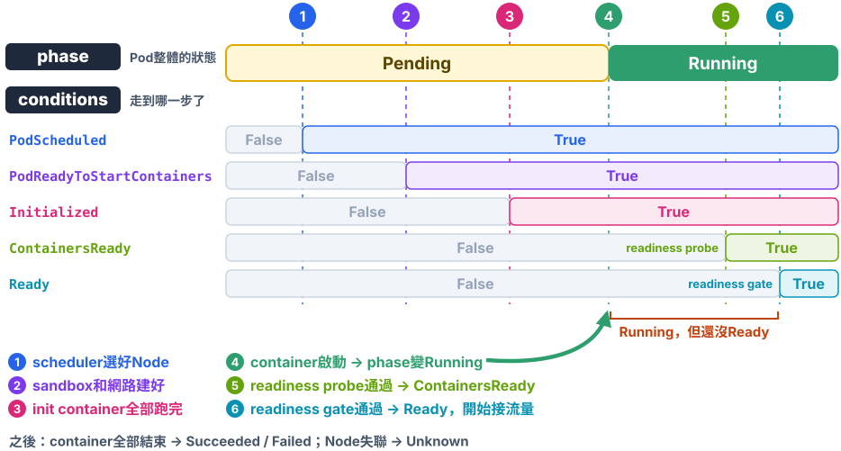
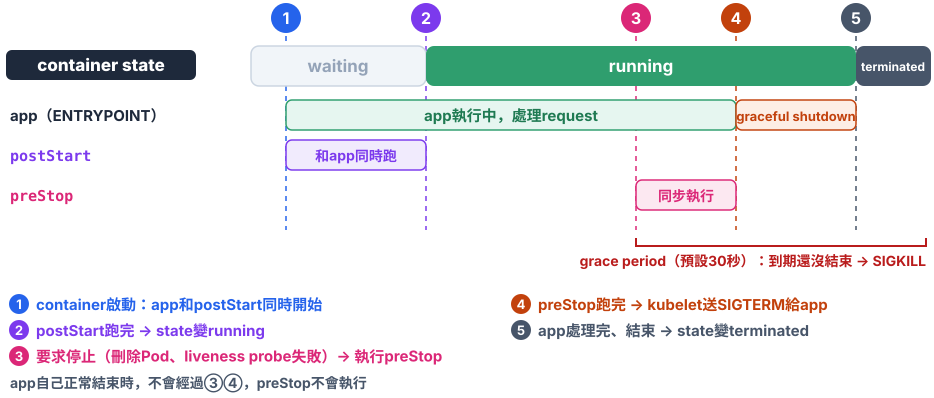

# Chap-4 Container orchestration之Pod篇

**目錄**

- [Pod：Kubernetes的原子排程單位](#podkubernetes的原子排程單位)
- [Pod的實現：pause container](#pod的實現pause-container)
- [Container常見設計思路](#container常見設計思路)
- [Pod API object使用方法](#pod-api-object使用方法)

## Pod：Kubernetes的原子排程單位

*Kubernetes為什麼不直接排程container，而要多一層Pod？*

這一章從Pod開始。先看Pod在Kubernetes的API object裡的位置：其他object都圍繞著Pod，有的管理Pod怎麼執行（見[Chap-5的控制器模式](chap-5-container-orchestration-controller.md#控制器模式)），有的替Pod提供config或對外存取（詳見[第2章的聲明式API](chap-2-kubernetes-architecture.md#聲明式api)）：


### 🖥️ 1. Kubernetes是一個分散式OS

把cloud當成一台電腦來看：

| 傳統OS         | Cloud                              |
| -------------- | ---------------------------------- |
| `.exe`安裝檔 | **container image**          |
| process        | **container**                |
| process group  | **Pod**                      |
| OS             | ***Kubernetes：分散式OS*** |

Kubernetes做的事，就是把OS裡「***process group***」的概念搬到container上，讓它成為這個分散式OS裡的基本單位。從另一個角度看，Pod也可以想成[一台模擬的VM](chap-2-kubernetes-architecture.md#親密關係pod)。

### 🌲 2. 真實OS裡的process group

在真正的OS裡，process不是各自獨立地跑，而是有組織地聚在一起。以nginx為例，用`pstree`看：

```bash
pstree -A -p -g $(pgrep -o nginx)      # -p顯示PID，-g顯示PGID，pgrep -o找最早啟動的master
# → nginx(1201,1201)-+-nginx(1202,1201)
#                    `-nginx(1203,1201)
```

括號裡是`(PID,PGID)`：

- **master**（1201）：讀config、管理worker，worker掛掉時重新`fork()`一個。
- **worker**（1202、1203）：master `fork()`出來的child，真正處理request。

它們是***3個不同的process***（PID各不相同），但屬於同一個process group `1201`。master和worker之間用socket、signal和共用mem溝通，所以***一定要跑在同一台機器上***。

> [!NOTE]
> **怎麼看懂`pstree`**
>
> - **tree的形狀是parent / child關係**：誰`fork()`了誰。process group要看括號裡的PGID，兩者不一定一致。
> - **用`{}`括起來的是thread，不是process**：<a id="pstree-thread"></a>例如`rsyslogd(1632)-+-{in:imklog}(1632)`，`imklog`只是`rsyslogd`這個process裡的一個thread。thread和同一個process的其他thread共用mem；`fork()`出來的child process則有自己的一份。

### 📦 3. Container的「單app模型」

常聽到的「***單process模型***」，**不是指container裡只能跑一個process，而是container沒有管理多個process的能力**，

- **PID 1就是app本身**：container裡的其他process都是它的child。
- **app只管自己知道的child**：例如nginx master會重啟掛掉的worker。但它不像`systemd`或init那樣，會監控、重啟、回收同一個PID namespace裡被過繼給PID 1的orphan process，這些process結束後就會留成zombie。

所以合理的說法是：「***單app***」-- ***one app per container***：

- **單process的app**：例如Go、Java、Node.js，用thread或event loop處理並行，container裡只有一個process。例如Go寫的API server（`{}`表示thread，見[怎麼看懂`pstree`](#pstree-thread)）：

    ```
    Go app container
    └── my-api（PID 1）           ← 只有這一個process
        ├── {my-api}（thread）    ← Go runtime的OS thread，數量大約是GOMAXPROCS（預設等於CPU核數）
        ├── {my-api}（thread）
        └── …                     ← 上萬個goroutine輪流排在這幾個thread上跑
    ```
- **多process的app**：例如nginx、PostgreSQL、gunicorn，由PID 1的master管理自己fork出來的worker：回收、重啟，並轉發signal。例如nginx：

    ```
    nginx container
    └── nginx master（PID 1）       ← 讀config、管理worker：掛掉就重新fork一個
        ├── nginx worker（PID 29）  ← 真正處理request
        ├── nginx worker（PID 30）
        └── nginx worker（PID 31）  ← 數量預設等於CPU核數（worker_processes auto）
    ```

兩種都符合one app per container，重點是***一個app***，不是一個process。需要一起工作的不同app，各放一個container，再用Pod組在一起。

### 🧲 4. 為什麼排程單位是Pod

***Pod是Kubernetes的原子排程單位***：scheduler是用Pod裡***所有container的資源加總***來找Node的。適合放進同一個Pod的，是具有「***超親密關係***」的container，常見的特徵：

- **檔案**：直接交換檔案。
- **溝通**：① 用`localhost`或socket檔案在本機溝通；② 非常頻繁地互相呼叫。
- **共用namespace**：例如Istio的Envoy sidecar，和app container共用同一個network namespace，再用iptables把app進出的流量全部導到Envoy。app不用改任何程式，流量就自動經過Envoy做加密、重試和監控，見[Chap-6的Istio](chap-6-declarative-api-operator.md#用istio理解聲明式api)。

## Pod的實現：pause container

**Pod只是一個*邏輯概念***。Kubernetes真正處理的，還是host上Linux container的[namespace](chap-1-container-basics.md#-①-建立namespace)和cgroups。**Pod本質是一組*共用了某些資源的container***：***Pod裡的所有container共用同一個network namespace，並且可以宣告共用同一個volume***。

要讓Pod中的所有containers共用network namespace，Kubernetes用了一個中間的container：**pause container**（a.k.a: Infra container）：

![Pod裡的pause container：container runtime建立sandbox時先啟動pause container，由它建立並持有net、ipc、uts namespace；container A和B透過setns()加入，3個container的/proc/{pid}/ns/net都指向同一個net:[4026532483]。runtime再呼叫CNI plugin，在這個network namespace裡建立eth0（10.244.1.5），用veth pair接到host上的bridge cni0](images/ch04/pod-pause-container.svg)

- **pause container永遠第一個建立**：其他使用者定義的container，再透過[setns()](chap-1-container-basics.md#setns加入另一個process的namespace)加入pause container的network namespace。
- **用的是極小的image**：`registry.k8s.io/pause`。它是用C寫的一個小程式，靜態編譯後只有幾百KB，啟動後就一直呼叫`pause()`休眠，幾乎不佔資源。

圖裡的Pod框，在[CRI](chap-2-kubernetes-architecture.md#-1-kubelet與各個interface)裡叫***sandbox***。Pod和sandbox不是同一個東西：

|                      | Pod                                                                                            | sandbox                                                                                  |
| -------------------- | ---------------------------------------------------------------------------------------------- | ---------------------------------------------------------------------------------------- |
| **屬於哪一層** | Kubernetes API                                                                                 | CRI / container runtime                                                                  |
| **存在哪裡**   | API Server（etcd）                                                                             | 某一個Node上                                                                             |
| **是什麼**     | 「***想要***什麼」的object：YAML裡定義的container、volume、`restartPolicy`、排程條件 | 「***實際***建出來的執行環境」：pause container、共用的namespace、Pod cgroup、IP |
| **誰建立**     | 使用者或controller（`kubectl apply`、Deployment）                                            | kubelet透過CRI呼叫`RunPodSandbox`，runtime建立                                         |
| **誰管理**     | kubelet、scheduler、controller                                                                 | containerd / CRI-O                                                                       |

***Pod是設計圖，sandbox是照設計圖在某個Node上蓋好的房子***。房子倒了可以照同一張圖重蓋，設計圖不變。

### 🔗 1. 共用network namespace的結果

對Pod裡的container A和container B來說：

- **Pod的lifecycle只和pause container一致**
- **一個Pod只有一個IP**：就是Pod的network namespace的IP。
- **進出流量都經過pause container的network namespace**。
- **同一個Pod中多個containers可以直接用`localhost`溝通**。
- **同一個Pod中多個containers看到的網路設備和pause container完全一樣**。

Pod裡共用哪些namespace、哪些各自獨立，完整的對照見[Pod中的container共用什麼](chap-1-container-basics.md#-2-pod中的container共用什麼)。

### 🕸️ 2. CNI plugin設計實現注意事項

因此，實現CNI plugin我們要注意

- **只要設定Pod的network namespace**：不需要管每個container怎麼用網路。這也是[runtime建立sandbox時](chap-3-kubernetes-operations.md#-step-5deploy-cni-plugin)，才呼叫CNI plugin的原因。CNI plugin的設計：***不用管app container有沒有啟動***：只要把pause container的network namespace設定好就夠了。
- **不能在container裡裝東西**：pause image的rootfs裡幾乎什麼都沒有，CNI plugin不能依賴在container裡安裝pkg或config file。

### 📁 3. 共用volume

pause container解決了network namespace的共用。與此類似，***volume定義也在Pod層級***。

- **一個volume，在host上只對應一個目錄**：kubelet替Pod準備好這個目錄，例如`emptyDir`在`/var/lib/kubelet/pods/{pod-uid}/volumes/kubernetes.io~empty-dir/{volume名稱}/`。
- **container只要宣告mount它**：kubelet就把同一個host目錄，分別[bind mount](chap-1-container-basics.md#mount---bind技術)到每個container自己的rootfs裡。所以不同container看到的，是同一批檔案。

#### emptyDir：跟著Pod生、跟著Pod死

`emptyDir`是Pod裡共用檔案最常用的volume：Pod排到Node上時，kubelet建立一個**空的目錄**(見上一段的 /var/lib/..../kubernets.io~empty-dir/{volume名稱})；Pod被刪除時，目錄連同裡面的資料一起刪掉。

```yaml
volumes:
  - name: app-volume
    emptyDir: {}                # 用Node的disk
  - name: cache
    emptyDir:
      medium: Memory            # 改用mem（tmpfs），比較快，
                                # 但會算進container的mem用量
      sizeLimit: 500Mi          # 超過上限，Pod會被驅逐
```

和其他常見的volume比較：

| volume                 | 資料放在哪                                                                                       | 活多久                                                   | 適合                                                   |
| ---------------------- | ------------------------------------------------------------------------------------------------ | -------------------------------------------------------- | ------------------------------------------------------ |
| **`emptyDir`** | 這個Node上，kubelet管理的目錄                                                                    | ***和Pod一樣***                                  | Pod裡的container共用暫存資料                           |
| **`hostPath`** | Node上一個指定的路徑，例如`/data`                                                              | 和Node一樣：Pod刪了，資料還在那台Node上                  | 需要讀Node本身的檔案，例如log agent讀`/var/log/pods` |
| **PVC**          | 外部storage，例如[第3章的Ceph](chap-3-kubernetes-operations.md#-step-6deploy-csi-driverrook-ceph) | ***和Pod無關***，Pod刪了資料還在，換Node也掛得上 | DB這類要持久化的資料                                   |

另外還有一類volume不存資料，而是把config、password project進container，見[Chap-7的Projected Volume](chap-7-volume.md#projected-volume)。

#### 例子：WAR包和Tomcat

一個Java web app的WAR包，要放進Tomcat的`webapps`目錄才能執行。有了Pod，就可以把**WAR包**和**Tomcat*****各做成一個image***，再用一個**共用的volume**組合起來：

<!-- hl: 6 13 | hl2: 10 11 16 17 21 22 -->
```yaml
apiVersion: v1
kind: Pod
metadata:
  name: javaweb
spec:
  initContainers:
    - name: war
      image: example/sample-war:v2          # image裡只有一個/sample.war
      command: ["cp", "/sample.war", "/app"]
      volumeMounts:
        - name: app-volume
          mountPath: /app
  containers:
    - name: tomcat
      image: tomcat:9.0                     # 官方的Tomcat image
      volumeMounts:
        - name: app-volume
          mountPath: /usr/local/tomcat/webapps
      ports:
        - containerPort: 8080
  volumes:
    - name: app-volume
      emptyDir: {}
```

- **`volumes`在Pod層級定義**：`app-volume`是一個`emptyDir`，Pod建立時是空的。
- **`war`是init container**：`initContainers`裡的container會比`containers`先執行，而且一個一個依序執行，***全部成功結束後***，`containers`才會啟動。它把`sample.war`複製到`/app`，也就是`app-volume`，然後結束。
- **`tomcat`把同一個volume mount到`webapps`**：所以它啟動時，`webapps`裡一定已經有`sample.war`。

***WAR包和Tomcat解耦了***：更新app只要換`war`的image，升級Tomcat只要換`tomcat`的image，兩邊互不影響。

> [!NOTE]
> 在Kubernetes的用法，***跑完就結束的叫init container***；***和主container一起長期執行的叫sidecar***，見[Sidecar：和app一起執行](#-2-sidecar和app一起執行)。

## Container常見設計思路

*log、proxy、監控這些輔助功能，該放在Pod裡、Node上，還是cluster層級？*

常聽到的「容器設計模式」，指的是放在Pod裡的兩種：init container和sidecar。但現在很多輔助功能已經移到Node或cluster層級，所以這一節從「***放在哪一層***」來看：

| 位置                         | 什麼時候執行                                | 一份服務誰                      | 典型例子                                                               |
| ---------------------------- | ------------------------------------------- | ------------------------------- | ---------------------------------------------------------------------- |
| **① Init container**  | 主container***啟動前***，做完就結束 | 這一個Pod                       | 複製WAR包、等DB可以連線、跑DB migration、先取好secret                  |
| **② Sidecar**         | 和主container***一起長期執行***     | 這一個Pod                       | Cloud SQL Auth Proxy、`git-sync`、config reload                      |
| **③ Node agent**      | 一直在Node上執行                            | ***這個Node上所有Pod*** | Fluent Bit收log、node-exporter、CNI plugin、CSI nodeplugin、kube-proxy |
| **④ Cluster service** | 一直在cluster裡執行                         | ***整個cluster***       | Operator、Ingress / Gateway、cert-manager                              |

### 🧰 1. Init container：啟動前的準備

`spec.initContainers`裡的container：

- **依序執行**：一個成功結束，下一個才開始。
- **全部完成，主container才啟動**：失敗的話，依Pod的`restartPolicy`重試，主container一直不會啟動。
- **可以用和主container不同的image**：準備工作需要的工具（`git`、DB client），不用放進app的image。

常見的用途：把檔案準備好（[WAR包的例子](#例子war包和tomcat)）、等DB或其他服務可以連線、跑DB migration、從Vault這類系統先取好secret。

### 🛵 2. Sidecar：和app一起執行

sidecar和主container***在同一個Pod裡一起長期執行***，透過Pod共用的資源和app合作：

- **共用network namespace**：app連`localhost`，就連到sidecar。
- **共用volume**：app寫的檔案，sidecar讀得到；sidecar下載的config，app也讀得到。

例如app要連雲端的DB，認證和加密交給[Cloud SQL Auth Proxy](https://cloud.google.com/sql/docs/mysql/sql-proxy)這個sidecar：

```yaml
spec:
  initContainers:
    - name: cloud-sql-proxy
      image: gcr.io/cloud-sql-connectors/cloud-sql-proxy:2.11.0
      restartPolicy: Always                   # 有這一行，就是native sidecar
      args: ["--port=5432", "my-project:asia-east1:my-db"]
  containers:
    - name: app
      image: example/my-app:1.0
      env:
        - name: DB_HOST
          value: "127.0.0.1"                  # app只連localhost，proxy負責認證、加密，再連到雲端的DB
```

- **native sidecar**：寫在`initContainers`裡、加上`restartPolicy: Always`（Kubernetes 1.29起預設開啟，見[官方文件](https://kubernetes.io/docs/concepts/workloads/pods/sidecar-containers/)）。它***比主container先啟動、比主container晚結束***，所以app一啟動就連得到proxy；Job的主container結束時，sidecar也會跟著結束，不會讓Job一直完成不了。
- 其他常見的sidecar：[`git-sync`](https://github.com/kubernetes/git-sync)（定時從Git拉最新的config或網頁）、config reload（config變更時通知app重新載入）、Istio的Envoy（見[為什麼排程單位是Pod](#-4-為什麼排程單位是pod)）。

### 🖥️ 3. Node agent：每個Node一份

用**DaemonSet**部署，每個Node一個Pod，***服務這個Node上所有的Pod***。前幾章已經看過好幾個：

- **CNI plugin**：例如[Flannel](chap-3-kubernetes-operations.md#-step-5deploy-cni-plugin)。
- **CSI nodeplugin**：例如[Rook-Ceph的nodeplugin](chap-3-kubernetes-operations.md#-step-6deploy-csi-driverrook-ceph)。
- **kube-proxy**。

收集log是最典型的例子，例如[Fluent Bit](https://fluentbit.io/)：

```
app container ──stdout──► Node上的/var/log/containers/*.log ──► Fluent Bit（DaemonSet）──► Elasticsearch / Loki
```

- **app直接寫到stdout / stderr**：runtime會把它存到Node上的log檔。
- **每個Node一個log agent**：1000個Pod分在10個Node上，只需要10個agent；用sidecar的話，要多1000個container。
- **sidecar只用在例外情況**：app只能寫檔、不能寫stdout時才用。

為什麼寫進檔案的log，Node上的agent收不到：

```
app寫到stdout / stderr
  → runtime接住，存到Node上的 /var/log/pods/…/0.log
  → Fluent Bit（DaemonSet）讀這些檔案 ✅

app寫到container裡的 /var/log/app.log
  → 只存在這個container自己的filesystem裡
  → Fluent Bit看不到 ❌
```

service mesh也在往這個方向走：Istio的[ambient mode](https://istio.io/latest/docs/ambient/)，用每個Node一個的`ztunnel`處理加密，Pod裡不再需要Envoy sidecar。

### 🏢 4. Cluster service：整個cluster一份

***整個cluster共用一份***的功能，用Deployment或Operator部署：

- **Operator**：例如[Rook](chap-3-kubernetes-operations.md#-step-6deploy-csi-driverrook-ceph)，看著CRD把Ceph建起來、修好。
- **Ingress / Gateway**：整個cluster對外的入口。
- **cert-manager**：替整個cluster申請、更新TLS certificate，見[cert-manager.io](https://cert-manager.io/)。

### 🧭 5. 怎麼選

```
這個功能需要和app共用network namespace、volume或lifecycle嗎？
  │  例如要攔截app的localhost流量、讀app寫的files、在app啟動前準備好
  ├── 是 → 只在啟動前做一次？   → ① init container
  │                     否則 → ② sidecar
  │
  └── 否 → 每個Node上的Pod都需要、而且做法都一樣嗎？
            ├── 是 → ③ Node agent（DaemonSet）
            └── 否 → ④ cluster service
```

> [!TIP]
> 💡 **一句話總結**
>
> ***能共用就共用***：sidecar的代價是每個Pod都多一個container，所以只有***必須***和app共用network namespace、volume或lifecycle的功能，才放進Pod裡；其他的往Node、cluster層級放。

## Pod API object使用方法

*既然container只是Pod裡的一個欄位，哪些config屬於Pod，哪些屬於container？*

container image很好用，但只有一個container，對Kubernetes來說資訊還不夠。就像貨櫃本身很好用，但四面光禿禿的，吊車沒地方抓，也不知道要放到哪裡。Pod就是替貨櫃***裝上吊環、貼上標籤***，讓Kubernetes這台吊車能操作它：要排到哪個Node（`nodeSelector`、`affinity`）、壞了怎麼辦（`restartPolicy`）、哪些東西要一起搬（多個`containers`、`volumes`）。這些「吊環」就是[下面表格](#-1-判斷原則)裡Pod層級的欄位。

***Pod不是更強的container，而是把一個或多個container，加上這些給Kubernetes用的欄位，包成一個可以被排程和管理的單位***。

### 🧭 1. 判斷原則

Pod扮演的是[一台模擬的VM](chap-2-kubernetes-architecture.md#親密關係pod)，container是這台VM裡的app。所以：

- **和「機器」有關的，屬於Pod**：排程到哪個Node、網路、`/etc/hosts`、volume、security config。
- **和namespace有關的，也屬於Pod**：Pod的設計就是讓container盡量共用namespace，見[Pod中的container共用什麼](chap-1-container-basics.md#-2-pod中的container共用什麼)。
- **和「app本身」有關的，屬於container**：image、啟動命令、port、資源上限、probe。

|                     | Pod層級（`spec`）                                           | container層級（`spec.containers[]`）                   |
| ------------------- | ------------------------------------------------------------- | -------------------------------------------------------- |
| **排程**      | `nodeSelector`、`nodeName`、`affinity`、`tolerations` | —                                                       |
| **網路**      | `hostNetwork`、`dnsPolicy`、`hostAliases`               | `ports`                                                |
| **namespace** | `shareProcessNamespace`、`hostPID`、`hostIPC`           | —                                                       |
| **storage**   | `volumes`：定義volume                                       | `volumeMounts`：mount到哪裡                            |
| **lifecycle** | `restartPolicy`                                             | `livenessProbe`、`readinessProbe`、`lifecycle`     |
| **app**       | —                                                            | `image`、`command`、`args`、`env`、`resources` |

### 📍 2. 排程：nodeSelector和nodeName（Pod level）

```yaml
spec:
  nodeSelector:
    disktype: ssd               # 只排到有disktype=ssd這個label的Node
```

- **`nodeSelector`**：把Pod和Node綁在一起，只會排到label符合的Node上。更彈性的條件用`affinity`，見[官方文件](https://kubernetes.io/docs/concepts/scheduling-eviction/assign-pod-node/)。
- **`nodeName`**：
    - **Default是空的**，不需要使用者寫，由scheduler挑好Node後填進去；每個Node上的kubelet，只執行`nodeName`是自己的Pod。使用者自己填，就是***跳過scheduler***，
    - **yaml定義中不空，比如“node1”**：Pod直接在指定的Node上執行, 會也跳過了scheduler的檢查（資源夠不夠、taint），所以一般只在測試、debug時用，例如[第3章測試PVC時](chap-3-kubernetes-operations.md#建立storageclass再測一次pvc)用它指定Node。

### 📝 3. hostAliases：Pod的/etc/hosts（Pod level）

```yaml
spec:
  hostAliases:
    - ip: "10.1.2.3"
      hostnames:
        - "foo.remote"
        - "bar.remote"
```

Pod啟動後：

```bash
cat /etc/hosts
```

```
# Kubernetes-managed hosts file.
127.0.0.1       localhost
...
10.244.135.10   hostaliases-pod
10.1.2.3        foo.remote
10.1.2.3        bar.remote
```

> [!WARNING]
> `/etc/hosts`由kubelet管理，***要改就改`hostAliases`***。直接在container裡改，Pod重建後就不見了。見[官方文件](https://kubernetes.io/docs/tasks/network/customize-hosts-file-for-pods/)。

### 🔗 4. 和namespace有關的欄位（Pod level）

#### shareProcessNamespace：共用PID namespace

```yaml
apiVersion: v1
kind: Pod
metadata:
  name: nginx
spec:
  shareProcessNamespace: true
  containers:
    - name: nginx
      image: nginx
    - name: shell
      image: busybox
      stdin: true               # 等於docker run -i
      tty: true                 # 等於docker run -t
```

- **`shareProcessNamespace: true`**：Pod裡所有container的process放在同一個PID namespace裡，使得同一個pod中所有containers***彼此看得到對方的process***。見[官方文件](https://kubernetes.io/docs/tasks/configure-pod-container/share-process-namespace/)。
- **`stdin` + `tty`**：這兩個field會讓`shell` container開一個terminal，使用者可以輸入命令、看到輸出。output =>`tty`; input=>`stdin`. 兩個要一起開，用戶才可以正常在terminal交互。

建立Pod後，attach到`shell` container的tty：

```bash
kubectl create -f nginx.yaml
kubectl attach -it nginx -c shell
ps ax                           # 在shell container裡執行
```

```
PID   USER     TIME  COMMAND
    1 65535     0:00 /pause
    7 root      0:00 nginx: master process nginx -g daemon off;
   35 101       0:00 nginx: worker process
   36 root      0:00 sh
   42 root      0:00 ps ax
```

***在`shell` container裡，看得到`nginx` container的process***，而且PID 1是[pause container](#pod的實現pause-container)。這個做法常用來debug：用一個有工具的container，去看另一個沒有`ps`、`sh`的精簡image。

對照不共用的時候：***每個container的第一個process，在自己的PID namespace裡都是PID 1***。這只是各自namespace裡的編號（[第1章的實驗](chap-1-container-basics.md#-在container裡實際看到的)也看得到），從host上看，它們有各自不同的真實PID：

```
                    在自己的PID namespace裡    在host上
pause container     PID 1  /pause             PID 4101
nginx container     PID 1  nginx master       PID 4150
                    PID 29 nginx worker       PID 4178
shell container     PID 1  sh                 PID 4203
```

> [!NOTE]
> shareProcessNamespace一般用在有「***sidecar要對app的process做事***」的需求

#### hostNetwork、hostPID、hostIPC：共用host的namespace

```yaml
spec:
  hostNetwork: true             # 用host的network namespace
  hostPID: true                 # 看得到host上所有process
  hostIPC: true                 # 用host的IPC namespace
```

Pod直接使用host的namespace，不另外建立。例如[control plane的Static Pod](chap-3-kubernetes-operations.md#static-pod)用`hostNetwork: true`，因為它們比CNI plugin更早啟動。

> [!NOTE]
> **IPC（Inter-Process Communication）namespace**：process之間「借用kernel傳資料」的3種方法：
>
> - **shared mem**：kernel準備好一塊mem，幾個process一起讀寫，不用一來一回地傳，是最常見、也最快的一種。
> - **semaphore**：process之間的鎖，決定誰可以存取共用的資源，常和shared mem搭配，避免同時寫亂。
> - **message queue**：kernel幫忙排隊的訊息信箱，一個process放訊息進去，另一個再取出來。
>
> 同一個IPC namespace裡的process，才看得到同一塊mem、同一個semaphore、同一個message queue。例如PostgreSQL的一組process（postmaster、backend、checkpointer等）就把共用的buffer放在shared mem裡，再用semaphore控制存取；這些process都在同一個container裡。如果一個Pod裡的container開啓shard IPC namespace，這些containers也可以這樣類似地直接交換資料。
>
> In contrast：一般app多半用socket或HTTP溝通，用不到它們；`hostIPC: true`會讓Pod看得到host上的這些東西，有安全風險，很少用。

### 📶 5. Pod的status：phase和conditions（Pod level）

`status.phase`是Pod整體的狀態，一共5種（[官方文件](https://kubernetes.io/docs/concepts/workloads/pods/pod-lifecycle/#pod-phase)）：

| phase                   | 意思                                                                                                         | 常見原因 / 下一步                                                                                                               |
| ----------------------- | ------------------------------------------------------------------------------------------------------------ | ------------------------------------------------------------------------------------------------------------------------------- |
| **`Pending`**   | Pod已經存進etcd，但還有container沒跑起來                                                                     | 還沒排程成功（資源不夠、`nodeSelector`沒有符合的Node）、正在拉image、init container還在跑。用`kubectl describe pod`看Events |
| **`Running`**   | 已經排程到某個Node，container都建好了，***至少有一個***正在執行、啟動或重啟                          | 正常狀態。能不能接流量要看`Ready`；container一直重啟（`CrashLoopBackOff`）時，phase也還是`Running`                        |
| **`Succeeded`** | 所有container都***正常結束***（exit code 0），而且不會再重啟                                         | 只有`restartPolicy`是`OnFailure`或`Never`才會出現，例如Job；`Always`（Deployment預設）的container結束就會被重啟         |
| **`Failed`**    | 所有container都結束了，***至少有一個失敗***（exit code不是0，或被系統kill，例如OOM），而且不會再重啟 | 用`kubectl logs --previous`看上一次的log、`kubectl describe pod`看Events。被Node驅逐（Evicted）的Pod也是`Failed`          |
| **`Unknown`**   | 拿不到Pod的狀態，kubelet沒辦法把狀態回報給API Server                                                         | 通常是Node和control plane之間斷線，例如Node當機、網路斷了                                                                       |

> [!NOTE]
> ***`kubectl get pod`的`STATUS`欄不是phase***：它會優先顯示更細的原因，例如`ContainerCreating`、`CrashLoopBackOff`、`Completed`、`Terminating`。要看真正的phase，用`kubectl get pod web -o jsonpath='{.status.phase}'`。

`status.conditions`再細分***為什麼是這個狀態***（[官方文件](https://kubernetes.io/docs/concepts/workloads/pods/pod-lifecycle/#pod-conditions)）：

| condition                               | `True`代表                                                                                   |
| --------------------------------------- | ---------------------------------------------------------------------------------------------- |
| **`PodScheduled`**              | 已經排到某個Node。排不上去時是`False`，`reason`是`Unschedulable`                         |
| **`PodReadyToStartContainers`** | sandbox和網路已經建好                                                                          |
| **`Initialized`**               | init container全部跑完                                                                         |
| **`ContainersReady`**           | 所有container都ready                                                                           |
| **`Ready`**                     | Pod可以接收流量，會被加進[Service](chap-2-kubernetes-architecture.md#存取關係service)的endpoint |



> [!NOTE]
> - **沒設readiness probe**：container一啟動就算Ready，`ContainersReady`立刻變成`True`。
> - **沒設readiness gate**：`Ready`和`ContainersReady`一致，兩個同一時刻變成`True`。見[Pod readiness gate](https://kubernetes.io/docs/concepts/workloads/pods/pod-lifecycle/#pod-readiness-gate)。

***`Running`不等於`Ready`***：

- **`Running`**：container已經啟動了，但app可能還在載入config、暖cache。
- **`Ready`**：[readiness probe](https://kubernetes.io/docs/tasks/configure-pod-container/configure-liveness-readiness-startup-probes/)通過，***真的可以服務了***，Service才會把流量送過來。

```bash
kubectl get pod
# → NAME   READY   STATUS    RESTARTS   AGE
#   web    0/1     Running   0          10s    ← Running，但還沒Ready
```

### 🧱 6. imagePullPolicy：什麼時候拉image（container level）

image本來就是container定義的一部分，所以`imagePullPolicy`是container層級的欄位（[官方文件](https://kubernetes.io/docs/concepts/containers/images/#image-pull-policy)）：

| 值                         | 行為                                              |
| -------------------------- | ------------------------------------------------- |
| **`Always`**       | 每次啟動container都去registry確認一次，有新版就拉 |
| **`IfNotPresent`** | Node上沒有這個image才拉                           |
| **`Never`**        | 從不拉，只用Node上已經有的image，沒有就啟動失敗   |

***沒寫的話，預設值看image的tag***：

- **tag是`:latest`或沒寫tag**（例如`nginx`）：預設`Always`。
- **其他tag**（例如`nginx:1.27`）：預設`IfNotPresent`。

所以正式環境建議用固定的版本tag，不要用`latest`：同一個tag永遠是同一個image，重建Pod也不會不小心換版本。

### 🪝 7. lifecycle：container啟動後、停止前的hook（container level）

`lifecycle`定義的是[Container Lifecycle Hooks](https://kubernetes.io/docs/concepts/containers/container-lifecycle-hooks/)：在container狀態改變時，執行指定的動作。例如（來自[Kubernetes官方文件](https://kubernetes.io/docs/tasks/configure-pod-container/attach-handler-lifecycle-event/)）：

```yaml
apiVersion: v1
kind: Pod
metadata:
  name: lifecycle-demo
spec:
  containers:
    - name: lifecycle-demo-container
      image: nginx
      lifecycle:
        postStart:
          exec:
            command: ["/bin/sh", "-c", "echo Hello from the postStart handler > /usr/share/message"]
        preStop:
          exec:
            command: ["/usr/sbin/nginx", "-s", "quit"]   # 讓nginx處理完手上的request再結束
```



- **`postStart`**：container啟動後立刻執行。
    - ***和`ENTRYPOINT`同時跑，不保證先後順序***：`postStart`執行時，app可能還沒準備好。
    - `postStart`還沒跑完之前，container不會被標成`running`；它失敗的話，container會被kill，再依`restartPolicy`處理。
- **`preStop`**：container***被要求停止時***，在send `SIGTERM`之前執行，例如刪除Pod、liveness probe失敗。
    - ***同步執行***：`preStop`跑完，kubelet才送`SIGTERM`給container。
    - 時間算在`terminationGracePeriodSeconds`（預設30秒）裡：超過時間還沒結束，就直接`SIGKILL`，見[Pod的termination流程](https://kubernetes.io/docs/concepts/workloads/pods/pod-lifecycle/#pod-termination)。
    - container自己正常結束時***不會***觸發。

`preStop`最常見的用途是***graceful shutdown***：讓app先停止接新的request、處理完手上未完成的工作，再結束。例子裡的`nginx -s quit`就是這個作用。

> [!TIP]
> 💡 **一句話總結**
>
> ***和機器、namespace有關的屬於Pod，和app本身有關的屬於container***。忘了哪個欄位在哪一層，就用`kubectl explain pod.spec`、`kubectl explain pod.spec.containers`查。

> [!NOTE]
> 📚 **延伸閱讀**
>
> 讀完這一章，推薦把Pod的原始定義讀一遍：[`kubernetes/api`的`core/v1/types.go`](https://github.com/kubernetes/api/blob/master/core/v1/types.go)裡的`type Pod struct`，***尤其是`PodSpec`***。每個欄位上面都有註解，說明它的用途和預設值。目標是下次看到一個Pod的YAML，不用查文件，就能說出常用欄位的作用。
