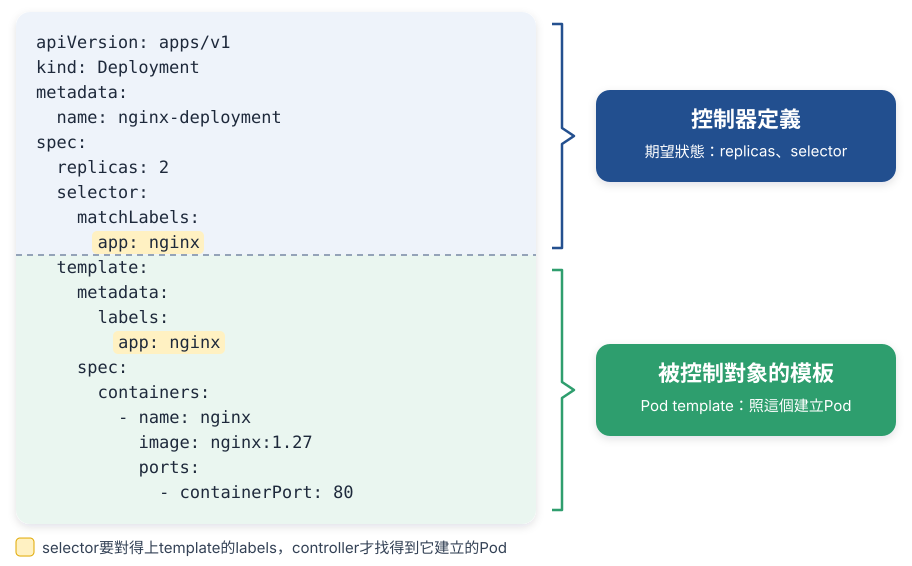
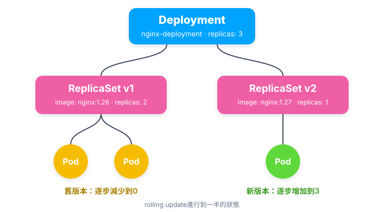

# Chap-5 Container orchestration之Controller篇

**目錄**

- [控制器模式](#控制器模式)
- [Deployment](#deployment)

## 控制器模式

*Deployment、StatefulSet、DaemonSet這些不同的object，Kubernetes怎麼用同一套方法管理它們？*

Kubernetes用一種叫***控制器模式***（controller pattern）的設計，***用一種object管理另一種object***，統一處理各種object的編排：Deployment、StatefulSet、DaemonSet、Job……每一種背後都有一個controller，而且都照同一個流程工作：***控制循環***（control/reconcile loop）。

### 🏭 1. 誰在執行：kube-controller-manager

[架構圖](chap-2-kubernetes-architecture.md#kubernetes的架構)裡的kube-controller-manager，其實就是***一組controller的集合***。看Kubernetes原始碼的`pkg/controller`目錄：

```bash
cd kubernetes/pkg/controller/
ls -d */
# → cronjob/  daemon/  deployment/  disruption/  endpointslice/  garbagecollector/
#   job/  namespace/  nodelifecycle/  podautoscaler/  replicaset/  serviceaccount/
#   statefulset/  volume/  ...
```

- **每個目錄是一個controller**：各自負責一種編排功能，Deployment只是其中之一。
- **放在一起，是因為它們遵循同一個模式**：***控制循環***。
- **跑在同一個process裡**：kube-controller-manager把它們編進同一個binary，以[Static Pod](chap-3-kubernetes-operations.md#static-pod)執行。

### 🔁 2. 控制循環

每個controller都在不停地做同一件事：

```go
for {
    實際狀態 := 取得object X在cluster裡的實際狀態
    期望狀態 := 取得object X的期望狀態
    if 實際狀態 != 期望狀態 {
        執行編排動作，把實際狀態調整成期望狀態
    }
}
```

- **實際狀態**：來自cluster本身，例如kubelet回報的container和Node狀態、監控系統的資料，或controller自己收集的資訊。
- **期望狀態**：來自使用者提交的YAML，例如`replicas: 2`，存在etcd裡。controller透過API Server watch這些object，不直接讀etcd。

以`replicas: 2`為例：

1. **數實際狀態**：找出所有帶`app: nginx` label的Pod，數出有幾個。實際負責數Pod的是Deployment底下的ReplicaSet controller，見[ownerReferences](#-4-ownerreferences記錄誰擁有誰)。
2. **讀期望狀態**：`replicas`的值是2。
3. **比較、調整**：少了就建立Pod，多了就刪除Pod。例如手動刪掉一個Pod，controller發現只剩1個，就再建立一個。

主要的編排邏輯都在第3步。這個比較、調整的動作叫***reconcile***，整個循環也叫reconcile loop或sync loop。文件裡看到這幾個詞，指的都是同一件事：***控制循環***。

reconcile的結果，通常是對被控制object的寫入：建立Pod、刪除Pod，或更新Pod的某個欄位。***使用者只寫期望狀態，「怎麼做到」交給controller***，這就是[聲明式API](chap-2-kubernetes-architecture.md#聲明式api)能運作的原因。

### 🧩 3. 控制器的兩半：定義和模板

以Deployment為例，一個controller object的YAML分成上下兩半：



- **上半部：控制器定義**：controller object本身，***期望狀態***寫在這裡，例如`replicas: 2`要2個Pod。
- **下半部：被控制對象的模板**：`template`就是一個Pod的定義（Pod template），controller照著它建立Pod。
- **`selector`要對得上`template`的`labels`**：controller用`selector`找出「哪些Pod是我在管的」，再拿來和期望狀態比較。

其他controller也是同樣的結構，只是期望狀態和被控制的對象不同：

| controller            | 期望狀態           | 被控制對象                         |
| --------------------- | ------------------ | ---------------------------------- |
| **Deployment**  | replicas、更新策略 | ReplicaSet（再由它管理Pod）        |
| **ReplicaSet**  | replicas           | Pod                                |
| **StatefulSet** | replicas、啟動順序 | Pod（每個有固定的名稱和自己的PVC） |
| **DaemonSet**   | 每個Node一個       | Pod                                |
| **Job**         | 要成功完成幾次     | Pod                                |

### 🔗 4. ownerReferences：記錄誰擁有誰

controller照模板建立object時，會在新object的`metadata.ownerReferences`裡記下***它的擁有者***。所以每個API object都有這個欄位。Deployment其實不直接擁有Pod，中間還有一層ReplicaSet：

```
Deployment nginx-deployment
└── ReplicaSet nginx-deployment-7c5ddbdf54        ← ownerReferences指向Deployment
    ├── Pod nginx-deployment-7c5ddbdf54-x2kqp     ← ownerReferences指向ReplicaSet
    └── Pod nginx-deployment-7c5ddbdf54-9pq7r
```

```bash
kubectl get pod nginx-deployment-7c5ddbdf54-x2kqp \
  -o jsonpath='{.metadata.ownerReferences[0].kind}/{.metadata.ownerReferences[0].name}'
# → ReplicaSet/nginx-deployment-7c5ddbdf54

kubectl describe pod nginx-deployment-7c5ddbdf54-x2kqp | grep "Controlled By"
# → Controlled By:  ReplicaSet/nginx-deployment-7c5ddbdf54
```

它的用途：

- **一起刪除**：刪掉Deployment時，garbage collector照著`ownerReferences`往下找，把它的ReplicaSet和Pod一起刪掉。
- **不搶別人的Pod**：一個Pod的label就算剛好符合某個controller的`selector`，只要它的owner是別人，這個controller也不會去管它。

> [!NOTE]
> Deployment中間多一層ReplicaSet，是為了做rolling update：更新image時，Deployment建立一個新的ReplicaSet，再逐步把新的調多、舊的調少。每個ReplicaSet只負責「維持幾個Pod」，更新的流程由Deployment控制。見[Deployment](#deployment)。

> [!TIP]
> 💡 **一句話總結**
>
> ***每個controller都是一個控制循環：拿期望狀態和實際狀態比較，不一樣就動手調整***。controller的YAML上半部寫期望狀態，下半部是被控制對象的模板，建立出來的object用`ownerReferences`記住自己屬於誰。

## Deployment

*Deployment、ReplicaSet和Pod是什麼關係？*

Deployment**不直接管理Pod**：它**管理ReplicaSet，ReplicaSet再管理Pod**，每一層都用[ownerReferences](#-4-ownerreferences記錄誰擁有誰)記錄自己的擁有者。Deployment同樣透過控制器模式，調整ReplicaSet的***數量和屬性***，實現兩種編排動作：[rolling update](#-1-rolling-update)和[scale out / scale in](#-3-scale-out--scale-in)。

### 🔄 1. Rolling update



- **Deployment管理ReplicaSet**：改了Pod template，例如image從`nginx:1.26`換成`nginx:1.27`，Deployment就建立一個新的ReplicaSet（v2）。每個ReplicaSet對應***一個版本***的Pod template。
- **逐步替換**：Deployment把v2一個一個調多、v1一個一個調少，直到v2有3個、v1剩0個。圖裡就是更新到一半的狀態：v1還有2個Pod，v2已經有1個。

像這樣，把cluster裡正在執行的多個Pod版本，***交替地逐一升級***，就是rolling update。完成之後，看新、舊兩個ReplicaSet的最終狀態：

```bash
kubectl get rs
# → NAME                          DESIRED   CURRENT   READY   AGE
#   nginx-deployment-1764197365   3         3         3       6s    ← v2：新版本
#   nginx-deployment-3167673210   0         0         0       30s   ← v1：舊版本
```

- **舊的ReplicaSet不會刪掉**：只是`replicas`變成0。`kubectl rollout undo`回到上一版時，Deployment就是把它重新調多。保留幾個舊版本，由`revisionHistoryLimit`決定，預設10個。

### 📋 2. ReplicaSet

一個ReplicaSet object，就是***`replicas`的定義，加上一個Pod template***。它的YAML和Deployment幾乎一樣，下面用同一份YAML標出差別，★的兩行改掉，就是一個ReplicaSet：

```yaml hl_lines="2 10 11"
apiVersion: apps/v1
kind: Deployment                  # ★ 改成ReplicaSet
metadata:
  name: nginx-deployment
spec:
  replicas: 3                     # 共通：期望狀態，維持3個Pod
  selector:                       # 共通：用label找出自己管的Pod
    matchLabels:
      app: nginx
  strategy:                       # ★ 只有Deployment有，ReplicaSet要拿掉
    type: RollingUpdate           #   rolling update怎麼做
  template:                       # 共通：Pod template，照這個建立Pod
    metadata:
      labels:
        app: nginx
    spec:
      containers:
        - name: nginx
          image: nginx:1.27
```

- **ReplicaSet是Deployment的子集**：`replicas`、`selector`、`template`兩者共通；Deployment多了rolling update相關的欄位，例如`strategy`、`revisionHistoryLimit`，沒寫的話就用預設值。
- **ReplicaSet只做一件事**：讓label符合的Pod維持`replicas`個，少了就建立、多了就刪除。
- ***Deployment controller實際操作的是ReplicaSet，不是Pod***：它只調整各個ReplicaSet的`replicas`；真正建立、刪除Pod的，是ReplicaSet controller。
- **一般不直接建立ReplicaSet**：直接用Deployment，才有rolling update和回到上一版的功能。

### 📈 3. Scale out / scale in

scale最簡單：Deployment controller只要修改它所控制的ReplicaSet的`replicas`就好。

```bash
kubectl scale deployment nginx-deployment --replicas=4      # 3 → 4

kubectl get replicaset
# → NAME                          DESIRED   CURRENT   READY   AGE
#   nginx-deployment-7c5ddbdf54   4         4         3       10m
```

- **scale out**：`replicas`從3改成4，ReplicaSet發現少了1個Pod，就照Pod template再建立一個。
- **scale in**：反過來，`replicas`調小，ReplicaSet就刪掉多出來的Pod。
- **不會建立新的ReplicaSet**：scale只改數量，沒有改Pod template，所以還是同一個ReplicaSet。改了template（例如換image），才會觸發[rolling update](#-1-rolling-update)，建立新的ReplicaSet。
- **也可以自動scale**：HorizontalPodAutoscaler依CPU使用率等指標，自動調整Deployment的`replicas`。
