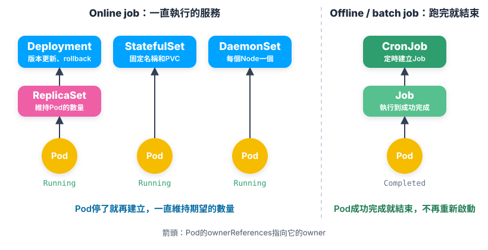
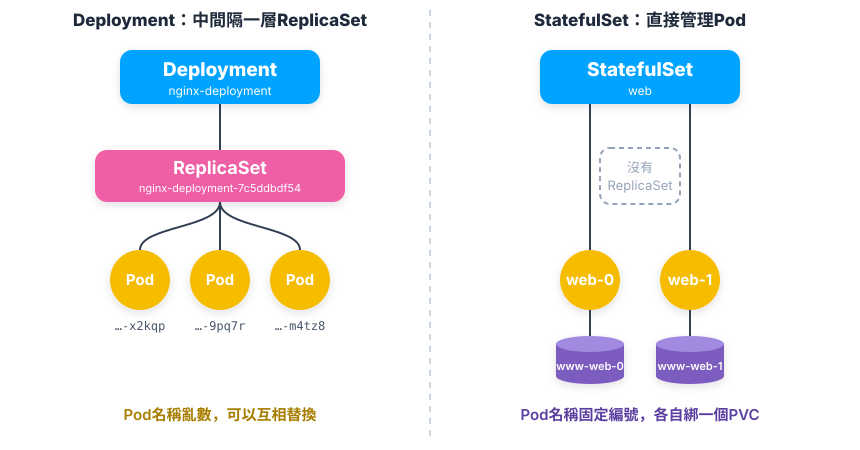
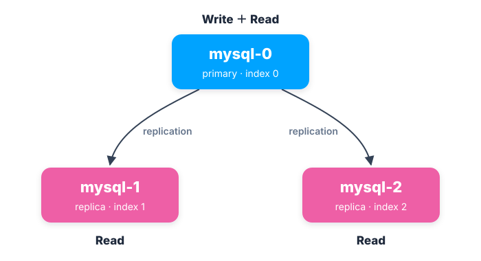
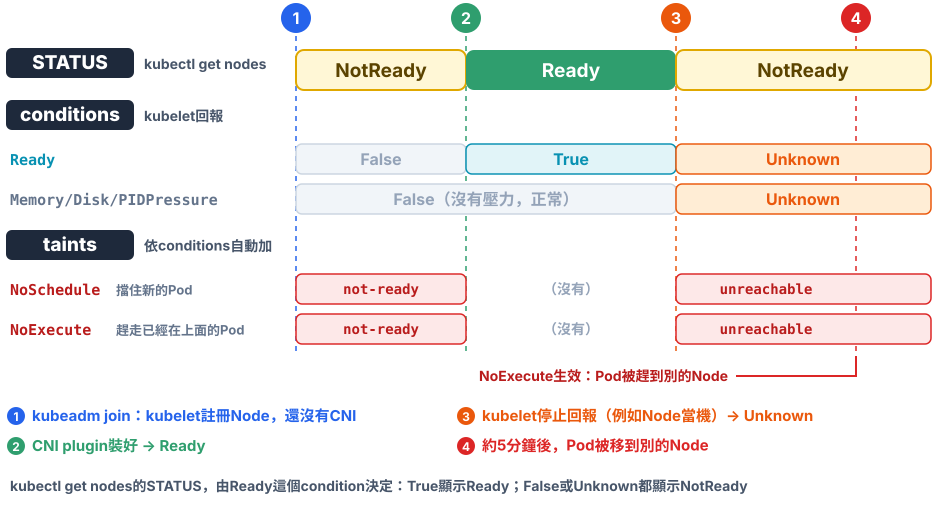

# Chap-5 Container Orchestration之Controller篇

**目錄**

- [Workload的兩大類](#workload的兩大類)
- [控制器模式](#控制器模式)
- [Deployment](#deployment)
- [Service](#service)
- [StatefulSet](#statefulset)
- [StatefulSet實踐：MySQL](#statefulset實踐mysql)
- [Taint和Toleration](#taint和toleration)
- [DaemonSet](#daemonset)
- [Job](#job)
- [CronJob](#cronjob)

## Workload的兩大類

*Kubernetes裡要跑的工作有哪幾種？各由哪個object管理？*

Kubernetes把要跑的工作（workload）分成兩大類，每一類都有自己的controller object管理Pod：



- **Online job**：長期執行的服務，例如web server、資料庫。Pod停了就再建立，一直維持期望的數量。由[Deployment](#deployment)、[StatefulSet](#statefulset)或[DaemonSet](#daemonset)管理，Deployment中間還隔一層ReplicaSet。
- **Offline / batch job**：執行完就結束的工作，例如資料處理、備份。Pod成功完成後狀態是`Completed`，不再重新啟動。由[Job](#job)管理，要定時執行，再由[CronJob](#cronjob)建立Job。

圖裡的箭頭是Pod的`ownerReferences`，記錄它的owner是誰，見[ownerReferences](#-4-ownerreferences記錄誰擁有誰)。

## 控制器模式

*Deployment、StatefulSet、DaemonSet這些不同的object，Kubernetes怎麼用同一套方法管理它們？*

Kubernetes用一種叫***控制器模式***（controller pattern）的設計，***用一種object管理另一種object***，統一處理各種object的編排：Deployment、StatefulSet、DaemonSet、Job……每一種背後都有一個controller，而且都照同一個流程工作：***控制循環***（control/reconcile loop）。

### 🏭 1. 誰在執行：kube-controller-manager

[架構圖](chap-3-kubernetes-architecture-operations.md#kubernetes的架構)裡的kube-controller-manager，其實就是***一組controller的集合***。看Kubernetes原始碼的`pkg/controller`目錄：

```bash
cd kubernetes/pkg/controller/
ls -d */
# → cronjob/  daemon/  deployment/  disruption/  endpointslice/  garbagecollector/
#   job/  namespace/  nodelifecycle/  podautoscaler/  replicaset/  serviceaccount/
#   statefulset/  volume/  ...
```

- **每個目錄是一個controller**：各自負責一種編排功能，Deployment只是其中之一。
- **放在一起，是因為它們遵循同一個模式**：***控制循環***。
- **跑在同一個process裡**：kube-controller-manager把它們編進同一個binary，以[Static Pod](chap-3-kubernetes-architecture-operations.md#static-pod)執行。

### 🔁 2. 控制循環

每個controller都在不停地做同一件事：

```go
for {
    實際狀態 := 取得object X在cluster裡的實際狀態
    期望狀態 := 取得object X的期望狀態
    if 實際狀態 != 期望狀態 {
        執行編排動作，把實際狀態調整成期望狀態
    }
}
```

- **實際狀態**：來自cluster本身，例如kubelet回報的container和Node狀態、監控系統的資料，或controller自己收集的資訊。
- **期望狀態**：來自使用者提交的YAML，例如`replicas: 2`，存在etcd裡。controller透過API Server watch這些object，不直接讀etcd。

以`replicas: 2`為例：

1. **數實際狀態**：找出所有帶`app: nginx` label的Pod，數出有幾個。實際負責數Pod的是Deployment底下的ReplicaSet controller，見[ownerReferences](#-4-ownerreferences記錄誰擁有誰)。
2. **讀期望狀態**：`replicas`的值是2。
3. **比較、調整**：少了就建立Pod，多了就刪除Pod。例如手動刪掉一個Pod，controller發現只剩1個，就再建立一個。

主要的編排邏輯都在第3步。這個比較、調整的動作叫***reconcile***，整個循環也叫reconcile loop或sync loop。文件裡看到這幾個詞，指的都是同一件事：***控制循環***。

reconcile的結果，通常是對被控制object的write：建立Pod、刪除Pod，或更新Pod的某個欄位。***使用者只寫期望狀態，「怎麼做到」交給controller***，這就是[聲明式API](chap-3-kubernetes-architecture-operations.md#聲明式api)能運作的原因。

### 🧩 3. 控制器的兩半：定義和模板

以Deployment為例，一個controller object的YAML分成上下兩半：


- **上半部：控制器定義**：controller object本身，***期望狀態***寫在這裡，例如`replicas: 2`要2個Pod。
- **下半部：被控制對象的模板**：`template`就是一個Pod的定義（Pod template），controller照著它建立Pod。
- **`selector`要對得上`template`的`labels`**：controller用`selector`找出「哪些Pod是我在管的」，再拿來和期望狀態比較。

其他controller也是同樣的結構，只是期望狀態和被控制的對象不同：

| controller            | 期望狀態           | 被控制對象                         |
| --------------------- | ------------------ | ---------------------------------- |
| **Deployment**  | replicas、更新策略 | ReplicaSet（再由它管理Pod）        |
| **ReplicaSet**  | replicas           | Pod                                |
| **StatefulSet** | replicas、啟動順序 | Pod（每個有固定的名稱和自己的PVC） |
| **DaemonSet**   | 每個Node一個       | Pod                                |
| **Job**         | 要成功完成幾次     | Pod                                |

### 🔗 4. ownerReferences：記錄誰擁有誰

controller照模板建立object時，會在新object的`metadata.ownerReferences`裡記下***它的擁有者***。所以每個API object都有這個欄位。Deployment其實不直接擁有Pod，中間還有一層ReplicaSet：

```
Deployment nginx-deployment
└── ReplicaSet nginx-deployment-7c5ddbdf54        ← ownerReferences指向Deployment
    ├── Pod nginx-deployment-7c5ddbdf54-x2kqp     ← ownerReferences指向ReplicaSet
    └── Pod nginx-deployment-7c5ddbdf54-9pq7r
```

```bash
kubectl get pod nginx-deployment-7c5ddbdf54-x2kqp \
  -o jsonpath='{.metadata.ownerReferences[0].kind}/{.metadata.ownerReferences[0].name}'
# → ReplicaSet/nginx-deployment-7c5ddbdf54

kubectl describe pod nginx-deployment-7c5ddbdf54-x2kqp | grep "Controlled By"
# → Controlled By:  ReplicaSet/nginx-deployment-7c5ddbdf54
```

它的用途：

- **一起刪除**：刪掉Deployment時，garbage collector照著`ownerReferences`往下找，把它的ReplicaSet和Pod一起刪掉。
- **不搶別人的Pod**：一個Pod的label就算剛好符合某個controller的`selector`，只要它的owner是別人，這個controller也不會去管它。

> [!NOTE]
> Deployment中間多一層ReplicaSet，是為了做rolling update：更新image時，Deployment建立一個新的ReplicaSet，再逐步把新的調多、舊的調少。每個ReplicaSet只負責「維持幾個Pod」，更新的流程由Deployment控制。見[Deployment](#deployment)。

> [!TIP]
> 💡 **一句話總結**
>
> ***每個controller都是一個控制循環：拿期望狀態和實際狀態比較，不一樣就動手調整***。controller的YAML上半部寫期望狀態，下半部是被控制對象的模板，建立出來的object用`ownerReferences`記住自己屬於誰。

## Deployment

*Deployment、ReplicaSet和Pod是什麼關係？*

Deployment**不直接管理Pod**：它**管理ReplicaSet，ReplicaSet再管理Pod**，每一層都用[ownerReferences](#-4-ownerreferences記錄誰擁有誰)記錄自己的擁有者。Deployment同樣透過控制器模式，調整ReplicaSet的***數量和屬性***，實現兩種編排動作：[rolling update](#-2-rolling-update)和[scale out / scale in](#-3-scale-out--scale-in)。

### 📋 1. ReplicaSet

一個ReplicaSet object，就是***`replicas`的定義，加上一個Pod template***。它的YAML和Deployment幾乎一樣，下面用同一份YAML標出差別，★的兩行改掉，就是一個ReplicaSet：

<!-- hl: 2 10 11 -->

```yaml
apiVersion: apps/v1
kind: Deployment                  # ★ 改成ReplicaSet
metadata:
  name: nginx-deployment
spec:
  replicas: 3                     # 共通：期望狀態，維持3個Pod
  selector:                       # 共通：用label找出自己管的Pod
    matchLabels:
      app: nginx
  strategy:                       # ★ 只有Deployment有，ReplicaSet要拿掉
    type: RollingUpdate           #   rolling update怎麼做
  template:                       # 共通：Pod template，照這個建立Pod
    metadata:
      labels:
        app: nginx
    spec:
      containers:
        - name: nginx
          image: nginx:1.27
```

- **ReplicaSet是Deployment的子集**：`replicas`、`selector`、`template`兩者共通；Deployment多了rolling update相關的欄位，例如`strategy`、`revisionHistoryLimit`，沒寫的話就用預設值。
- **ReplicaSet只做一件事**：讓label符合的Pod維持`replicas`個，少了就建立、多了就刪除。
- ***Deployment controller實際操作的是ReplicaSet，不是Pod***：它只調整各個ReplicaSet的`replicas`；真正建立、刪除Pod的，是ReplicaSet controller。
- **一般不直接建立ReplicaSet**：直接用Deployment，才有rolling update和回到上一版的功能。

### 🔄 2. Rolling update


- **Deployment管理ReplicaSet**：改了Pod template，例如image從`nginx:1.26`換成`nginx:1.27`，Deployment就建立一個新的ReplicaSet（v2）。每個ReplicaSet對應***一個版本***的Pod template。
- **逐步替換**：Deployment把v2一個一個調多、v1一個一個調少，直到v2有3個、v1剩0個。圖裡就是更新到一半的狀態：v1還有2個Pod，v2已經有1個。

像這樣，把cluster裡正在執行的多個Pod版本，***交替地逐一升級***，就是rolling update。完成之後，看新、舊兩個ReplicaSet的最終狀態：

```bash
kubectl get rs
# → NAME                          DESIRED   CURRENT   READY   AGE
#   nginx-deployment-1764197365   3         3         3       6s    ← v2：新版本
#   nginx-deployment-3167673210   0         0         0       30s   ← v1：舊版本
```

- **舊的ReplicaSet不會刪掉**：只是`replicas`變成0。`kubectl rollout undo`回到上一版時，Deployment就是把它重新調多，見[Rollback](#-4-rollback回到之前的版本)。保留幾個舊版本，由`revisionHistoryLimit`決定，預設10個。

### 📈 3. Scale out / scale in

scale最簡單：Deployment controller只要修改它所控制的ReplicaSet的`replicas`就好。

```bash
kubectl scale deployment nginx-deployment --replicas=4      # 3 → 4

kubectl get replicaset
# → NAME                          DESIRED   CURRENT   READY   AGE
#   nginx-deployment-7c5ddbdf54   4         4         3       10m
```

- **scale out**：`replicas`從3改成4，ReplicaSet發現少了1個Pod，就照Pod template再建立一個。
- **scale in**：反過來，`replicas`調小，ReplicaSet就刪掉多出來的Pod。
- **不會建立新的ReplicaSet**：scale只改數量，沒有改Pod template，所以還是同一個ReplicaSet。改了template（例如換image），才會觸發[rolling update](#-2-rolling-update)，建立新的ReplicaSet。
- **也可以自動scale**：HorizontalPodAutoscaler依CPU使用率等指標，自動調整Deployment的`replicas`。

### ⏪ 4. Rollback：回到之前的版本

每次修改Pod template，都會產生一個新的***revision***，各自對應一個ReplicaSet。假設依序做了3次變更：建立（`nginx:1.26`）、升級到`nginx:1.27`，以及一次打錯版本號、更新失敗的`nginx:1.91`。

**① 記下每次變更的原因**：在annotation `kubernetes.io/change-cause`寫下說明，`rollout history`會顯示它。

```bash
kubectl set image deployment/nginx-deployment nginx=nginx:1.91
kubectl annotate deployment/nginx-deployment kubernetes.io/change-cause="升級到nginx:1.91"
```

**② 查看歷史**：

```bash
kubectl rollout history deployment/nginx-deployment
# → REVISION  CHANGE-CAUSE
#   1         建立：nginx:1.26
#   2         升級到nginx:1.27
#   3         升級到nginx:1.91      ← 這個image不存在，新的Pod一直起不來

# 看revision 2的Pod template細節
kubectl rollout history deployment/nginx-deployment --revision=2
```

**③ 回到指定的revision**：

```bash
kubectl rollout undo deployment/nginx-deployment --to-revision=2
# → deployment.apps/nginx-deployment rolled back
```

- **rollback也是rolling update**：Deployment controller把revision 2的ReplicaSet調多、revision 3的調少，和[rolling update](#-2-rolling-update)一樣逐步替換。
- **不加`--to-revision`**：回到上一個revision。
- **revision號碼會往上加**：回到revision 2之後，它變成***revision 4***，歷史裡的2就不見了。
- **能回到多久以前**：由`revisionHistoryLimit`決定，預設保留10個舊的ReplicaSet。

> [!NOTE]
> **一次改好幾個地方：`rollout pause`**
>
> 每改一次Pod template，就會觸發一次rolling update、多一個revision。要同時改image和資源上限這類好幾個地方時，可以先暫停：
>
> ```bash
> # ① 暫停：之後的修改先不觸發rolling update
> kubectl rollout pause deployment/nginx-deployment
> # ② 修改1：換image（還不會更新Pod）
> kubectl set image deployment/nginx-deployment nginx=nginx:1.27
> # ③ 修改2：調整mem上限（還不會更新Pod）
> kubectl set resources deployment/nginx-deployment -c nginx --limits=memory=256Mi
> # ④ 恢復：②③的修改一次生效，只觸發一次rolling update
> kubectl rollout resume deployment/nginx-deployment
> ```
>
> - **只產生一次rolling update、一個revision**：pause期間的修改都會累積起來，resume之後一起套用。
> - **pause期間scale照常**：改`replicas`不受影響，因為scale不會改Pod template。
> - **pause期間不能rollback**：要先`resume`，才能`rollout undo`。

## Service

*Pod的IP會變，client要怎麼穩定地找到它們？*

Service是Kubernetes用來***把一組Pod暴露給外界存取***的機制。例如一個Deployment有3個Pod，就可以定義一個Service；client只要連到這個Service，就會連到其中一個Pod。為什麼需要它，見[第3章的存取關係：Service](chap-3-kubernetes-architecture-operations.md#存取關係service)。

### 🚪 1. 什麼是Service：一組Pod的固定入口

<!-- hl: 6 7 -->

```yaml
apiVersion: v1
kind: Service
metadata:
  name: nginx
spec:
  selector:               # 用label找出這個Service背後的Pod
    app: nginx
  ports:
    - port: 80            # Service的port
      targetPort: 80      # 轉發到Pod的port
```

- **用`selector`找Pod**：和[controller的`selector`](#-3-控制器的兩半定義和模板)一樣，帶`app: nginx` label的Pod，就是這個Service背後的Pod。
- **Pod換了也不用改**：Pod重建、IP改了，Kubernetes會自動更新Service背後的Pod清單（EndpointSlice），client完全不用知道。
- **固定的DNS名稱**：CoreDNS替Service建立`nginx.default.svc.cluster.local`這樣的名稱，同一個namespace裡直接用`nginx`就連得到。
- **流量怎麼轉到Pod**：每個Node上的kube-proxy把轉發規則寫進kernel，見[kube-proxy在哪裡、做什麼](chap-3-kubernetes-architecture-operations.md#kube-proxy在哪裡做什麼)。

### 🔀 2. 怎麼存取Service：VIP和DNS

Service有兩種被存取的方式，其中DNS又分成兩種：

```
存取Service
├── ① VIP：直接連Service的IP，例如10.0.23.1
│         → kube-proxy把request轉到其中一個Pod
│
└── ② DNS：連my-svc.my-namespace.svc.cluster.local
          ├── ⓐ Normal Service：DNS解析成Service的VIP → 接下來和①一樣
          └── ⓑ Headless Service：DNS直接解析成Pod的IP（不分配VIP）
```

- **① VIP**：Virtual IP，不屬於任何一台機器的虛擬IP。連到它的request，由每個Node上的kube-proxy轉到Service背後的某一個Pod。
- **② DNS**：連Service的DNS名稱，例如`my-svc.my-namespace.svc.cluster.local`，由CoreDNS解析。依Service有沒有VIP，又分成兩種：
  - **ⓐ Normal Service**：有VIP，DNS名稱只是VIP的別名。
  - **ⓑ Headless Service**：***不分配VIP***，DNS名稱直接解析成Pod的IP。DNS會return所有ready Pod的IP，由client自己選一個連。

Headless Service的寫法，只差在`clusterIP: None`：

<!-- hl: 2 -->

```yaml
spec:
  clusterIP: None         # headless Service：不分配VIP
  selector:
    app: nginx
```

***StatefulSet就是靠headless Service，讓每個Pod有固定的DNS名稱***，見[StatefulSet](#statefulset)。

> [!NOTE]
> 從cluster外面存取Service，還有`NodePort`、`LoadBalancer`這幾種類型，以及HTTP層的Ingress / Gateway。這些屬於網路的主題，之後另外整理。

## StatefulSet

*Deployment管不好哪一類app？StatefulSet多做了什麼？*

### 🗃️ 1. Stateless vs stateful

Deployment對app做了一個簡化的假設：***一個app的所有Pod都一模一樣***。所以Pod之間沒有順序，也不在乎跑在哪一台host上，壞了一個就照template再建一個。

但有些app不符合這個假設：

- **instance之間有依賴關係**：尤其是分散式app，例如主從（primary / replica）、主備（active / standby）。誰先啟動、誰是primary，都有講究。
- **每個instance有自己的資料**：DB這類storage app，每個instance通常在local disk上存著自己的一份資料。instance被刪掉後，就算重建出來，***instance和資料之間的對應關係也已經不見了***，app就會出錯。

這種***instance之間不對等***、或***instance依賴外部資料***的app，叫做***stateful app***；反過來，所有instance都一樣、可以隨意替換的，叫stateless app。

|                        | stateless app                | stateful app                                 |
| ---------------------- | ---------------------------- | -------------------------------------------- |
| **instance之間** | 完全一樣，可以互相替換       | 不對等：有順序、有主從                       |
| **資料**         | 不存在instance裡，或可以丟掉 | 每個instance有自己的資料，重建後要接回同一份 |
| **例子**         | web server、API server       | MySQL主從、etcd、Kafka、CockroachDB          |
| **用什麼管理**   | [Deployment](#deployment)     | StatefulSet                                  |

stateful app放在哪一種storage上比較好，見[第3章「Ceph不是所有stateful app的最佳選擇」](chap-3-kubernetes-architecture-operations.md#-業界常見的做法ceph不是所有stateful-app的最佳選擇)。

### 🧩 2. StatefulSet的兩種狀態

StatefulSet把真實世界裡app的狀態，抽象成兩種：

**① topology state：instance之間不對等**

- **要照順序啟動**：例如primary A要比replica B先啟動。
- **重建時也要照同樣的順序**：把A和B兩個Pod都刪掉，再建立時還是A先、B後。
- **重建後的network identity要和原來一樣**：新的Pod要用同樣的名字、同樣的方式被找到，原本連它的client才不用改。

**② storage state：每個instance綁著自己的資料**

- **Pod A不管重建幾次，讀到的都是同一份資料**：例如Pod A第一次讀到的資料，和十分鐘後再讀到的，應該是同一份，即使這段時間Pod A被重建過。
- **最典型的例子**：DB的多個instance，每個存著自己的資料。

***StatefulSet的核心功能，就是把這兩種狀態記錄下來，在Pod重建時替新的Pod恢復***：

| 狀態                     | StatefulSet怎麼記錄                                                              | 重建後恢復成什麼                                                                                |
| ------------------------ | -------------------------------------------------------------------------------- | ----------------------------------------------------------------------------------------------- |
| **topology state** | 每個Pod有固定的編號名稱：`web-0`、`web-1`……，照編號依序建立                | 同樣的名稱、同樣的DNS名稱（透過[headless Service](#-2-怎麼存取servicevip和dns)），啟動順序也一樣 |
| **storage state**  | 每個Pod有自己的PVC：`www-web-0`、`www-web-1`……（`volumeClaimTemplates`） | 重建後的`web-0`掛回同一個PVC，讀到同一份資料                                                  |

### 🏷️ 3. Topology state：serviceName和固定的DNS名稱

StatefulSet怎麼用[headless Service](#-2-怎麼存取servicevip和dns)的DNS名稱，維持Pod的topology state？先準備一個headless Service，名稱是`nginx`：

<!-- hl: 4 -->

```yaml
apiVersion: v1
kind: Service
metadata:
  name: nginx
spec:
  clusterIP: None             # headless：不分配VIP
  selector:
    app: nginx
  ports:
    - port: 80
```

再建立StatefulSet：

<!-- hl: 6 -->

```yaml
apiVersion: apps/v1
kind: StatefulSet
metadata:
  name: web
spec:
  serviceName: "nginx"        # 用上面那個headless Service，替Pod建立DNS名稱
  replicas: 2
  selector:
    matchLabels:
      app: nginx
  template:
    metadata:
      labels:
        app: nginx
    spec:
      containers:
        - name: nginx
          image: nginx:1.27
```

***和[Deployment](#-1-replicaset)的YAML比，唯一的差別就是多了`serviceName`***。它告訴StatefulSet controller：執行[控制循環](#-2-控制循環)時，用`nginx`這個headless Service，替每個Pod保證一個***解析得到的固定身分***。

用`-w`（watch）即時看StatefulSet建立兩個Pod的過程：

```bash
kubectl get pods -w -l app=nginx
# → NAME    READY   STATUS              RESTARTS   AGE
#   web-0   0/1     Pending             0          0s
#   web-0   0/1     ContainerCreating   0          0s
#   web-0   1/1     Running             0          19s   ← web-0 Ready之後
#   web-1   0/1     Pending             0          0s    ← web-1才開始建立
#   web-1   0/1     ContainerCreating   0          0s
#   web-1   1/1     Running             0          20s
```

Pod很快就建好了，來不及看的話，用`kubectl describe statefulset web`看最後的Events，也有同樣的建立順序。結果是：

```
StatefulSet web（serviceName: nginx）
├── Pod web-0    ← web-0.nginx.default.svc.cluster.local
└── Pod web-1    ← web-1.nginx.default.svc.cluster.local
```

- **Pod名稱是固定的編號**：`<StatefulSet名稱>-<編號>`，從0開始往上加，一個編號對應一個Pod，不會重複，也不是Deployment那種亂數。
- **照編號依序建立**：`web-0`進入Running、而且conditions裡的`Ready`變成`True`之前，`web-1`一直不會建立。所以替Pod設定readiness probe很重要：沒設的話，container一啟動就算Ready，app可能還沒準備好，下一個Pod就開始建立了。conditions見[第4章的Pod的status](chap-4-container-orchestration-pod.md#-5-pod的statusphase和conditionspod-level)。
- **每個Pod有自己的DNS名稱**：`Pod名稱.Service名稱.namespace.svc.cluster.local`，直接解析成那個Pod的IP。
- **重建後身分不變**：`web-0`被刪掉，重建出來的還是叫`web-0`，DNS名稱也一樣，只有IP可能不同。client用DNS名稱連，就不受影響。

這樣，***StatefulSet就保證了Pod network identity的穩定性***：Pod怎麼重建，名稱、DNS名稱和建立順序都不變。

### 💾 4. Storage state：volumeClaimTemplates和固定的PVC

#### 為什麼不直接在Pod裡寫storage

要讓每個Pod綁著自己的資料，資料得放在remote的持久化storage上。但如果要開發者直接在Pod裡寫storage的細節，**會有兩個問題：**

- **① 超出開發者的專業**：app開發者不一定懂Ceph、GlusterFS這些storage系統，也不知道公司的cluster是怎麼建起來的。
- **② infrastructure的資訊被過度暴露**：storage server的位址、username、認證檔的位置，全寫在Pod的YAML裡，等於讓全公司的開發者都看得到。

所以storage的細節，應該交給管理cluster的人；開發者只要說「***我需要多大、什麼樣的storage***」就好。Kubernetes用PVC和PV把這兩件事分開。

#### PVC：開發者只要兩步

Kubernetes引入了PVC（PersistentVolumeClaim）和PV（PersistentVolume）這兩種API object，大大降低了宣告、使用持久化volume的門檻。有了PVC，開發者想用一個volume，只要兩步：

**① 定義一個PVC，宣告想要的volume屬性**：

<!-- hl: 4 -->

```yaml
apiVersion: v1
kind: PersistentVolumeClaim
metadata:
  name: pv-claim
spec:
  accessModes:
    - ReadWriteOnce           # 同一時間只掛在一個Node上讀寫
  resources:
    requests:
      storage: 1Gi            # 要多大
```

**② 在Pod裡宣告使用這個PVC**：

<!-- hl: 14 15 -->

```yaml
apiVersion: v1
kind: Pod
metadata:
  name: pv-pod
spec:
  containers:
    - name: pv-container
      image: nginx:1.27
      volumeMounts:
        - name: pv-storage
          mountPath: /usr/share/nginx/html
  volumes:
    - name: pv-storage
      persistentVolumeClaim:
        claimName: pv-claim   # 只寫PVC的名稱
```

- **兩份YAML都沒有storage的細節**：沒有server位址、username、認證檔，和[直接在Pod裡寫storage](#為什麼不直接在pod裡寫storage)比，開發者只需要知道「要多大、怎麼存取」。
- **PV由誰提供**：管理cluster的人，見[PV](#pv管理cluster的人提供實作)。

#### PV：管理cluster的人提供實作

符合PVC條件的volume，來自管理cluster的人建立的***PV***（PersistentVolume）。例如一個透過Ceph CSI driver使用RBD的PV：

```yaml
apiVersion: v1
kind: PersistentVolume
metadata:
  name: pv-volume
spec:
  capacity:
    storage: 10Gi                     # 這個PV有10Gi
  accessModes:
    - ReadWriteOnce
  csi:                                # storage的細節都在這裡
    driver: rook-ceph.rbd.csi.ceph.com
    volumeHandle: foo                 # Ceph裡RBD image的名稱
    fsType: ext4
    volumeAttributes:
      clusterID: rook-ceph
      pool: replicapool
      staticVolume: "true"
    nodeStageSecretRef:               # 認證資訊放在Secret裡，不寫在YAML
      name: rook-csi-rbd-node
      namespace: rook-ceph
```

- **storage的細節只出現在PV裡**：用哪個CSI driver、哪個pool、認證放在哪個Secret，開發者寫的PVC完全不用知道。這個driver就是[第3章Rook-Ceph](chap-3-kubernetes-architecture-operations.md#-step-6deploy-csi-driverrook-ceph)裝好的那一個。
- **Kubernetes負責配對**：PV有10Gi、`accessModes`也對得上，滿足[PVC](#pvc開發者只要兩步)要的1Gi，Kubernetes就把這個PV綁到PVC上，兩者的狀態都變成`Bound`。
- **也可以不用手動建PV**：設定StorageClass，Kubernetes依PVC自動建立PV（dynamic provisioning），見[第3章用StorageClass測試PVC](chap-3-kubernetes-architecture-operations.md#建立storageclass再測一次pvc)。實務上大多用這種方式。

***PVC和PV的設計，就是interface和implementation的思想***：

- **開發者只要會用interface**：也就是PVC，說明要什麼。
- **管理cluster的人負責implementation**：也就是PV，說明怎麼做到，再交給Kubernetes綁定。
- **好處**：
  - 不必把storage系統的細節暴露給開發者；
  - 職責分開，出事時比較容易定位問題、釐清是誰的責任。

> [!NOTE]
> 手動建立的PV要和PVC配對成功，兩邊的`storageClassName`要一樣。cluster有default StorageClass時，沒寫`storageClassName`的PVC會被自動補上default，改走dynamic provisioning，就不會綁到這個手動建的PV。所以手動配對時，兩邊都寫同一個`storageClassName`（例如`manual`），或都寫`""`。

#### volumeClaimTemplates：每個Pod一個固定的PVC

PVC、PV的設計，也讓StatefulSet管理storage state成為可能。在[前面的StatefulSet `web`](#-3-topology-stateservicename和固定的dns名稱)裡，加上`volumeClaimTemplates`：

```yaml
spec:
  template:
    spec:
      containers:
        - name: nginx
          image: nginx:1.27
          volumeMounts:
            - name: www                       # 用下面模板建立的PVC
              mountPath: /usr/share/nginx/html
  volumeClaimTemplates:                       # 每個Pod照這個模板建一個PVC
    - metadata:
        name: www
      spec:
        accessModes: [ReadWriteOnce]
        resources:
          requests:
            storage: 1Gi
```

StatefulSet替每個Pod各建一個PVC，名稱是`<模板名稱>-<Pod名稱>`，和Pod的編號一一對應：

```bash
kubectl get pvc
# → NAME        STATUS   VOLUME          CAPACITY   ACCESS MODES   AGE
#   www-web-0   Bound    pvc-15c268c7…   1Gi        RWO            48s
#   www-web-1   Bound    pvc-15c79307…   1Gi        RWO            48s
```

驗證資料跟著Pod的編號走：每個Pod寫一個不同的檔案，刪掉Pod，等重建後再讀：

```bash
for i in 0 1; do
  kubectl exec web-$i -- \
    sh -c "echo hello web-$i > /usr/share/nginx/html/index.html"
done

kubectl delete pod -l app=nginx               # 刪掉web-0和web-1

# 等StatefulSet照順序重建完
kubectl exec web-0 -- cat /usr/share/nginx/html/index.html
# → hello web-0                               ← 讀到的還是原本那一份
```

- **重建的`web-0`掛回`www-web-0`**：StatefulSet照名稱找到原本的PVC，PVC還綁著原本的PV，所以讀到的是同一份資料。
- **Pod刪掉，PVC還在**：PVC的生命週期和Pod分開，所以重建時接得回去。StatefulSet被刪除或scale in時，PVC要不要一起刪，由`persistentVolumeClaimRetentionPolicy`設定，預設是保留。

***StatefulSet管理storage state的方式，就是讓每個Pod的編號，對應一個固定的PVC***。加上[topology state](#-3-topology-stateservicename和固定的dns名稱)的固定名稱和DNS，Pod怎麼重建，身分和資料都接得回來。

### 🔄 5. 為什麼不需要ReplicaSet

[ReplicaSet](#-1-replicaset)只在乎Pod的***數量***對不對，所有Pod都一樣、可以互相替換；StatefulSet則要***每個Pod都有不能互換的身分***：名稱、建立順序、對應的PVC都要固定。兩者的差別：

|                          | ReplicaSet（Deployment底下）                    | StatefulSet需要的                                        |
| ------------------------ | ----------------------------------------------- | -------------------------------------------------------- |
| **Pod名稱**        | 亂數，例如`nginx-deployment-7c5ddbdf54-x2kqp` | 固定編號：`web-0`、`web-1`                           |
| **建立、刪除順序** | 同時建立；scale in時隨便挑一個刪                | `web-0` Ready才建`web-1`；scale in從編號最大的開始刪 |
| **Pod和PVC的對應** | 沒有，Pod之間沒差別                             | `web-0`永遠掛`www-web-0`                             |

所以Deployment管理ReplicaSet、ReplicaSet再管理Pod；***StatefulSet的controller則自己直接管理每一個Pod***：



### 🔄 6. Rolling update：原地一個一個換

沒有ReplicaSet，StatefulSet要怎麼更新image？方法和[Deployment的rolling update](#-2-rolling-update)不一樣：

```
Deployment：建一個新的ReplicaSet，Pod整個換新
  ReplicaSet v1：nginx-…-aaaa1、nginx-…-aaaa2   ← 調少
  ReplicaSet v2：nginx-…-bbbb1、nginx-…-bbbb2   ← 調多，名稱全部換掉

StatefulSet：原地一個一個換，從編號最大的開始
  web-1（舊）→ 刪掉 → 重建web-1（新版本），掛回www-web-1
  web-0（舊）→ 刪掉 → 重建web-0（新版本），掛回www-web-0
```

- **原地更新**：名稱、DNS名稱、PVC都不變，只有image換成新版本。所以Pod的身分和資料都接得回來。
- **從編號最大的開始**：`web-1`更新完、Ready了，才換`web-0`。和建立時的順序（0 → 1）相反。
- **歷史版本記在ControllerRevision**：沒有舊的ReplicaSet可以保留，改用ControllerRevision這種object記錄每一版的Pod template。`kubectl rollout undo statefulset/web`就是照它回到上一版，再原地更新一次。

```bash
kubectl get controllerrevisions
# → NAME             CONTROLLER             REVISION   AGE
#   web-6b8b9c7f5d   statefulset.apps/web   1          10m
#   web-75d4d6c9b4   statefulset.apps/web   2          2m
```

**用`partition`做canary**：只更新編號 ≥ `partition`的Pod，其他的維持舊版本。

```yaml
spec:
  updateStrategy:
    type: RollingUpdate
    rollingUpdate:
      partition: 1                # 只更新web-1（編號 ≥ 1）；web-0維持舊版本
```

先用`partition: 1`只換`web-1`，確認新版本沒問題，再把`partition`調成0，更新剩下的Pod。

> [!TIP]
> 💡 **StatefulSet的工作原理**
>
> - ***StatefulSet的controller直接管理Pod***：中間沒有ReplicaSet，靠Pod名稱裡的編號（`web-0`、`web-1`）區分每個instance。
> - ***每個Pod透過`serviceName`指定的headless Service，得到帶同樣編號的固定DNS名稱***：例如`web-0.nginx.default.svc.cluster.local`，由CoreDNS解析成這個Pod目前的IP。
> - ***StatefulSet依`volumeClaimTemplates`，替每個Pod建立同樣編號的PVC***：例如`www-web-0`，Pod重建後掛回同一個PVC，讀到同一份資料。

## StatefulSet實踐：MySQL

*用StatefulSet部署一個primary加兩個replica的MySQL cluster，topology state和storage state分別怎麼派上用場？*

### 🎯 目標：一個primary、兩個replica

要部署的是一個***primary-replica replication***的MySQL cluster：

- **1個primary**：接收write，再把資料同步給replica。
- **多個replica**：從primary同步資料，而且要能scale out。
- **Write**：***只能***在primary上執行。
- **Read**：可以在所有節點上執行，primary和replica都可以。

先從1個primary加2個replica開始：



- **topology state**：`mysql-0`一定是primary，必須最先啟動；replica要等primary準備好，才能開始同步。
- **storage state**：每個Pod有自己的資料，重建後要接回原本那一份，不能從頭來過。

下面用MySQL 8.0的***GTID***（Global Transaction ID）做replication：replica只要連上primary，就會自動從缺的地方開始同步，不需要先手動備份、複製資料。

步驟：

1. **[Step 1](#-step-1secret和configmap)**：建立Secret（root的password）和ConfigMap（primary、replica的config）。
2. **[Step 2](#-step-2兩個servicewrite和read)**：建立兩個Service，write連`mysql-0.mysql`，read連`mysql-read`。
3. **[Step 3](#-step-3statefulsetinit-containermysqlsidecar)**：建立StatefulSet，init container依Pod編號挑config，sidecar啟動replication。
4. **[Step 4](#-step-4驗證寫primary從replica讀scale-out)**：驗證寫primary、從replica讀，以及scale out。

### 🔐 Step 1：Secret和ConfigMap

root的password放在Secret：

```bash
kubectl create secret generic mysql-root --from-literal=password='changeme'
```

primary和replica的config放在同一個ConfigMap，Pod啟動時再依角色挑一份：

```yaml
apiVersion: v1
kind: ConfigMap
metadata:
  name: mysql
data:
  primary.cnf: |
    [mysqld]
    log-bin                         # 開啟binlog，replica靠它同步
    gtid_mode=ON
    enforce_gtid_consistency=ON
  replica.cnf: |
    [mysqld]
    read_only=ON                    # replica不接受一般的write
    gtid_mode=ON
    enforce_gtid_consistency=ON
```

### 🚪 Step 2：兩個Service，write和read

```yaml
apiVersion: v1
kind: Service
metadata:
  name: mysql                       # headless：write連mysql-0.mysql
spec:
  clusterIP: None
  selector:
    app: mysql
  ports:
    - port: 3306
---
apiVersion: v1
kind: Service
metadata:
  name: mysql-read                  # 普通Service：read連mysql-read
spec:
  selector:
    app: mysql
  ports:
    - port: 3306
```

- **`mysql`（headless）**：給StatefulSet當`serviceName`，每個Pod有固定的DNS名稱。write一定要連primary，也就是`mysql-0.mysql`，見[headless Service](#-2-怎麼存取servicevip和dns)。
- **`mysql-read`（普通Service）**：有VIP，轉到任何一個ready的Pod，primary和replica都可能。read連它就好。

### 🧱 Step 3：StatefulSet，init container、MySQL、sidecar

每個Pod裡有三個container，分工如下：

| container                       | 種類                | 做什麼                                                                                                  |
| ------------------------------- | ------------------- | ------------------------------------------------------------------------------------------------------- |
| **`init-mysql`**        | init&nbsp;container | 從hostname取出Pod編號：`0`用`primary.cnf`，其他用`replica.cnf`；再依編號寫一個唯一的`server-id` |
| **`mysql`**             | app&nbsp;container  | MySQL本身，資料放在`volumeClaimTemplates`建立的PVC                                                    |
| **`setup-replication`** | sidecar             | 只在replica上做事：等本機的MySQL啟動後，連上`mysql-0.mysql`，開始replication                          |

```yaml
apiVersion: apps/v1
kind: StatefulSet
metadata:
  name: mysql
spec:
  serviceName: mysql
  replicas: 3
  selector:
    matchLabels:
      app: mysql
  template:
    metadata:
      labels:
        app: mysql
    spec:
      initContainers:
        - name: init-mysql                    # ① 依Pod編號挑config
          image: mysql:8.0
          command:
            - bash
            - -c
            - |
              # 印出每一行指令；任何一行失敗就停止
              set -ex
              # 從hostname取出Pod編號：mysql-1 → 1
              [[ $HOSTNAME =~ -([0-9]+)$ ]] || exit 1
              ordinal=${BASH_REMATCH[1]}
              # 每個MySQL要有唯一的server-id：mysql-0 → 100、mysql-1 → 101
              echo -e "[mysqld]\nserver-id=$((100 + ordinal))" > /mnt/conf.d/server-id.cnf
              # 編號0是primary，其他是replica：從ConfigMap複製對應的config
              if [[ $ordinal -eq 0 ]]; then
                cp /mnt/config-map/primary.cnf /mnt/conf.d/
              else
                cp /mnt/config-map/replica.cnf /mnt/conf.d/
              fi
          volumeMounts:
            - name: conf                      # 寫到這裡，②的mysql會讀
              mountPath: /mnt/conf.d
            - name: config-map                # ConfigMap mysql的兩份config
              mountPath: /mnt/config-map
      containers:
        - name: mysql                         # ② MySQL本身
          image: mysql:8.0
          env:
            - name: MYSQL_ROOT_PASSWORD
              valueFrom:
                secretKeyRef:
                  name: mysql-root
                  key: password
          ports:
            - containerPort: 3306
          volumeMounts:
            - name: data
              mountPath: /var/lib/mysql
              subPath: mysql                  # 避開PVC根目錄的lost+found
            - name: conf
              mountPath: /etc/mysql/conf.d    # ①挑好的config
          readinessProbe:                     # 能執行SQL才算Ready
            exec:
              command:
                - bash
                - -c
                - mysql -uroot -p"$MYSQL_ROOT_PASSWORD" -h 127.0.0.1 -e "SELECT 1"
            initialDelaySeconds: 10
            periodSeconds: 5
        - name: setup-replication             # ③ replica開始同步
          image: mysql:8.0
          env:
            - name: MYSQL_ROOT_PASSWORD
              valueFrom:
                secretKeyRef:
                  name: mysql-root
                  key: password
          command:
            - bash
            - -c
            - |
              # 印出每一行指令；任何一行失敗就停止
              set -ex
              # 從hostname取出Pod編號
              [[ $HOSTNAME =~ -([0-9]+)$ ]] || exit 1
              # 只有replica（編號不是0）要設定replication
              if [[ ${BASH_REMATCH[1]} -ne 0 ]]; then
                # sql "…"：用root連本機的MySQL，執行一段SQL
                sql() { mysql -uroot -p"$MYSQL_ROOT_PASSWORD" -h 127.0.0.1 -e "$1"; }
                # 等本機的MySQL啟動，能執行SQL為止
                until sql "SELECT 1"; do sleep 2; done
                # 結果是空的，表示還沒設定過；Pod重啟時就不會重複設定
                if [[ -z "$(sql 'SHOW REPLICA STATUS')" ]]; then
                  # 指定primary、開始同步：
                  #   SOURCE_HOST：primary固定的DNS名稱（headless Service）
                  #   SOURCE_AUTO_POSITION=1：用GTID，自動從缺的地方開始同步
                  #   GET_SOURCE_PUBLIC_KEY=1：MySQL 8.0預設的認證方式需要它
                  sql "CHANGE REPLICATION SOURCE TO
                         SOURCE_HOST='mysql-0.mysql',
                         SOURCE_USER='root',
                         SOURCE_PASSWORD='$MYSQL_ROOT_PASSWORD',
                         SOURCE_AUTO_POSITION=1,
                         GET_SOURCE_PUBLIC_KEY=1;
                       START REPLICA;"
                fi
              fi
              # 設定完不結束、留在Pod裡；sidecar一結束，就會被一直重啟
              exec sleep infinity
      volumes:
        - name: conf
          emptyDir: {}                        # ①寫、②讀的config目錄
        - name: config-map
          configMap:
            name: mysql
  volumeClaimTemplates:                       # 每個Pod一個PVC：data-mysql-0……
    - metadata:
        name: data
      spec:
        accessModes: [ReadWriteOnce]
        resources:
          requests:
            storage: 10Gi
```

- **topology state**：StatefulSet照編號依序建立，`mysql-0`（primary）Ready之後，才建立`mysql-1`；replica連的是固定的`mysql-0.mysql`，primary重建後IP變了也連得到。
- **storage state**：每個Pod的資料在自己的PVC（`data-mysql-0`、`data-mysql-1`……），重建後掛回原本那一份。
- **config怎麼傳**：①把挑好的config寫進`emptyDir` `conf`，②把同一個`emptyDir`mount到`/etc/mysql/conf.d`。這就是[共用volume](chap-4-container-orchestration-pod.md#-3-共用volume)的用法。

### ✅ Step 4：驗證，寫primary、從replica讀、scale out

```bash
kubectl apply -f mysql-configmap.yaml -f mysql-services.yaml -f mysql-statefulset.yaml
kubectl get pods -l app=mysql -w
# → mysql-0 Running → mysql-1 Running → mysql-2 Running（依序建立）
```

Write到primary（`mysql-0.mysql`）：

```bash
kubectl run mysql-client --image=mysql:8.0 -it --rm --restart=Never -- \
  mysql -h mysql-0.mysql -uroot -pchangeme -e "
    CREATE DATABASE test;
    CREATE TABLE test.messages (message VARCHAR(250));
    INSERT INTO test.messages VALUES ('hello');"
```

從`mysql-read`讀，多跑幾次，會輪到不同的Pod（`@@server_id`是100、101、102）：

```bash
kubectl run mysql-client --image=mysql:8.0 -it --rm --restart=Never -- \
  mysql -h mysql-read -uroot -pchangeme -e "SELECT @@server_id, message FROM test.messages"
# → @@server_id  message
#   101          hello                ← 從replica讀到primary寫的資料
```

scale out成5個，新的replica自動加入、同步：

```bash
kubectl scale statefulset mysql --replicas=5
```

> [!WARNING]
> 這是學習用的簡化版本：
>
> - **replica從頭同步**：新的replica靠GTID從primary的第一筆binlog開始同步。primary的binlog一旦被清掉（`binlog_expire_logs_seconds`預設30天），新的replica就要先用MySQL內建的Clone plugin，從primary複製一份資料。
> - **用root做replication**：正式環境要另外建一個只有replication權限的帳號，password也不要寫在指令裡。
> - **primary掛掉不會自動換人**：`mysql-0`永遠是primary。要自動failover，用MySQL Operator、Percona Operator這類專門的operator。

## Taint和Toleration

*怎麼讓Pod「別過來」某些Node，又讓特定的Pod例外？*

### 🚫 1. Taint：Node上的排斥標記

taint貼在Node上，格式是`key=value:effect`，value可以省略：

```
node.kubernetes.io/not-ready:NoSchedule
└────────── key ───────────┘ └─effect─┘
└─────────────── taint ───────────────┘

dedicated=gpu:NoSchedule
└─ key ─┘ └─┘ └─effect─┘
         value
└─────── taint ────────┘
```

- **key**：說明原因，例如「這個Node NotReady」「這個Node留給GPU的工作」。
- **effect**：說明對Pod的影響，有下面三種，由Kubernetes的API定義，不能自己新增：

| effect                         | 對新的Pod                | 對已經在上面的Pod  | 誰執行                                   |
| ------------------------------ | ------------------------ | ------------------ | ---------------------------------------- |
| **`NoSchedule`**       | 不排上來                 | 不受影響           | scheduler                                |
| **`PreferNoSchedule`** | 盡量不排，真的沒地方才排 | 不受影響           | scheduler                                |
| **`NoExecute`**        | 不排上來                 | ***趕走*** | control plane的taint eviction controller |

***一個taint只有一個effect，但同一個key可以搭配多個effect***，每個組合是一個獨立的taint。例如NotReady的Node，同時有兩個`not-ready`：

```bash
kubectl describe node worker1 | grep -A1 Taints
# → Taints:  node.kubernetes.io/not-ready:NoSchedule    ← 擋住新的Pod
#            node.kubernetes.io/not-ready:NoExecute     ← 已經在上面的Pod，過一段時間趕走
```

同一個Node上，key＋effect的組合不會重複。

**Note：注意區分下面Node上4種容易混淆的terms：**

| Term                | 是什麼                                                       | 例子                                                     | 用途                                    |
| ------------------- | ------------------------------------------------------------ | -------------------------------------------------------- | --------------------------------------- |
| **condition** | Node的***健康狀態***，kubelet定期回報                | `Ready=False`，`kubectl get nodes`顯示成`NotReady` | 描述Node「怎麼了」                      |
| **label**     | 貼在Node上的***分類標籤***，寫成`key=value`        | `disktype=ssd`                                         | 讓Pod「挑選」Node，例如`nodeSelector` |
| **taint**     | 貼在Node上的***排斥標記***，寫成`key=value:effect` | `node.kubernetes.io/not-ready:NoSchedule`              | 讓Pod「別過來」或「離開」               |
| **key**       | label和taint的***名稱***，等號或冒號前面那一段       | `disktypenode.kubernetes.io/not-ready`                 | 指定要比對哪個label或taint              |

taint和label的key寫法一樣，但存在Node的不同欄位，各管各的。例如kubeadm替master同時加上label `node-role.kubernetes.io/control-plane`（用來標示角色，`kubectl get nodes`的ROLES欄就是讀它）和同名的taint（用來排斥一般的Pod）。

### 🩺 2. Node的狀態：conditions和STATUS

Node的conditions和[Pod的conditions](chap-4-container-orchestration-pod.md#-5-pod的statusphase和conditionspod-level)是同一種設計：`kubectl get nodes`的STATUS欄，主要就是看`Ready`這個condition，顯示`Ready`或`NotReady`；kubelet聯絡不到時是`Unknown`。

```bash
kubectl describe node worker1
# → Taints:      node.kubernetes.io/not-ready:NoSchedule
#   Conditions:
#   Type             Status   Reason
#   MemoryPressure   False    KubeletHasSufficientMemory
#   DiskPressure     False    KubeletHasNoDiskPressure
#   PIDPressure      False    KubeletHasSufficientPID
#   Ready            False    KubeletNotReady
```

一個Node從加入cluster、變成Ready，到出狀況，STATUS、conditions和taint是這樣變化的：



- **①→②**：剛join的Node還沒有network plugin，`Ready`是`False`，自動帶著`not-ready`的兩個taint：`NoSchedule`擋住新的Pod，`NoExecute`會趕走已經在上面的Pod；network plugin裝好後變成`Ready`，taint也跟著拿掉。這就是[第3章Step 5](chap-3-kubernetes-architecture-operations.md#-step-5deploy-cni-plugin)看到的過程。
- **③**：kubelet停止回報，control plane不知道Node的實際狀況，所以***所有conditions都變成`Unknown`***，改加上`unreachable`的兩個taint（`NoSchedule`和`NoExecute`）。
- **④**：一般的Pod對`unreachable:NoExecute`只容忍300秒，所以約5分鐘後被移到別的Node，見[Toleration](#-4-tolerationpod怎麼容忍taint)。

### 🏭 3. Taint從哪裡來

**① 系統依Node的conditions自動加**：kube-controller-manager裡的Node lifecycle controller，看Node的conditions加上對應的taint（前面的`node.kubernetes.io/`省略，例如`not-ready`的完整名稱是`node.kubernetes.io/not-ready`）：

| Node的狀態                                                      | 自動加上的taint                                | effect                  |
| --------------------------------------------------------------- | ---------------------------------------------- | ----------------------- |
| `Ready`是`False`                                            | `not-ready`                                  | `NoScheduleNoExecute` |
| `Ready`是`Unknown`（聯絡不到kubelet）                       | `unreachable`                                | `NoScheduleNoExecute` |
| `MemoryPressure`、`DiskPressure`、`PIDPressure`是`True` | `memory-pressuredisk-pressure``pid-pressure` | `NoSchedule`          |
| `NetworkUnavailable`是`True`                                | `network-unavailable`                        | `NoSchedule`          |
| 被`kubectl cordon`或`drain`                                 | `unschedulable`                              | `NoSchedule`          |

**② kubeadm替control plane加**：`kubeadm init`時，替Master加上`node-role.kubernetes.io/control-plane:NoSchedule`，見[第3章的Taint / Toleration](chap-3-kubernetes-architecture-operations.md#taint-toleration)。

**③ 管理cluster的人自己加**：

```bash
kubectl taint nodes worker1 dedicated=gpu:NoSchedule      # 只讓有toleration的Pod排上來
kubectl taint nodes worker1 dedicated=gpu:NoSchedule-     # 最後的「-」：刪掉這個taint
```

### 🛂 4. Toleration：Pod怎麼容忍taint

toleration寫在Pod的YAML裡，結構和taint對應：

```yaml
spec:
  tolerations:
    - key: dedicated                  # 容忍dedicated=gpu:NoSchedule
      operator: Equal
      value: gpu
      effect: NoSchedule
    - key: node.kubernetes.io/not-ready
      operator: Exists
      effect: NoExecute
      tolerationSeconds: 60           # Node NotReady後，再待60秒才被趕走
```

配對規則：

| toleration的寫法                                                                      | 容忍哪些taint                           |
| ------------------------------------------------------------------------------------- | --------------------------------------- |
| `key: dedicated`、`operator: Equal`、`value: gpu`、`effect: NoSchedule`       | 只有`dedicated=gpu:NoSchedule`        |
| `key: node.kubernetes.io/not-ready`、`operator: Exists`，***不寫effect*** | `not-ready`的***所有***effect |
| ***不寫key***、`operator: Exists`、`effect: NoSchedule`                   | ***所有key***的NoSchedule taint |
| 不寫key、不寫effect、`operator: Exists`                                             | 全部的taint                             |

- **`Equal`和`Exists`**：`Equal`要key和value都對上；`Exists`只看key，不用寫value。
- **`tolerationSeconds`**：只對`NoExecute`有效，表示被趕走前還能待多久。一般的Pod會被自動加上`not-ready`、`unreachable`的`NoExecute` toleration，`tolerationSeconds`是300秒，所以Node出狀況約5分鐘後，Pod才被移到別的Node。
- **toleration只是「允許」，不是「指定」**：有toleration，Pod只是***可以***排到有taint的Node上，不保證一定排上去。要指定Node，還要搭配`nodeSelector`或affinity。

## DaemonSet

*有些Pod要在每個Node上都跑一個，Kubernetes怎麼保證？*

顧名思義，DaemonSet的作用，是在cluster裡執行***Daemon Pod***。這種Pod有三個特徵：

- **每個Node上都有**：cluster裡的每一個Node，都會執行這個Pod。
- **每個Node上只有一個**：同一個Node上，不會有第二個。
- **跟著Node增減**：新的Node加入cluster後，Pod會自動在新Node上建立；舊的Node被刪除後，上面的Pod也跟著回收。

機制聽起來很簡單，但Daemon Pod非常重要。這些功能都***必須在每一個Node上執行***，前幾章已經見過好幾個：

- **network plugin的agent**：處理這個Node上container的網路，例如[第3章的Flannel](chap-3-kubernetes-architecture-operations.md#-step-5deploy-cni-plugin)。
- **kube-proxy**：把Service的轉發規則，寫進這個Node的kernel。
- **storage plugin的agent**：在這個Node上mount remote storage的目錄，處理container的volume目錄，例如[第3章Rook-Ceph的CSI nodeplugin](chap-3-kubernetes-architecture-operations.md#-step-6deploy-csi-driverrook-ceph)。
- **監控和log的agent**：收集這個Node上的監控資料和log，見[第4章的Node agent](chap-4-container-orchestration-pod.md#-3-node-agent每個node一份)。

### 📄 1. YAML例子：每個Node一個log agent

最典型的例子，是在每個Node上跑一個收log的agent。現在最常用的是[Fluent Bit](https://fluentbit.io/)：很輕量，每個Node上只佔幾MB的mem。

```yaml
apiVersion: apps/v1
kind: DaemonSet
metadata:
  name: fluent-bit
  namespace: kube-system
spec:
  selector:
    matchLabels:
      name: fluent-bit
  template:
    metadata:
      labels:
        name: fluent-bit
    spec:
      tolerations:                            # 容忍control plane的taint
        - key: node-role.kubernetes.io/control-plane
          operator: Exists
          effect: NoSchedule
      containers:
        - name: fluent-bit
          image: cr.fluentbit.io/fluent/fluent-bit:3.2
          volumeMounts:
            - name: varlog
              mountPath: /var/log
      volumes:
        - name: varlog
          hostPath:
            path: /var/log                    # 讀這個Node自己的log
```

- **沒有`replicas`**：Pod的數量由Node的數量決定，一個Node一個。
- **`tolerations`**：control plane的Node預設有`NoSchedule`的taint，一般的Pod排不上去。加上這個toleration，control plane的Node也會跑一個，見[第3章的Taint / Toleration](chap-3-kubernetes-architecture-operations.md#taint-toleration)。
- **`hostPath`**：把Node上的`/var/log`mount進來，agent才讀得到這個Node上所有container的log。

```bash
kubectl apply -f fluent-bit.yaml
kubectl get daemonset -n kube-system fluent-bit
# → NAME         DESIRED   CURRENT   READY   UP-TO-DATE   AVAILABLE   AGE
#   fluent-bit   3         3         3       3            3           1m
```

`DESIRED`是3，因為cluster有3個Node（1個Master、2個Worker），每個Node一個。

### 🔁 2. 怎麼保證每個Node剛好一個

這是典型的[控制循環](#-2-控制循環)能處理的問題。DaemonSet controller透過API Server取得所有Node，一個一個檢查：這個Node上，有沒有帶`name=fluent-bit` label的Pod在跑？

```go
for _, node := range 所有Node {
    pods := 這個Node上帶name=fluent-bit的Pod
    switch {
    case len(pods) == 0:
        在這個Node上建立一個Pod      // 少了：補上
    case len(pods) > 1:
        刪掉多出來的Pod              // 多了：刪掉
    default:
        什麼都不做                   // 剛好一個：正常
    }
}
```

- **沒有這種Pod**：要在這個Node上建立一個。
- **有，但多於一個**：把多出來的Pod從這個Node上刪掉。刪除很簡單，直接呼叫Kubernetes API就好。
- **剛好一個**：這個Node正常，不用動。

### 🛡️ 3. Tolerations：連不健康的Node也要排得上去

DaemonSet常遇到一個「雞生蛋」的問題，比如：Node剛加入、還沒有network plugin時，Node是`NotReady`，帶著`node.kubernetes.io/not-ready`這類taint，一般的Pod排不上去（見[第3章Step 5](chap-3-kubernetes-architecture-operations.md#-step-5deploy-cni-plugin)）。***但network plugin本身，就是要來修好網路的那個Pod***；它要是也排不上去，這個Node永遠不會有網路。

taint、effect和toleration的意思，見[Taint和Toleration](#taint和toleration)。

所以DaemonSet的Pod，要能容忍這些taint。例如network plugin的agent：

```yaml
spec:
  template:
    metadata:
      labels:
        name: network-plugin-agent
    spec:
      hostNetwork: true               # 直接用Node的網路：它比Pod網路更早啟動
      tolerations:
        - operator: Exists            # 不寫key：任何NoSchedule的taint都容忍
          effect: NoSchedule
```

這是Flannel這類network plugin實際的寫法：一次容忍所有`NoSchedule`的taint，包括control plane Node上的taint，保證每個Node都會跑一個。

不過，***很多toleration其實不用自己寫***：DaemonSet controller建立Pod時，會自動加上`not-ready`、`unreachable`的`NoExecute` toleration，以及`disk-pressure`、`memory-pressure`、`pid-pressure`、`unschedulable`的`NoSchedule` toleration（Pod用`hostNetwork: true`時，再加上`network-unavailable`）；master的`control-plane`則不會自動加，要像[fluent-bit的例子](#-1-yaml例子每個node一個log-agent)自己寫。

注意：`not-ready`、`unreachable`其實各有`NoSchedule`和`NoExecute`兩個taint（見[三種effect](#-1-taintnode上的排斥標記)），DaemonSet***只自動容忍`NoExecute`***的那一個。所以Node變成NotReady時，已經在上面的daemon不會被趕走；但新的daemon Pod排不上NotReady的Node。network plugin要排到還沒有網路的Node上，才必須自己寫上面YAML裡的`operator: Exists`、`effect: NoSchedule`：不寫key，`not-ready:NoSchedule`也一起容忍了。

所以DaemonSet的Pod，就算Node不健康、被`kubectl drain`標成unschedulable，也還是排得上去、不會被趕走。這正是daemon該有的行為：***只要Node還在，它就要在***。

> [!NOTE]
> 撰寫中。

## Job

*只要執行一次、做完就結束的工作，Kubernetes怎麼管理？*

前面的Deployment、StatefulSet、DaemonSet管的都是[online job](#workload的兩大類)：Pod停了就再建立。但有些工作***做完就該結束***，例如資料處理、跑一次migration、計算一個結果。這種batch job由***Job***管理：它的期望狀態不是「維持幾個Pod」，而是「***成功完成幾次***」。

### 📄 1. YAML例子：計算圓周率

<!-- hl: 6 9 -->

```yaml
apiVersion: batch/v1
kind: Job
metadata:
  name: pi
spec:
  backoffLimit: 4                 # 最多重試4次
  template:
    spec:
      restartPolicy: Never        # 只能是Never或OnFailure
      containers:
        - name: pi
          image: perl:5.34.0
          command: ["perl", "-Mbignum=bpi", "-wle", "print bpi(2000)"]
```

- **沒有`selector`**：Job自動替Pod加上`batch.kubernetes.io/controller-uid`和`job-name`這兩個label，並用它們當`selector`，不需要自己寫。
- **`restartPolicy`不能是`Always`**：Pod做完就該結束，`Always`會讓container一直重新啟動，所以Job不接受。
- **`backoffLimit`**：失敗時最多重試幾次，預設6。

```bash
kubectl apply -f pi.yaml
kubectl get job pi
# → NAME   STATUS     COMPLETIONS   DURATION   AGE
#   pi     Complete   1/1           12s        30s

kubectl get pods -l job-name=pi
# → NAME       READY   STATUS      RESTARTS   AGE
#   pi-7xk2q   0/1     Completed   0          30s

kubectl logs pi-7xk2q
# → 3.14159265358979323846264338327950288419716939937510...
```

Pod跑完後狀態是`Completed`，***不會被刪掉***，所以還看得到它的log。

### 🔁 2. Job的控制循環

Job controller也是一個[控制循環](#-2-控制循環)，比較的是這兩個值：

- **`completions`**：總共要成功完成幾次，預設1。
- **`parallelism`**：同時最多跑幾個Pod，預設1。

每一輪，controller數出已經成功的Pod和正在跑的Pod，算出還要建立幾個：

```go
for {
    還沒完成的 := completions - 已經成功的Pod數
    要建立的 := min(parallelism, 還沒完成的) - 正在跑的Pod數
    if 要建立的 > 0 {
        建立「要建立的」個Pod
    }
    if 已經成功的Pod數 == completions {
        把Job標成Complete，結束
    }
}
```

例如把`pi`改成`completions: 4`、`parallelism: 2`：一開始同時跑2個Pod，每成功一個就補一個，直到總共成功4次。

```bash
kubectl get pods -l job-name=pi -w
# → pi-a1   1/1   Running     ← 第1批：2個同時跑
#   pi-b2   1/1   Running
#   pi-a1   0/1   Completed   ← 成功1個，補上第3個
#   pi-c3   1/1   Running
#   ...
```

### 🔢 3. Indexed Job：每個Pod處理不同的部分

[Job的控制循環](#-2-job的控制循環)裡`completions: 4`的例子，Pod都***一模一樣***：同一個image、同一個command，適合「**同一件事做N次**」。

但如果要把「**一份工作切成N塊」**同時處理，例如5個檔案`data-0.csv`到`data-4.csv`，一模一樣的Pod就有問題了：**沒有任何資訊能分辨「我是第幾個」**，每個Pod都不知道自己該處理哪個檔案。

加上`completionMode: Indexed`，**Job controller會替Pod編號0到`completions - 1`，放進env var `JOB_COMPLETION_INDEX`**。程式讀這個env var，就知道自己該處理哪一塊：

<!-- hl: 4 | hl2: 11 -->

```yaml
spec:
  completions: 5
  parallelism: 5
  completionMode: Indexed
  template:
    spec:
      restartPolicy: Never
      containers:
        - name: worker
          image: busybox:1.37
          command: ["sh", "-c", "echo 處理 data-$JOB_COMPLETION_INDEX.csv"]
```

```bash
kubectl get pods -l job-name=process
# → NAME              READY   STATUS      RESTARTS   AGE
#   process-0-8xk2q   0/1     Completed   0          20s
#   process-1-p7w4m   0/1     Completed   0          20s
#   process-2-zq9rt   0/1     Completed   0          20s
#   process-3-b5nc6   0/1     Completed   0          20s
#   process-4-h2vjd   0/1     Completed   0          20s

kubectl logs process-3-b5nc6
# → 處理 data-3.csv
```

Pod名稱裡也帶著編號（`process-3-…`），編號另外也記在annotation `batch.kubernetes.io/job-completion-index`裡。

|                      | 一般Job                | Indexed Job                          |
| -------------------- | ---------------------- | ------------------------------------ |
| **Pod之間**    | 一模一樣，可以互相替換 | 各有編號0到4                         |
| **怎麼算完成** | 任意5個Pod成功         | 0到4***每個編號都成功一次*** |
| **Pod失敗時**  | 補一個新的Pod就好      | 補的Pod***沿用同一個編號***  |

這有點像[StatefulSet](#statefulset)：Pod有固定的編號、各自負責自己那一份，只是Indexed Job做完就結束。

### ⚠️ 4. 失敗、逾時和清理

Pod失敗時，依`restartPolicy`有兩種處理方式：

| `restartPolicy`       | 誰處理         | 結果                                                        |
| ----------------------- | -------------- | ----------------------------------------------------------- |
| **`OnFailure`** | kubelet        | **重啟container：** 同一個Pod裡重新啟動container      |
| **`Never`**     | Job controller | **新建pod：** 建立一個新的Pod，失敗的Pod留著方便查log |

兩種都算一次重試，間隔照10秒、20秒、40秒……加倍，最長6分鐘，超過`backoffLimit`就把Job標成`Failed`。

另外三個常用的欄位：

- **`activeDeadlineSeconds`**：整個Job最長運行時間，時間到了就終止所有Pod、標成`Failed`，比如，如果是300s，那麼job必須在300s中結束。這個值優先於`backoffLimit`。
- **`ttlSecondsAfterFinished`**：Job結束（成功或失敗）幾秒後，連同Pod自動刪掉。Pod刪掉後，`kubectl logs`也看不到它的log了；要保留log，得先用[DaemonSet的log agent](#-1-yaml例子每個node一個log-agent)收到log系統。不設的話，Job和Pod會一直留在cluster裡。
- **`podFailurePolicy`**：依exit code或Pod的condition決定怎麼處理，例如程式的bug（exit code 42）直接讓Job失敗，不浪費重試；Node被drain造成的失敗不計入`backoffLimit`。

### 🧰 5. 常見的用法

用Job做平行處理時，關鍵是***每個Pod怎麼知道自己要做哪一份工作***。依照工作項是不是事先知道、總數知不知道，常見的有四種用法：

| 用法 | `completions` | `parallelism` | 怎麼分配工作 | 適合 |
| --- | --- | --- | --- | --- |
| **[Indexed Job](#-3-indexed-job每個pod處理不同的部分)** | N | 自訂 | 每個Pod讀`JOB_COMPLETION_INDEX` | 工作項事先知道，例如切成N份的資料 |
| **固定數量 + queue** | N | 自訂 | 每個Pod從queue拿***一個***工作項 | 總數知道，但內容由別的程式放進queue |
| **不固定數量 + queue** | 不設 | N | 每個Pod一直拿，***queue空了就退出*** | 總數不知道 |
| **每個工作項一個Job** | 1 | 1 | 外部工具照模板產生多個Job | 每個工作項的參數差很多 |

> [!TIP]
> 💡 **一句話總結**
>
> ***Job的期望狀態是「成功完成幾次」***：controller照`completions`和`parallelism`建立Pod，Pod跑完是`Completed`、不再重新啟動；失敗就重試，超過`backoffLimit`或`activeDeadlineSeconds`就讓Job失敗。

## CronJob

*要定時執行的工作，例如每天凌晨備份，怎麼做？*

CronJob就是***定時建立Job的controller***，和Linux的`cron`一樣用排程表達式。它和Job的關係，跟[Deployment和ReplicaSet](#-4-ownerreferences記錄誰擁有誰)一樣：CronJob不直接管Pod，時間到了就照`jobTemplate`建立一個新的Job，Job再建立Pod。

### 📄 1. YAML例子：每分鐘印一次時間

<!-- hl: 6 7 | hl2: 8 10 -->

```yaml
apiVersion: batch/v1
kind: CronJob
metadata:
  name: hello
spec:
  schedule: "*/1 * * * *"            # 每分鐘
  timeZone: "Asia/Taipei"
  jobTemplate:                       # Job的模板
    spec:
      template:                      # Pod的模板
        spec:
          restartPolicy: OnFailure
          containers:
            - name: hello
              image: busybox:1.37
              command: ["sh", "-c", "date; echo Hello from Kubernetes"]
```

- **`schedule`**：5個欄位分別是分、時、日、月、星期，例如`0 3 * * *`是每天3:00。
- **`timeZone`**：不寫的話，用kube-controller-manager所在的時區，通常是UTC。
- **兩層模板**：`jobTemplate`是Job的模板，裡面的`template`才是Pod的模板。這就是[控制器的兩半](#-3-控制器的兩半定義和模板)套了兩次。

```bash
kubectl apply -f hello.yaml
kubectl get cronjob hello
# → NAME    SCHEDULE      TIMEZONE      SUSPEND   ACTIVE   LAST SCHEDULE   AGE
#   hello   */1 * * * *   Asia/Taipei   False     0        20s             3m

kubectl get jobs
# → NAME             STATUS     COMPLETIONS   DURATION   AGE
#   hello-29884321   Complete   1/1           4s         2m20s
#   hello-29884322   Complete   1/1           4s         80s
#   hello-29884323   Complete   1/1           3s         20s
```

Job的名稱是CronJob的名稱加上排程時間（從1970年起算的分鐘數），所以每次執行的名稱都不一樣，也不會重複建立同一個時間點的Job。

### 🚦 2. 上一個還沒跑完怎麼辦：concurrencyPolicy

如果工作比排程間隔還久，例如每分鐘排一次、但每次要跑3分鐘，下一個時間點到時，上一個Job還在跑。`concurrencyPolicy`決定怎麼處理：

| `concurrencyPolicy`       | 上一個Job還在跑時           |
| --------------------------- | --------------------------- |
| **`Allow`**（預設） | 照樣建立新的Job，多個同時跑 |
| **`Forbid`**        | 跳過這一次，不建立新的Job   |
| **`Replace`**       | 刪掉還在跑的Job，換成新的   |

CronJob能判斷「上一個Job還在不在跑」，靠的就是Job的`ownerReferences`指向這個CronJob，見[Workload的兩大類](#workload的兩大類)的圖。

### 🧹 3. 其他常用欄位

- **`startingDeadlineSeconds`**：錯過排程時間（例如kube-controller-manager剛好重新啟動）多少秒內還可以補跑；超過就跳過這一次。
- **`successfulJobsHistoryLimit`** / **`failedJobsHistoryLimit`**：保留幾個成功 / 失敗的Job，預設3和1，更舊的連同Pod自動刪掉。
- **`suspend: true`**：暫停排程，已經在跑的Job不受影響。

不想等排程，要馬上手動跑一次，可以從CronJob建立一個Job：

```bash
kubectl create job hello-manual --from=cronjob/hello
```

> [!TIP]
> 💡 **一句話總結**
>
> ***CronJob是管理Job的controller***：照`schedule`定時用`jobTemplate`建立Job，Job再建立Pod；用`concurrencyPolicy`處理重疊的執行，用history limit自動清掉舊的Job。
