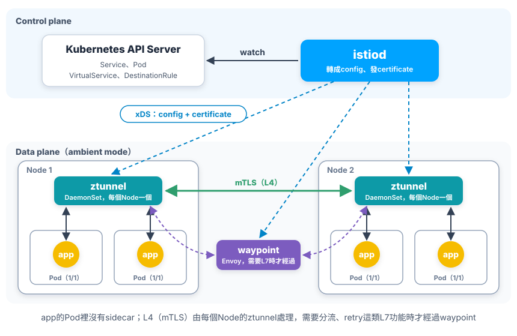
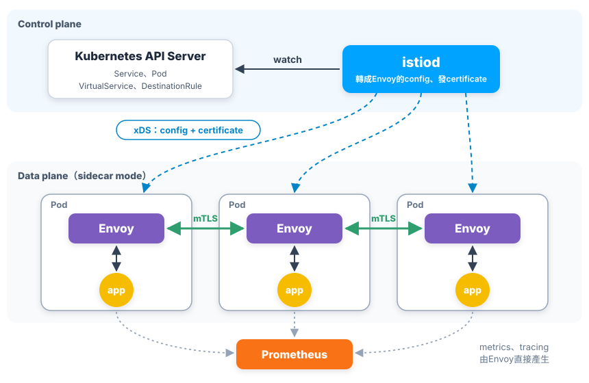
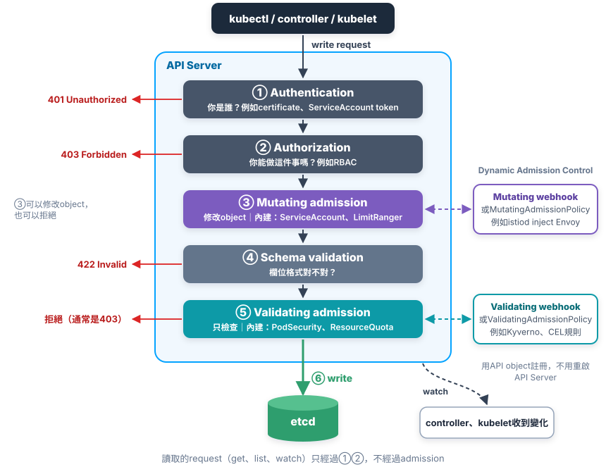
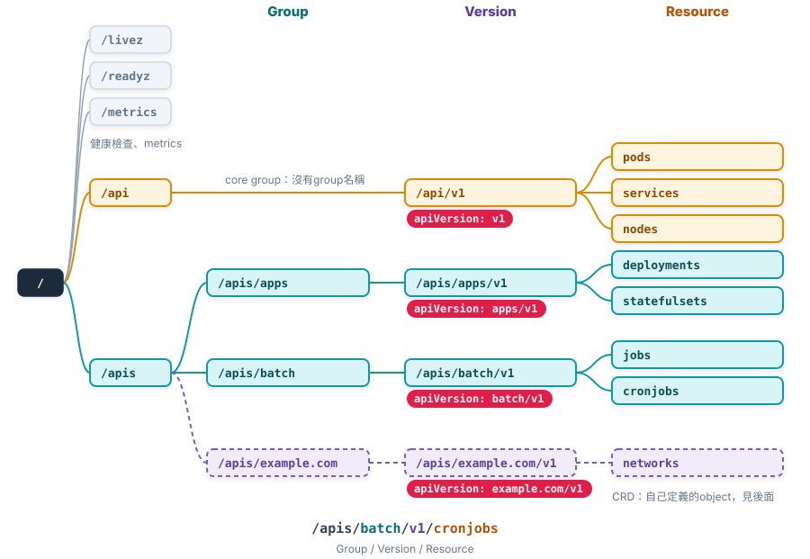
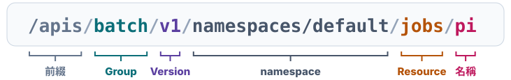
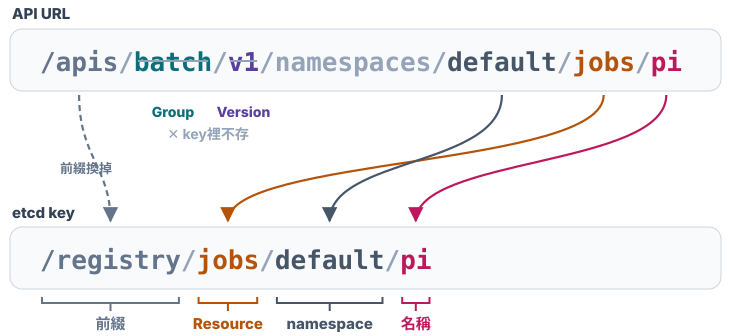

# Chap-6 Declarative API

**目錄**

- [命令式和聲明式](#命令式和聲明式)
- [用Istio理解聲明式API](#用istio理解聲明式api)
- [API Server怎麼處理request](#api-server怎麼處理request)
- [API object的組織方式](#api-object的組織方式)
- [RBAC](#rbac)

## 命令式和聲明式

*同樣是寫YAML，怎樣才算「聲明式API」？*

[Chap-3](chap-3-kubernetes-architecture-operations.md#聲明式api)說過，Kubernetes的API是***聲明式***的：只描述想要的狀態，交給[controller](chap-5-container-orchestration-controller.md#控制器模式)去達成。但用了YAML，不代表就是聲明式。管理同一個Deployment，`kubectl`有三種做法：

### ⌨️ 1. 命令式命令：參數寫在命令列

```bash
kubectl create deployment nginx --image=nginx:1.27 --replicas=2
kubectl set image deployment/nginx nginx=nginx:1.28
```

每一行都是一個***動作***：「建立」、「把image改成1.28」。要做什麼、怎麼做，都寫在命令列上。

### 📝 2. 命令式配置文件：create + replace

把參數改寫在YAML裡：

<!-- hl: 17 -->

```yaml
apiVersion: apps/v1
kind: Deployment
metadata:
  name: nginx
spec:
  replicas: 2
  selector:
    matchLabels:
      app: nginx
  template:
    metadata:
      labels:
        app: nginx
    spec:
      containers:
        - name: nginx
          image: nginx:1.27
```

先建立，之後把`image`改成`nginx:1.28`，再用`replace`更新：

<!-- hl: 2 -->

```bash
kubectl create -f nginx.yaml
# 把nginx.yaml裡的image改成nginx:1.28
kubectl replace -f nginx.yaml
```

這種先`create`、再`replace`的做法，叫***命令式配置文件***操作。它和[命令式命令](#-1-命令式命令參數寫在命令列)***沒有本質上的差別***，只是把命令列的參數寫進了YAML：

- **還是在下動作**：`create`是「建立」，`replace`是「整個換掉」。
- **要自己知道object的狀態**：object已經存在時`create`會失敗，還不存在時`replace`會失敗，所以每次都要先判斷該用哪一個。

### ✅ 3. 聲明式：kubectl apply

那到底什麼才是聲明式API？答案是***`kubectl apply`***：

<!-- hl: 2 -->

```bash
kubectl apply -f nginx.yaml
# 把nginx.yaml裡的image改成nginx:1.28
kubectl apply -f nginx.yaml
```

- **建立和更新都是同一個指令**：不用管object存不存在，`apply`只負責把YAML裡寫的***期望狀態***交給API Server。
- **只描述「要什麼」，不描述「怎麼做」**：YAML寫的是「image要是`nginx:1.28`」，要建立還是更新、怎麼把Pod換成新版本，交給API Server和controller決定。

| 做法             | 指令                                                                                                      | 你告訴Kubernetes的是                            |
| ---------------- | --------------------------------------------------------------------------------------------------------- | ----------------------------------------------- |
| **命令式** | `kubectl create deployment`、`kubectl set image`、<br />`kubectl create -f`、`kubectl replace -f` | ***動作***<br />參數在命令列或 -f YAML |
| **聲明式** | `kubectl apply -f`                                                                                      | ***期望狀態***                          |

### 🔀 4. replace和apply的差別：PUT和PATCH

兩個指令都能更新object，但送給API Server的request不一樣：

|                          | `kubectl replace`                                      | `kubectl apply`                                                        |
| ------------------------ | -------------------------------------------------------- | ------------------------------------------------------------------------ |
| **HTTP**           | `PUT`                                                  | `PATCH`                                                                |
| **做什麼**         | 用YAML裡的object<br />***整個換掉***原本的object | 只改YAML裡***有寫的欄位***<br />和原本的object***合併*** |
| **別人改過的欄位** | 不在YAML裡就被蓋掉                                       | 保留                                                                     |
| **多人同時修改**   | ❌ 會互相覆蓋<br />YAML帶著舊版本時回`409 Conflict`    | ✅ 各改各的欄位、自動合併                                                |

簡單說：***`apply`允許多個writer同時修改同一個object，並且具備merge能力***；`replace`則會互相覆蓋。

`kubectl set image`、`kubectl edit`、`kubectl scale`也是send `PATCH` request，只改指定的欄位，**PATCH不會動到別人改過的其他欄位**。但***用`PATCH`不代表就是聲明式***：這些指令是當下下的一個[動作](#-1-命令式命令參數寫在命令列)（「把image改成1.28」「把`replicas`改成5」），**改完沒有留下描述期望狀態的YAML。之後有人用舊的YAML再`apply`，這些修改就會被改回去**。

> [!TIP]
> 用HPA的Deployment，YAML裡***不要寫`replicas`***。否則每次`apply`都會把HPA調好的數量改回YAML裡的值。

> [!TIP]
> 💡 **聲明式API的三個特點**
>
> 1. **提交的是期望狀態**：只要提交一個定義好的API object，「聲明」想要的狀態，不描述怎麼做。
> 2. **允許多個writer**：使用者、HPA、各種controller都可以用`PATCH`修改同一個object，**不需要知道別人local的YAML長什麼樣子**，各改各的欄位，由API Server合併。這讓HPA、Istio、各種Operator這些**互不認識的controller**，可以同時修改同一個object而不會互相覆蓋，是Kubernetes能一直***疊加***新功能的前提。
> 3. **controller能自動reconcile**：有了前兩點，controller只要對API object做增、刪、改、查，就能在**不需要外界介入**的情況下，持續把實際狀態調整成期望狀態，見[控制循環](chap-5-container-orchestration-controller.md#-2-控制循環)。
>
> 所以，***聲明式API是Kubernetes編排能力的核心***。

### 🧑‍💻 5. Kubernetes編程範式

有了聲明式API，要在Kubernetes上加入自己的功能，做法都一樣：

> **用[控制器模式](chap-5-container-orchestration-controller.md#控制器模式)，對Kubernetes裡API object做增、刪、改、查，完成自己的業務邏輯。**

這就是***Kubernetes編程範式***。Kubernetes內建的功能，和開源社群在它上面做的擴充，都照這個方式寫：

| 例子                                              | 監看什麼object                         | 做什麼                                                                                                            |
| ------------------------------------------------- | -------------------------------------- | ----------------------------------------------------------------------------------------------------------------- |
| **Deployment controller**                   | Deployment、ReplicaSet                 | 建立和調整ReplicaSet，完成rolling update                                                                          |
| **[Istio（istiod）](#用istio理解聲明式api)** | VirtualService、DestinationRule（CRD） | 把流量規則traffic rule轉成Envoy的config，push到每個Pod的sidecar（*例如canary release時，90%流量給v1、10%給v2*） |
| **cert-manager**                            | Certificate（CRD）                     | 自動向CA申請TLS certificate，快到期時自動更新                                                                     |
| **Operator**                                | 自己定義的object（CRD）                | 例如`kind: MySQLCluster`，自動建立StatefulSet、做備份、failover                                                 |

使用者只要寫YAML聲明期望狀態，剩下的交給這些controller。

從「**用Kubernetes deploy程式**」，到「**用Kubernetes寫程式**」，關鍵就在理解這個範式：

1. **自訂API object**：用CRD（CustomResourceDefinition）定義新的`kind`，例如`MySQLCluster`。
2. **自訂controller**：監看這些object，用控制循環把期望狀態變成實際狀態。

這兩者合起來就是***Operator***，也是這一章後面的內容。

## 用Istio理解聲明式API

*一個不用改程式、就能控制所有微服務流量的系統，怎麼建立在聲明式API上？*

### 🕸️ 1. Istio是什麼

Istio是一個***Service Mesh***：不用改app的程式，就能替cluster裡的微服務加上**流量控制**（例如canary release、retry、timeout）、**服務之間的mTLS，以及metrics和tracing**。

> [!NOTE]
> Istio的核心是***一層由proxy組成的網格***：app之間的流量都經過proxy，由istiod統一push config給它們。sidecar mode下，proxy是每個Pod裡的Envoy sidecar；ambient mode下，proxy是每個Node上的ztunnel，需要L7功能時再經過waypoint。
>
> 這就是Service Mesh的意思：***把服務之間的通訊，例如路由、mTLS、retry、metrics，從app裡拿出來，交給這層proxy處理***，app的程式不用改。

Istio有兩種模式：

1）**每個Node**上放一個ztunnel DaemonSet的**ambient mode**。

2）**每個Pod**裡放一個Envoy的**sidecar mode**。

兩者的差別在***網絡******proxy放在哪裡***：

|                              | ambient mode                                                                                                    | sidecar mode                                                             |
| ---------------------------- | --------------------------------------------------------------------------------------------------------------- | ------------------------------------------------------------------------ |
| **proxy放在哪**        | ***每個Node***上一個ztunnel<br />（[DaemonSet](chap-5-container-orchestration-controller.md#daemonset)） | ***每個Pod***裡一個Envoy<br /> (sidecar)                         |
| **100個Pod、10個Node** | 10個ztunnel                                                                                                     | 100個Envoy                                                               |
| **app的Pod數量**       | 只有app一個container<br />（READY`1/1`）                                                                      | 多inject一個Envoy sidecar container<br />共兩個container（READY`2/2`） |
| **L7功能（例如分流）** | 需要時才部署waypoint proxy<br />（一個跑Envoy的Deployment）                                                     | 每個Envoy都能做                                                          |

> [!TIP]
> `1/1`、`2/2`是`kubectl get pods`輸出裡READY欄的值：***ready的container數 / Pod裡container的總數***。例如`1/1`是Pod裡有1個container，1個ready；`2/2`是app加上Envoy共2個container，2個都ready。

**ambient mode**的架構如下，Pod裡沒有sidecar：



sidecar mode架構如下。這一節用**sidecar mode說明**，因為它最能看出聲明式API的作用。



- **Control plane**：istiod，watch Kubernetes的object，轉成Envoy看得懂的config和certificate。
- **Data plane**：Envoy，每個Pod裡一個網絡proxy，app的進出流量都經過它。
- **xDS**：Envoy定義的**一組config API**。control plane（istiod）透過這組API，把config push給Envoy。每個Envoy啟動時**主動連到istiod**，建立一條gRPC長連線；之後istiod有新的config，就從這條連線push下來，Envoy不需要reload。

> [!NOTE]
> **xDS**是「x Discovery Service」的縮寫，x代表「某一種」config，例如**RDS** push路由規則、**SDS** push certificate等等。

### 🔀 2. Envoy怎麼接管Pod的流量

Pod裡的container***共用同一個network namespace***（見[Chap-4](chap-4-container-orchestration-pod.md#-1-共用network-namespace的結果)），所以只要改這個network namespace的iptables規則，就能讓app的流量都先經過Envoy：

- **規則做什麼**：app的outbound流量，轉到Envoy的port 15001；inbound流量，轉到port 15006；Envoy自己的outbound流量（UID 1337）不轉，避免繞圈。
- **誰設定iptables**：不是Envoy，也不是使用者。***sidecar mode下***有兩種方式：
  - ***init container `istio-init`***：和Envoy一起，由[sidecar injection](#-3-sidecar怎麼自動加進pod)自動加進Pod。它在app啟動前執行`istio-iptables`程式寫好規則，然後結束。改iptables需要`NET_ADMIN`（Linux改網路設定的capability）權限，所以每個Pod裡都多了一個高權限的container。很多cluster用Pod Security Admission限制Pod的權限，`baseline`以上的等級不允許`NET_ADMIN`，這種Pod會直接被拒絕。
  - ***Istio CNI plugin***：安裝Istio時部署的DaemonSet，在每個Node上加一個CNI plugin。建立Pod網路時就把規則寫好，Pod裡不需要高權限的init container，官方建議用這種。

要注意，這裡的兩種方式，和[第1節](#-1-istio是什麼)的兩種模式是***不同層次***的選擇：

| 層次                                             | 選項                              | 決定什麼                                                                                                      |
| ------------------------------------------------ | --------------------------------- | ------------------------------------------------------------------------------------------------------------- |
| **第一層：data plane用哪種模式**           | ambient mode / sidecar mode       | proxy放在哪裡：<br />**每個Node一個ztunnel**，還是**每個Pod一個Envoy**                            |
| **第二層：sidecar mode下，誰設定iptables** | `istio-init` / Istio CNI plugin | 把流量導到Envoy的iptables規則:<br />由**Pod裡的init container**寫，還是由**Node上的CNI plugin**寫 |

> [!NOTE]
> Istio CNI和ambient mode的ztunnel都是每個Node一個的DaemonSet，但角色不同：Istio CNI只在建立Pod網路時***設定iptables規則***，不處理流量；ztunnel是***真正處理流量***的proxy。ambient mode也需要Istio CNI，用它把Pod的流量導到ztunnel。

例如app要呼叫另一個叫`reviews`的服務（Service名稱是`reviews`，port 9080），程式裡照樣連`reviews:9080`，完全不知道Envoy的存在；但outbound流量已經先被iptables導到Envoy，由Envoy決定送到哪個Pod，並加上mTLS。這就是[Chap-4的sidecar](chap-4-container-orchestration-pod.md#-2-sidecar和app一起執行)設計思路。

### 💉 3. sidecar怎麼自動加進Pod

替namespace加上label，之後在這個namespace建立的Pod都會自動inject Envoy：

<!-- hl: 1 -->

```bash
kubectl label namespace default istio-injection=enabled
kubectl apply -f reviews-v1.yaml             # YAML裡只有一個container
kubectl get pods
# → NAME                          READY   STATUS    RESTARTS   AGE
#   reviews-v1-6b8f9c7d4-x2kqp    2/2     Running   0          20s

kubectl get pod reviews-v1-6b8f9c7d4-x2kqp -o jsonpath='{.spec.containers[*].name}'
# → reviews istio-proxy
```

你的YAML只寫了一個container，實際的Pod卻有兩個（`READY 2/2`），多出來的`istio-proxy`就是Envoy。它是這樣加進去的：

1. **Send request**：ReplicaSet controller照Pod template，send一個建立Pod的request。
2. **呼叫webhook**：API Server把Pod對象寫進etcd***之前***，先呼叫Istio註冊的***Mutating Admission Webhook***，見後面的[Dynamic Admission Control](#-2-admission-control內建的和dynamic的)。
3. **Return patch**：webhook看到這個namespace有`istio-injection=enabled` label，要inject Envoy sidecar，就return一個patch給API Server：「加上`istio-proxy` container（以及`istio-init`）」。然後API Server套用patch，繼續後面的validation。完整的流程見後面的[API Server怎麼處理request](#api-server怎麼處理request)。

   ```
   request進來 → authentication → authorization
             → mutating admission（呼叫Istio webhook，套用patch）
             → schema驗證 → validating admission
             → write到etcd
   ```
4. **Write**：通過validation後，把修改後的Pod寫進etcd。

這正是[聲明式API的特點](#-4-replace和apply的差別put和patch)：***你聲明的object，可以被另一個writer合併修改***。Deployment的YAML裡還是只有一個container，只有實際建立的Pod多了Envoy；你之後再`apply`，也不會把Envoy蓋掉。

### 🎯 4. 用聲明式API控制流量

Traffic rule流量規則也可以使用API object定義。例如同一個app有舊版v1和新版v2，Pod的label分別是`version: v1`、`version: v2`，想讓90%流量給v1、10%給v2。

**Pod的`version` label從哪裡來**：部署兩個Deployment，Pod模板裡的`app`相同、`version`不同。app不知道，也不需要知道這個label：

<!-- hl: 7 10 | hl2: 14 -->

```yaml
apiVersion: apps/v1
kind: Deployment
metadata:
  name: reviews-v1
spec:
  selector:
    matchLabels: { app: reviews, version: v1 }  # 新版的Deployment寫version: v2
  template:
    metadata:
      labels: { app: reviews, version: v1 }     # 新版的Deployment寫version: v2
    spec:
      containers:
        - name: reviews
          image: example/reviews:1.0            # 新版用2.0
```

Deployment裡不會寫Service；Service是用`selector`找出***身上有對應label的Pod***，見[Chap-5的Service](chap-5-container-orchestration-controller.md#-1-什麼是service一組pod的固定入口)。這裡的Service只寫`app`：

<!-- hl: 6 -->

```yaml
apiVersion: v1
kind: Service
metadata:
  name: reviews
spec:
  selector: { app: reviews }    # 沒有version，v1、v2的Pod都選到
  ports:
    - port: 9080
```

- **Service只看`app`**：v1、v2的Pod都在`reviews` Service後面。只用Service的話，流量平均分給每個Pod，兩版的比例由Pod數量決定。
- **`version`給Istio看**：下面的DestinationRule用`version`把同一個Service後面的Pod再分成兩組。

先用***DestinationRule***，**依`version` label把Pod分成兩組（subset）：**

<!-- hl: 8 11 | hl2: 6 -->

```yaml
apiVersion: networking.istio.io/v1
kind: DestinationRule
metadata:
  name: reviews         # DestinationRule自己的名字
spec:
  host: reviews         # Service的名稱：分組的是這個Service背後的Pod
  subsets:
    - name: v1          # subset的名稱，VirtualService用它
      labels:
        version: v1     # 帶version: v1 label的Pod
    - name: v2          # subset的名稱，VirtualService用它
      labels:
        version: v2
```

再用***VirtualService***，**規定每組分到多少流量：**

<!-- hl: 13 17 -->

```yaml
apiVersion: networking.istio.io/v1
kind: VirtualService
metadata:
  name: reviews
spec:
  hosts:
    - reviews                 # 呼叫reviews這個Service時套用
  http:
    - route:
        - destination:
            host: reviews     # Service的名稱
            subset: v1        # DestinationRule裡的subset
          weight: 90          # 90%給v1
        - destination:
            host: reviews
            subset: v2
          weight: 10          # 10%給v2
```

- **istiod是controller**：watch到***DestinationRule***和***VirtualService***這兩個object，轉成config push給每個Envoy。
- **比例和Pod數量無關**：只用Kubernetes的Service的話，流量平均分給所有Pod，比例只能靠Pod數量去湊。
- **要逐步切換到新版**：只要改`weight`，再`kubectl apply`。

> [!TIP]
> 💡 **一句話總結**
>
> ***Istio從頭到尾都建立在聲明式API上***：sidecar是Admission Webhook對Pod object的修改，流量規則traffic rule是CRD，istiod是watch這些object的controller。使用者只要聲明期望狀態，剩下的交給Istio。

## API Server怎麼處理request

*執行`kubectl apply`時，YAML從進到API Server到write進etcd，中間經過了哪些關卡？*

### 🚦 1. 處理流程

Kubernetes裡所有元件都透過API Server讀寫object：不管是你用**kubectl**或者**controller**自動建立Pod；還是**kubelet**回報Pod的狀態，都是send request給API Server。每個write object的request，都會照同一個順序經過這幾關：



| 步驟                              | 做什麼                                         | 例子                                                                             |
| --------------------------------- | ---------------------------------------------- | -------------------------------------------------------------------------------- |
| **① Authentication**       | 確認request是誰送的                            | client certificate、ServiceAccount的token                                        |
| **② Authorization**        | 確認這個身分能不能對這個resource做這個動作     | [RBAC](#rbac)：Role / RoleBinding                                                         |
| **③ Mutating admission**   | ***修改***object                       | `ServiceAccount` admission controller替Pod加上token volume；Istio inject Envoy |
| **④ Schema validation**    | 檢查欄位型別、必填欄位                         | `replicas`寫成字串就失敗                                                       |
| **⑤ Validating admission** | ***只檢查、不修改***，不符合規定就拒絕 | `PodSecurity`拒絕高權限的Pod；`ResourceQuota`拒絕超過配額的request           |
| **⑥ Write**                | 存進etcd                                       |                                                                                  |

- **① AuthN ② AuthZ**：[Chap-8的ServiceAccountToken](chap-8-volume.md#-6-serviceaccounttokenpod怎麼存取api-server)用curl實際跑過一次：token負責① AuthN，RBAC負責② AuthZ。
- **③ mutating在 ⑤ validating之前**：③ mutating可以看成***input/pre hook***：拿到送進來的原始object，可以修改它；⑤ validating 可以看成***output/post hook***：檢查改完之後、準備write進etcd的最終object，只能放行或拒絕。
- **讀取的request**（`get`、`list`、`watch`）只經過① AuthN ② AuthZ，不經過admission。

### 🧩 2. Admission Control：內建的和Dynamic的

[處理流程](#-1-處理流程)裡的③和⑤這兩關，叫***Admission Control***。執行它們的程式有兩種來源：

|                    | 內建的admission controller                                              | Dynamic Admission Control                                       |
| ------------------ | ----------------------------------------------------------------------- | --------------------------------------------------------------- |
| **例子**     | `LimitRanger`、`ServiceAccount`、`PodSecurity`、`ResourceQuota` | Istio的sidecar injector、cert-manager、Kyverno這類policy engine |
| **程式在哪** | 編譯在API Server裡面                                                    | 外部的webhook server，或寫在API object裡的CEL規則               |
| **怎麼開啟** | API Server的參數`--enable-admission-plugins`，改了要重啟API Server    | ***建立一個API object***就註冊好了，不用重啟            |

> [!NOTE]
> 表裡的***Kyverno***是CNCF的**policy engine**：用YAML寫規則（`ClusterPolicy`這個CRD），例如「image不能用`latest` tag」「Pod一定要設`resources.limits`」，再由它的admission webhook在③、⑤檢查或修改object。

「Dynamic」指的就是第二種： ***不改API Server、不重啟，用API object動態註冊***自己的admission邏輯。註冊這件事本身也是聲明式的。

Dynamic Admission Control有兩類：

| 種類                                                                        | 修改                     | 檢查                       |
| --------------------------------------------------------------------------- | ------------------------ | -------------------------- |
| **Admission webhook**：呼叫外部的webhook server                       | MutatingAdmissionWebhook | ValidatingAdmissionWebhook |
| **Admission policy**：在API object裡用CEL寫規則，由API Server自己執行 | MutatingAdmissionPolicy  | ValidatingAdmissionPolicy  |

> [!NOTE]
> ***CEL***（Common Expression Language）是Google設計的運算式語言，只能寫判斷式、不能寫迴圈，所以執行快、不會卡住API Server，適合直接在API Server裡執行。例如`object.spec.replicas <= 5`，見[ValidatingAdmissionPolicy](#-4-validatingadmissionpolicy不用架webhook)。Kubernetes其他地方也用它，例如CRD的欄位驗證規則。

### 🪝 3. Admission webhook：以Istio為例

Istio是一個Service Mesh，會自動在每個Pod裡加上一個Envoy proxy，完整的說明見前面的[用Istio理解聲明式API](#用istio理解聲明式api)。這裡看它怎麼用admission webhook做到這件事。

[Istio的sidecar injection](#-3-sidecar怎麼自動加進pod)，就是用一個`MutatingWebhookConfiguration`註冊的（簡化過）：

<!-- hl: 7 8 9 10 11 12 13 14 15 16 -->

```yaml
apiVersion: admissionregistration.k8s.io/v1
kind: MutatingWebhookConfiguration
metadata:
  name: istio-sidecar-injector
webhooks:
  - name: sidecar-injector.istio.io
    clientConfig:
      service:                          # webhook server：istiod
        name: istiod
        namespace: istio-system
        path: /inject
    rules:                              # 只處理建立Pod
      - operations: ["CREATE"]
        apiGroups: [""]
        apiVersions: ["v1"]
        resources: ["pods"]
    namespaceSelector:                  # 只處理有這個label的namespace
      matchLabels:
        istio-injection: enabled
    failurePolicy: Fail
```

- **`clientConfig`**：API Server要呼叫誰。這裡是istiod的`/inject`。
- **`rules`、`namespaceSelector`**：哪些request才呼叫。只有在有`istio-injection: enabled`的namespace裡***建立Pod***時才呼叫，其他request完全不經過webhook。
- **`failurePolicy`**：webhook沒回應時怎麼辦。`Fail`是拒絕request，`Ignore`是跳過webhook、照常建立。

API Server把整個Pod包成一個`AdmissionReview` send給webhook；webhook return的response裡，帶著一個JSON Patch：

```json
{
  "apiVersion": "admission.k8s.io/v1",
  "kind": "AdmissionReview",
  "response": {
    "uid": "<和request相同的uid>",
    "allowed": true,
    "patchType": "JSONPatch",
    "patch": "<base64編碼的JSON Patch>"
  }
}
```

`patch`解碼後，就是「在`spec.containers`加上`istio-proxy`」這類操作：

```json
[
  { "op": "add", "path": "/spec/containers/-", "value": { "name": "istio-proxy", "...": "..." } },
  { "op": "add", "path": "/spec/initContainers/-", "value": { "name": "istio-init", "...": "..." } }
]
```

Validating webhook也一樣，只是response裡不帶`patch`，用`allowed: false`加上原因來拒絕。

**為什麼不會重複觸發**：

- 一個request只經過一次admission。⑥ write是同一個request的最後一步，不是新的request。
- `rules`只處理`CREATE`。Pod之後的更新，例如kubelet回報status，都是`UPDATE`，不會再呼叫。
- 有多個mutating webhook時，API Server可能把前面的webhook再呼叫一次。原因是mutating webhook的***執行順序沒有保證***，後面的webhook可能新加了東西，例如一個container，而前面的webhook執行時還看不到它。所以webhook必須***idempotent***：Istio會先檢查Pod裡是不是已經有`istio-proxy`，有的話就不改。

webhook的處理邏輯大致如下（虛擬碼）。和controller不同，webhook***沒有控制循環***：API Server收到request時才呼叫它，它return patch後就結束了。

<!-- hl: 4 5 -->

```go
// API Server呼叫webhook時才執行，不是迴圈
func handleAdmission(review AdmissionReview) AdmissionResponse {
    pod := review.Request.Object
    if hasContainer(pod, "istio-proxy") {   // 已經有sidecar：不改（idempotent）
        return allow()
    }
    patch := renderTemplate(pod)             // 用ConfigMap istio-sidecar-injector裡的template
    return allowWithPatch(patch)             // 交給API Server套用
}
```

### 📏 4. ValidatingAdmissionPolicy：不用架webhook

很多檢查其實很簡單，例如「`replicas`不能超過5」。為了這種規則架一個webhook server，還要管它的高可用和certificate，成本太高。***ValidatingAdmissionPolicy***讓你直接在API object裡用CEL寫規則，由API Server自己執行：

<!-- hl: 13 14 15 -->

```yaml
apiVersion: admissionregistration.k8s.io/v1
kind: ValidatingAdmissionPolicy
metadata:
  name: max-replicas
spec:
  failurePolicy: Fail
  matchConstraints:
    resourceRules:
      - apiGroups: ["apps"]
        apiVersions: ["v1"]
        operations: ["CREATE", "UPDATE"]
        resources: ["deployments"]
  validations:
    - expression: "object.spec.replicas <= 5"
      message: "replicas不能超過5"
```

```yaml
apiVersion: admissionregistration.k8s.io/v1
kind: ValidatingAdmissionPolicyBinding
metadata:
  name: max-replicas
spec:
  policyName: max-replicas
  validationActions: ["Deny"]
```

- **Policy**：規則本身，`expression`是CEL，`object`就是送進來的Deployment。
- **Binding**：決定這個規則套用到哪裡、違反時怎麼處理。`Deny`是拒絕；也可以用`Warn`只警告，或`Audit`只記錄。

```bash
kubectl scale deployment nginx --replicas=10
# → error: ... ValidatingAdmissionPolicy 'max-replicas' with binding 'max-replicas'
#   denied request: replicas不能超過5
```

***MutatingAdmissionPolicy***是同樣的想法，用CEL寫修改規則，是比較新的功能。複雜的修改，例如Istio要依很多設定組出整個Envoy container，還是用webhook。

> [!TIP]
> 💡 **一句話總結**
>
> ***每個write request都照同一個流程：authentication → authorization → mutating admission → schema validation → validating admission → write到etcd***。Admission Control是在write之前插入自己邏輯的地方；用webhook或CEL policy，透過API object動態註冊，不用改API Server。

## API object的組織方式

*Kubernetes裡有這麼多種object，API Server怎麼找到你要的那一個？*

### 🗂️ 1. Group、Version、Resource

API Server用三個部分定位一種API object：

| 部分               | 意思                       | 例子                                       |
| ------------------ | -------------------------- | ------------------------------------------ |
| **Group**    | 這類object屬於哪個功能群組 | `apps`、`batch`、`networking.k8s.io` |
| **Version**  | API的版本                  | `v1`、`v1beta1`                        |
| **Resource** | object的種類，用複數小寫   | `deployments`、`jobs`、`pods`        |

YAML開頭的`apiVersion: apps/v1`就是***Group/Version***，`kind: Deployment`對應的***Resource***是`deployments`。

> [!TIP]
> ***Kind和Resource不一樣***：Kind是object的型別，寫在YAML的`kind`裡，單數、大寫開頭，例如`Deployment`；Resource是URL裡的名字，複數小寫，例如`deployments`。

所有API object按這三層組織成一棵樹：



從這棵樹可以看出，API object的組織方式是***一層一層往下分***的：先分group，再分version，最後才是resource。

| Group                              | URL路徑                  | apiVersion         | object                                                                                  |
| ---------------------------------- | ------------------------ | ------------------ | --------------------------------------------------------------------------------------- |
| **core**<br />（沒有名稱）   | `/api/v1`              | `v1`             | Pod、Service、Node等最早就有的object                                                    |
| **apps**                     | `/apis/apps/v1`        | `apps/v1`        | Deployment、ReplicaSet、StatefulSet、DaemonSet、ControllerRevision：管理Pod的controller |
| **batch**                    | `/apis/batch/v1`       | `batch/v1`       | Job、CronJob：batch job                                                                 |
| **example.com**<br />（CRD） | `/apis/example.com/v1` | `example.com/v1` | 自己定義的object，例如`kind: Network`，Resource是`networks`                         |

- **core group**：沒有group名稱，所以URL走`/api`，YAML裡只寫version：`apiVersion: <version>`<version></version>
- **其他group**：URL是`/apis/<group>/<version>`，YAML是`apiVersion: <group>/<version>`。group有兩種：apps或者batch。
- **CRD也掛在這棵樹上**：和內建object走同一套規則。

### 🔗 2. 完整的URL

找到resource之後，再加上namespace和名稱，就是一個object完整的URL，例如：



kubectl的每個命令，背後都是對這種URL send一個HTTP request。例如`kubectl get job pi -n default`，就是`GET`上面這個URL，拿回`pi`這個Job。

URL少寫後面幾段，範圍就變大；同樣用`GET`：

| kubectl命令                       | HTTP request                                      | 拿到什麼                                              |
| --------------------------------- | ------------------------------------------------- | ----------------------------------------------------- |
| `kubectl get job pi -n default` | `GET /apis/batch/v1/namespaces/default/jobs/pi` | `pi`這個Job                                         |
| `kubectl get jobs -n default`   | `GET /apis/batch/v1/namespaces/default/jobs`    | 不帶名稱：這個namespace裡所有的Job                    |
| `kubectl get jobs -A`           | `GET /apis/batch/v1/jobs`                       | 不帶namespace：所有namespace的Job                     |
| `kubectl get jobs -A -w`        | `GET /apis/batch/v1/jobs?watch=true`            | watch：連線不斷開，有變化時API Server持續push給client |

建立、修改、刪除也是同一個URL，只是HTTP method不同：`kubectl create`是`POST`（URL不帶名稱），`kubectl replace`是`PUT`，`kubectl apply`、`kubectl edit`是`PATCH`，`kubectl delete`是`DELETE`。

### 🧭 3. API Server怎麼找到CronJob

例如建立一個CronJob，YAML開頭這樣寫：

```yaml
apiVersion: batch/v1
kind: CronJob
```

- **`batch`是Group，`v1`是Version**：兩個合起來寫在`apiVersion`裡。
- **`CronJob`是Kind，不是Resource**：Kind是object的型別，寫在YAML裡；Resource是URL裡的名字，複數小寫，也就是`cronjobs`。


這張圖和[API Server怎麼處理request](#api-server怎麼處理request)的流程圖是***同一個request***：那張圖展開的是admission的各個關卡，這張圖展開的是***路由和version轉換***。右邊並列的那一欄，用①～⑥標出每一步對應那張圖的哪一關。

1. **kubectl組出URL**：kubectl先把YAML轉成JSON，再向API Server查詢（discovery）`batch/v1`裡`CronJob`對應的Resource是`cronjobs`，組出`POST /apis/batch/v1/namespaces/default/cronjobs`。
2. **A. Filters**：限流（APF）、authentication、audit、authorization，對應那張圖的①②。
3. **B. 依URL找handler**：先看是`/api`還是`/apis`。core group沒有group名稱，走`/api`；CronJob不是core object，所以走`/apis`，再依序比對`batch`、`v1`、`cronjobs`，找到處理CronJob的handler。
4. **C. Handler**：把JSON decode成object，再經過admission和validation，見[API Server怎麼處理request](#api-server怎麼處理request)。
5. **D. Encode，write到etcd**：轉成storage version，以protobuf存進etcd。

**同一個object有好幾個version**：<a id="multi-version"></a>一種object可以同時提供好幾個version，例如某個object從`v1beta1`升到`v1`的過渡期間，兩個版本都能用。API Server內部會在三種version之間轉換：

| version                        | 格式                                                                 | 是什麼                                                                                               |
| ------------------------------ | -------------------------------------------------------------------- | ---------------------------------------------------------------------------------------------------- |
| **request<br />version** | JSON<br /><span style="white-space: nowrap">（HTTP body）</span>     | client送來的，例如`batch/v1`。kubectl會把YAML轉成JSON再送出                                        |
| **internal version**     | Go struct                                                            | 只存在API Server的mem裡。不管request是哪個version，decode後都先轉成它，admission和validation都對它做 |
| **storage version**      | protobuf<br /><span style="white-space: nowrap">（CRD用JSON）</span> | 實際存進etcd的version，***只有一個***。client之後用其他version讀，再由API Server當場轉換     |

這樣升級version時，舊的client照樣能用舊version send request，達到向後相容。

### 💾 4. etcd裡的key：和URL不一樣

URL是給client用的。object實際存在etcd裡時，key是另一種格式：



- **沒有version**：同一個object在etcd裡***只存一份***，用storage version存，見[上一節](#-3-api-server怎麼找到cronjob)。
- **內建object沒有group**：格式是`/registry/<resource>/<namespace>/<name>`。CRD的key才會帶group，例如`/registry/example.com/networks/default/my-net`。

### 🔍 5. 用kubectl查詢API的結構

上面的group、version、resource和URL，都可以在cluster裡直接查到：

```bash
kubectl api-resources                                       # 每個resource屬於哪個group / version
kubectl get --raw /apis | jq '.groups[].name'               # 列出所有group
kubectl get --raw /apis/batch/v1 | jq '.resources[].name'   # batch/v1下有哪些resource
kubectl get job pi -v=6                                     # 印出kubectl實際send的URL
```

> [!TIP]
> 💡 **一句話總結**
>
> ***API Server用Group、Version、Resource把所有object組織成一棵樹***。內建object的URL和etcd key都照這個規則，自己定義的object也掛在同一棵樹上，見[Chap-7的CRD和controller](chap-7-crd-operator.md#manualcrd和controller)。

## RBAC

*誰能對哪個object做什麼？*

[request流程](#api-server怎麼處理request)的② Authorization，在Kubernetes裡就是**RBAC**（Role-Based Access Control）。所有對API object的操作都要經過API Server，原因之一就是要由它來做授權。

### 🧩 1. 三個核心概念

- **Role**：一組規則，定義能對哪些API object做哪些動作。
- **Subject**：被授權的對象，可以是User、Group或ServiceAccount。
- **RoleBinding**：把Subject和Role綁在一起。

### 📜 2. Role和RoleBinding

```yaml
kind: Role
apiVersion: rbac.authorization.k8s.io/v1
metadata:
  namespace: mynamespace
  name: example-role
rules:
- apiGroups: [""]                   # ""是core group
  resources: ["pods"]
  verbs: ["get", "watch", "list"]
```

這條規則的意思是：被授權的對象，可以對`mynamespace`裡的Pod做`get`、`watch`、`list`。`apiGroups`、`resources`就是[Group、Version、Resource](#-1-groupversionresource)裡的group和resource。

- **namespace只是分組**：它把object分開管理，本身不會隔離network或資源。要隔離，得再搭配RBAC、NetworkPolicy、ResourceQuota。
- **可以細到單一object**：加上`resourceNames: ["my-config"]`，就只對名叫`my-config`的object有效。
- **verbs**：`get`、`list`、`watch`、`create`、`update`、`patch`、`delete`、`deletecollection`；`*`代表全部。

```yaml
kind: RoleBinding
apiVersion: rbac.authorization.k8s.io/v1
metadata:
  namespace: mynamespace
  name: example-rolebinding
subjects:                           # 綁給誰
- kind: User
  name: example-user
  apiGroup: rbac.authorization.k8s.io
roleRef:                            # 綁哪個Role
  kind: Role
  name: example-role
  apiGroup: rbac.authorization.k8s.io
```

- **User不是API object**：Kubernetes裡沒有User這種object，也不用建立。user的名字來自① Authentication，例如client certificate裡的CN、OIDC token裡的使用者。RBAC只看request帶來的這個名字。
- **Role和RoleBinding都是namespaced object**：只在自己的namespace裡有效。

### 🌐 3. ClusterRole和ClusterRoleBinding

不屬於任何namespace的object（例如Node），或是要對所有namespace生效時，就用ClusterRole和ClusterRoleBinding。寫法一樣，只是沒有`namespace`欄位。

| 組合 | 權限範圍 |
| --- | --- |
| **Role + RoleBinding** | 一個namespace |
| **ClusterRole + ClusterRoleBinding** | 整個cluster，包括所有namespace和Node這類object |
| **ClusterRole + RoleBinding** | 只在RoleBinding所在的namespace。***常用來重複使用同一份ClusterRole***，例如把`view`綁給某個namespace |

### 🤖 4. ServiceAccount：最常用的Subject

實務上很少直接用User，大多用**ServiceAccount**，也就是Kubernetes自己管理的身分。Pod怎麼拿到它的token、用curl存取API Server，見[Chap-8的ServiceAccountToken](chap-8-volume.md#-6-serviceaccounttokenpod怎麼存取api-server)。

```yaml
subjects:
- kind: ServiceAccount
  name: example-sa
  namespace: mynamespace
```

ServiceAccount在RBAC裡對應的名字，一定要記住：

| | 名字 |
| --- | --- |
| **user** | `system:serviceaccount:<namespace>:<name>` |
| **group**：某個namespace的所有ServiceAccount | `system:serviceaccounts:<namespace>` |
| **group**：整個cluster的所有ServiceAccount | `system:serviceaccounts` |

每個namespace都有一個`default` ServiceAccount，***預設沒有任何權限***。需要存取API Server時，只給最小權限。

檢查某個身分有沒有權限：

```bash
kubectl auth can-i list pods -n mynamespace \
  --as=system:serviceaccount:mynamespace:example-sa
# → yes
```

### 🏷️ 5. 內建的ClusterRole

`kubectl get clusterroles`會看到很多內建的ClusterRole：

- **`system:`開頭**：給Kubernetes元件用。例如`system:kube-scheduler`，綁給kube-scheduler用的身分，只包含scheduler需要的權限。
- **給使用者用的四個**：

| ClusterRole | 權限 |
| --- | --- |
| `cluster-admin` | 全部，`verbs: ["*"]`。***最高權限，要謹慎使用*** |
| `admin` | 一個namespace裡幾乎全部，包括管理RBAC |
| `edit` | 讀寫大部分object，但不能改RBAC |
| `view` | 唯讀，看不到Secret |

### 🧪 6. 練習：讓一個namespace的所有ServiceAccount都能唯讀

用RoleBinding把內建的`view`，綁給`mynamespace`裡的所有ServiceAccount：

```yaml
kind: RoleBinding
apiVersion: rbac.authorization.k8s.io/v1
metadata:
  namespace: mynamespace
  name: all-sa-view
subjects:
- kind: Group
  name: system:serviceaccounts:mynamespace
  apiGroup: rbac.authorization.k8s.io
roleRef:
  kind: ClusterRole                 # 引用ClusterRole，但權限只在mynamespace生效
  name: view
  apiGroup: rbac.authorization.k8s.io
```

> [!TIP]
> 💡 **一句話總結**
>
> ***Role是一組權限規則，RoleBinding把它綁給Subject***；Cluster版本的作用範圍是整個cluster。Subject最常用的是ServiceAccount，所以***Role + RoleBinding + ServiceAccount***是最需要掌握的組合。
