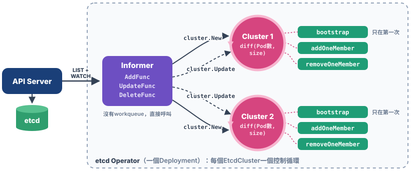

# Chap-7 CRD & Operator

**目錄**

- [CRD、controller和Operator](#crdcontroller和operator)
- [Manual：CRD和controller](#manualcrd和controller)
- [Auto：用kubebuilder產生](#auto用kubebuilder產生)
- [Operator](#operator)

## CRD、controller和Operator

*這一章的三個主角，是什麼關係？*


- **CRD**：讓API Server***認識一種新的object型別***，例如`Network`。它只負責「存」：之後建立的Network CR，只是etcd裡的一筆資料，見[建立Network](#-2-建立network)。**就像在餐廳的點餐系統上新增一道菜：之後客人就能點這道菜，但點了只是「下了單」，廚房還沒開始做**。
- **Controller**：watch這種object的變化，把實際狀態調整成`spec`寫的樣子，也就是[控制器模式](chap-5-container-orchestration-controller.md#控制器模式)。**它就是看單做菜的廚師：一直盯著新進來的單，把菜做成單上寫的樣子**。
- **Operator**：Operator = CRD+controller，而且controller裡寫的是***維運一個複雜app的知識***。例如DB的Operator，使用者只寫一個描述DB cluster的YAML，Operator就負責建立cluster、備份、failover、升級，見[Operator](#operator)。**它像一位主廚：研發新菜品（CRD），再把備料、做法、出問題時的補救方法教會廚師（controller）**。

所以[Manual：CRD和controller](#manualcrd和controller)裡的Network controller，其實就是一個最簡單的Operator；Operator和一般controller的差別，只在controller裡寫了多少維運知識。

> [!TIP]
> 💡 **一句話總結**
>
> ***CRD描述「要什麼」***；*把維運知識寫進controller，**controller負責「怎麼做到」***；***CRD+Controller就是Operator***。

## Manual：CRD和controller

*Kubernetes沒有的object型別，怎麼自己加？加了之後，誰來讓它真的做事？*

這一章要做的是：***寫一個Network YAML，cloud上就自動建好一個對應的subnet***；改YAML，subnet跟著更新；刪掉YAML，subnet也跟著刪掉。


以一個描述網路的`Network`為例，從零開始手寫，整體分成6步，每一步對應圖上的①～⑥：

1. **[寫CRD](#-1-crd讓api-server認識新的object型別)**：告訴API Server有`Network`這種object。
2. **[建立Network](#-2-建立network)**：用`kubectl`建立`my-net`，確認它存進etcd；但這時還沒有人讓它做事。
3. **[用Go定義Network型別](#-3-用go定義network型別)**：寫[doc.go](#-3a-docgo整個pkg共用的tag)、[types.go](#-3b-typesgonetwork的完整定義)、[register.go](#-3c-registergo註冊到scheme)。
4. **[產生client程式碼](#-4-產生client程式碼)**：用code-generator產生clientset、informer、lister。
5. **[寫controller](#-5-寫controller)**：了解Informer怎麼send change events給controller，再寫[main](#-5b-main啟動controller)、[NewController](#-5c-newcontroller註冊event-handler)、[Run](#-5d-run控制循環)，最後是真正的邏輯[syncHandler](#-5e-synchandler比較期望狀態和實際狀態)。
6. **[Run it!](#-6-run-it)**：建立、修改、刪除`my-net`，看controller怎麼反應。

開始之前，先建立project，產生`go.mod`：

```bash
mkdir network-controller && cd network-controller
go mod init github.com/<you>/network-controller   # 建立go.mod
```

> [!NOTE]
> **`github.com/<you>/network-controller`是什麼**
>
> - **module名稱**：這個Go module的名字，也是project裡每個pkg import路徑的開頭。
> - **`<you>`**：換成自己的GitHub帳號名稱，例如`github.com/megleet/network-controller`。
> - **不一定要放到GitHub**：習慣寫之後要放的repo網址，別人才能直接`go get`。
> - **前後要一致**：第4節產生程式碼時，`--output-pkg`的開頭也要用同一個名稱。

整個project的結構參考Kubernetes官方的範例[sample-controller](https://github.com/kubernetes/sample-controller)。***這些目錄和檔案都要自己建立***，每個檔案在哪一步寫，標在右邊。例外有兩個：

- **`go.mod`**：上面的`go mod init`已經產生了。
- **`pkg/generated/`**：第4節執行code-generator後才會出現，裡面的程式碼都是產生的，不用自己寫。

`hack/boilerplate.go.txt`只是一段license註解，可以直接從sample-controller複製。

```
network-controller/
├── go.mod                        <-- module名稱和deps，見第4節
├── main.go                       <-- 啟動controller，見第5.b節
├── controller.go                 <-- NewController、Run、syncHandler，見第5.c～5.e節
├── vpc.go                        <-- 模擬cloud的網路API，見第5.e節
├── hack/
│   ├── boilerplate.go.txt        <-- 產生的程式碼開頭要加的license註解
│   └── update-codegen.sh         <-- 執行code-generator，見第4節
├── crd/
│   └── network-crd.yaml          <-- CRD，見第1節
├── examples/
│   └── my-net.yaml               <-- CR，見第2節
└── pkg/
    ├── apis/
    │   └── example/              <-- group（example.com）
    │       └── v1/               <-- version
    │           ├── doc.go        <-- 整個pkg共用的tag，見第3.a節
    │           ├── register.go   <-- 註冊到scheme，見第3.c節
    │           └── types.go      <-- Network的Go定義，見第3.b節
    └── generated/                <-- code-generator產生，不用自己寫，見第4節
        ├── clientset/
        ├── informers/
        └── listers/
```

### 🧩 1. CRD：讓API Server認識新的object型別

[Chap-5](chap-5-container-orchestration-controller.md)看到的Deployment、Job、CronJob，都是Kubernetes**內建的object型別**，API Server的程式碼裡本來就有它們的定義。如果想要一種新的object型別，例如用來描述網路的`Network`，就用**CRD**（CustomResourceDefinition）告訴API Server。把下面的內容寫進`crd/network-crd.yaml`：

<!-- hl: 4 6 9 10 15 16 23 -->

```yaml
apiVersion: apiextensions.k8s.io/v1
kind: CustomResourceDefinition
metadata:
  name: networks.example.com        # 必須是<plural>.<group>
spec:
  group: example.com
  scope: Namespaced                 # 和Pod一樣屬於某個namespace
  names:
    kind: Network
    plural: networks
    singular: network
    shortNames: [net]               # list，目前只有一個簡稱net
  versions:
  - name: v1
    served: true                    # 這個version可以用來send request
    storage: true                   # 存進etcd時用這個version
    schema:
      openAPIV3Schema:
        type: object
        properties:
          spec:
            type: object
            required: [cidr, gateway]  # list：cidr和gateway都必填
            properties:
              cidr:
                type: string
              gateway:
                type: string
```

- **`group`、`version`、`plural`**：就是[Group、Version、Resource](chap-6-declarative-api.md#-1-groupversionresource)那三層。這個CRD會在樹上多長出`/apis/example.com/v1/networks`。
- **`served`和`storage`**：一個CRD可以同時有好幾個version，例如`v1`和`v2`。這兩個欄位管的是不同的事：

  - **`served: true`**：client可以用這個version讀寫，例如`/apis/example.com/v1/...`和`/apis/example.com/v2/...`都能用，***所以可以有好幾個***。
  - **`storage: true`**：etcd裡實際存成哪個version。一筆資料在etcd裡只存一份，***所以只能有一個***，也就是[storage version](chap-6-declarative-api.md#multi-version)。client用其他version讀寫時，API Server會把資料轉換成client要的version。
- **`schema`**：API Server在[④ Schema validation](chap-6-declarative-api.md#api-server怎麼處理request)用它檢查欄位。例如少了`cidr`，或型別不對，request會直接被擋下來。
- **`required: [cidr, gateway]`**：建立Network時，`spec`裡***一定要有***`cidr`和`gateway`，少一個都不行。`[cidr, gateway]`是YAML清單的簡寫，等於分兩行寫`- cidr`、`- gateway`。沒寫`required`的話，這兩個欄位都是選填，controller就要自己處理欄位是空的情況。

  ```bash
  kubectl apply -f examples/my-net.yaml   # spec裡漏寫gateway
  # → The Network "my-net" is invalid: spec.gateway: Required value
  ```

> [!NOTE]
> **CRD和CR**：CRD（CustomResourceDefinition）是***型別的定義***，像Go裡的`type Network struct`；依照這個定義建立的object叫CR（Custom Resource），像`Network{...}`這個var。

### 🌐 2. 建立Network

CRD建好之後，`Network`就和內建的object型別一樣，可以寫YAML、用`kubectl`操作。把下面的內容寫進`examples/my-net.yaml`：

```yaml
apiVersion: example.com/v1
kind: Network
metadata:
  name: my-net
spec:
  cidr: 192.168.0.0/16
  gateway: 192.168.0.1
```

建立CRD和CR，需要一個可以操作的cluster。用kind在local建一個***單節點***的cluster就夠了：CRD和CR只會寫進API Server和etcd；kind的介紹見[用kind在local建cluster](chap-3-kubernetes-architecture-operations.md#-用kind在local建cluster)。

```bash
kind create cluster --name demo
kubectl wait --for=condition=Ready nodes --all --timeout=120s   # 剛建好時節點是NotReady，等它變成Ready
```

```bash
kubectl apply -f crd/network-crd.yaml
kubectl get crd networks.example.com
kubectl apply -f examples/my-net.yaml
kubectl get net                       # shortNames生效
# → NAME     AGE
#   my-net   5s
kubectl get net my-net -v=6           # 看實際send的URL
# → "Response" verb="GET" url="https://.../apis/example.com/v1/namespaces/default/networks/my-net" status="200 OK"
```

- **`-v=6`**：印出kubectl實際send給API Server的HTTP request，見[Chap-6的用kubectl查詢API的結構](chap-6-declarative-api.md#-5-用kubectl查詢api的結構)。

它在etcd裡的key是`/registry/example.com/networks/default/my-net`，和[etcd裡的key](chap-6-declarative-api.md#-4-etcd裡的key和url不一樣)說的一樣：CRD的key帶group。

但現在的`my-net`***只是一筆存在etcd裡的資料***：沒有人去真的建立網路。CRD只負責「讓API Server認識這種object型別」，***要讓它真的做事，還需要一個controller***，見[Informer](#-5a-informercontroller怎麼知道network變了)。

### 🐹 3. 用Go定義Network型別

第1節的CRD是寫給API Server看的型別定義。controller是Go程式，從API Server拿到的Network是一段JSON，要先轉成Go object才能用，所以Go裡也要有一份同樣的型別定義：`type Network struct`。兩份定義的欄位要一致，例如CRD `schema`裡的`cidr`，對應Go struct裡的`Cidr`。

這一節寫`pkg/apis/example/v1/`底下的3個檔案。目錄名稱`example/`只是Go的pkg名稱，真正的group由`doc.go`的`+groupName`決定。

#### 📄 3.a `doc.go`：整個pkg共用的tag

整個pkg共用的設定，叫global tags：

```go
// +k8s:deepcopy-gen=package
// +groupName=example.com

package v1
```

- **`+k8s:deepcopy-gen=package`**：替這個pkg裡所有的型別產生`DeepCopy()`。
- **`+groupName`**：這個pkg對應的group。

#### 🧱 3.b `types.go`：Network的完整定義

`Network`的完整定義：

<!-- hl: 5 6 7 15 18 -->

```go
package v1

import metav1 "k8s.io/apimachinery/pkg/apis/meta/v1"

// +genclient
// +genclient:noStatus
// +k8s:deepcopy-gen:interfaces=k8s.io/apimachinery/pkg/runtime.Object

// Network describes a Network resource
type Network struct {
	metav1.TypeMeta   `json:",inline"`             // apiVersion、kind
	metav1.ObjectMeta `json:"metadata,omitempty"`  // 每個object自己的metadata，
	                                               // 例如name、namespace、labels

	Spec NetworkSpec `json:"spec"`                 // 期望狀態，見NetworkSpec
}

type NetworkSpec struct {
	Cidr    string `json:"cidr"`                   // 例如"10.0.0.0/16"
	Gateway string `json:"gateway"`                // 例如"10.0.0.1"
}

// +k8s:deepcopy-gen:interfaces=k8s.io/apimachinery/pkg/runtime.Object

// NetworkList is a list of Network resources
type NetworkList struct {
	metav1.TypeMeta `json:",inline"`               // apiVersion、kind
	metav1.ListMeta `json:"metadata"`              // list特有的metadata，
	                                               // 例如resourceVersion、continue

	Items []Network `json:"items"`                 // 查到的每個Network
}
```

- **`TypeMeta`和`ObjectMeta`**：每個API object都有，對應YAML的`apiVersion`、`kind`和`metadata`。
- **`json:"cidr"`**：轉成JSON / YAML時的欄位名稱，要和CRD的`schema`一致。格式見下面的note。
- **`NetworkList`**：`kubectl get net`這種list request，return的是一個List object，不是陣列。
- **`+genclient`**：替`Network`產生client的程式碼。只寫在`Network`上，`NetworkList`不用。
- **`+genclient:noStatus`**：不要產生`UpdateStatus()`。
  - **`UpdateStatus()`是什麼**：object通常分成兩半：`spec`是使用者寫的期望狀態，`status`是controller回報的實際狀態。`UpdateStatus()`是產生的client裡的方法，controller用它把結果寫回`status`，***只改`status`，不動`spec`***。
  - **為什麼不要**：`Network`只有`Spec`，沒有`Status`欄位，沒有東西要回報，所以不用產生這個方法。
- **`+k8s:deepcopy-gen:interfaces=…`**：讓產生的`DeepCopyObject()` implement `runtime.Object`。所有API object都要implement它，固定這樣寫。

> [!NOTE]
> **🏷️ 看懂`` `json:"cidr"` ``這種struct tag**
>
> ```
> Cidr    string `json:"cidr"`
> ^       ^      ^
> 欄位    型別   struct tag
> ```
>
> - **反引號包起來的部分叫struct tag**：寫在欄位型別後面，是附加在這個欄位上的資訊，不影響欄位本身，***給負責轉換JSON和Go struct的lib讀***。
> - **格式是`key:"value"`**：key `json`表示這是給轉換JSON的lib看的，例如Go內建的`encoding/json`；client-go把API Server傳來的JSON轉成`Network`時，讀的也是這個tag。value `"cidr"`是這個欄位在JSON裡的名稱。
> - **為什麼需要**：Go的欄位要大寫開頭（`Cidr`），其他pkg才讀得到，但YAML裡寫的是小寫的`cidr`。struct tag告訴lib：JSON的`cidr`對應Go的`Cidr`。
> - **YAML也看`json` tag**：Kubernetes收到YAML時，會先轉成JSON再轉成Go object，所以只寫`json` tag就夠了。
> - **逗號後面是option**：見下表。
>
> | 寫法                          | 意思                                                                             |
> | ----------------------------- | -------------------------------------------------------------------------------- |
> | `json:"metadata,omitempty"` | 欄位名稱是`metadata`；值是空的時候，轉成JSON就省略這個欄位                     |
> | `json:",inline"`            | 不給名稱，把`TypeMeta`裡的`apiVersion`、`kind`直接放在最外層，不包成另一層 |

> [!TIP]
> **🏷️ 看懂`// +…`這種tag**
>
> - **寫在註解裡**：Go compiler會略過`//`開頭的註解，所以這些tag完全不影響程式執行，***只有code-generator會讀***。
> - **`+`開頭**：表示這是給工具看的tag，不是寫給人看的說明。
> - **`:`是分層，`=`是給value**：見下表。
>
> | 寫法                   | 意思                                                   | 例子                                                                                                |
> | ---------------------- | ------------------------------------------------------ | --------------------------------------------------------------------------------------------------- |
> | `+name`              | 只寫name：寫了就打開這個功能                           | `+genclient`：產生client                                                                          |
> | `+name:option`       | 在name底下選一個option                                 | `+genclient:noStatus`：產生client，但不產生只更新status的`UpdateStatus()`                       |
> | `+name=value`        | 把value設給name，code-generator會照這個value產生程式碼 | `+groupName=example.com`：產生的client用`example.com`當group，URL是`/apis/example.com/v1/...` |
> | `+name:option=value` | 把value設給name底下的option                            | `+k8s:deepcopy-gen:interfaces=…`：見下一點                                                       |
>
> - **最後一個怎麼讀**：照`+name:option=value`拆開：name是`k8s:deepcopy-gen`（它自己也用`:`分層，意思是k8s底下產生DeepCopy的工具），option是`interfaces`（要implement哪些interface），value`k8s.io/apimachinery/pkg/runtime.Object`是Go型別的全名：前面`k8s.io/apimachinery/pkg/runtime`是pkg的路徑，最後的`Object`是這個pkg裡的型別名稱。整句的意思是：產生的DeepCopy程式碼，要讓`Network`符合`runtime.Object`的要求。
> - **寫在哪裡，就作用在哪裡**：寫在`type`正上方，只作用在這個型別，例如`types.go`；寫在`package`上方，作用在整個pkg，也就是[`doc.go`的global tags](#-3a-docgo整個pkg共用的tag)。
> - **kubebuilder也是同一套寫法**：後面的[用註解描述CRD](#-2-用註解描述crd)用的`+kubebuilder:resource:shortName=net`，格式完全一樣。

#### 📋 3.c `register.go`：註冊到scheme

把`Network`和`NetworkList`註冊到scheme，client才知道`example.com/v1`的`Network`要decode成哪個Go型別。這個檔案的內容是固定的，換掉型別名稱就能套用：

```go
package v1

import (
	metav1 "k8s.io/apimachinery/pkg/apis/meta/v1"
	"k8s.io/apimachinery/pkg/runtime"
	"k8s.io/apimachinery/pkg/runtime/schema"
)

var SchemeGroupVersion = schema.GroupVersion{Group: "example.com", Version: "v1"}

var (
	SchemeBuilder = runtime.NewSchemeBuilder(addKnownTypes)
	AddToScheme   = SchemeBuilder.AddToScheme
)

func addKnownTypes(scheme *runtime.Scheme) error {
	scheme.AddKnownTypes(SchemeGroupVersion, &Network{}, &NetworkList{})
	metav1.AddToGroupVersion(scheme, SchemeGroupVersion)
	return nil
}

// Resource takes an unqualified resource and returns a Group qualified GroupResource
func Resource(resource string) schema.GroupResource {
	return SchemeGroupVersion.WithResource(resource).GroupResource()
}
```

- **`AddKnownTypes`**：告訴scheme，`example.com/v1`的`Network`、`NetworkList`對應哪個Go型別。
- **`Resource()`**：把`"networks"`轉成帶group的`networks.example.com`。第4節產生的lister找不到object時，會用它組出錯誤訊息，***少了它compile會失敗***。

### ⚙️ 4. 產生client程式碼

[第3節](#-3-用go定義network型別)在`doc.go`和`types.go`裡寫了一些`// +`開頭的tag，例如`// +genclient`、`// +groupName=example.com`。Go compiler會把它們當成一般註解略過，真正讀這些tag、照著產生程式碼的是另一個程式[`k8s.io/code-generator`](https://github.com/kubernetes/code-generator)。

所以先在project根目錄`network-controller/`執行`go get -tool`，把code-generator加進`go.mod`，固定好版本，後面的`update-codegen.sh`才找得到code-generator：

```bash
# 在network-controller/裡執行
go get -tool k8s.io/code-generator
cat go.mod                       # 看看go.mod多了什麼
```

<!-- hl: 5 9 -->

```
module github.com/<you>/network-controller     <-- 這個project的名稱

go 1.27.1                                      <-- 需要的Go版本

tool k8s.io/code-generator                     <-- go get -tool加的②

require (                                      <-- 用到的deps，Go自動加的
    k8s.io/apimachinery v0.37.2 // indirect    <-- types.go裡的metav1
    k8s.io/code-generator v0.37.2 // indirect  <-- go get -tool加的①
    …其他indirect deps省略
)
```

`go get -tool`做了兩件事：

- **① 記下版本**：在`require`裡記下要用code-generator的哪個版本。
- **② 登記成工具**：加一行`tool`，表示它是開發時用的工具，不是程式碼要import的lib。

再把產生程式碼的命令寫成`hack/update-codegen.sh`，之後每次改了`types.go`，就重跑一次`./hack/update-codegen.sh`：

```bash
#!/usr/bin/env bash
set -euo pipefail

source "$(go list -m -f '{{.Dir}}' k8s.io/code-generator)/kube_codegen.sh"

kube::codegen::gen_helpers \
  --boilerplate hack/boilerplate.go.txt ./pkg/apis      # 產生DeepCopy
kube::codegen::gen_client --with-watch \
  --output-dir ./pkg/generated \
  --output-pkg github.com/<you>/network-controller/pkg/generated \
  --boilerplate hack/boilerplate.go.txt ./pkg/apis      # 產生clientset、lister、informer
```

執行它，再把產生的程式碼用到的deps補進`go.mod`：

```bash
chmod +x hack/update-codegen.sh   # 第一次要加上執行權限
./hack/update-codegen.sh          # 產生程式碼
go mod tidy                       # 產生的clientset會import client-go，把它加進go.mod
go build ./pkg/...                # 確認可以compile
```

`go mod tidy`會掃描project裡所有的`import`，把用到、但`go.mod`裡還沒有的module加進去，用不到的拿掉。這一步之後，`client-go`才會出現在`go.mod`的`require`裡。

產生之後的結構：

```
pkg/
├── apis/example/v1/
│   ├── doc.go
│   ├── register.go
│   ├── types.go
│   └── zz_generated.deepcopy.go        <-- DeepCopy()
└── generated/
    ├── clientset/versioned/            <-- 對API Server做CRUD
    │   ├── clientset.go                <-- NewForConfig()：建立clientset
    │   ├── typed/example/v1/network.go <-- Networks(ns)：Get、List、Create、Delete…
    │   └── fake/                       <-- 假的clientset，寫測試用
    ├── informers/externalversions/     <-- watch Network的變化，維護local cache
    │   ├── factory.go                  <-- NewSharedInformerFactory()
    │   └── example/v1/network.go       <-- NetworkInformer
    └── listers/example/v1/             <-- 從local cache讀Network
        └── network.go                  <-- NetworkLister
```

一共產生21個檔案，這裡只列controller會直接用到的，其他是框架內部用的。clientset、informers、listers這三個目錄，就是[寫controller](#-5a-informercontroller怎麼知道network變了)要用的工具：

| 目錄                | 連到哪裡                   | 用來做什麼                                                           | controller裡怎麼用                              |
| ------------------- | -------------------------- | -------------------------------------------------------------------- | ----------------------------------------------- |
| **clientset** | API Server                 | **HTTP讀寫**Network：Get、List、Create、Update、Delete、Watch  | `addFinalizer`用`Update`改Network           |
| **informers** | API Server（LIST + WATCH） | **收到Network的變化**，更新local cache，呼叫event handler      | 註冊`AddFunc`、`UpdateFunc`、`DeleteFunc` |
| **listers**   | informer的local cache      | **ReadOnly**，快速查詢Network. 只有`Get`和`List`，不能修改 | `syncHandler`用`Get`讀期望狀態              |

### 🛠️ 5. 寫controller

controller分成5個部分：先了解informer怎麼把change events send過來，再依序寫`main()`、`NewController()`、`Run()`，最後是真正的邏輯`syncHandler()`。

#### 🔁 5.a Informer：controller怎麼知道Network變了

[建立Network](#-2-建立network)之後，`my-net`只是etcd裡的一筆資料。要讓它真的做事，還需要一個controller：***watch etcd中關於Network的變化，把實際的網路調整成YAML裡寫的樣子***。這和[控制器模式](chap-5-container-orchestration-controller.md#控制器模式)裡Deployment controller做的事一樣，只是對象換成自己定義的object。

controller要怎麼知道Network什麼時候被新增、修改、刪除？最直接的做法是每隔幾秒就問API Server一次「現在有哪些Network」，再自己比較哪裡不一樣。但大部分時候什麼都沒變，API Server卻一直被問，很浪費。

所以controller改用**informer**：它和API Server保持一條`WATCH`連線，***Network有變化時，API Server會主動push過來***，controller不用一直問。

**Informer**就是一個***自帶local cache和index、可以註冊event handler的client***，每一種object都有自己的Informer。整個流程如下圖，藍色是client-go提供的，橘色是自己寫的：


1. **Reflector：LIST + WATCH機制**：Reflector對API Server send兩種request：
   - **LIST**：`GET /apis/example.com/v1/namespaces/default/networks`，一次拿回目前所有的Network（一個`NetworkList`），放進②DeltaFIFO，連線就結束。
   - **WATCH**：同一個URL加上`?watch=true`，連線不斷開，之後Network每次被新增、修改、刪除，API Server就push一個event過來。
   - **先LIST、再WATCH**：只有WATCH的話，controller啟動前就存在的Network不會被看到。LIST回傳的`resourceVersion`會帶進WATCH，表示「從這個時間點之後的變化開始push」，兩者剛好接上，中間不會漏掉event。URL的格式見[Chap-6的完整的URL](chap-6-declarative-api.md#-2-完整的url)。
2. **DeltaFIFO**：WATCH收到的每個event，都帶著event type（`ADDED`、`MODIFIED`、`DELETED`）和變化後的object。Reflector把「**event type + object**」包成一個***delta***，依序放進DeltaFIFO這個queue，先進先出。
3. **Indexer**：local cache/store + index。Informer從DeltaFIFO取出delta，更新local cache/store：一個`{key: value}`的map，key是`namespace/name`，value是Network object。新增就放進去，刪除就拿掉。Indexer還會建立index。controller要讀Network時，用lister從這份cache讀，不用再向API Server索要。
4. **Event handler**：更新完cache，Informer依照變化的種類，呼叫對應的`AddFunc`、`UpdateFunc`或`DeleteFunc`。這三個handler是***自己寫的***，在[5.c](#-5c-newcontroller註冊event-handler)建立controller時註冊；什麼時候呼叫哪一個，見下面的note。

> [!NOTE]
> **🔔 三個event handler什麼時候被呼叫**<a id="event-handlers"></a>
>
> 
>
> | handler        | 什麼時候被呼叫         | 例子                                                                                                                                           |
> | -------------- | ---------------------- | ---------------------------------------------------------------------------------------------------------------------------------------------- |
> | `AddFunc`    | cache裡多了一個Network | `kubectl apply`建立`my-net`；或controller啟動時，LIST拿到已經存在的`my-net`                                                              |
> | `UpdateFunc` | cache裡的Network被修改 | `kubectl patch`改了`cidr`；或resync定時trigger                                                                                             |
> | `DeleteFunc` | Network從cache裡消失   | `kubectl delete my-net`後，controller刪掉subnet、清理完，`my-net`真的被刪除時（見[5.e的finalizer](#-5e-synchandler比較期望狀態和實際狀態)） |
>
> 在這個controller裡，三個handler都只做一件事：`c.enqueue(obj)`，把key放進workqueue。要建立、更新還是刪除，留給syncHandler讀最新的Network再判斷。

5. **Workqueue**：event handler只做一件事：把object的`namespace/name`放進workqueue，例如`my-net`就是`default/my-net`。這個字串叫做***key***，只放key、不放整個object的原因，見下面的note。

6. **Worker**：controller的worker從workqueue取出`namespace/name`，用lister到cache讀出最新的Network，開始調整。

> [!NOTE]
> **🤝 為什麼workqueue和lister要一起用**
>
> ***workqueue告訴controller「檢查哪一個」，lister用這個key從local cache查出「它現在的期望狀態」，syncHandler再拿它和cloud的實際狀態比較，不一樣就調整cloud。***
>
> ```
> ① workqueue.Get()                            → default/my-net（檢查哪一個）
> ② lister.Networks("default").Get("my-net")   → 最新的my-net（期望狀態）
> ③ syncHandler：和cloud上的subnet（實際狀態）比較，不一樣就調整cloud
> ```
>
> queue裡只放key（`namespace/name`），不放整個object，要用時再用lister讀，好處是：
>
> - **decouple快和慢**：Informer收到event很快，業務邏輯（例如呼叫cloud API）很慢。event handler如果直接做業務邏輯，就會拖慢甚至block Informer；先放進queue，兩邊就能各跑各的速度。
> - **自動去重**：同一個Network短時間改了5次，queue裡還是只有一筆`default/my-net`，worker只處理一次。
> - **永遠讀最新的**：worker處理時才去cache讀object，拿到的一定是最新狀態，不會照著過時的版本做。
> - **失敗可以重試**：處理失敗時用`AddRateLimited()`放回queue，等待時間會一次比一次長。
> - **同一個key不會同時處理**：開好幾個worker，workqueue也保證同一個`namespace/name`同時只會被一個worker處理。

**resync**：Informer每隔一段時間（[5.b](#-5b-main啟動controller)設定的30秒），會對cache裡所有object再trigger一次`UpdateFunc`，避免漏掉event。`UpdateFunc`被呼叫時會拿到兩個參數：`old`是修改前的object，`new`是修改後的object。controller比較兩者的`ResourceVersion`，就能分辨是不是真的有變化：`ResourceVersion`是API Server替object記的版本號，object每被修改一次就換一個新值。真的被修改時，新舊兩個的`ResourceVersion`不一樣；resync沒有任何修改，兩個的`ResourceVersion`一樣，controller就可以直接略過，見[5.c](#-5c-newcontroller註冊event-handler)的`UpdateFunc`。

#### 🚀 5.b main：啟動controller

在project根目錄建立`main.go`：

```go
package main

import (
	"context"
	"flag"
	"os"
	"os/signal"
	"syscall"
	"time"

	"k8s.io/client-go/tools/clientcmd"
	"k8s.io/klog/v2"

	clientset "github.com/<you>/network-controller/pkg/generated/clientset/versioned"
	informers "github.com/<you>/network-controller/pkg/generated/informers/externalversions"
)

func main() {
	kubeconfig := flag.String("kubeconfig", "", "kubeconfig的路徑，留空時用in-cluster config")
	flag.Parse()

	ctx, stop := signal.NotifyContext(context.Background(), os.Interrupt, syscall.SIGTERM)
	defer stop()

	cfg, err := clientcmd.BuildConfigFromFlags("", *kubeconfig)
	if err != nil {
		klog.Fatal(err)
	}
	networkClient := clientset.NewForConfigOrDie(cfg)                              // 產生的Network clientset

	factory := informers.NewSharedInformerFactory(networkClient, 30*time.Second)  // resync週期
	controller := NewController(networkClient, factory.Example().V1().Networks())

	factory.Start(ctx.Done())                                                      // 開始List + Watch
	if err := controller.Run(ctx, 2); err != nil {                                 // 2個worker
		klog.Fatal(err)
	}
}
```

- **`--kubeconfig`**：controller在cluster外面跑時（例如開發時在自己的電腦上），用kubeconfig連API Server；deploy成Pod時留空，改用Pod的ServiceAccount連API Server。
- **`SharedInformerFactory`**：同一種object在同一個程式裡只開一條Watch。controller如果同時要watch Network和Deployment，就各從自己的factory拿informer。

#### 🔌 5.c NewController：註冊event handler

`controller.go`分成三段寫，***依序貼進同一個檔案***：這一節是第一段，5.d、5.e接在後面。

```go
package main

import (
	"context"
	"fmt"
	"slices"
	"time"

	"k8s.io/apimachinery/pkg/api/errors"
	metav1 "k8s.io/apimachinery/pkg/apis/meta/v1"
	utilruntime "k8s.io/apimachinery/pkg/util/runtime"
	"k8s.io/apimachinery/pkg/util/wait"
	"k8s.io/client-go/tools/cache"
	"k8s.io/client-go/util/workqueue"
	"k8s.io/klog/v2"

	examplev1 "github.com/<you>/network-controller/pkg/apis/example/v1"
	clientset "github.com/<you>/network-controller/pkg/generated/clientset/versioned"
	informers "github.com/<you>/network-controller/pkg/generated/informers/externalversions/example/v1"
	listers "github.com/<you>/network-controller/pkg/generated/listers/example/v1"
)

const finalizer = "example.com/network-cleanup"

type Controller struct {
	networkclientset clientset.Interface
	networksLister   listers.NetworkLister
	networksSynced   cache.InformerSynced
	workqueue        workqueue.TypedRateLimitingInterface[cache.ObjectName]
}

func NewController(networkclientset clientset.Interface, networkInformer informers.NetworkInformer) *Controller {
	c := &Controller{
		networkclientset: networkclientset,
		networksLister:   networkInformer.Lister(),             // 從local cache讀
		networksSynced:   networkInformer.Informer().HasSynced,
		workqueue: workqueue.NewTypedRateLimitingQueueWithConfig(
			workqueue.DefaultTypedControllerRateLimiter[cache.ObjectName](),
			workqueue.TypedRateLimitingQueueConfig[cache.ObjectName]{Name: "Networks"},
		),
	}

	networkInformer.Informer().AddEventHandler(cache.ResourceEventHandlerFuncs{
		AddFunc: c.enqueue,
		UpdateFunc: func(old, new interface{}) {
			if old.(*examplev1.Network).ResourceVersion == new.(*examplev1.Network).ResourceVersion {
				return                                              // resync，沒有變化
			}
			c.enqueue(new)
		},
		DeleteFunc: c.enqueue,
	})
	return c
}

func (c *Controller) enqueue(obj interface{}) {
	ref, err := cache.DeletionHandlingObjectToName(obj)          // 取出namespace/name
	if err != nil {
		utilruntime.HandleError(err)
		return
	}
	c.workqueue.Add(ref)
}
```

`DeletionHandlingObjectToName`會處理一種特殊情況：Watch斷線期間object被刪掉了，Informer收到的不是Network本身，而是一個`DeletedFinalStateUnknown`。它一樣能從裡面取出`namespace/name`。

#### ♻️ 5.d Run：控制循環

接在`controller.go`後面：

```go
func (c *Controller) Run(ctx context.Context, workers int) error {
	defer c.workqueue.ShutDown()

	if !cache.WaitForCacheSync(ctx.Done(), c.networksSynced) {  // 等cache第一次同步完
		return fmt.Errorf("failed to wait for caches to sync")
	}
	klog.Info("controller started")
	for i := 0; i < workers; i++ {
		go wait.UntilWithContext(ctx, c.runWorker, time.Second)
	}
	<-ctx.Done()
	return nil
}

func (c *Controller) runWorker(ctx context.Context) {
	for c.processNextWorkItem(ctx) {
	}
}

func (c *Controller) processNextWorkItem(ctx context.Context) bool {
	ref, shutdown := c.workqueue.Get()
	if shutdown {
		return false
	}
	defer c.workqueue.Done(ref)

	if err := c.syncHandler(ctx, ref); err != nil {
		c.workqueue.AddRateLimited(ref)                            // 失敗：等一下再重試
		utilruntime.HandleError(err)
		return true
	}
	c.workqueue.Forget(ref)                                      // 成功：清掉重試次數
	return true
}
```

- **`WaitForCacheSync`**：cache還沒同步完就開始處理，會把「cache裡還沒有」誤以為「object不存在」。
- **`Done()`**：告訴workqueue這個key處理完了；處理期間如果又有新event，`Done()`之後會再放回queue。

#### 🎯 5.e syncHandler：比較期望狀態和實際狀態

這是***唯一真正要自己寫的邏輯***。其他程式碼幾乎都是固定的寫法。接在`controller.go`最後面：

<!-- hl: 2 10 14 20 -->

```go
func (c *Controller) syncHandler(ctx context.Context, ref cache.ObjectName) error {
	network, err := c.networksLister.Networks(ref.Namespace).Get(ref.Name)  // 期望狀態
	if errors.IsNotFound(err) {
		return nil                                                    // 已經刪除，finalizer處理過了
	}
	if err != nil {
		return err
	}

	if !network.DeletionTimestamp.IsZero() {                          // 使用者刪除了Network
		if err := vpc.Delete(ref.Namespace, ref.Name); err != nil {
			return err
		}
		return c.removeFinalizer(ctx, network)                          // 拿掉finalizer，API Server才真的刪除
	}
	if !slices.Contains(network.Finalizers, finalizer) {
		return c.addFinalizer(ctx, network)
	}

	actual, exists := vpc.Get(ref.Namespace, ref.Name)            // 實際狀態
	switch {
	case !exists:
		return vpc.Create(ref.Namespace, ref.Name, network.Spec)
	case actual.Cidr != network.Spec.Cidr || actual.Gateway != network.Spec.Gateway:
		return vpc.Update(ref.Namespace, ref.Name, network.Spec)
	}
	return nil
}

func (c *Controller) addFinalizer(ctx context.Context, network *examplev1.Network) error {
	n := network.DeepCopy()                                       // 改副本，不改cache裡的object
	n.Finalizers = append(n.Finalizers, finalizer)
	_, err := c.networkclientset.ExampleV1().Networks(n.Namespace).Update(ctx, n, metav1.UpdateOptions{})
	return err
}

func (c *Controller) removeFinalizer(ctx context.Context, network *examplev1.Network) error {
	n := network.DeepCopy()
	n.Finalizers = slices.DeleteFunc(n.Finalizers, func(f string) bool { return f == finalizer })
	_, err := c.networkclientset.ExampleV1().Networks(n.Namespace).Update(ctx, n, metav1.UpdateOptions{})
	return err
}
```

- **finalizer**：Network加上finalizer之後，`kubectl delete`不會馬上刪掉它，只會設定`DeletionTimestamp`。controller看到之後先刪掉cloud的subnet，再拿掉finalizer，API Server才真的把它從etcd刪掉。所以就算刪除的時候controller沒在跑，重開後也一定會看到這個Network，不會漏刪。
- **不要直接改cache裡的object**：`addFinalizer`、`removeFinalizer`要先`network.DeepCopy()`，改的是副本，再用clientset `Update`回API Server。cache裡的object是大家共用的。

`vpc`代表cloud provider建立網路的API（例如AWS、GCP的VPC / subnet API）。這裡不連真的cloud，用一個map模擬，每次操作印一行log，方便在[第6節](#-6-run-it)看到controller做了什麼。建立`vpc.go`：

```go
package main

import (
	"sync"

	"k8s.io/klog/v2"

	examplev1 "github.com/<you>/network-controller/pkg/apis/example/v1"
)

// fakeVPC模擬cloud provider的網路API：用一個map記住建立了哪些subnet，每次操作都印一行log。
// 換成真的cloud時，把這幾個方法改成呼叫AWS、GCP的VPC / subnet API。
type fakeVPC struct {
	mu      sync.Mutex
	subnets map[string]examplev1.NetworkSpec              // key是namespace/name
}

var vpc = &fakeVPC{subnets: map[string]examplev1.NetworkSpec{}}

func (v *fakeVPC) Get(namespace, name string) (examplev1.NetworkSpec, bool) {
	v.mu.Lock()
	defer v.mu.Unlock()
	spec, ok := v.subnets[namespace+"/"+name]
	return spec, ok
}

func (v *fakeVPC) Create(namespace, name string, spec examplev1.NetworkSpec) error {
	v.mu.Lock()
	defer v.mu.Unlock()
	v.subnets[namespace+"/"+name] = spec
	klog.Infof("vpc: create subnet %s/%s cidr=%s gateway=%s", namespace, name, spec.Cidr, spec.Gateway)
	return nil
}

func (v *fakeVPC) Update(namespace, name string, spec examplev1.NetworkSpec) error {
	v.mu.Lock()
	defer v.mu.Unlock()
	v.subnets[namespace+"/"+name] = spec
	klog.Infof("vpc: update subnet %s/%s cidr=%s gateway=%s", namespace, name, spec.Cidr, spec.Gateway)
	return nil
}

func (v *fakeVPC) Delete(namespace, name string) error {
	v.mu.Lock()
	defer v.mu.Unlock()
	delete(v.subnets, namespace+"/"+name)
	klog.Infof("vpc: delete subnet %s/%s", namespace, name)
	return nil
}
```

### 🧪 6. Run it!

在`network-controller/`裡啟動controller：

```bash
kubectl apply -f crd/network-crd.yaml
go run . --kubeconfig=$HOME/.kube/config        # 在你的電腦上跑controller，連到kind cluster
# → controller started
```

在另一個terminal：

```bash
kubectl apply -f examples/my-net.yaml
kubectl get net my-net -o jsonpath='{.metadata.finalizers}'   # controller加上的finalizer
# → ["example.com/network-cleanup"]
kubectl patch net my-net --type=merge \
  -p '{"spec":{"cidr":"10.1.0.0/16","gateway":"10.1.0.1"}}'
kubectl delete net my-net
```

controller的terminal會依序印出：

```
controller started
vpc: create subnet default/my-net cidr=192.168.0.0/16 gateway=192.168.0.1
vpc: update subnet default/my-net cidr=10.1.0.0/16 gateway=10.1.0.1
vpc: delete subnet default/my-net
```

- **create**：`my-net`建立後，controller先加上finalizer，再建立subnet。[第2節](#-2-建立network)已經建立過`my-net`的話，controller一啟動就會從`LIST`看到它，馬上建立subnet。
- **update**：`patch`改了`cidr`和`gateway`，實際狀態和期望狀態不一樣，controller更新subnet。
- **delete**：`kubectl delete`只設定了`DeletionTimestamp`；controller刪掉subnet、拿掉finalizer之後，`my-net`才真的消失。

> [!NOTE]
> **實務上常用kubebuilder**：上面的informer、workqueue、`Run()`都是固定的寫法。實務上大多用kubebuilder產生，見[Auto：用kubebuilder產生](#auto用kubebuilder產生)。完整可執行的手寫範例，可以參考官方的[kubernetes/sample-controller](https://github.com/kubernetes/sample-controller)，它一直跟著新版client-go更新。

> [!TIP]
> 💡 **一句話總結**
>
> ***Informer負責把API Server的變化同步到local cache，workqueue負責排隊和重試，自己只要寫syncHandler***：從cache讀出期望狀態，和實際狀態比較，不一樣就調整。這就是Kubernetes裡每一個controller的寫法。

## Auto：用kubebuilder產生

*上一節手寫的那些檔案，有沒有工具可以直接產生？*

[Manual：CRD和controller](#manualcrd和controller)裡，project結構、CRD的YAML、informer和workqueue都是自己寫的。實務上大多用**kubebuilder**產生這些固定的部分，只留下業務邏輯自己寫。

> [!NOTE]
> **Operator SDK是什麼**：另一個常聽到的寫Operator的工具，屬於[Operator Framework](https://github.com/operator-framework) project。
>
> - **Go版本就是kubebuilder**：用Go寫的時候，產生project的部分直接用kubebuilder，寫法和這一節一樣。
> - **不只能用Go**：也能用Helm chart或Ansible寫Operator。
> - **打包和安裝**：能把Operator打包，交給OLM（Operator Lifecycle Manager）在cluster裡安裝和升級。
>
> 只用Go寫的話，直接用kubebuilder就好。

同樣的`Network`，用kubebuilder只要4步：

1. **[建立project](#-1-建立project)**：`kubebuilder init`、`kubebuilder create api`產生整個project。
2. **[用註解描述CRD](#-2-用註解描述crd)**：在Go型別上加註解，CRD的YAML自動產生。
3. **[只寫Reconcile()](#-3-只寫reconcile)**：informer、workqueue都包好了，只寫比較和調整的邏輯。
4. **[Run it!](#-4-run-it)**：`make install`、`make run`。

最後在[比較表](#-5-手寫和kubebuilder的比較)裡，對照兩種寫法的差別。

### 🏗️ 1. 建立project

```bash
# <you>換成自己的GitHub帳號
kubebuilder init --domain example.com --repo github.com/<you>/network-operator
kubebuilder create api --group net --version v1 --kind Network   # 問要不要產生resource和controller，都選y
```

產生的結構：

```
network-operator/
├── Makefile                      <-- make manifests、make run等命令
├── PROJECT                       <-- kubebuilder自己的設定
├── go.mod
├── cmd/
│   └── main.go                   <-- 啟動manager，不用改
├── api/
│   └── v1/
│       ├── groupversion_info.go  <-- 相當於手寫的register.go、doc.go
│       ├── network_types.go      <-- 相當於手寫的types.go
│       └── zz_generated.deepcopy.go
├── internal/
│   └── controller/
│       └── network_controller.go <-- 只要寫Reconcile()
└── config/
    ├── crd/                      <-- 產生的CRD YAML
    ├── rbac/                     <-- 產生的RBAC
    ├── manager/                  <-- deploy controller用的YAML
    └── samples/
        └── net_v1_network.yaml   <-- CR的範例
```

***group是`<group>.<domain>`***：這裡的group是`net.example.com`，不是手寫版的`example.com`，YAML要寫`apiVersion: net.example.com/v1`。

### 📝 2. 用註解描述CRD

在`network_types.go`裡填上欄位。***CRD的YAML不用手寫***：`make manifests`會讀Go型別和`+kubebuilder`開頭的註解，產生`config/crd/`底下的CRD。

<!-- hl: 3 5 9 10 -->

```go
type NetworkSpec struct {
	// +required
	Cidr string `json:"cidr"`
	// +required
	Gateway string `json:"gateway"`
}

// +kubebuilder:object:root=true
// +kubebuilder:resource:shortName=net

// Network is the Schema for the networks API
type Network struct {
	metav1.TypeMeta   `json:",inline"`
	metav1.ObjectMeta `json:"metadata,omitempty"`

	Spec NetworkSpec `json:"spec"`
}
```

- **`+required`**：產生CRD時，會變成`schema`裡的`required: [cidr, gateway]`，和[手寫版的CRD](#-1-crd讓api-server認識新的object型別)一樣。
- **`+kubebuilder:resource:shortName=net`**：變成CRD的`shortNames: [net]`。
- **`+kubebuilder:object:root=true`**：表示這是一個API object，要產生`DeepCopyObject()`，相當於手寫版的`+k8s:deepcopy-gen:interfaces=…`。

### 🧠 3. 只寫Reconcile()

`network_controller.go`裡，kubebuilder已經產生了骨架，只要填`Reconcile()`。邏輯和手寫版的[syncHandler](#-5e-synchandler比較期望狀態和實際狀態)一樣：

```go
// +kubebuilder:rbac:groups=net.example.com,resources=networks,verbs=get;list;watch;update;patch
// +kubebuilder:rbac:groups=net.example.com,resources=networks/finalizers,verbs=update

func (r *NetworkReconciler) Reconcile(ctx context.Context, req ctrl.Request) (ctrl.Result, error) {
	var network netv1.Network
	if err := r.Get(ctx, req.NamespacedName, &network); err != nil {   // 從cache讀
		return ctrl.Result{}, client.IgnoreNotFound(err)                  // 已經刪除
	}

	if !network.DeletionTimestamp.IsZero() {                            // 使用者刪除了Network
		if err := vpc.Delete(req.Namespace, req.Name); err != nil {
			return ctrl.Result{}, err                                       // return error就會自動重試
		}
		controllerutil.RemoveFinalizer(&network, finalizer)
		return ctrl.Result{}, r.Update(ctx, &network)
	}
	if controllerutil.AddFinalizer(&network, finalizer) {
		return ctrl.Result{}, r.Update(ctx, &network)
	}

	actual, exists := vpc.Get(req.Namespace, req.Name)                   // 實際狀態
	switch {
	case !exists:
		return ctrl.Result{}, vpc.Create(req.Namespace, req.Name, network.Spec)
	case actual.Cidr != network.Spec.Cidr || actual.Gateway != network.Spec.Gateway:
		return ctrl.Result{}, vpc.Update(req.Namespace, req.Name, network.Spec)
	}
	return ctrl.Result{}, nil
}

func (r *NetworkReconciler) SetupWithManager(mgr ctrl.Manager) error {
	return ctrl.NewControllerManagedBy(mgr).
		For(&netv1.Network{}).                                              // watch Network
		Named("network").
		Complete(r)
}
```

- **informer、workqueue都看不到了**：`For(&netv1.Network{})`就是「watch Network」，controller-runtime在背後建立[informer和workqueue](#-5a-informercontroller怎麼知道network變了)，把`namespace/name`包成`req`交給`Reconcile()`。
- **`r.Get()`讀的是cache**：拿到的是副本，可以直接改，不用自己`DeepCopy()`。
- **重試**：return error就會自動`AddRateLimited`；要定時重新檢查，return `ctrl.Result{RequeueAfter: time.Minute}`。
- **`+kubebuilder:rbac`**：`make manifests`會依這些註解產生`config/rbac/`，controller deploy到cluster後才有權限讀寫Network，RBAC見[Chap-6的RBAC](chap-6-declarative-api.md#rbac)。

### 🧪 4. Run it!

```bash
make manifests generate                            # 從註解產生CRD、RBAC、DeepCopy
make install                                       # 把CRD裝進cluster
make run                                           # 在cluster外面跑controller
kubectl apply -f config/samples/net_v1_network.yaml
```

要deploy到cluster裡，用`make docker-build docker-push IMG=<image>`和`make deploy IMG=<image>`。

### ⚖️ 5. 手寫和kubebuilder的比較

|                               | 手寫（code-generator + client-go）                         | kubebuilder（controller-runtime）           |
| ----------------------------- | ---------------------------------------------------------- | ------------------------------------------- |
| **project結構**         | 自己建                                                     | `kubebuilder init`產生                    |
| **Go型別**              | 自己寫`types.go`、`register.go`、`doc.go`            | `create api`產生骨架，只填欄位            |
| **CRD YAML**            | 手寫，`schema`要和Go型別保持一致                         | `make manifests`從Go型別和註解產生        |
| **client**              | code-generator產生clientset、informer、lister              | 不用產生，manager提供共用的cache和client    |
| **informer、workqueue** | 自己組裝，見`NewController()`、`Run()`                 | controller-runtime包好                      |
| **要寫的邏輯**          | `syncHandler()`                                          | `Reconcile()`                             |
| **重試**                | 自己`AddRateLimited()`                                   | return error自動重試，或`RequeueAfter`    |
| **RBAC、deploy**        | 自己寫YAML                                                 | 註解產生RBAC，`config/`裡有deploy用的YAML |
| **適合**                | 了解controller的原理；Kubernetes內建的controller也是這樣寫 | 實務上寫controller和Operator                |

> [!TIP]
> 💡 **一句話總結**
>
> ***kubebuilder把手寫版裡固定的部分都產生好了***：CRD從Go型別產生，informer和workqueue藏在controller-runtime裡，自己只寫`Reconcile()`。

## Operator

*有狀態app的維運知識，怎麼寫成程式？*

[Chap-5的StatefulSet](chap-5-container-orchestration-controller.md#statefulset)能管理有狀態app，但寫Pod template時常有「在YAML裡寫程式」的感覺。Operator換一個做法：***用CRD描述想要的有狀態app，在controller裡用程式完成deploy和維運***。

Operator本身就是一個普通的Deployment。它要透過API Server建立Pod、Service、自己的CR，所以deploy前要先給它[RBAC](chap-6-declarative-api.md#rbac)權限。下面用etcd Operator的設計來說明。

### 🗄️ 1. 例子：etcd cluster要怎麼組

先看要組出來的樣子：3個etcd member組成一個cluster，client用2379 port讀寫資料，member之間用2380 port同步資料、選出leader：


etcd用***static cluster***的方式組cluster時，每個member的啟動參數都要寫清楚整個cluster的拓撲：

```bash
etcd --name infra0 \
  --initial-advertise-peer-urls http://10.0.1.10:2380 \
  --listen-peer-urls http://10.0.1.10:2380 \
  --initial-cluster infra0=http://10.0.1.10:2380,infra1=http://10.0.1.11:2380,infra2=http://10.0.1.12:2380 \
  --initial-cluster-token etcd-cluster-1 \
  --initial-cluster-state new
```

- **`--initial-cluster`**：這個member啟動時，cluster裡有哪些member，格式是`<名字>=<peer URL>`。
- **`--listen-peer-urls`**：member之間用2380 port溝通。
- **`--initial-cluster-token`**：這個cluster獨一無二的名字。
- **`--initial-cluster-state`**：`new`代表建立新cluster，`existing`代表加入已有的cluster。

拓撲寫死在參數裡，就沒辦法scale。Operator改成***先建一個種子節點，再一個一個加進去***：

```bash
# ① bootstrap：種子節點，cluster裡只有它自己
etcd --name infra0 ... \
  --initial-cluster infra0=http://10.0.1.10:2380 \
  --initial-cluster-state new \
  --initial-cluster-token 4b5215fa-5401-4a95-a8c6-892317c9bef8

# ② 加入新member：先告訴cluster，再用existing啟動它
etcdctl member add infra1 --peer-urls=http://10.0.1.11:2380
etcd --name infra1 ... \
  --initial-cluster infra0=http://10.0.1.10:2380,infra1=http://10.0.1.11:2380 \
  --initial-cluster-state existing
```

重複②，直到member數量等於想要的大小。***Operator要做的，就是用程式產生這些命令，再用Pod把它們run起來***。

### 📝 2. 使用者只寫一個EtcdCluster

```yaml
apiVersion: etcd.database.coreos.com/v1beta2
kind: EtcdCluster
metadata:
  name: example-etcd-cluster
spec:
  size: 3
  version: "3.5.17"
```

`size`是cluster的member數量。要scale時，改`size`再`kubectl apply`，Operator就會增減member。

### 🔁 3. Operator的控制循環



etcd Operator的特別之處，是***每個EtcdCluster都有一個自己的控制循環***：

1. **新增**：Informer收到新的EtcdCluster，就在Operator裡建立一個對應的Cluster（`cluster.New`）。它的生命週期和真實的etcd cluster一樣。
2. **bootstrap**：Cluster第一次執行時，先建一個和EtcdCluster同名的[Headless Service](chap-5-container-orchestration-controller.md#-3-topology-stateservicename和固定的dns名稱)，再建種子節點的Pod。建Pod之前還不知道它的IP，所以`--initial-cluster`裡用的是***Pod的DNS名稱***，不是IP。
3. **控制循環**：每隔一段時間比較一次：
   - 實際狀態：正在跑、屬於這個cluster的Pod數量。
   - 期望狀態：EtcdCluster的`size`。
   - Pod不夠就`addOneMember`：產生新Pod的名字、`etcdctl member add`、組出新的`--initial-cluster`、用`existing`啟動Pod；太多就`removeOneMember`。
4. **修改**：之後改`size`或`version`，都由這個Cluster的控制循環處理（`cluster.Update`）。

> [!NOTE]
> etcd Operator的Informer***沒有用workqueue***，event handler直接執行業務邏輯。這和[5.a](#-5a-informercontroller怎麼知道network變了)的寫法不同：建立一個etcd cluster很慢，會拖慢Informer。寫新的Operator時，照[Manual](#manualcrd和controller)或[kubebuilder](#auto用kubebuilder產生)的寫法就好。

### ⚖️ 4. 設計上的取捨

和[Chap-5的MySQL StatefulSet](chap-5-container-orchestration-controller.md#statefulset實踐mysql)比較，會有兩個問題：

- **為什麼Pod可以用隨機名字**：StatefulSet用`web-0`、`web-1`這種編號把拓撲固定下來。etcd Operator每次加減member都先執行`etcdctl member add`、`member remove`，***拓撲由etcd自己記錄***，不需要在外面用編號固定。
- **為什麼不用PV**：etcd用Raft，***少於一半***的member掛掉時，cluster照樣能讀寫；控制循環建新Pod加進去就恢復了。但***一半以上***掛掉時，cluster就不能寫入，新Pod也救不回來，只能從備份恢復：
  - **Backup Operator**：每建立一個EtcdBackup object，就替指定的cluster備份一次，例如存到S3。實務上用[CronJob](chap-5-container-orchestration-controller.md#cronjob)定時建立。
  - **Restore Operator**：建立一個EtcdRestore object，從備份恢復出一個新cluster，再交給etcd Operator接管。

### 🤝 5. Operator和StatefulSet

兩者不是二選一。app既需要StatefulSet的固定名稱和storage，又有很多維運邏輯要寫時，可以寫一個Operator，***在控制循環裡建立和管理StatefulSet***，而不是直接管理Pod。例如Prometheus Operator，就是替每個Prometheus建立一個StatefulSet。


寫Operator的框架，用[kubebuilder](#auto用kubebuilder產生)就好；Operator SDK的Go版本，底層也是kubebuilder。

### 🚧 6. CRD不是萬能的

**不適合用CRD的場景**：

| 場景                       | 例子                       | 為什麼不適合                                       |
| -------------------------- | -------------------------- | -------------------------------------------------- |
| **大量、頻繁寫入**   | metrics、log、event stream | 每次寫入都要經過API Server和etcd                   |
| **很大的object**     | 大型config、binary資料     | etcd單筆資料有大小上限（預設約1.5MB）              |
| **複雜查詢**         | 排序、join、統計           | API Server只能依label、field篩選，不能像DB一樣查詢 |
| **不是「期望狀態」** | 一次性的命令、串流資料     | CRD描述的是要維持的狀態，不是要執行一次的動作      |

最後一種需求要自己寫API，或用aggregated API server：自己寫一個API server，掛在Kubernetes的API Server後面，對`kubectl`來說就和內建的API一樣。

**效能瓶頸主要在**：


- **① etcd**：所有CR都存在etcd，每次寫入都要經過Raft。
- **② watch的fan-out**：每個watch這種object的client，API Server都要push一份event。
- **③ JSON**：CR只能用JSON傳輸和儲存，不像內建object可以用protobuf，encode / decode比較慢。
- **④ 數量一多**：`LIST`變慢，Informer的cache也佔很多mem。

> [!TIP]
> 💡 **一句話總結**
>
> ***Operator = CRD描述有狀態app + controller用程式完成維運***。etcd Operator把「種子節點 + 逐一加入」寫成控制循環，讓一個etcd cluster能自己scale、自己修復；修不好時，再交給Backup / Restore Operator。
