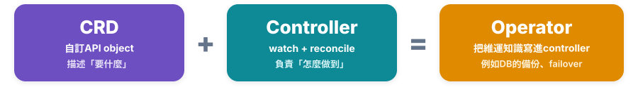
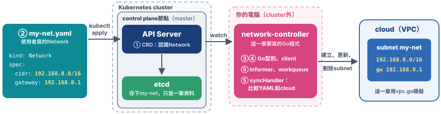
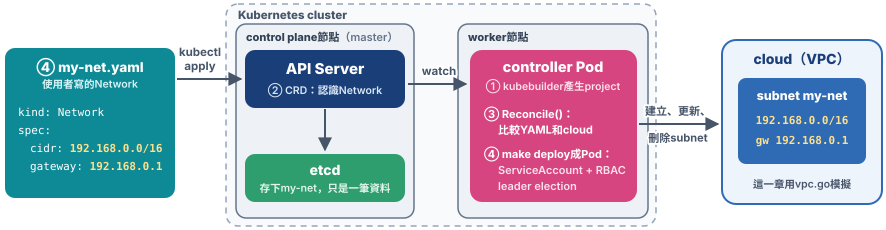
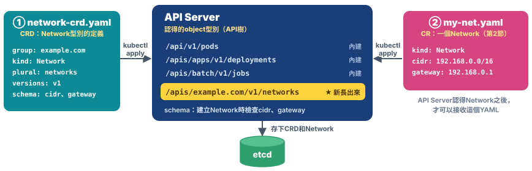
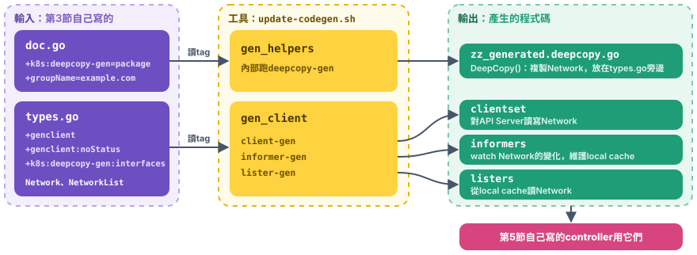
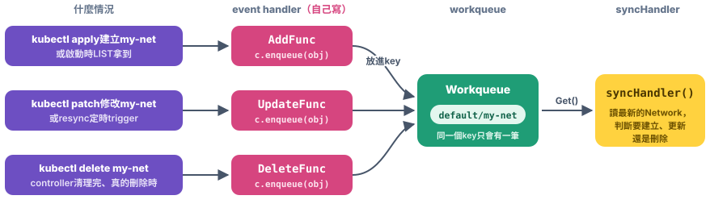
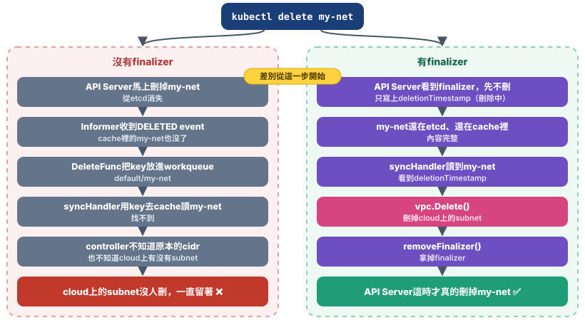
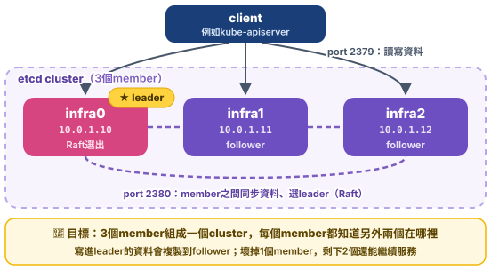
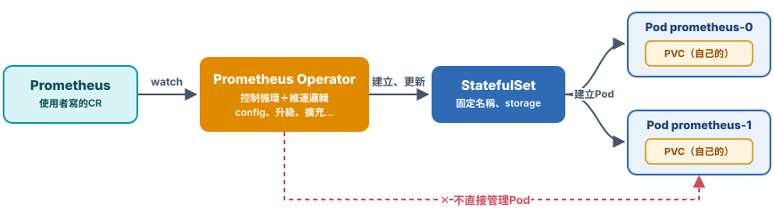
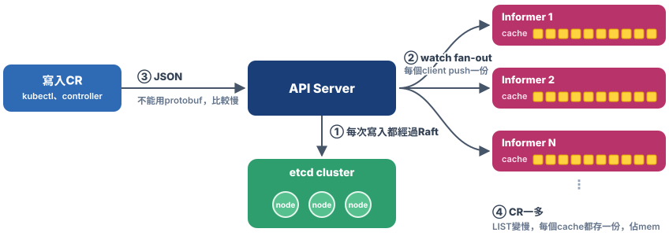

# Chap-7 CRD & Operator

**目錄**

- [CRD、controller和Operator](#crdcontroller和operator)
- [Goal：自定義Network CRD和Controller](#goal自定義network-crd和controller)
- [Manual：CRD和controller](#manualcrd和controller)
- [Auto：用kubebuilder產生](#auto用kubebuilder產生)
- [Operator](#operator)

## CRD、controller和Operator

*這一章的三個主角，是什麼關係？*



- **CRD**：讓API Server***認識一種新的object型別***，例如`Network`。它只負責「存」：之後建立的Network CR，只是etcd裡的一筆資料，見[建立Network](#-2-建立network)。**就像在餐廳的點餐系統上新增一道菜：之後客人就能點這道菜，但點了只是「下了單」，廚房還沒開始做**。
- **Controller**：watch這種object的變化，把實際狀態調整成`spec`寫的樣子，也就是[控制器模式](chap-5-container-orchestration-controller.md#控制器模式)。**它就是看單做菜的廚師：一直盯著新進來的單，把菜做成單上寫的樣子**。
- **Operator**：Operator = CRD+controller，而且controller裡寫的是***維運一個複雜app的知識***。例如DB的Operator，使用者只寫一個描述DB cluster的YAML，Operator就負責建立cluster、備份、failover、升級，見[Operator](#operator)。**它像一位主廚：研發新菜品（CRD），再把備料、做法、出問題時的補救方法教會廚師（controller）**。

所以[Manual：CRD和controller](#manualcrd和controller)裡的Network controller，其實就是一個最簡單的Operator；Operator和一般controller的差別，只在controller裡寫了多少維運知識。

> [!TIP]
> 💡 **一句話總結**
>
> ***CRD描述「要什麼」***；***controller負責「怎麼做到」***；**CRD+寫入了維運知識的Controller==Operator。**

## Goal：自定義Network CRD和Controller

*最後要做出什麼？controller要放在哪裡？*

這一章要做的是：***寫一個Network YAML，cloud上就自動建好一個對應的subnet***；改YAML，subnet跟著更新；刪掉YAML，subnet也跟著刪掉。

同一個目標，這一章用兩種寫法各做一次：

|                              | [Manual：手寫](#manualcrd和controller)       | [Auto：kubebuilder](#auto用kubebuilder產生)                 |
| ---------------------------- | ------------------------------------------- | ---------------------------------------------------------- |
| **controller怎麼寫**   | 自己寫informer、workqueue、syncHandler      | kubebuilder產生，只寫`Reconcile()`                       |
| **controller跑在哪裡** | 你的電腦上（cluster外），用`go run .`執行 | ***cluster裡的Pod***（一個Deployment），業界的做法 |
| **怎麼連API Server**   | kubeconfig                                  | Pod的ServiceAccount，權限由RBAC決定                        |
| **適合**               | 看懂controller的每個零件                    | 正式環境                                                   |

**Manual：controller在你的電腦上**（cluster外，用`go run .`執行）



圖上的①～⑤是[Manual](#manualcrd和controller)的步驟編號，標出每一步做的是哪一塊。

**Auto：controller是cluster裡的Pod**（業界的做法）



圖上的①～④是[Auto](#auto用kubebuilder產生)的步驟編號，標出每一步做的是哪一塊。

***業界幾乎都用Auto的方式***：controller部署成cluster裡的Pod，跟著cluster一起運作，不依賴任何一台電腦；Manual只是開發時方便，改完程式碼直接`go run`，不用每次重新打包image。

> [!NOTE]
> **🏭 業界怎麼放controller**
>
> 正式環境裡，controller幾乎都部署成cluster裡的Pod，很少跑在某台電腦上：
>
> | 面向               | 業界常見做法                                                                                                                     | 例子                                                                                                                        |
> | ------------------ | -------------------------------------------------------------------------------------------------------------------------------- | --------------------------------------------------------------------------------------------------------------------------- |
> | **形式**     | 一個Deployment，放在***專用的namespace***，和app分開                                                                     | kubebuilder產生的namespace是`<project>-system`，例如`network-operator-system`                                           |
> | **副本數**   | 2個以上，開***leader election***                                                                                         | 同一時間只有一個Pod真的在處理，另一個待命；leader掛了，另一個馬上接手                                                       |
> | **權限**     | 專用的ServiceAccount，[RBAC](chap-6-declarative-api.md#rbac)只給需要的權限                                                        | 只能讀寫自己的CR，以及要建立的Pod、Service等                                                                                |
> | **安裝方式** | 把controller的CRD、RBAC、Deployment打包成一份YAML或Helm chart，使用者一個命令就裝好；也可以交給OLM（Operator Lifecycle Manager） | kubebuilder的`make build-installer`產生`dist/install.yaml`，使用者`kubectl apply -f install.yaml`就裝好整個controller |
> | **維運**     | 設定resource requests / limits、health probe，暴露metrics                                                                        | kubebuilder產生的project default就有`/healthz`、`/metrics`                                                              |
>
> - **OLM（Operator Lifecycle Manager）**：一個專門管理Operator的Operator，也裝在cluster裡。使用者建立一個`Subscription`，寫要裝哪個Operator、跟著哪個channel（例如`stable`），OLM就自動裝好CRD、RBAC、Deployment；之後出新版時照channel自動升級，也會先裝好它依賴的其他Operator。[OperatorHub.io](https://operatorhub.io/)上的Operator都用OLM安裝。

## Manual：CRD和controller

*Kubernetes沒有的object型別，怎麼自己加？加了之後，誰來讓它真的做事？*

[Chap-5](chap-5-container-orchestration-controller.md#-5-控制循環實際怎麼跑)看過Kubernetes內建的controller，例如[Deployment controller](chap-5-container-orchestration-controller.md#-5-deployment-controller實際怎麼跑)，怎麼用Informer、event handler、workqueue和syncHandler跑控制循環。這一節用***同一套零件，自己寫一個custom controller***。

以一個描述網路的`Network`為例，從零開始手寫。controller在你的電腦上執行，就是[Goal](#goal自定義network-crd和controller)裡Manual那張圖的樣子。整體分成6步，每一步對應目標圖上的①～⑥：

1. **[寫CRD](#-1-crd讓api-server認識新的object型別)**：告訴API Server有`Network`這種object。
2. **[建立Network](#-2-建立network)**：用`kubectl`建立`my-net`，確認它存進etcd；但這時還沒有人讓它做事。
3. **[用Go定義Network型別](#-3-用go定義network型別)**：寫[doc.go](#-3a-docgo整個pkg共用的tag)、[types.go](#-3b-typesgonetwork的完整定義)、[register.go](#-3c-registergo註冊到scheme)。
4. **[產生controller需要的程式碼](#-4-產生controller需要的程式碼)**：用code-generator產生clientset、informer、lister和DeepCopy；controller本身在第5節自己寫。
5. **[寫controller](#-5-寫controller)**：了解Informer怎麼send change events給controller，再寫[main](#-5b-main啟動controller)、[NewController](#-5c-newcontroller註冊event-handler)、[Run](#-5d-runreconcile-loop)，最後是真正的邏輯[syncHandler](#-5e-synchandler比較期望狀態和實際狀態)。
6. **[Run it!](#-6-run-it)**：建立、修改、刪除`my-net`，看controller怎麼反應。

開始之前，先建立project，產生`go.mod`：

```bash
mkdir network-controller && cd network-controller
go mod init github.com/<you>/network-controller   # 建立go.mod
```

> [!NOTE]
> **`github.com/<you>/network-controller`是什麼**
>
> - **module名稱**：這個Go module的名字，也是project裡每個pkg import路徑的開頭。
> - **`<you>`**：換成自己的GitHub帳號名稱，例如`github.com/megleet/network-controller`。
> - **不一定要放到GitHub**：習慣寫之後要放的repo網址，別人才能直接`go get`。
> - **前後要一致**：第4節產生程式碼時，`--output-pkg`的開頭也要用同一個名稱。

整個project的結構參考Kubernetes官方的範例[sample-controller](https://github.com/kubernetes/sample-controller)。***這些目錄和檔案都要自己建立***，每個檔案在哪一步寫，標在右邊。例外有兩個：

- **`go.mod`**：上面的`go mod init`已經產生了。
- **`pkg/generated/`**：第4節執行code-generator後才會出現，裡面的程式碼都是產生的，不用自己寫。

`hack/boilerplate.go.txt`只是一段license註解，可以直接從sample-controller複製。

```
network-controller/
├── go.mod                        <-- module名稱和deps，見第4節
├── main.go                       <-- 啟動controller，見第5.b節
├── controller.go                 <-- NewController、Run、syncHandler，見第5.c～5.e節
├── vpc.go                        <-- 模擬cloud的網路API，見第5.e節
├── hack/
│   ├── boilerplate.go.txt        <-- 產生的程式碼開頭要加的license註解
│   └── update-codegen.sh         <-- 執行code-generator，見第4節
├── crd/
│   └── network-crd.yaml          <-- CRD，見第1節
├── examples/
│   └── my-net.yaml               <-- CR，見第2節
└── pkg/
    ├── apis/
    │   └── example/              <-- group（example.com）
    │       └── v1/               <-- version
    │           ├── doc.go        <-- 整個pkg共用的tag，見第3.a節
    │           ├── register.go   <-- 註冊到scheme，見第3.c節
    │           └── types.go      <-- Network的Go定義，見第3.b節
    └── generated/                <-- code-generator產生，不用自己寫，見第4節
        ├── clientset/            <-- 連API Server讀寫Network
        ├── informers/            <-- watch Network的變化，維護local cache
        └── listers/              <-- 從local cache讀Network
```

### 🧩 1. CRD：讓API Server認識新的object型別

[Chap-5](chap-5-container-orchestration-controller.md)看到的Deployment、Job、CronJob，都是Kubernetes**內建的object型別**，API Server的程式碼裡本來就有它們的定義。如果想要一種新的object型別，例如用來描述網路的`Network`，就用**CRD**（CustomResourceDefinition）告訴API Server。



把下面的內容寫進`crd/network-crd.yaml`：

<!-- hl: 6 10 14 | hl2: 4 9 15 16 23 -->

```yaml
apiVersion: apiextensions.k8s.io/v1
kind: CustomResourceDefinition
metadata:
  name: networks.example.com        # 必須是<plural>.<group>
spec:
  group: example.com
  scope: Namespaced                 # 和Pod一樣屬於某個namespace
  names:
    kind: Network
    plural: networks
    singular: network
    shortNames: [net]               # list，目前只有一個簡稱net
  versions:                         # 這個CRD有哪些version，一項一個
  - name: v1                        # version的名字，就是URL和apiVersion裡的v1
    served: true                    # v1可以用來send request
    storage: true                   # 存進etcd時用v1
    schema:
      openAPIV3Schema:
        type: object
        properties:
          spec:
            type: object
            required: [cidr, gateway]  # list：cidr和gateway都必填
            properties:
              cidr:
                type: string
              gateway:
                type: string
```

- **`group`、`version`、`plural`**：就是[Group、Version、Resource](chap-6-declarative-api.md#-1-groupversionresource)那三層。這個CRD會在樹上多長出`/apis/example.com/v1/networks`。
- **`served`和`storage`**：一個CRD可以同時有好幾個version，例如`v1`和`v2`。version下面的這兩個欄位管的是不同的事：

  - **`served: true`**：client可以用這個version（`name`寫的那個，例如`v1`）讀寫，例如`/apis/example.com/v1/...`和`/apis/example.com/v2/...`都能用，***所以可以有好幾個***。
  - **`storage: true`**：etcd裡實際存成哪個version。一筆資料在etcd裡只存一份，***所以只能有一個***，也就是[storage version](chap-6-declarative-api.md#multi-version)。client用其他version讀寫時，API Server會把資料轉換成client要的version。

- **`schema`**：API Server在[④ Schema validation](chap-6-declarative-api.md#api-server怎麼處理request)用它檢查欄位。例如少了`cidr`，或型別不對，request會直接被擋下來。
- **`required: [cidr, gateway]`**：建立Network時，`spec`裡***一定要有***`cidr`和`gateway`，少一個都不行。`[cidr, gateway]`是YAML清單的簡寫，等於分兩行寫`- cidr`、`- gateway`。沒寫`required`的話，這兩個欄位都是選填，controller就要自己處理欄位是空的情況。

  ```bash
  kubectl apply -f examples/my-net.yaml   # spec裡漏寫gateway
  # → The Network "my-net" is invalid: spec.gateway: Required value
  ```

> [!NOTE]
> **CRD和CR**：CRD（CustomResourceDefinition）是***型別的定義***，像Go裡的`type Network struct`；依照這個定義建立的object叫CR（Custom Resource），像`Network{...}`這個var。

### 🌐 2. 建立Network

CRD建好之後，`Network`就和內建的object型別一樣，可以寫YAML、用`kubectl`操作。把下面的內容寫進`examples/my-net.yaml`：

```yaml
apiVersion: example.com/v1
kind: Network
metadata:
  name: my-net
spec:
  cidr: 192.168.0.0/16
  gateway: 192.168.0.1
```

建立CRD和CR，需要一個可以操作的cluster。用kind在local建一個***單節點***的cluster就夠了：CRD和CR只會寫進API Server和etcd；kind的介紹見[用kind在local建cluster](chap-3-kubernetes-architecture-operations.md#-用kind在local建cluster)。

```bash
kind create cluster --name demo
kubectl wait --for=condition=Ready nodes --all --timeout=120s   # 剛建好時節點是NotReady，等它變成Ready
```

kind會自動在`~/.kube/config`寫進***怎麼連到這個cluster的API Server***的資料：API Server的位址、cluster的CA憑證和你的client certificate，見[kind在`~/.kube/config`寫了什麼](chap-3-kubernetes-architecture-operations.md#kind-kubeconfig)。`kubectl`和[第6節](#-6-run-it)的controller都讀這個檔案連到API Server。

先看CRD裝進去前後，API Server認不認得`Network`：

```bash
kubectl api-resources --api-group=example.com     # apply CRD之前
# → NAME   SHORTNAMES   APIVERSION   NAMESPACED   KIND           （空的，不認得）

kubectl apply -f crd/network-crd.yaml
kubectl api-resources --api-group=example.com     # apply CRD之後
# → NAME       SHORTNAMES   APIVERSION       NAMESPACED   KIND
#   networks   net          example.com/v1   true         Network
```

CRD一建好，API Server馬上在API樹上多了`networks`，不用重開任何東西。這時`kubectl get net`會回「No resources found」：API認得這種object，只是還沒有任何一個。

再建立`my-net`：

```bash
kubectl get crd networks.example.com
kubectl apply -f examples/my-net.yaml
kubectl get net                       # shortNames生效
# → NAME     AGE
#   my-net   5s
kubectl get net my-net -v=6           # 看實際send的URL
# → "Response" verb="GET" url="https://.../apis/example.com/v1/namespaces/default/networks/my-net" status="200 OK"
```

- **`-v=6`**：印出kubectl實際send給API Server的HTTP request，見[Chap-6的用kubectl查詢API的結構](chap-6-declarative-api.md#-5-用kubectl查詢api的結構)。

它在etcd裡的key是`/registry/example.com/networks/default/my-net`，和[etcd裡的key](chap-6-declarative-api.md#-4-etcd裡的key和url不一樣)說的一樣：CRD的key帶group。

但現在的`my-net`***只是一筆存在etcd裡的資料***：沒有人去真的建立網路。CRD只負責「讓API Server認識這種object型別」，***要讓它真的做事，還需要一個controller***，見[Informer](#-5a-informercontroller怎麼知道network變了)。

### 🐹 3. 用Go定義Network型別

第1節的CRD是寫給API Server看的型別定義。controller是Go程式，從API Server拿到的Network是一段JSON，要先轉成Go object才能用，所以Go裡也要有一份同樣的型別定義：`type Network struct`。兩份定義的欄位要一致，例如CRD `schema`裡的`cidr`，對應Go struct裡的`Cidr`。

這一節寫`pkg/apis/example/v1/`底下的3個檔案。目錄名稱`example/`只是Go的pkg名稱，真正的group由`doc.go`的`+groupName`決定。


#### 📄 3.a `doc.go`：整個pkg共用的tag

整個pkg共用的設定，叫global tags：

```go
// +k8s:deepcopy-gen=package
// +groupName=example.com

package v1
```

- **`+k8s:deepcopy-gen=package`**：替這個pkg裡所有的型別產生`DeepCopy()`。
- **`+groupName`**：這個pkg對應的group。

#### 🧱 3.b `types.go`：Network的完整定義

`Network`的完整定義：

<!-- hl: 5 6 7 15 18 -->

```go
package v1

import metav1 "k8s.io/apimachinery/pkg/apis/meta/v1"

// +genclient
// +genclient:noStatus
// +k8s:deepcopy-gen:interfaces=k8s.io/apimachinery/pkg/runtime.Object

// Network describes a Network resource
type Network struct {
	metav1.TypeMeta   `json:",inline"`             // apiVersion、kind
	metav1.ObjectMeta `json:"metadata,omitempty"`  // 每個object自己的metadata，
	                                               // 例如name、namespace、labels

	Spec NetworkSpec `json:"spec"`                 // 期望狀態，見NetworkSpec
}

type NetworkSpec struct {
	Cidr    string `json:"cidr"`                   // 例如"10.0.0.0/16"
	Gateway string `json:"gateway"`                // 例如"10.0.0.1"
}

// +k8s:deepcopy-gen:interfaces=k8s.io/apimachinery/pkg/runtime.Object

// NetworkList is a list of Network resources
type NetworkList struct {
	metav1.TypeMeta `json:",inline"`               // apiVersion、kind
	metav1.ListMeta `json:"metadata"`              // list特有的metadata，
	                                               // 例如resourceVersion、continue

	Items []Network `json:"items"`                 // 查到的每個Network
}
```

- **`TypeMeta`和`ObjectMeta`**：每個API object都有，對應YAML的`apiVersion`、`kind`和`metadata`。
- **`json:"cidr"`**：轉成JSON / YAML時的欄位名稱，要和CRD的`schema`一致。格式見下面的note。
- **`NetworkList`**：`kubectl get net`這種list request，return的是一個List object，不是陣列。
- **`+genclient`**：替`Network`產生client的程式碼。只寫在`Network`上，`NetworkList`不用。
- **`+genclient:noStatus`**：不要產生`UpdateStatus()`。
  - **`UpdateStatus()`是什麼**：object通常分成兩半：`spec`是使用者寫的期望狀態，`status`是controller回報的實際狀態。`UpdateStatus()`是產生的client裡的方法，controller用它把結果寫回`status`，***只改`status`，不動`spec`***。
  - **為什麼不要**：`Network`只有`Spec`，沒有`Status`欄位，沒有東西要回報，所以不用產生這個方法。
- **`+k8s:deepcopy-gen:interfaces=…`**：讓產生的`DeepCopyObject()` implement `runtime.Object`。所有API object都要implement它，固定這樣寫。

> [!NOTE]
> **🏷️ 看懂`` `json:"cidr"` ``這種struct tag**
>
> ```
> Cidr    string `json:"cidr"`
> ^       ^      ^
> 欄位    型別   struct tag
> ```
>
> - **反引號包起來的部分叫struct tag**：寫在欄位型別後面，是附加在這個欄位上的資訊，不影響欄位本身，***給負責轉換JSON和Go struct的lib讀***。
> - **格式是`key:"value"`**：key `json`表示這是給轉換JSON的lib看的，例如Go內建的`encoding/json`；client-go把API Server傳來的JSON轉成`Network`時，讀的也是這個tag。value `"cidr"`是這個欄位在JSON裡的名稱。
> - **為什麼需要**：Go的欄位要大寫開頭（`Cidr`），其他pkg才讀得到，但YAML裡寫的是小寫的`cidr`。struct tag告訴lib：JSON的`cidr`對應Go的`Cidr`。
> - **YAML也看`json` tag**：Kubernetes收到YAML時，會先轉成JSON再轉成Go object，所以只寫`json` tag就夠了。
> - **逗號後面是option**：見下表。
>
> | 寫法                          | 意思                                                                             |
> | ----------------------------- | -------------------------------------------------------------------------------- |
> | `json:"metadata,omitempty"` | 欄位名稱是`metadata`；值是空的時候，轉成JSON就省略這個欄位                     |
> | `json:",inline"`            | 不給名稱，把`TypeMeta`裡的`apiVersion`、`kind`直接放在最外層，不包成另一層 |

> [!TIP]
> **🏷️ 看懂`// +…`這種tag**
>
> - **寫在註解裡**：Go compiler會略過`//`開頭的註解，所以這些tag完全不影響程式執行，***只有code-generator會讀***。
> - **`+`開頭**：表示這是給工具看的tag，不是寫給人看的說明。
> - **`:`是分層，`=`是給value**：見下表。
>
> | 寫法                   | 意思                                                   | 例子                                                                                                |
> | ---------------------- | ------------------------------------------------------ | --------------------------------------------------------------------------------------------------- |
> | `+name`              | 只寫name：寫了就打開這個功能                           | `+genclient`：產生client                                                                          |
> | `+name:option`       | 在name底下選一個option                                 | `+genclient:noStatus`：產生client，但不產生只更新status的`UpdateStatus()`                       |
> | `+name=value`        | 把value設給name，code-generator會照這個value產生程式碼 | `+groupName=example.com`：產生的client用`example.com`當group，URL是`/apis/example.com/v1/...` |
> | `+name:option=value` | 把value設給name底下的option                            | `+k8s:deepcopy-gen:interfaces=…`：見下一點                                                       |
>
> - **最後一個怎麼讀**：照`+name:option=value`拆開：name是`k8s:deepcopy-gen`（它自己也用`:`分層，意思是k8s底下產生DeepCopy的工具），option是`interfaces`（要implement哪些interface），value`k8s.io/apimachinery/pkg/runtime.Object`是Go型別的全名：前面`k8s.io/apimachinery/pkg/runtime`是pkg的路徑，最後的`Object`是這個pkg裡的型別名稱。整句的意思是：產生的DeepCopy程式碼，要讓`Network`符合`runtime.Object`的要求。
> - **寫在哪裡，就作用在哪裡**：寫在`type`正上方，只作用在這個型別，例如`types.go`；寫在`package`上方，作用在整個pkg，也就是[`doc.go`的global tags](#-3a-docgo整個pkg共用的tag)。
> - **kubebuilder也是同一套寫法**：後面的[用註解描述CRD](#-2-用註解描述crd)用的`+kubebuilder:resource:shortName=net`，格式完全一樣。

#### 📋 3.c `register.go`：註冊到scheme

`register.go`是給[第4節](#-4-產生controller需要的程式碼)code generator產生的clientset用的。clientset是controller用來向API Server做LIST、WATCH和Update，以便取得相關的Network的更新變化，informer和lister也是通過clientset拿資料。

API Server回傳的Network是JSON（`{"apiVersion":"example.com/v1","kind":"Network",...}`）。clientset要把它decode成`types.go`的`Network` struct，就需要使用一個type對照表，這個表叫**scheme**，存在controller的mem裡；`register.go`負責把`Network`和`NetworkList`登記進去。

```text
你寫的controller.go
  └─ 用clientset / lister / informer（第4節產生的）
       └─ 用register.go的AddToScheme、SchemeGroupVersion、Resource()
            └─ 用types.go的Network、NetworkList
```

這個檔案的內容是固定的，換掉型別名稱就能套用：

```go
package v1

import (
	metav1 "k8s.io/apimachinery/pkg/apis/meta/v1"
	"k8s.io/apimachinery/pkg/runtime"
	"k8s.io/apimachinery/pkg/runtime/schema"
)

// 這個pkg的group和version，要和CRD的group、versions.name一致
// 產生的clientset用它組URL：/apis/example.com/v1/...
var SchemeGroupVersion = schema.GroupVersion{Group: "example.com", Version: "v1"}

var (
	SchemeBuilder = runtime.NewSchemeBuilder(addKnownTypes)
	AddToScheme   = SchemeBuilder.AddToScheme   // 產生的clientset啟動時呼叫它，把下面的型別登記進scheme
)

func addKnownTypes(scheme *runtime.Scheme) error {
	// 告訴scheme：example.com/v1的Network、NetworkList對應這兩個Go型別
	scheme.AddKnownTypes(SchemeGroupVersion, &Network{}, &NetworkList{})
	metav1.AddToGroupVersion(scheme, SchemeGroupVersion)
	return nil
}

// Resource把"networks"轉成帶group的networks.example.com
// 第4節產生的lister找不到object時，用它組出錯誤訊息：networks.example.com "my-net" not found
// 自己的程式碼沒呼叫它，但lister有，所以少了它compile會失敗
func Resource(resource string) schema.GroupResource {
	return SchemeGroupVersion.WithResource(resource).GroupResource()
}
```

### ⚙️ 4. 產生controller需要的程式碼

[第3節](#-3-用go定義network型別)在`doc.go`和`types.go`裡寫了一些`// +`開頭的tag，例如`// +genclient`、`// +groupName=example.com`。Go compiler會把它們當成一般註解略過，真正讀這些tag、照著產生程式碼的是另一個程式[`k8s.io/code-generator`](https://github.com/kubernetes/code-generator)。



所以先在project根目錄`network-controller/`執行`go get -tool`，把code-generator加進`go.mod`，固定好版本，後面的`update-codegen.sh`才找得到code-generator：

```bash
# 在network-controller/裡執行
go get -tool k8s.io/code-generator
cat go.mod                       # 看看go.mod多了什麼
```

<!-- hl: 5 9 -->

```
module github.com/<you>/network-controller     <-- 這個project的名稱

go 1.27.1                                      <-- 需要的Go版本

tool k8s.io/code-generator                     <-- go get -tool加的②

require (                                      <-- 用到的deps，Go自動加的
    k8s.io/apimachinery v0.37.2 // indirect    <-- types.go裡的metav1
    k8s.io/code-generator v0.37.2 // indirect  <-- go get -tool加的①
    …其他indirect deps省略
)
```

`go get -tool`做了兩件事：

- **① 記下版本**：在`require`裡記下要用code-generator的哪個版本。
- **② 登記成工具**：加一行`tool`，表示它是開發時用的工具，不是程式碼要import的lib。

再把產生程式碼的命令寫成`hack/update-codegen.sh`，之後每次改了`types.go`，就重跑一次`./hack/update-codegen.sh`：

```bash
#!/usr/bin/env bash
set -euo pipefail

source "$(go list -m -f '{{.Dir}}' k8s.io/code-generator)/kube_codegen.sh"

kube::codegen::gen_helpers \
  --boilerplate hack/boilerplate.go.txt ./pkg/apis      # 產生DeepCopy
kube::codegen::gen_client --with-watch \
  --output-dir ./pkg/generated \
  --output-pkg github.com/<you>/network-controller/pkg/generated \
  --boilerplate hack/boilerplate.go.txt ./pkg/apis      # 產生clientset、lister、informer
```

執行它，再把產生的程式碼用到的deps補進`go.mod`：

```bash
chmod +x hack/update-codegen.sh   # 第一次要加上執行權限
./hack/update-codegen.sh          # 產生程式碼
go mod tidy                       # 產生的clientset會import client-go，把它加進go.mod
go build ./pkg/...                # 確認可以compile
```

`go mod tidy`會掃描project裡所有的`import`，把用到、但`go.mod`裡還沒有的module加進去，用不到的拿掉。這一步之後，`client-go`才會出現在`go.mod`的`require`裡。

產生之後的結構：

```
pkg/
├── apis/example/v1/
│   ├── doc.go
│   ├── register.go
│   ├── types.go
│   └── zz_generated.deepcopy.go        <-- DeepCopy()
└── generated/
    ├── clientset/versioned/            <-- 對API Server做CRUD
    │   ├── clientset.go                <-- NewForConfig()：建立clientset
    │   ├── typed/example/v1/network.go <-- Networks(ns)：Get、List、Create、Delete…
    │   └── fake/                       <-- 假的clientset，寫測試用
    ├── informers/externalversions/     <-- watch Network的變化，維護local cache
    │   ├── factory.go                  <-- NewSharedInformerFactory()
    │   └── example/v1/network.go       <-- NetworkInformer
    └── listers/example/v1/             <-- 從local cache讀Network
        └── network.go                  <-- NetworkLister
```

一共產生21個檔案，這裡只列controller會直接用到的，其他是框架內部用的。clientset、informers、listers這三個目錄，就是[寫controller](#-5a-informercontroller怎麼知道network變了)要用的工具：

| 目錄                | 連到哪裡                   | 用來做什麼                                                           | controller裡怎麼用                              |
| ------------------- | -------------------------- | -------------------------------------------------------------------- | ----------------------------------------------- |
| **clientset** | API Server                 | **HTTP讀寫**Network：Get、List、Create、Update、Delete、Watch  | `addFinalizer`用`Update`改Network           |
| **informers** | API Server（LIST + WATCH） | **收到Network的變化**，更新local cache，呼叫event handler      | 註冊`AddFunc`、`UpdateFunc`、`DeleteFunc` |
| **listers**   | informer的local cache      | **ReadOnly**，快速查詢Network. 只有`Get`和`List`，不能修改 | `syncHandler`用`Get`讀期望狀態              |

### 🛠️ 5. 寫controller

controller分成5個部分：先了解informer怎麼把change events send過來，再依序寫`main()`、`NewController()`、`Run()`，最後是真正的邏輯`syncHandler()`。

#### 🔁 5.a Informer：controller怎麼知道Network變了

[建立Network](#-2-建立network)之後，`my-net`只是etcd裡的一筆資料。要讓它真的做事，還需要一個controller：***watch etcd中關於Network的變化，把實際的網路調整成YAML裡寫的樣子***。這和[控制器模式](chap-5-container-orchestration-controller.md#控制器模式)裡Deployment controller做的事一樣，只是對象換成自己定義的object。

controller要怎麼知道Network什麼時候被新增、修改、刪除？最直接的做法是每隔幾秒就問API Server一次「現在有哪些Network」，再自己比較哪裡不一樣。但大部分時候什麼都沒變，API Server卻一直被問，很浪費。

所以controller改用**informer**：它和API Server保持一條`WATCH`連線，***Network有變化時，API Server會主動push過來***，controller不用一直問。

這套零件和Chap-5的[Deployment controller](chap-5-container-orchestration-controller.md#-5-deployment-controller實際怎麼跑)完全一樣，只是這次watch的是自己定義的Network。

**Informer**就是一個***①自帶local cache和index、②可以從controller註冊event handler的③API Server client***，每一種object都有自己的Informer。整個流程如下圖，藍色是client-go提供的，橘色是自己寫的：


**1）Reflector：ListAndWatch機制**：Reflector負責和API Server溝通，用的方法叫`ListAndWatch()`，做兩件事：先拿到目前所有的Network，再接收之後的變化。

- **先拿到所有的Network**：Reflector對`/apis/example.com/v1/namespaces/default/networks`開一條WATCH連線，帶上`?watch=true&sendInitialEvents=true`。API Server先把***目前已經存在的每個Network***都當成一個`ADDED` event送過來，送完再送一個bookmark event，表示「初始資料送完了」。這些event都放進②RealFIFO。這種做法叫WatchList。
- **再接收之後的變化**：同一條連線不斷開，之後Network每次被新增、修改、刪除，API Server就push一個event過來。

**2）RealFIFO**：WATCH收到的每個event，都帶著event type（`ADDED`、`MODIFIED`、`DELETED`）和變化後的object。Reflector把「**event type + object**」包成一個***delta***，依序放進RealFIFO這個queue，先進先出。

**3）Indexer**：***local store + index + event handler***。local cache/store是一個`{key: value}`的map，key是`namespace/name`，value是Network object。Informer不斷從RealFIFO取出（Pop）delta，更新local cache：Informer每拿到一個delta，就先查local cache裡有沒有這個object：

- **cache裡沒有**：把object加進cache，再呼叫`AddFunc`；
- **cache裡已經有**：用新的object更新cache，再呼叫`UpdateFunc`；
- **delta的type是`Deleted`**：把object從cache刪掉，再呼叫`DeleteFunc`。

***這3個handler（`AddFunc`、`UpdateFunc`、`DeleteFunc`）是自己寫的，在[5.c](#-5c-newcontroller註冊event-handler)由controller註冊給Informer***。它們只做一件事：**把object的key**（例如`default/my-net`）**放進workqueue**。

Indexer還會建立index。controller要讀Network時，用lister從這份cache讀，不用再向API Server索要。

> [!NOTE]
> **🔔 三個event handler什麼時候被呼叫**<a id="event-handlers"></a>
>
> 
>
> | handler        | 什麼時候被呼叫         | 例子                                                                                                          |
> | -------------- | ---------------------- | ------------------------------------------------------------------------------------------------------------- |
> | `AddFunc`    | cache裡多了一個Network | `kubectl apply`建立`my-net`；或controller啟動時，LIST拿到已經存在的`my-net`                             |
> | `UpdateFunc` | cache裡的Network被修改 | `kubectl patch`改了`cidr`；或resync定時trigger                                                            |
> | `DeleteFunc` | Network從cache裡消失   | `kubectl delete my-net`後，controller刪掉subnet、清理完，`my-net`真的被刪除時（見[finalizer](#finalizer)） |
>
> 在這個controller裡，三個handler都只做一件事：`c.enqueue(obj)`，把key放進workqueue。要建立、更新還是刪除，留給syncHandler讀最新的Network再判斷。

**4）Workqueue**：event handler只做一件事：把object的`namespace/name`放進workqueue，例如`my-net`就是`default/my-net`。這個字串叫做***key***，只放key、不放整個object的原因，見下面的note。

**5）Controller worker**：controller的worker從workqueue取出`namespace/name`，用lister到cache讀出最新的Network，開始調整。

> [!NOTE]
> **🤝 為什麼workqueue和lister要一起用**
>
> ***workqueue告訴controller「檢查哪一個」，lister用這個key從local cache查出「它現在的期望狀態」，syncHandler再拿它和cloud的實際狀態比較，不一樣就調整cloud。***
>
> ```
> ① workqueue.Get()                            → default/my-net（檢查哪一個）
> ② lister.Networks("default").Get("my-net")   → 最新的my-net（期望狀態）
> ③ syncHandler：和cloud上的subnet（實際狀態）比較，不一樣就調整cloud
> ```
>
> queue裡只放key（`namespace/name`），不放整個object，要用時再用lister讀，好處是：
>
> - **decouple快和慢**：Informer收到event很快，業務邏輯（例如呼叫cloud API）很慢。event handler如果直接做業務邏輯，就會拖慢甚至block Informer；先放進queue，兩邊就能各跑各的速度。
> - **自動去重**：同一個Network短時間改了5次，queue裡還是只有一筆`default/my-net`，worker只處理一次。
> - **永遠讀最新的**：worker處理時才去cache讀object，拿到的一定是最新狀態，不會照著過時的版本做。
> - **失敗可以重試**：處理失敗時用`AddRateLimited()`放回queue，等待時間會一次比一次長。
> - **同一個key不會同時處理**：開好幾個worker，workqueue也保證同一個`namespace/name`同時只會被一個worker處理。

**resync**：Informer每隔一段時間（[5.b](#-5b-main啟動controller)設定的30秒），會對cache裡所有object再trigger一次`UpdateFunc`，即使object完全沒變；這時傳進去的`old`和`new`是cache裡同一份object。`UpdateFunc`會把key放進workqueue，worker取出key後就會呼叫syncHandler（③ → ④ → ⑤），***等於定期強迫controller再檢查一次：Network寫的期望狀態，和cloud上subnet的實際狀態是不是一樣***。如果沒有變化，就什麼都不做；如果有變化，就更新實際的CR進行reconcile.

為什麼需要：實際狀態可能在Kubernetes以外被改了，例如有人在cloud的console上手動刪掉subnet。這時Kubernetes裡的`my-net`（存在etcd裡的那個object）完全沒被修改，API Server也就沒有event可以push。resync本身不會去查cloud，它只是把cache裡的Network再trigger一次，讓syncHandler再跑一次；***是syncHandler裡的`vpc.Get()`去cloud查***，發現subnet不見了就重新建立。

> [!TIP]
> **💡 k8s cluster內部的東西需要resync嗎？基本上不需要**
>
> - **有event可以收**：cluster內的object（例如Pod、ReplicaSet）一被改，API Server就會push event；controller只要也watch它們，就會馬上收到，不用定期重查。`所以如果只需要manager cluster內object的controller，常把resync關掉（設成0）或根據需要把wait period設得很長。`
> - **Informer不會漏event**：WATCH斷線時，Reflector會重新LIST把cache補齊，所以也不用靠resync補。

> [!NOTE]
> **🔄 `old`和`new`從哪裡來**
>
> local cache裡每個object只存一份（最新的），`old`和`new`是Informer呼叫`UpdateFunc`那一刻臨時拿的兩個參數：
>
> | 情況                                              | `old`                                             | `new`                                               |
> | ------------------------------------------------- | --------------------------------------------------- | ----------------------------------------------------- |
> | **平常，真的被修改**，例如`kubectl patch` | local cache裡現在那一份（還沒更新，所以是修改前的） | WATCH收到的`MODIFIED` event帶來的object（修改後的） |
> | **resync**                                  | local cache裡那一份                                 | ***同一份***，沒有新的event                   |
>
> 平常被修改時，Informer先取出cache裡的舊版當`old`，把event帶來的新版存進cache，再呼叫`UpdateFunc(old, new)`；呼叫完，cache裡只剩新版。需要知道「改了什麼」的controller，可以比較`old`和`new`，例如只在`cidr`變了才處理。

#### 🚀 5.b main：啟動controller

在project根目錄建立`main.go`：

```go
package main

import (
	"context"
	"flag"
	"os"
	"os/signal"
	"syscall"
	"time"

	"k8s.io/client-go/tools/clientcmd"
	"k8s.io/klog/v2"

	clientset "github.com/<you>/network-controller/pkg/generated/clientset/versioned"
	informers "github.com/<you>/network-controller/pkg/generated/informers/externalversions"
)

func main() {
	kubeconfig := flag.String("kubeconfig", "", "kubeconfig的路徑，留空時用in-cluster config")
	flag.Parse()

	ctx, stop := signal.NotifyContext(context.Background(), os.Interrupt, syscall.SIGTERM)
	defer stop()                                       // 收到Ctrl+C或SIGTERM時，ctx會被取消

	// ① 連API Server
	// 有給--kubeconfig：讀這個檔案，controller在你的電腦上（cluster外）執行，這一章就是這樣
	// 留空：用in-cluster config，也就是Pod的ServiceAccount token
	//       （kubelet自動掛在/var/run/secrets/kubernetes.io/serviceaccount/），deploy成Pod時用
	cfg, err := clientcmd.BuildConfigFromFlags("", *kubeconfig)
	if err != nil {
		klog.Fatal(err)
	}
	networkClient := clientset.NewForConfigOrDie(cfg)  // 第4節產生的clientset

	// ② 建立factory，向它要Network Informer
	// Informer用networkClient連API Server；真正負責LIST + WATCH、斷線重連的是Informer裡的Reflector
	// Shared：同一種object只開一條Watch，多個地方要Network Informer，拿到的都是同一個
	factory := informers.NewSharedInformerFactory(networkClient, 30*time.Second)  // 30秒：resync週期
	controller := NewController(networkClient, factory.Example().V1().Networks())

	// ③ 啟動：先啟動informer，再啟動controller
	// factory.Start：啟動informer，在背景goroutine裡LIST + WATCH、更新cache；馬上return，不會卡住
	// controller.Run：先等cache同步完（所以要先Start），再開worker處理workqueue；
	//                 會一直卡在這裡，直到ctx被取消（Ctrl+C或SIGTERM）
	factory.Start(ctx.Done())
	if err := controller.Run(ctx, 2); err != nil {     // 2個worker
		klog.Fatal(err)
	}
}
```

`main()`做三件事：① 連API Server、② 建立factory並拿到Network Informer、③ 啟動informer和controller，細節寫在程式碼的註解裡。in-cluster config見[Chap-8的ServiceAccountToken](chap-8-volume.md#-6-serviceaccounttokenpod怎麼存取api-server)，Reflector見[5.a](#-5a-informercontroller怎麼知道network變了)。

#### 🔌 5.c NewController：註冊event handler

`controller.go`分成三段寫，***依序貼進同一個檔案***：這一節是第一段：註冊event handler，5.d、5.e接在後面。

```go
package main

import (
	"context"
	"fmt"
	"slices"
	"time"

	"k8s.io/apimachinery/pkg/api/errors"
	metav1 "k8s.io/apimachinery/pkg/apis/meta/v1"
	utilruntime "k8s.io/apimachinery/pkg/util/runtime"
	"k8s.io/apimachinery/pkg/util/wait"
	"k8s.io/client-go/tools/cache"
	"k8s.io/client-go/util/workqueue"
	"k8s.io/klog/v2"

	examplev1 "github.com/<you>/network-controller/pkg/apis/example/v1"
	clientset "github.com/<you>/network-controller/pkg/generated/clientset/versioned"
	informers "github.com/<you>/network-controller/pkg/generated/informers/externalversions/example/v1"
	listers "github.com/<you>/network-controller/pkg/generated/listers/example/v1"
)

const finalizer = "example.com/network-cleanup"     // 刪除Network時用，見5.e的finalizer

// Controller把controller要用的工具放在一起
type Controller struct {
	networkclientset clientset.Interface              // 寫入用：連API Server，例如加、拿掉finalizer
	networksLister   listers.NetworkLister            // 讀取用：從local cache讀Network，不問API Server
	networksSynced   cache.InformerSynced             // 問informer：cache第一次同步完了沒（5.d用）
	workqueue        workqueue.TypedRateLimitingInterface[cache.ObjectName]  // 放待處理的key
}

func NewController(networkclientset clientset.Interface, networkInformer informers.NetworkInformer) *Controller {
	// ① 準備工具：lister和HasSynced都從Network Informer拿
	// workqueue是rate limiting queue：失敗時AddRateLimited，重試間隔一次比一次長
	c := &Controller{
		networkclientset: networkclientset,
		networksLister:   networkInformer.Lister(),
		networksSynced:   networkInformer.Informer().HasSynced,
		workqueue: workqueue.NewTypedRateLimitingQueueWithConfig(
			workqueue.DefaultTypedControllerRateLimiter[cache.ObjectName](),
			workqueue.TypedRateLimitingQueueConfig[cache.ObjectName]{Name: "Networks"},
		),
	}

	// ② 註冊event handler：Network有變化時，informer呼叫對應的handler
	// 三個handler都只做一件事：把key放進workqueue；要建立、更新還是刪除，留給syncHandler判斷
	networkInformer.Informer().AddEventHandler(cache.ResourceEventHandlerFuncs{
		AddFunc: c.enqueue,                            // 新增，或啟動時LIST拿到已經存在的
		UpdateFunc: func(old, new interface{}) {
			c.enqueue(new)                             // 修改，或resync定時trigger，見5.a
		},
		DeleteFunc: c.enqueue,                         // 真的被刪除
	})
	return c
}

// enqueue把object的key（namespace/name，例如default/my-net）放進workqueue
func (c *Controller) enqueue(obj interface{}) {
	// DeletionHandlingObjectToName：Watch斷線期間object被刪掉時，informer收到的不是Network，
	// 而是DeletedFinalStateUnknown；這個函式一樣能從裡面取出namespace/name
	ref, err := cache.DeletionHandlingObjectToName(obj)
	if err != nil {
		utilruntime.HandleError(err)
		return
	}
	c.workqueue.Add(ref)                               // 同一個key已經在queue裡，就不會重複加
}
```

`NewController()`做兩件事：① 準備lister、workqueue這些工具、② 向Network Informer註冊event handler，細節寫在程式碼的註解裡。三個handler什麼時候被呼叫，見[5.a](#event-handlers)。

#### ♻️ 5.d Run：reconcile loop

接在`controller.go`後面：

```go
// Run啟動控制循環：等cache同步完，開workers個worker，一直跑到ctx被取消
func (c *Controller) Run(ctx context.Context, workers int) error {
	defer c.workqueue.ShutDown()                       // 結束時關掉queue，worker的Get()會收到shutdown

	// ① 等cache第一次同步完
	// 沒等的話，會把「cache裡還沒有」誤以為「object不存在」
	if !cache.WaitForCacheSync(ctx.Done(), c.networksSynced) {
		return fmt.Errorf("failed to wait for caches to sync")
	}
	klog.Info("controller started")

	// ② 開worker：每個worker一直重複runWorker；runWorker結束的話，1秒後再開一個
	for i := 0; i < workers; i++ {
		go wait.UntilWithContext(ctx, c.runWorker, time.Second)
	}
	<-ctx.Done()                                       // 卡在這裡，直到Ctrl+C或SIGTERM
	return nil
}

// runWorker一直從workqueue取key來處理，直到queue被關掉
func (c *Controller) runWorker(ctx context.Context) {
	for c.processNextWorkItem(ctx) {
	}
}

// processNextWorkItem取一個key，交給syncHandler；return false表示queue已關掉
func (c *Controller) processNextWorkItem(ctx context.Context) bool {
	ref, shutdown := c.workqueue.Get()                 // queue是空的就等，直到有key
	if shutdown {
		return false
	}
	// Done：告訴queue這個key處理完了
	// 處理期間如果又有新event，Done之後會再放回queue；同一個key不會同時被兩個worker處理
	defer c.workqueue.Done(ref)

	if err := c.syncHandler(ctx, ref); err != nil {
		c.workqueue.AddRateLimited(ref)                // 失敗：等一下再重試，間隔一次比一次長
		utilruntime.HandleError(err)
		return true
	}
	c.workqueue.Forget(ref)                            // 成功：清掉這個key的重試次數
	return true
}
```

`Run()`做兩件事：① 等cache同步完、② 開worker，每個worker不斷從workqueue取key、交給syncHandler，細節寫在程式碼的註解裡。

#### 🎯 5.e syncHandler：比較期望狀態和實際狀態

寫syncHandler之前，先認識它會用到的**finalizer**。<a id="finalizer"></a>

**finalizer是什麼**：object的`metadata.finalizers`清單裡的一個字串，例如`example.com/network-cleanup`，可以想成貼在object上的「***還不能刪***」標籤。每個object都有`finalizers`這個欄位，但default是空的；`my-net.yaml`裡也沒寫，是controller第一次處理`my-net`時，用clientset `Update`加上去的，所以它和`spec`一樣存在etcd裡。用`kubectl get net my-net -o yaml`才看得到：

```yaml
metadata:
  name: my-net
  finalizers:
  - example.com/network-cleanup     # controller加的，my-net.yaml裡沒有
```

**為什麼需要finalizer**：比較使用者執行`kubectl delete my-net`時的兩種情況：



如果刪除時controller剛好沒在跑：

- **沒有finalizer**：更糟。controller重開後，cache裡根本沒有`my-net`，連「有一個Network被刪了」都不知道。
- **有finalizer**：`my-net`會一直卡在「刪除中」，等controller重開、刪掉subnet，才會消失。

***finalizer讓`my-net`在被刪除前，先留在etcd裡等controller清理完cloud。*** 沒有它，`my-net`會在controller清理之前就消失，cloud上的subnet就沒人管了。

**什麼時候需要finalizer**：不是每個controller都需要。判斷方法：***object被刪除時，有沒有Kubernetes自己清不掉的東西要清理***。

| controller管的東西                                                   | 刪除時誰清理                                     | 需要finalizer嗎                     |
| -------------------------------------------------------------------- | ------------------------------------------------ | ----------------------------------- |
| **cluster外的資源**（cloud subnet、load balancer、DNS record） | 只有controller自己知道要清                       | ✅ 需要，否則會留下沒人管的外部資源 |
| **cluster裡的object**（Pod、StatefulSet、Service）             | 設好`ownerReferences`，garbage collector自動刪 | ❌ 通常不需要                       |
| **read-only、不建立任何東西**                                       | 沒有東西要清                                     | ❌ 不需要                           |

這一章的controller管的是cloud上的subnet，所以需要finalizer。

**寫syncHandler**：下面的`syncHandler()`是整個controller裡***唯一真正要自己寫的邏輯***，其他程式碼（5.b～5.d）幾乎都是固定的寫法。把它接在`controller.go`最後面：

<!-- hl: 4 16 20 29 -->

```go
// syncHandler比較一個Network的期望狀態和實際狀態，不一樣就調整cloud
func (c *Controller) syncHandler(ctx context.Context, ref cache.ObjectName) error {
	// ① 期望狀態：用lister從local cache讀Network
	network, err := c.networksLister.Networks(ref.Namespace).Get(ref.Name)
	if errors.IsNotFound(err) {
		return nil                                     // 已經刪除，finalizer處理過了
	}
	if err != nil {
		return err
	}

	// ② 條件滿足：DeletionTimestamp有值，說明有人要刪除這個Network
	// 因為有finalizer，kubectl delete只設定了DeletionTimestamp，Network還留在etcd
	// 先刪cloud上的subnet，再拿掉finalizer，API Server才真的把Network從etcd刪掉
	// 就算刪除時controller沒在跑，重開後也一定會看到它，不會漏刪
	if !network.DeletionTimestamp.IsZero() {
		if err := vpc.Delete(ref.Namespace, ref.Name); err != nil {
			return err
		}
		return c.removeFinalizer(ctx, network)
	}
	// 上面的條件不滿足：DeletionTimestamp是零，說明沒有人要刪除這個Network
	// 還沒有finalizer：先加上，Update後會觸發一次UpdateFunc，下一輪再往下做
	if !slices.Contains(network.Finalizers, finalizer) {
		return c.addFinalizer(ctx, network)
	}

	// ③ 實際狀態：直接去cloud查subnet，見下面的note
	actual, exists := vpc.Get(ref.Namespace, ref.Name)
	switch {
	case !exists:                                      // cloud上沒有：建立
		return vpc.Create(ref.Namespace, ref.Name, network.Spec)
	case actual.Cidr != network.Spec.Cidr || actual.Gateway != network.Spec.Gateway:
		return vpc.Update(ref.Namespace, ref.Name, network.Spec)  // 不一樣：更新
	}
	return nil                                         // 一樣：什麼都不做（resync大多走到這裡）
}

// addFinalizer、removeFinalizer：改副本再Update回API Server
// 不能直接改cache裡的object：它是大家共用的，改了會讓cache和API Server不一致
func (c *Controller) addFinalizer(ctx context.Context, network *examplev1.Network) error {
	n := network.DeepCopy()
	n.Finalizers = append(n.Finalizers, finalizer)
	_, err := c.networkclientset.ExampleV1().Networks(n.Namespace).Update(ctx, n, metav1.UpdateOptions{})
	return err
}

func (c *Controller) removeFinalizer(ctx context.Context, network *examplev1.Network) error {
	n := network.DeepCopy()
	n.Finalizers = slices.DeleteFunc(n.Finalizers, func(f string) bool { return f == finalizer })
	_, err := c.networkclientset.ExampleV1().Networks(n.Namespace).Update(ctx, n, metav1.UpdateOptions{})
	return err
}
```

`syncHandler()`做三件事：① 讀期望狀態、② 處理刪除和finalizer、③ 查實際狀態並調整cloud，細節寫在程式碼的註解裡。

> [!NOTE]
> **🔍 實際狀態從哪裡讀**
>
> 實際狀態要去controller負責管理的那個東西那裡讀：
>
> - **管的是其他Kubernetes object**（例如Pod、StatefulSet）：再開一個Informer watch它們，從local cache讀。它們一變，controller馬上收到event。
> - **管的是cluster外的東西**（cloud資源、DNS、資料庫、app本身）：在syncHandler裡直接呼叫那個系統的API去查。這些東西被改了，Kubernetes不會有任何event，所以要靠[resync](#-5a-informercontroller怎麼知道network變了)讓syncHandler定期再跑一次：resync本身只是把cache裡的Network（來自etcd）再trigger一次，***真正去查cluster外狀態的是syncHandler***。
>
> 這一章管的是cloud上的subnet，屬於第二種，所以用`vpc.Get()`直接去cloud查。

`vpc`代表cloud provider建立網路的API（例如AWS、GCP的VPC / subnet API）。這裡不連真的cloud，用一個map模擬，每次操作印一行log，方便在[第6節](#-6-run-it)看到controller做了什麼。建立`vpc.go`：

```go
package main

import (
	"sync"

	"k8s.io/klog/v2"

	examplev1 "github.com/<you>/network-controller/pkg/apis/example/v1"
)

// fakeVPC模擬cloud provider的網路API（實際狀態）：用一個map記住建立了哪些subnet，每次操作都印一行log
// 只存在controller的mem裡：controller重開，map就清空了，真的cloud不會這樣
// 換成真的cloud時，把下面4個方法改成呼叫AWS、GCP的VPC / subnet API，controller其他程式碼都不用改
type fakeVPC struct {
	mu      sync.Mutex                                // 好幾個worker會同時呼叫，用lock保護map
	subnets map[string]examplev1.NetworkSpec              // key是namespace/name，value是subnet的cidr、gateway
}

// vpc是全域var，syncHandler直接呼叫vpc.Get()、vpc.Create()……
var vpc = &fakeVPC{subnets: map[string]examplev1.NetworkSpec{}}

// Get查subnet現在的樣子（實際狀態）；不存在時第二個回傳值是false
// 真的cloud：AWS的DescribeSubnets、GCP的subnetworks.get
func (v *fakeVPC) Get(namespace, name string) (examplev1.NetworkSpec, bool) {
	v.mu.Lock()
	defer v.mu.Unlock()
	spec, ok := v.subnets[namespace+"/"+name]
	return spec, ok
}

// Create建立subnet
// 真的cloud：AWS的CreateSubnet、GCP的subnetworks.insert
func (v *fakeVPC) Create(namespace, name string, spec examplev1.NetworkSpec) error {
	v.mu.Lock()
	defer v.mu.Unlock()
	v.subnets[namespace+"/"+name] = spec
	klog.Infof("vpc: create subnet %s/%s cidr=%s gateway=%s", namespace, name, spec.Cidr, spec.Gateway)  // 第6節看到的log
	return nil
}

// Update把subnet改成新的cidr、gateway
// 真的cloud：GCP的subnetworks.patch；AWS的subnet建好後不能改CIDR，要刪掉再建
func (v *fakeVPC) Update(namespace, name string, spec examplev1.NetworkSpec) error {
	v.mu.Lock()
	defer v.mu.Unlock()
	v.subnets[namespace+"/"+name] = spec
	klog.Infof("vpc: update subnet %s/%s cidr=%s gateway=%s", namespace, name, spec.Cidr, spec.Gateway)
	return nil
}

// Delete刪除subnet；Network被刪除時，syncHandler先呼叫它，再拿掉finalizer
// 真的cloud：AWS的DeleteSubnet、GCP的subnetworks.delete
func (v *fakeVPC) Delete(namespace, name string) error {
	v.mu.Lock()
	defer v.mu.Unlock()
	delete(v.subnets, namespace+"/"+name)
	klog.Infof("vpc: delete subnet %s/%s", namespace, name)
	return nil
}
```

### 🧪 6. Run it!

CRD和`my-net`在[第2節](#-2-建立network)已經建立好了，這裡只要在`network-controller/`裡啟動controller：

```bash
go run . --kubeconfig=$HOME/.kube/config        # controller從這個檔案讀API Server的位址和憑證
# → controller started
```

- **`--kubeconfig=$HOME/.kube/config`**：controller在你的電腦上（cluster外）執行，要自己找到API Server。`~/.kube/config`是[第2節](#-2-建立network)`kind create cluster`時kind寫的，裡面有kind cluster的API Server位址（`https://127.0.0.1:<port>`）、cluster的CA憑證和你的client certificate；`kubectl`也是讀這個檔案。`main.go`收到這個flag，就用`clientcmd.BuildConfigFromFlags()`讀它，見[5.b](#-5b-main啟動controller)。

在另一個terminal：

```bash
kubectl get net my-net -o jsonpath='{.metadata.finalizers}'   # controller加上的finalizer
# → ["example.com/network-cleanup"]
kubectl patch net my-net --type=merge \
  -p '{"spec":{"cidr":"10.1.0.0/16","gateway":"10.1.0.1"}}'
kubectl delete net my-net
```

controller的terminal會依序印出：

```
controller started
vpc: create subnet default/my-net cidr=192.168.0.0/16 gateway=192.168.0.1
vpc: update subnet default/my-net cidr=10.1.0.0/16 gateway=10.1.0.1
vpc: delete subnet default/my-net
```

- **create**：controller一啟動就會從`LIST`看到第2節建立的`my-net`，先加上finalizer，再建立subnet。
- **update**：`patch`改了`cidr`和`gateway`，實際狀態和期望狀態不一樣，controller更新subnet。
- **delete**：`kubectl delete`只設定了`DeletionTimestamp`；controller刪掉subnet、拿掉finalizer之後，`my-net`才真的消失。

> [!NOTE]
> **實務上常用kubebuilder**：上面的informer、workqueue、`Run()`都是固定的寫法。實務上大多用kubebuilder產生，見[Auto：用kubebuilder產生](#auto用kubebuilder產生)。完整可執行的手寫範例，可以參考官方的[kubernetes/sample-controller](https://github.com/kubernetes/sample-controller)，它一直跟著新版client-go更新。

> [!TIP]
> 💡 **一句話總結**
>
> ***Informer負責把API Server的變化同步到local cache，workqueue負責排隊和重試，自己只要寫syncHandler***：從cache讀出期望狀態，和實際狀態比較，不一樣就調整。這就是Kubernetes裡每一個controller的寫法。

## Auto：用kubebuilder產生

*上一節手寫的那些檔案，有沒有工具可以直接產生？*

[Manual：CRD和controller](#manualcrd和controller)裡，project結構、CRD的YAML、informer和workqueue都是自己寫的。實務上大多用**kubebuilder**產生這些固定的部分，只留下業務邏輯自己寫。

> [!NOTE]
> **Operator SDK是什麼**：另一個常聽到的寫Operator的工具，屬於[Operator Framework](https://github.com/operator-framework) project。
>
> - **三種做Operator的方式**：
>   - **Go**：自己寫controller的Go程式碼。Operator SDK自己不產生程式碼，而是呼叫kubebuilder來產生，所以`operator-sdk init`、`operator-sdk create api`產生的目錄結構、`Reconcile()`和`make`指令，都和這一節用`kubebuilder`產生的一模一樣。
>   - **Helm**：不寫controller，只寫Helm chart。Operator SDK提供寫好的controller，每次reconcile就用CR的值套用你的chart。
>   - **Ansible**：不寫controller，只寫Ansible playbook。Operator SDK提供寫好的controller，每次reconcile就執行你的playbook。
> - **打包和安裝**：能把Operator打包，交給OLM（Operator Lifecycle Manager）在cluster裡安裝和升級。
>
> 用Go的方式的話，直接用kubebuilder就好。

同樣的`Network`，用kubebuilder只要4步：

1. **[建立project](#-1-建立project)**：`kubebuilder init`、`kubebuilder create api`產生整個project。
2. **[用註解描述CRD](#-2-用註解描述crd)**：在Go型別上加註解，CRD的YAML自動產生。
3. **[只寫Reconcile()](#-3-只寫reconcile)**：informer、workqueue都包好了，只寫比較和調整的邏輯。
4. **[Run it!](#-4-run-it)**：`make install`、`make run`。

最後在[比較表](#-5-手寫和kubebuilder的比較)裡，對照兩種寫法的差別。

### 🏗️ 1. 建立project

```bash
mkdir network-operator && cd network-operator      # project名稱取自資料夾名稱
# <you>換成自己的GitHub帳號
kubebuilder init --domain example.com --repo github.com/<you>/network-operator
kubebuilder create api --group net --version v1 --kind Network   # 問要不要產生resource和controller，都選y
```

產生的結構：

```
network-operator/
├── Makefile                      <-- make manifests、make run等命令
├── PROJECT                       <-- kubebuilder自己的設定
├── go.mod
├── cmd/
│   └── main.go                   <-- 啟動manager，不用改
├── api/
│   └── v1/
│       ├── groupversion_info.go  <-- 相當於手寫的register.go、doc.go
│       ├── network_types.go      <-- 相當於手寫的types.go
│       └── zz_generated.deepcopy.go
├── internal/
│   └── controller/
│       └── network_controller.go <-- 只要寫Reconcile()
└── config/
    ├── crd/                      <-- 產生的CRD YAML
    ├── rbac/                     <-- 產生的RBAC
    ├── manager/                  <-- deploy controller用的YAML
    └── samples/
        └── net_v1_network.yaml   <-- CR的範例
```

***group是`<group>.<domain>`***：這裡的group是`net.example.com`，不是手寫版的`example.com`，YAML要寫`apiVersion: net.example.com/v1`。

### 📝 2. 用註解描述CRD

打開`api/v1/network_types.go`，***只改兩個地方***，其他kubebuilder產生的程式碼保留：把`NetworkSpec`換成下面的欄位，並在`Network`上面加一行`+kubebuilder:resource:shortName=net`。***CRD的YAML不用手寫***：`make manifests`會讀Go型別和`+kubebuilder`開頭的註解，產生`config/crd/`底下的CRD。

<!-- hl: 3 5 10 -->

```go
type NetworkSpec struct {
	// +required
	Cidr string `json:"cidr"`
	// +required
	Gateway string `json:"gateway"`
}

// +kubebuilder:object:root=true
// +kubebuilder:subresource:status
// +kubebuilder:resource:shortName=net                  <-- 自己加的這一行

// Network is the Schema for the networks API
type Network struct {
	...                                                 // kubebuilder產生的，不用改
}
```

改完型別，重新產生DeepCopy和CRD：

```bash
make generate manifests
```

- **`+required`**：產生CRD時，會變成`schema`裡的`required: [cidr, gateway]`，和[手寫版的CRD](#-1-crd讓api-server認識新的object型別)一樣。
- **`+kubebuilder:resource:shortName=net`**：變成CRD的`shortNames: [net]`。
- **`+kubebuilder:object:root=true`**：表示這是一個API object，要產生`DeepCopyObject()`，相當於手寫版的`+k8s:deepcopy-gen:interfaces=…`。

### 🧠 3. 只寫Reconcile()

`internal/controller/network_controller.go`裡，kubebuilder已經產生了骨架。改三個地方：import加上`controllerutil`、拿掉沒用到的`logf`；加一個`finalizer`常數；填好`Reconcile()`。

`Reconcile()`的***邏輯和Manual的[syncHandler](#-5e-synchandler比較期望狀態和實際狀態)完全一樣***：① 讀期望狀態、② 處理刪除和finalizer、③ 查實際狀態並調整cloud。不一樣的只有細節：讀寫Network、加上和拿掉finalizer，改用controller-runtime（kubebuilder產生的project所用的lib）提供的函式，例如`r.Get()`、`r.Update()`、`controllerutil.AddFinalizer()`。

<!-- hl: 19 25 34 39 -->

```go
import (
	...
	"sigs.k8s.io/controller-runtime/pkg/controller/controllerutil"   // 加上
	// logf "sigs.k8s.io/controller-runtime/pkg/log"               // 拿掉
)

const finalizer = "net.example.com/network-cleanup"   // 用法和Manual一樣，名字帶kubebuilder的group

// RBAC：controller deploy成Pod後要有權限讀寫Network，make manifests依這些註解產生config/rbac/
// +kubebuilder:rbac:groups=net.example.com,resources=networks,verbs=get;list;watch;create;update;patch;delete
// +kubebuilder:rbac:groups=net.example.com,resources=networks/status,verbs=get;update;patch
// +kubebuilder:rbac:groups=net.example.com,resources=networks/finalizers,verbs=update

// Reconcile比較一個Network的期望狀態和實際狀態，不一樣就調整cloud（對應Manual的syncHandler）
// req就是workqueue裡的key（namespace/name），controller-runtime從queue拿出來交給它
func (r *NetworkReconciler) Reconcile(ctx context.Context, req ctrl.Request) (ctrl.Result, error) {
	// ① 期望狀態：r.Get()從local cache讀Network（對應Manual的lister）
	var network netv1.Network
	if err := r.Get(ctx, req.NamespacedName, &network); err != nil {
		return ctrl.Result{}, client.IgnoreNotFound(err)   // 已經刪除，finalizer處理過了
	}

	// ② 條件滿足：DeletionTimestamp有值，說明有人要刪除這個Network
	// 先刪cloud上的subnet，再拿掉finalizer，API Server才真的把Network從etcd刪掉
	if !network.DeletionTimestamp.IsZero() {
		if err := vpc.Delete(req.Namespace, req.Name); err != nil {
			return ctrl.Result{}, err                         // return error就會自動AddRateLimited重試
		}
		controllerutil.RemoveFinalizer(&network, finalizer)   // 改的是r.Get()給的副本，不用DeepCopy()
		return ctrl.Result{}, r.Update(ctx, &network)         // 寫回API Server
	}
	// 上面的條件不滿足：DeletionTimestamp是零，說明沒有人要刪除這個Network
	// 還沒有finalizer：AddFinalizer加上並回傳true，Update後會再觸發一次Reconcile，下一輪再往下做
	if controllerutil.AddFinalizer(&network, finalizer) {
		return ctrl.Result{}, r.Update(ctx, &network)
	}

	// ③ 實際狀態：直接去cloud查subnet，和Manual一樣
	actual, exists := vpc.Get(req.Namespace, req.Name)
	switch {
	case !exists:                                          // cloud上沒有：建立
		return ctrl.Result{}, vpc.Create(req.Namespace, req.Name, network.Spec)
	case actual.Cidr != network.Spec.Cidr || actual.Gateway != network.Spec.Gateway:
		return ctrl.Result{}, vpc.Update(req.Namespace, req.Name, network.Spec)   // 不一樣：更新
	}
	return ctrl.Result{}, nil                              // 一樣：什麼都不做
}

// SetupWithManager取代Manual的5.b～5.d：註冊informer、event handler、workqueue和worker
func (r *NetworkReconciler) SetupWithManager(mgr ctrl.Manager) error {
	return ctrl.NewControllerManagedBy(mgr).
		For(&netv1.Network{}).   // watch Network：Network一變，就把它的key放進workqueue
		Named("network").
		Complete(r)              // worker從queue拿到key，就呼叫r.Reconcile()
}
```

`Reconcile()`和Manual一樣做三件事，細節寫在程式碼的註解裡。另外：

- **informer、workqueue都看不到了**：`For(&netv1.Network{})`一行，controller-runtime就在背後建立Manual在[5.a](#-5a-informercontroller怎麼知道network變了)～5.d自己接起來的informer、workqueue和worker。
- **定時重新檢查**：return `ctrl.Result{RequeueAfter: time.Minute}`，一分鐘後這個key會再進workqueue，作用和Manual的resync類似。
- **RBAC**：`+kubebuilder:rbac`產生的權限是什麼，見[Chap-6的RBAC](chap-6-declarative-api.md#rbac)。

### 🧪 4. Run it!

再補兩個檔案：

- **`internal/controller/vpc.go`**：和Manual的[vpc.go](#-5e-synchandler比較期望狀態和實際狀態)一樣，把`package main`改成`package controller`、`examplev1`改成`netv1`（import `github.com/<you>/network-operator/api/v1`）。
- **`config/samples/net_v1_network.yaml`**：把`spec`填上和Manual一樣的`cidr`、`gateway`，`metadata.name`改成`my-net`。

這一節照業界的做法，***把controller deploy成cluster裡的Pod***。Manual的CRD還在cluster裡的話，先刪掉，否則兩個CRD的shortName都是`net`：

```bash
kubectl delete crd networks.example.com --ignore-not-found       # 刪掉Manual的CRD

make docker-build IMG=network-operator:dev                        # 把controller打包成image
kind load docker-image network-operator:dev --name demo            # 把image載入kind cluster
make deploy IMG=network-operator:dev                               # 裝CRD、RBAC、Deployment
kubectl -n network-operator-system get pods
# → NAME                                                   READY   STATUS    RESTARTS   AGE
#   network-operator-controller-manager-746c98795c-smb8t   1/1     Running   0          11s
```

- **`kind load docker-image`**：kind的節點是Docker container，看不到你電腦上的image，要先載進去。正式環境則是`make docker-push`到image registry。
- **`make deploy`**：用kustomize套用`config/default`，一次建好namespace、CRD、ServiceAccount、RBAC和controller的Deployment。

再建立、修改、刪除`my-net`：

```bash
kubectl apply -f config/samples/net_v1_network.yaml
kubectl patch networks.net.example.com my-net --type=merge \
  -p '{"spec":{"cidr":"10.1.0.0/16","gateway":"10.1.0.1"}}'
kubectl delete networks.net.example.com my-net
kubectl -n network-operator-system logs deploy/network-operator-controller-manager | grep vpc
# → vpc: create subnet default/my-net cidr=192.168.0.0/16 gateway=192.168.0.1
#   vpc: update subnet default/my-net cidr=10.1.0.0/16 gateway=10.1.0.1
#   vpc: delete subnet default/my-net
```

- **用完整名稱`networks.net.example.com`**：剛刪掉Manual的CRD後，`kubectl`的discovery cache可能還記得它，`net`這個shortName會被解析成舊的`networks.example.com`而找不到。用完整名稱就不會弄錯。

結果和Manual的Run it!一樣，只是controller現在是cluster裡的Pod。開發時想快速重跑，也可以用`make install`（只裝CRD）加`make run`（在你的電腦上跑controller），和Manual的方式一樣。

清理：

```bash
make undeploy                                      # 刪掉controller、RBAC、CRD和namespace
```

### ⚖️ 5. 手寫和kubebuilder的比較

|                               | 手寫（code-generator + client-go）                         | kubebuilder（controller-runtime）           |
| ----------------------------- | ---------------------------------------------------------- | ------------------------------------------- |
| **project結構**         | 自己建                                                     | `kubebuilder init`產生                    |
| **Go型別**              | 自己寫`types.go`、`register.go`、`doc.go`            | `create api`產生骨架，只填欄位            |
| **CRD YAML**            | 手寫，`schema`要和Go型別保持一致                         | `make manifests`從Go型別和註解產生        |
| **client**              | code-generator產生clientset、informer、lister              | 不用產生，manager提供共用的cache和client    |
| **informer、workqueue** | 自己組裝，見`NewController()`、`Run()`                 | controller-runtime包好                      |
| **要寫的邏輯**          | `syncHandler()`                                          | `Reconcile()`                             |
| **重試**                | 自己`AddRateLimited()`                                   | return error自動重試，或`RequeueAfter`    |
| **RBAC、deploy**        | 自己寫YAML                                                 | 註解產生RBAC，`config/`裡有deploy用的YAML |
| **適合**                | 了解controller的原理；Kubernetes內建的controller也是這樣寫 | 實務上寫controller和Operator                |

> [!TIP]
> 💡 **一句話總結**
>
> ***kubebuilder把手寫版裡固定的部分都產生好了***：CRD從Go型別產生，informer和workqueue藏在controller-runtime裡，自己只寫`Reconcile()`。

## Operator

*stateful app的維運知識，怎麼寫成程式？*

在Kubernetes裡管理stateful app很麻煩，[Chap-5的StatefulSet](chap-5-container-orchestration-controller.md#statefulset)雖然做得到，但寫Pod template的時候，常常覺得像在YAML file裡寫程式，很不順手。Kubernetes ecosystem裡有另一種更彈性、也更適合用程式碼表達的做法：**Operator**。它***用CRD描述想要的stateful app，在controller裡用程式完成deploy和維運***。

Operator本身就是一個普通的Deployment。它要透過API Server建立Pod、Service、自己的CR，所以deploy前要先給它[RBAC](chap-6-declarative-api.md#rbac)權限。下面用etcd官方的etcd-operator來說明。

### 🗄️ 1. 例子：etcd cluster要怎麼組

先看要組出來的樣子：3個etcd member組成一個cluster，client用2379 port讀寫資料，member之間用2380 port同步資料、選出leader：



etcd用***static cluster***的方式組cluster時，每個member的啟動參數都要寫清楚整個cluster的拓撲：

```bash
etcd --name infra0 \
  --initial-advertise-peer-urls http://10.0.1.10:2380 \
  --listen-peer-urls http://10.0.1.10:2380 \
  --initial-cluster infra0=http://10.0.1.10:2380,infra1=http://10.0.1.11:2380,infra2=http://10.0.1.12:2380 \
  --initial-cluster-token etcd-cluster-1 \
  --initial-cluster-state new
```

- **`--name`**：這個member的名字，要和`--initial-cluster`裡的名字對得上。
- **`--initial-advertise-peer-urls`**：***告訴其他member「用這個位址找我」***，要和`--initial-cluster`裡自己那一項（`infra0=http://10.0.1.10:2380`）一樣。
- **`--listen-peer-urls`**：***自己在哪個位址等其他member連進來***。member之間用2380 port溝通。listen是自己開門的位址，advertise是告訴別人的位址，兩個可以不同：例如listen寫`http://0.0.0.0:2380`（所有網卡都接受連線），但advertise不能寫`0.0.0.0`，一定要寫別人連得到的位址`http://10.0.1.10:2380`。
- **`--initial-cluster`**：這個member啟動時，cluster裡有哪些member，格式是`<名字>=<peer URL>`。
- **`--initial-cluster-token`**：這個cluster獨一無二的名字。
- **`--initial-cluster-state`**：`new`代表建立新cluster，`existing`代表加入已有的cluster。

> [!NOTE]
> **🧭 static是什麼意思**
>
> static是etcd組cluster的三種方式之一：***事先就知道所有member的名字和IP，直接寫在每個member的啟動參數裡***，也就是上面的`--initial-cluster`。三種方式的差別在「member怎麼知道彼此在哪裡」：
>
> | 方式                     | member怎麼知道彼此在哪裡                                         | 適合                          |
> | ------------------------ | ---------------------------------------------------------------- | ----------------------------- |
> | **Static**         | 每個member啟動時用`--initial-cluster`列出全部member            | 事先知道IP，例如固定的3台機器 |
> | **etcd Discovery** | 先找一個現成的etcd當「報到處」，member啟動時去那裡登記、互相找到 | 事先不知道IP，例如DHCP分配    |
> | **DNS Discovery**  | 從DNS的SRV record查出member列表                                  | 有自己的DNS可以設定           |
>
> 詳見etcd官方的[Clustering Guide](https://etcd.io/docs/latest/op-guide/clustering/)。

**在Kubernetes裡**：用StatefulSet + headless Service，每個Pod有固定的名字和DNS名字，例如`etcd-0.etcd`、`etcd-1.etcd`、`etcd-2.etcd`，Pod建立之前就知道（見[Chap-5的固定的DNS名稱](chap-5-container-orchestration-controller.md#-3-topology-stateservicename和固定的dns名稱)）。所以第一次組cluster時，`--initial-cluster`可以照static的方式，寫DNS名字：

```bash
--initial-cluster etcd-0=http://etcd-0.etcd:2380,etcd-1=http://etcd-1.etcd:2380,etcd-2=http://etcd-2.etcd:2380
```

**麻煩在之後member有變動**：StatefulSet只會建立和刪除Pod，***不懂etcd的規則***。例如把replicas從3改成4，StatefulSet建出`etcd-3`，但沒有人先向cluster登記它，`etcd-3`一啟動就失敗：

```
couldn't find local name "etcd-3" in the initial cluster configuration
```

加減member，都要照etcd規定的順序：

- **加一個member**：
  1. 用`etcdctl member add --learner`向cluster登記新member，先當learner；
  2. 啟動新member的Pod：`--initial-cluster`列出加入後的全部member，並用`--initial-cluster-state existing`（加入已有的cluster）；
  3. 新member追上資料後，用`etcdctl member promote`升成正式member。
- **減一個member**：先用`etcdctl member remove`把它從cluster移除，再刪掉Pod。
- **learner**：剛加入、還在同步資料的member，不參與投票。資料追上之前不算進quorum，避免新member拖慢cluster。

上面這些規則，例如加member要先登記、新member先當learner、減member要先移除再刪Pod，就是***維運etcd的知識***。沒有Operator時，只能靠人看文件、一步一步手動執行，或是在StatefulSet的YAML裡塞一大段shell script（例如Pod啟動時先呼叫`etcdctl member add`），也就是[開頭](#operator)說的「在YAML file裡寫程式」。***把這些維運知識寫進controller，再用CRD讓使用者只描述想要的結果***，就是開頭說的[Operator](#crdcontroller和operator)。所以Operator要做的，就是用程式照這個順序執行，使用者只要說「我要幾個member」。

### 📝 2. 使用者只寫一個EtcdCluster

下面用etcd官方的[etcd-operator](https://github.com/etcd-io/etcd-operator)。先安裝它，cluster裡會多出`EtcdCluster`這個CRD，以及一個跑Operator的Deployment：

```bash
kubectl apply -f https://github.com/etcd-io/etcd-operator/releases/download/v0.2.0/install-v0.2.0.yaml
kubectl get crd | grep etcd
# → etcdclusters.operator.etcd.io   ...
```

使用者只寫一個EtcdCluster，存成`etcd-cluster.yaml`：

<!-- hl: 6 -->

```yaml
apiVersion: operator.etcd.io/v1alpha1
kind: EtcdCluster
metadata:
  name: etcd
spec:
  size: 3            # member數量
  version: v3.5.21   # etcd的版本
```

```bash
kubectl apply -f etcd-cluster.yaml
kubectl get pods
# → etcd-0   1/1   Running   ...
#   etcd-1   1/1   Running   ...
#   etcd-2   1/1   Running   ...
kubectl exec etcd-0 -- etcdctl member list
# → ..., started, etcd-2, http://etcd-2.etcd.default.svc.cluster.local:2380, ...
#   ..., started, etcd-1, http://etcd-1.etcd.default.svc.cluster.local:2380, ...
#   ..., started, etcd-0, http://etcd-0.etcd.default.svc.cluster.local:2380, ...
```

要scale時，改`size`就好：

```bash
kubectl patch etcdcluster etcd --type=merge -p '{"spec":{"size":5}}'   # 3 → 5：一次加一個member
kubectl patch etcdcluster etcd --type=merge -p '{"spec":{"size":3}}'   # 5 → 3：一次減一個member
```

要讓資料在Pod重建後還在，可以加上`storageSpec`，Operator會替每個member建一個PVC。

### 🔁 3. Operator的控制循環

etcd-operator是用[kubebuilder](#auto用kubebuilder產生)寫的，和Auto一節一樣只寫`Reconcile()`。它***每次`Reconcile()`只做一步，例如只加一個member，然後過幾秒再呼叫一次`Reconcile()`***（這叫requeue），重新看實際狀態，再做下一步。因為etcd的每一步都要等上一步生效，例如新member要先追上資料，才能promote。

1. **建立基本的object**：EtcdCluster第一次出現時，建一個headless Service，和一個`replicas: 0`的StatefulSet。
2. **bootstrap**：把replicas改成1，`etcd-0`用`--initial-cluster-state new`啟動，cluster裡只有它自己。
3. **讀實際狀態**：呼叫etcd的API，查member list和每個member的健康狀態。
4. **一次只做一步**：
   - **有learner**：資料追上了就promote，還沒追上就等下一輪；
   - **member比`size`少**：`member add`一個learner，replicas加1；
   - **member比`size`多**：`member remove`一個，replicas減1。
5. **修改**：之後改`size`就照上面一步一步scale；改`version`，Operator先檢查升級路徑是否支援，再更新StatefulSet的image。

Operator的log可以看到這個過程：

```
Creating StatefulSet with 0 replica
StatefulSet has 0 replicas. Trying to create a new cluster with 1 member
[Scale out] adding a new learner member to etcd cluster
Learner member added successfully
Learner is ready to be promoted to voting member
...
[Scale in] removing one member
```

每個新Pod的`--initial-cluster`和`--initial-cluster-state`，放在Operator維護的ConfigMap `etcd-state`裡，每加減一個member就更新一次：

```bash
kubectl get configmap etcd-state -o jsonpath='{.data}'
# → {"ETCD_INITIAL_CLUSTER":"etcd-0=http://etcd-0.etcd.default.svc.cluster.local:2380,etcd-1=...,etcd-2=...",
#    "ETCD_INITIAL_CLUSTER_STATE":"existing", ...}
```

### ⚖️ 4. 設計上的取捨

和[Chap-5的MySQL StatefulSet](chap-5-container-orchestration-controller.md#statefulset實踐mysql)比較：

- **固定名字交給StatefulSet**：etcd-operator不自己管Pod，而是管一個StatefulSet，Pod的名字和DNS名字由StatefulSet固定下來。
- **etcd的規則交給Operator**：`member add`、`promote`、`remove`的順序，StatefulSet做不到，寫在Operator的控制循環裡。
- **為什麼一次只做一步**：etcd用Raft，***超過一半***的member正常，cluster才能寫入。一次加或減一個，每一步之後確認健康再繼續，cluster在過程中一直維持多數正常。

### 🤝 5. Operator和StatefulSet

兩者不是二選一。app既需要StatefulSet的固定名稱和storage，又有很多維運邏輯要寫時，可以寫一個Operator，***在控制循環裡建立和管理StatefulSet***，而不是直接管理Pod。上面的etcd-operator就是這樣；Prometheus Operator也是，替每個Prometheus建立一個StatefulSet。



寫Operator的框架，用[kubebuilder](#auto用kubebuilder產生)就好；就算用Operator SDK，選Go的方式時它也是呼叫kubebuilder產生程式碼。

### 🚧 6. CRD不是萬能的

**不適合用CRD的場景**：

| 場景                       | 例子                       | 為什麼不適合                                       |
| -------------------------- | -------------------------- | -------------------------------------------------- |
| **大量、頻繁寫入**   | metrics、log、event stream | 每次寫入都要經過API Server和etcd                   |
| **很大的object**     | 大型config、binary資料     | etcd單筆資料有大小上限（default約1.5MB）           |
| **複雜查詢**         | 排序、join、統計           | API Server只能依label、field篩選，不能像DB一樣查詢 |
| **不是「期望狀態」** | 一次性的命令、串流資料     | CRD描述的是要維持的狀態，不是要執行一次的動作      |

最後一種需求要自己寫API，或用aggregated API server：自己寫一個API server，掛在Kubernetes的API Server後面，對`kubectl`來說就和內建的API一樣。

**效能瓶頸主要在**：



- **① etcd**：所有CR都存在etcd，每次寫入都要經過Raft。
- **② watch的fan-out**：每個watch這種object的client，API Server都要push一份event。
- **③ JSON**：CR只能用JSON傳輸和儲存，不像內建object可以用protobuf，encode / decode比較慢。
- **④ 數量一多**：`LIST`變慢，Informer的cache也佔很多mem。

> [!TIP]
> 💡 **一句話總結**
>
> ***Operator = CRD描述有狀態app + controller用程式完成維運***。etcd-operator讓StatefulSet負責固定名字的Pod，自己把「`member add` → 啟動 → `promote`」這套etcd的規則寫成控制循環，使用者改`size`，cluster就一次一個member地scale。
