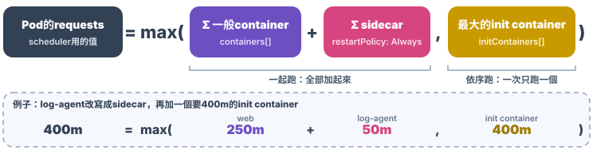
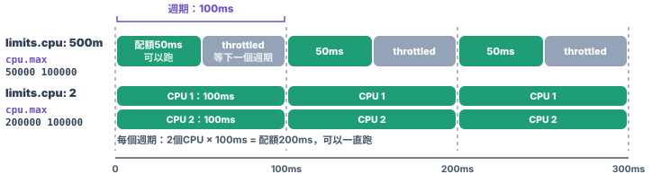
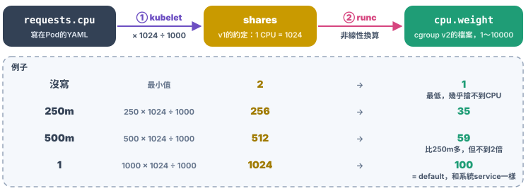
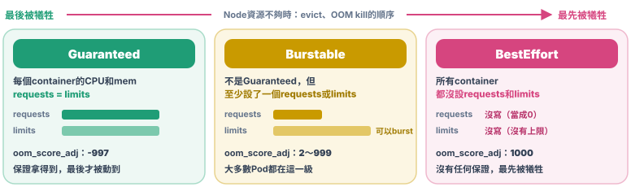

# Chap-8 Scheduler

**目錄**

- [資源模型](#資源模型)
- [QoS和eviction](#qos和eviction)
- [Scheduler怎麼選Node](#scheduler怎麼選node)
- [Scheduling framework](#scheduling-framework)
- [Priority和preemption](#priority和preemption)

> [!NOTE]
> 撰寫中：「Scheduler怎麼選Node」只寫了開頭，之後的section還沒寫。

## 資源模型

*Pod要用多少CPU和mem，怎麼告訴Kubernetes？*

### 📦 1. 資源寫在Pod上

[Pod是Kubernetes最小的排程單位](chap-4-container-orchestration-pod.md#-4-為什麼排程單位是pod)，所以***和排程、資源管理有關的欄位，都寫在Pod上***。其中最重要的是**CPU**和**mem**：

<!-- hl: 9 10 11 12 13 14 15 18 19 20 21 22 23 24 -->

```yaml
apiVersion: v1
kind: Pod
metadata:
  name: frontend
spec:
  containers:
  - name: web                 # app
    image: nginx
    resources:
      requests:
        cpu: "250m"
        memory: "64Mi"
      limits:
        cpu: "500m"
        memory: "128Mi"
  - name: log-agent           # 收log的sidecar
    image: fluent/fluent-bit
    resources:
      requests:
        cpu: "50m"
        memory: "32Mi"
      limits:
        cpu: "100m"
        memory: "64Mi"
```

- **resources寫在每個container上**：`resources`在`containers[]`底下，每個container各寫一份。
- **Pod的總量由scheduler算出來**：scheduler看的不是單純的加總，而是：
  - **一般container**：全部加起來，例如上面的Pod，`requests.cpu`是250m + 50m = **300m**，`requests.memory`是64Mi + 32Mi = **96Mi**；
  - **[init container](chap-4-container-orchestration-pod.md#-1-init-container啟動前的準備)**：一個一個依序執行，所以只取**最大的那一個**，再和一般container的總和比，取大的；
  - **[sidecar](chap-4-container-orchestration-pod.md#-2-sidecar和app一起執行)**（`restartPolicy: Always`的init container）：和一般container一起跑，所以***要加進總和***。



**resources也可以寫在Pod這一層**：在`spec.resources`寫整個Pod的額度，由Pod裡所有container共用，不用逐一分配。這是**Pod-level resources**，只支援CPU、mem和hugepages：

```yaml
spec:
  resources:              # 整個Pod共用
    requests:
      cpu: "500m"
      memory: "128Mi"
    limits:
      cpu: "1"
      memory: "256Mi"
  containers:
  - name: web
    image: nginx
  - name: log-agent
    image: fluent/fluent-bit
```

### 🧮 2. CPU和mem的單位

#### 🖥️ CPU：以「CPU的個數」為單位

- **`1`是1個CPU**：等於1個vCPU，或physical core上的1個hyperthread，看Node的硬體決定。
- **可以寫小數**：`500m`就是500 millicpu，也就是**0.5個CPU**。最小單位是`1m`。
- ***寫`500m`，不要寫`0.5`***：兩者完全一樣，API Server會把`0.5`統一存成`500m`，`kubectl get`看到的也是`500m`。

#### 💾 mem：以bytes為單位

有兩組單位：

| 寫法                                     | 進位     | 例子                                                                                |
| ---------------------------------------- | -------- | ----------------------------------------------------------------------------------- |
| **`Ki`、`Mi`、`Gi`、`Ti`** | 2的次方  | `1Mi` = 1024 × 1024 = 1,048,576 bytes；上面例子的`64Mi`就是2²⁶ bytes         |
| **`K`、`M`、`G`、`T`**     | 10的次方 | `1M` = 1000 × 1000 = 1,000,000 bytes，比`1Mi`少大約5%；`1G`比`1Gi`少大約7% |

- **統一用`Mi`、`Gi`**：和`free`、`top`這些工具看到的數字一致。
- **YAML裡不寫`B`**：寫`64Mi`，不是`64MiB`，後者會被API Server拒絕。
- **mem不要寫小寫`m`**：`m`的意思是「千分之一」，和CPU的`500m`一樣。所以`memory: 128m`是128 × 0.001 = ***0.128 bytes***，不是128MiB；mem請寫`128Mi`。

### 🗜️ 3. 可壓縮和不可壓縮資源

Kubernetes用`requests`和`limits`管理的資源有三種：**CPU**、**mem**，以及**`ephemeral-storage`**（Pod在Node disk上用的空間）。scheduler排程時三者都會檢查，但用到上限時，結果完全不同：

| 資源                        | 類型                                 | 用到上限時                                                                                                                                               |
| --------------------------- | ------------------------------------ | -------------------------------------------------------------------------------------------------------------------------------------------------------- |
| **CPU**               | **compressible**（可壓縮）     | kernel限制它能用的CPU時間（**throttling**），container只會***變慢，不會被殺掉***                                                           |
| **mem**               | **incompressible**（不可壓縮） | kernel的**OOM killer**殺掉container裡的process；kubelet再依`restartPolicy`重啟container，`kubectl get pod`會看到`OOMKilled`和restart次數增加 |
| **ephemeral-storage** | **incompressible**             | Node的disk空間，例如[emptyDir、log、container的writable layer](chap-9-volume.md#storage的分類)；用量超過limit時，Pod會被**evict**                   |

- **被殺的是container，不是Pod**：mem超過limit時，OOM kill的是container裡的process，Pod還在，container會被重啟。
- **Node的mem不夠是另一回事**：scheduler只看`requests`，所以一台Node上所有Pod的`limits`加起來可以超過Node的mem（見[overcommit](#-4-requests和limits)）。例如4Gi的Node上有4個Pod，每個`requests`是1Gi、`limits`是2Gi；每個Pod都用1.5Gi，***沒超過自己的limit***，但加起來**6Gi**，Node的mem不夠了。這時kubelet會主動**evict** Pod，見[QoS和eviction](#qos和eviction)。

### ⚖️ 4. requests和limits

#### 🎯 requests和limits的差別

每種資源都分成`requests`和`limits`：

- **`requests`**：保證能從scheduler拿到的量。
  - **scheduler只看`requests`**：決定Pod能不能放進一台Node。它***不看`limits`，也不看實際用量***。
  - **CPU緊張時依比例分配**：`requests.cpu`會寫進cgroup。
  - **mem緊張時evict**：Node的mem不夠時，用量超過`requests`越多的Pod，越先被evict。
- **`limits`**：不能超過的上限。寫進cgroup。
  - CPU用到上限會被throttle，mem超過上限會被OOM kill。

#### 🗂️ 對應到cgroup的檔案

這些值最後都變成cgroup v2的檔案，原理見[Chap-1的cgroups](chap-1-container-namespace-cgroups.md#-3-實際建立一個cgroup)：

| 欄位                | cgroup v2的檔案 | 效果                                            |
| ------------------- | --------------- | ----------------------------------------------- |
| `requests.cpu`    | `cpu.weight`  | CPU不夠用時，各container依這個比例分配          |
| `limits.cpu`      | `cpu.max`     | `500m`寫成`50000 100000`：每100ms最多用50ms |
| `requests.memory` | 不寫進cgroup    | 只給scheduler和eviction用                       |
| `limits.memory`   | `memory.max`  | `128Mi`寫成`134217728`，超過就OOM kill      |

#### 🧮 實際寫進cgroup的值怎麼算

- **`limits.cpu` → `cpu.max`**：這個檔案裡有兩個數字，用空格隔開，例如`50000 100000`，單位都是微秒（µs）：
  - **週期（第二個數字）**：多久重新計算一次，kubelet default設成100000µs（100ms），一般不會改；
  - **配額（第一個數字）**：每個週期內，最多能用多少CPU時間：
    - **配額 = `limits.cpu` × 週期**：`500m`是0.5 × 100000 = 50000，寫成`50000 100000`，每100ms最多用50ms，也就是***半個CPU***；`2`寫成`200000 100000`，每100ms可以用200ms，因為同時跑在2個CPU上。



其他幾個值比較單純：

- **`limits.memory` → `memory.max`**：直接換算成bytes。`128Mi`是128 × 1024 × 1024 = `134217728`。
- **`requests.memory`**：不寫進cgroup，只給scheduler和eviction用。
- **`requests.cpu` → `cpu.weight`**：`cpu.weight`是***搶CPU時的分配比例***，只在CPU不夠用時才有作用。
  - **例子**：Node只有1個CPU，A、B兩個container都想用滿。A的`cpu.weight`是100、B是300，就照100：300分配，A拿到25%、B拿到75%；B閒著時，A可以用滿100%。
  - **和`cpu.max`的差別**：`cpu.max`是硬上限，CPU閒著也不能超過；`cpu.weight`平常不限制任何人，只決定搶CPU時誰拿得多。
  - **為什麼分兩步**：Kubernetes最早是照cgroup v1設計的，v1用`cpu.shares`表示權重，約定***1個CPU = 1024 shares***，所以kubelet到現在還是先算出**shares** = millicpu × 1024 ÷ 1000，例如`250m` → 256；cgroup v2改用`cpu.weight`，範圍變成1～10000、default 100，所以container runtime（例如runc）再把shares換算成`cpu.weight`，過程見下圖。



換算的目標是讓***`requests.cpu: 1`剛好等於`cpu.weight`的default 100***，和Node上不歸Kubernetes管的process（例如systemd的service）一樣重。換算不是線性的，所以`250m`和`500m`大約是35：59，不是剛好1：2。

> [!NOTE]
> runc 1.3.2、crun 1.23以後，換算的非線性公式如下：
>
> $$
> \text{cpu.weight} = \left\lceil 10^{\frac{L^2}{612} + \frac{125L}{612} - \frac{7}{34}} \right\rceil, \quad L = \log_2(\text{shares})
> $$

#### ✏️ 沒寫requests或limits時

- **只寫`limits`**：`requests`自動補成和`limits`一樣。
- **兩個都不寫**：CPU的權重是***最低值***，CPU一緊張，這個container最先被擠掉。

#### 🚫 requests > limits：不允許

`limits`不能小於`requests`，例如`requests.cpu`是500m、`limits.cpu`是250m，API Server會***直接拒絕這個Pod***。

#### 📈 requests < limits：overcommit

`requests`可以比`limits`小，例如上面的`web`，`requests.cpu`是250m、`limits.cpu`是500m。scheduler只用`requests`計算，所以一台4個CPU的Node，可以放下16個這樣的container，即使它們的`limits`加起來是8個CPU。這叫**overcommit**：平常大家用不滿，Node的使用率比較高。

代價是大家***同時用到接近`limits`***時，Node的資源就不夠：

- **CPU**：互相搶，有starvation，大家都變慢。
- **mem**：Node的mem被用完，kubelet開始evict Pod，或kernel直接OOM kill。`requests`和`limits`差得越多，越容易被選中。

> [!NOTE]
> **實務上怎麼設**
>
> - **mem**：`requests`和`limits`設成**一樣**，避免Node的mem被超賣，最後被OOM kill或evict。
> - **CPU**：一定要設`requests`。`limits`可以不設，或設大一點：CPU超過只會變慢、不會被殺掉，不設limit反而能用到Node閒置的CPU。

> [!TIP]
> 💡 **一句話總結**
>
> ***`requests`給scheduler看，`limits`給cgroup用***。CPU是可壓縮資源，超過只會變慢；mem是不可壓縮資源，超過就OOM kill。

## QoS和eviction

*Node的資源不夠時，Kubernetes先犧牲誰？*

`requests`和`limits`怎麼設，決定了Pod的**QoS（Quality of Service）等級**。QoS的***主要用途是eviction***：Node的資源緊張、kubelet要回收資源時，依這個等級決定先犧牲哪些Pod，見[Node資源不夠時](#-4-node資源不夠時eviction和oom)。等級由Kubernetes自動算出來，寫在Pod的`status.qosClass`，不是在`spec`裡自己填的。



### 🛡️ 1. Guaranteed

**條件**：Pod裡***每一個container***（包括init container）的CPU和mem，都設了`requests`和`limits`，而且**兩者相等**。

```yaml
apiVersion: v1
kind: Pod
metadata:
  name: qos-guaranteed
spec:
  containers:
  - name: nginx
    image: nginx
    resources:
      limits:
        memory: "200Mi"
        cpu: "700m"
      requests:
        memory: "200Mi"
        cpu: "700m"
```

建立後確認它的QoS等級：

```bash
kubectl get pod qos-guaranteed -o jsonpath='{.status.qosClass}'
# → Guaranteed
```

- **CPU和mem都要符合**：只有mem相等、CPU沒設，就不算Guaranteed。
- **最後才被evict**：Node的mem不夠時，kubelet***最後才會動Guaranteed的Pod***。
- **可以獨佔CPU**：kubelet開了static CPU manager policy、而且`requests.cpu`是整數（例如`2`）時，這個container會被綁在固定的CPU核心上，不和別人共用，適合延遲敏感的應用。
- **只寫`limits`也算**：`requests`會自動補成和`limits`一樣，所以下面這樣寫也是Guaranteed：

  ```yaml
  resources:
    limits:          # 沒寫requests，自動補成一樣的值
      memory: "200Mi"
      cpu: "700m"
  ```

### 🎈 2. Burstable

**條件**：不符合Guaranteed，但***至少有一個container設了`requests`或`limits`***（CPU或mem都算）。

```yaml
apiVersion: v1
kind: Pod
metadata:
  name: qos-burstable
spec:
  containers:
  - name: nginx
    image: nginx
    resources:
      limits:
        memory: "200Mi"
      requests:
        memory: "100Mi"
```

- **為什麼是Burstable**：mem的`requests`（100Mi）比`limits`（200Mi）小，CPU也沒設，所以不是Guaranteed；但至少設了一個值，所以也不是BestEffort。
- **可以「burst」**：平常保證有100Mi，Node有空閒時可以用到200Mi，這就是[overcommit](#-4-requests和limits)。
- **大多數Pod都在這一級**：只設`requests`、或`requests`比`limits`小，都屬於Burstable。
- **最常見的寫法：只寫`requests`**：例如CPU只設`requests: {cpu: "250m"}`、不設`limits`，也是Burstable，這正是[實務上建議](#-4-requests和limits)的CPU設定。
- **練習：開頭的`frontend`是哪一級**：[`web`和`log-agent`](#-1-資源寫在pod上)的`requests`都比`limits`小，所以是**Burstable**。就算把`web`改成`requests` = `limits`，只要`log-agent`還不相等，整個Pod***仍然是Burstable***：Guaranteed要求的是每一個container。

### 🪶 3. BestEffort

**條件**：Pod裡***所有container都沒設`requests`和`limits`***。

```yaml
apiVersion: v1
kind: Pod
metadata:
  name: qos-besteffort
spec:
  containers:
  - name: nginx
    image: nginx
```

- **沒有任何保證**：scheduler當它的`requests`是0，放到哪台Node都行；CPU的權重是最低值。
- **最先被犧牲**：Node的資源一緊張，***BestEffort的Pod最先被evict***。
- **適合**：可以隨時重跑、不在乎被中斷的工作，例如測試用的Pod。

### 🚨 4. Node資源不夠時：eviction和OOM

Node的mem或disk快用完時，有兩道防線，都會參考QoS等級；同時，Node也會[暫時不接新的Pod](#-node有pressure時新的pod排不上來)。

#### ① kubelet主動evict Pod

Node的可用mem低於門檻（例如`memory.available<100Mi`）時，kubelet挑Pod刪掉。挑選的順序是：

- **先看用量有沒有超過`requests`**：超過的先被挑。BestEffort的`requests`是0，一定超過；Guaranteed的用量不可能超過`limits`，也就不會超過`requests`；
- **再看[Priority](#priority和preemption)**：優先度低的先；
- **最後看超過`requests`多少**：超過越多越先。

結果就是***BestEffort最先、Burstable其次、Guaranteed最後***。

#### ② kernel的OOM killer

kubelet來不及反應、mem已經真的用完時，kernel直接殺process。kubelet事先依QoS替每個container設好`oom_score_adj`，數字越大越先被殺：

| QoS                  | `oom_score_adj`                               | 被OOM kill的順序 |
| -------------------- | ----------------------------------------------- | ---------------- |
| **BestEffort** | `1000`                                        | 最先             |
| **Burstable**  | 介於`2`到`999`，`requests.memory`越小越大 | 其次             |
| **Guaranteed** | `-997`                                        | 最後             |

#### 🔍 實際看看

把上面三個Pod都建起來，一次列出它們的QoS等級，再看container裡PID 1的`oom_score_adj`：

```bash
kubectl get pod -o custom-columns=NAME:.metadata.name,QOS:.status.qosClass
kubectl exec qos-guaranteed -- cat /proc/1/oom_score_adj
kubectl exec qos-burstable -- cat /proc/1/oom_score_adj
kubectl exec qos-besteffort -- cat /proc/1/oom_score_adj
```

```
NAME             QOS
qos-guaranteed   Guaranteed
qos-burstable    Burstable
qos-besteffort   BestEffort

-997
988
1000
```

- **Burstable的988怎麼來的**：1000 − 1000 × `requests.memory` ÷ Node的mem。這台Node有大約7.65Gi，`qos-burstable`的`requests.memory`是100Mi，算出來大約是988。`requests.memory`越大，數字越小，越晚被OOM kill。

#### 🚧 Node有pressure時：新的Pod排不上來

除了evict已經在跑的Pod，kubelet還會讓這台Node***暫時不接新的Pod***：

1. kubelet發現mem或disk快不夠，把Node的condition設成`MemoryPressure`或`DiskPressure`。
2. control plane依這個condition替Node加上**taint**（Node上的標記，意思是「沒有對應**toleration**的Pod不要排過來」）：`node.kubernetes.io/memory-pressure:NoSchedule`或`node.kubernetes.io/disk-pressure:NoSchedule`。
3. scheduler看到taint，Pod沒有對應的toleration就不排到這台Node。

兩種pressure擋下的Pod不一樣：

| Node的condition          | 被擋下的新Pod                                                                                         |
| ------------------------ | ----------------------------------------------------------------------------------------------------- |
| **DiskPressure**   | 所有新Pod，除了有toleration的                                                                         |
| **MemoryPressure** | ***只有BestEffort的Pod***。Guaranteed和Burstable的Pod會被自動加上這個toleration，還是排得上去 |

**DaemonSet的Pod不受影響**：DaemonSet controller會自動替它的Pod加上`memory-pressure`、`disk-pressure`、`pid-pressure`等toleration，所以每台Node上的agent照樣排得上去。

> [!NOTE]
> **DaemonSet的Pod要設好`requests.memory`**
>
> DaemonSet的Pod被evict之後，DaemonSet controller會馬上***在同一台Node上重建***它，等於白回收了，所以要讓它不容易被evict。**DaemonSet跑的多半是Node本身需要的agent，例如CNI、log收集、監控。少了它們，這台Node可能連網路都不通**。依照[kubelet挑Pod的順序](#①-kubelet主動evict-pod)，有效的做法是：
>
> - **`requests.memory`設成接近實際用量**：最好等於`limits.memory`，用量就不會超過`requests`；
> - **設高的PriorityClass**：Node上不可少的agent（例如CNI、log agent）用`system-node-critical`。
>
> 不一定要設成Guaranteed：Guaranteed還要求CPU的`requests`等於`limits`，CPU有limit就會被throttle，agent可能因此變慢。CPU和eviction無關，***不用為了eviction限制CPU***。

> [!TIP]
> 💡 **一句話總結**
>
> ***QoS等級由`requests`和`limits`自動決定***：兩者相等是Guaranteed，有設一部分是Burstable，都沒設是BestEffort。Node資源不夠時，BestEffort最先被犧牲，Guaranteed最後。

## Scheduler怎麼選Node

### 🧭 1. Scheduler是什麼

**default scheduler**（`kube-scheduler`）只做一件事：***替每一個還沒有Node的Pod選一台Node***。

- **哪些Pod要排**：Pod的`spec.nodeName`是空的，而且`spec.schedulerName`沒寫，或者填了`default-scheduler`。
- **什麼是binding**。scheduler把pod的`spec.nodeName`填上選好的node，就算**調度成功**. ***注意：真正啟動container的是那台Node上的kubelet。***
- **哪些pod不需要scheduler**：自己寫了`spec.nodeName`的Pod（見[Chap-4](chap-4-container-orchestration-pod.md#-2-排程nodeselector和nodenamepod-level)），以及kubelet從Node上的檔案直接啟動的**static Pod**。

### 🔁 2. Scheduler也是一種controller

[Chap-5](chap-5-container-orchestration-controller.md#-2-控制循環)說過，每個controller都是一個控制循環：拿期望狀態和實際狀態比較，不一樣就動手調整。scheduler可以看成一種特殊的controller：用[Informer](chap-5-container-orchestration-controller.md#-5-控制循環實際怎麼跑) watch Pod和Node，在自己的cache裡存一份，***只在有變化時才做事***。和一般controller不同的是，它只做binding，並不會create/delete object。

**scheduler核心的問題是「SELECT 」**：scheduler要同時考慮資源夠不夠、[taint](#-node有pressure時新的pod排不上來)、affinity、分散到不同zone等條件，**比較很多台Node才選得出一台**。

- **scheduling queue**：決定先排哪個Pod；
- **Filter和Score**：先filter掉放不下的Node，再替剩下的Node算score，選score最高的；
- **assume**：選好Node後，先在自己的cache裡當作這個Pod已經放上去了，不等binding寫回API server，就接著排下一個。

> [!TIP]
> 💡 **一句話總結**
>
> ***scheduler是一個專門做「Pod配Node」的controller***：watch還沒有Node的Pod，選一台Node寫進`spec.nodeName`，剩下的交給kubelet。

## Scheduling framework

## Priority和preemption
