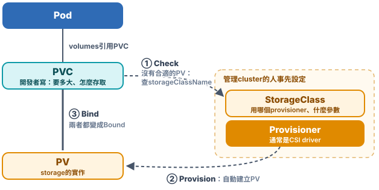

# Chap-8 Storage & Volume

**目錄**

- [Projected Volume](#projected-volume)
- [PV、PVC、StorageClass](#pvpvcstorageclass)

## Projected Volume

*有些volume不是用來存資料的，而是把config、password「project」進container。它們怎麼運作？*

### 📽️ 1. 什麼是Projected Volume

大部分volume是用來***存資料***的，例如[chap-4的emptyDir、hostPath、PVC](chap-4-container-orchestration-pod.md#emptydir跟著pod生跟著pod死)。另外有幾種volume，作用是***把Kubernetes裡事先定義好的資料提供給container***：從container來看，這些檔案像是被Kubernetes「project」進來的，所以叫Projected Volume。

| 來源 | 提供什麼 |
| --- | --- |
| **Secret** | password、token、certificate這類敏感資料 |
| **ConfigMap** | 一般的config |
| **Downward API** | Pod自己的資訊：名稱、namespace、label、資源上限 |
| **ServiceAccountToken** | 存取API Server用的token，見[ServiceAccountToken](#-6-serviceaccounttokenpod怎麼存取api-server) |

這幾種都可以單獨當volume用（`secret`、`configMap`、`downwardAPI`），也可以用[`projected`](https://kubernetes.io/docs/concepts/storage/projected-volumes/)把好幾個來源***合併到同一個目錄***。

### 🔐 2. 例子：用Secret存DB的username和password

先把username、password各存成一個Secret：

```bash
kubectl create secret generic user --from-file=./username.txt
kubectl create secret generic pass --from-file=./password.txt
```

再用`projected`把兩個Secret mount到同一個目錄：

```yaml
apiVersion: v1
kind: Pod
metadata:
  name: test-projected-volume
spec:
  containers:
    - name: test-secret-volume
      image: busybox
      args: ["sleep", "86400"]
      volumeMounts:
        - name: mysql-cred
          mountPath: /projected-volume
          readOnly: true
  volumes:
    - name: mysql-cred
      projected:
        sources:
          - secret:
              name: user
          - secret:
              name: pass
```

```bash
kubectl exec -it test-projected-volume -- ls /projected-volume/
# → password.txt  username.txt
```

- **Secret的每個key，變成目錄裡的一個檔案**：key是檔名，value是檔案內容。
- **app只要讀檔案**：不用在程式裡寫死password，也不用呼叫Kubernetes API。
- **Secret更新後，檔案會自動更新**：kubelet定期同步，會有一點延遲。改用env var inject的話，要重建Pod才會更新，見[env var還是volume](#-5-env-var還是volume)。

> [!WARNING]
> [Secret](https://kubernetes.io/docs/concepts/configuration/secret/)預設***只做base64編碼，沒有加密***，etcd裡存的內容可以直接還原。要真的加密，要另外設定[encryption at rest](https://kubernetes.io/docs/tasks/administer-cluster/encrypt-data/)，或改用Vault這類外部的secret管理系統。

### ⚙️ 3. ConfigMap：一般的config

ConfigMap和Secret的用法幾乎一樣，差別在於它存的是***不敏感***的config，例如DB的位址、log等級、功能開關。

例如一個app的config file：

```bash
cat app.properties
# → db.host=mysql.default.svc.cluster.local
#   db.port=3306
#   log.level=info
#   feature.new-checkout=true

kubectl create configmap app-config --from-file=app.properties
kubectl get configmap app-config -o yaml        # -o yaml：把這個API object以YAML印出來
```

```yaml
apiVersion: v1
kind: ConfigMap
metadata:
  name: app-config
data:
  app.properties: |                             # key是檔名，value是整個檔案內容
    db.host=mysql.default.svc.cluster.local
    db.port=3306
    log.level=info
    feature.new-checkout=true
```

Pod裡用`configMap` volume把它mount進來，app照樣讀`/etc/app/app.properties`：

```yaml
spec:
  containers:
    - name: app
      image: example/my-app:1.0
      volumeMounts:
        - name: config
          mountPath: /etc/app
  volumes:
    - name: config
      configMap:
        name: app-config
```

- **建立方式**：`kubectl create configmap`可以從檔案（`--from-file`）、整個目錄，或直接給key=value（`--from-literal`）建立，也可以直接寫ConfigMap的YAML。
- **也可以變成env var**：用`envFrom`或`valueFrom.configMapKeyRef`，適合少量的值；但env var不會自動更新，見[env var還是volume](#-5-env-var還是volume)。

和Secret比較：

| | ConfigMap | Secret |
| --- | --- | --- |
| **存什麼** | 不敏感的config | password、token、certificate |
| **存在etcd裡** | 明文 | base64編碼，可另外設定encryption at rest |
| **mount到Node上** | 一般的disk | ***tmpfs（mem）***，不會寫進Node的disk |
| **權限** | 通常大家都能讀 | 可以用RBAC限制，只讓需要的人和Pod讀 |
| **大小上限** | 1MiB | 1MiB |

### 🪪 4. Downward API：讓container知道自己是誰

Downward API讓container***不用呼叫API Server***，就能拿到***自己這個Pod***的資訊：名稱、namespace、IP、所在的Node、label、資源上限。

下面的Pod同時用了***2種辦法***，把Pod的資訊給container：***給法一：env var***（`env`），***給法二：volume***（`downwardAPI`）。

```yaml
apiVersion: v1
kind: Pod
metadata:
  name: web-7d4f9
  labels:                                   # ① 來源：Pod自己的label
    app: web
    version: v2
spec:
  containers:
    - name: app
      image: busybox
      command: ["sleep", "3600"]
      env:                                  # 給法一：env var，啟動時給一次
        - name: MY_POD_NAME                 # → MY_POD_NAME=web-7d4f9
          valueFrom:
            fieldRef:
              fieldPath: metadata.name
        - name: MY_NODE_NAME                # → MY_NODE_NAME=worker1
          valueFrom:
            fieldRef:
              fieldPath: spec.nodeName
        - name: MY_POD_IP                   # → MY_POD_IP=10.244.1.5
          valueFrom:
            fieldRef:
              fieldPath: status.podIP
      resources:
        limits:
          memory: 128Mi
      volumeMounts:
        - name: podinfo
          mountPath: /etc/podinfo           # ③ mount到container裡的/etc/podinfo
  volumes:
    - name: podinfo
      downwardAPI:                          # 給法二：volume，每個欄位一個檔案
        items:
          - path: labels                    # ② kubelet把①寫成檔案labels：
            fieldRef:                       #    每行一個key="value"
              fieldPath: metadata.labels
          - path: mem_limit                 # 檔案mem_limit：上面的limits.memory
            resourceFieldRef:
              containerName: app
              resource: limits.memory
```

```bash
# 給法一：env var
kubectl exec web-7d4f9 -- env | grep MY_
# → MY_POD_NAME=web-7d4f9
#   MY_NODE_NAME=worker1
#   MY_POD_IP=10.244.1.5

# 給法二：volume，downwardAPI的每個item變成一個檔案
kubectl exec web-7d4f9 -- ls /etc/podinfo
# → labels  mem_limit

kubectl exec web-7d4f9 -- cat /etc/podinfo/labels
# → app="web"            ← 來自metadata.labels的 app: web
#   version="v2"         ← 來自metadata.labels的 version: v2

kubectl exec web-7d4f9 -- cat /etc/podinfo/mem_limit
# → 134217728            ← 來自limits.memory的128Mi，單位是byte（128 × 1024 × 1024）
```

- **兩種給法**：
  - env var（`fieldRef`）：適合名稱、IP、Node名稱這類固定的值；
  - volume（`downwardAPI`）：每個欄位變成一個檔案，適合label、annotation，***它們改了，檔案會跟著更新***。
- **常見用途**：
  - log和metrics裡帶上Pod名稱和Node名稱，方便追查；
  - app依資源上限調整自己，例如JVM依`limits.memory`決定heap大小。
- **限制：只拿得到container啟動前就確定的資訊**：Downward API拿得到的，都是Pod object上***container啟動前就確定***的欄位，例如名稱、IP、label、資源上限。container執行後才出現的資訊，例如container裡process的PID，Downward API拿不到，要在Pod裡另外放一個sidecar來取得；sidecar要看得到app的process，Pod要設定`shareProcessNamespace: true`。另外，它也只拿得到***這個Pod自己***的資訊；其他Pod或Service的資訊，還是要呼叫API Server，見[ServiceAccountToken](#-6-serviceaccounttokenpod怎麼存取api-server)。

### 🔄 5. env var還是volume

Secret、ConfigMap和Downward API的資訊，大多也可以用env var給container：

| | env var | volume（檔案） |
| --- | --- | --- |
| **寫法** | `env`、`envFrom`、`valueFrom` | `secret`、`configMap`、`downwardAPI`、`projected` |
| **來源更新後** | ❌ ***不會更新***，要重建Pod | ✅ kubelet定期同步，檔案自動更新（會有一點延遲） |
| **app怎麼讀** | 啟動時讀一次`getenv()` | 讀檔案；要即時生效，app要重新讀檔或監看檔案變化 |
| **適合** | 少量、啟動後不會變的值，例如Pod名稱 | config file、certificate、會變的label和config |

***一般建議用volume（檔案）的方式***，因為來源更新後，container裡看到的內容會跟著更新。

> [!NOTE]
> 用`subPath`把volume裡的單一檔案mount到某個路徑時，這個檔案***不會***自動更新，和env var一樣要重建Pod。

### 🎫 6. ServiceAccountToken：Pod怎麼存取API Server

有些Pod裡的程式要***操作Kubernetes API***，例如[controller](chap-5-container-orchestration-controller.md#控制器模式)、CI的agent、[Headlamp](chap-3-kubernetes-architecture-operations.md#-step-7deploy-dashboardheadlamp)這類web UI。API Server收到request時，要先回答兩個問題：

| 問題 | 誰負責 |
| --- | --- |
| **你是誰**（authentication） | ***ServiceAccount***：Pod的身分，用token證明 |
| **你能做什麼**（authorization） | ***RBAC***：Role / ClusterRole定義權限，RoleBinding / ClusterRoleBinding把權限綁到ServiceAccount |

***ServiceAccount本身只是身分，不帶任何權限***。權限要另外用RBAC綁上去。

**① Pod怎麼自動拿到token**

每個namespace都有一個叫`default`的ServiceAccount。Pod沒有指定`serviceAccountName`時就用它，而且Kubernetes會自動替Pod加上一個projected volume，mount到每個container的`/var/run/secrets/kubernetes.io/serviceaccount/`：

```bash
kubectl describe pod web-7d4f9
```

```
Containers:
  app:
    Mounts:
      /var/run/secrets/kubernetes.io/serviceaccount from kube-api-access-7xk2q (ro)
Volumes:
  kube-api-access-7xk2q:
    Type:                    Projected (a volume that contains injected data from multiple sources)
    TokenExpirationSeconds:  3607
    ConfigMapName:           kube-root-ca.crt
    ConfigMapOptional:       <nil>
    DownwardAPI:             true
```

`kube-api-access-7xk2q`就是用[`projected`](#-1-什麼是projected-volume)把三個來源合併到同一個目錄，等於自動加了這段YAML：

<!-- hl: 4 5 6 -->
```yaml
volumes:
  - name: kube-api-access-7xk2q
    projected:
      sources:
        - serviceAccountToken:          # 來源一：token
            expirationSeconds: 3607
            path: token
        - configMap:                    # 來源二：ConfigMap
            name: kube-root-ca.crt
            items:
              - key: ca.crt
                path: ca.crt
        - downwardAPI:                  # 來源三：Downward API
            items:
              - path: namespace
                fieldRef:
                  fieldPath: metadata.namespace
```

| 檔案 | 來源 | 用途 |
| --- | --- | --- |
| **`token`** | `serviceAccountToken` | 證明身分，放在HTTP header：`Authorization: Bearer <token>` |
| **`ca.crt`** | ConfigMap `kube-root-ca.crt`（每個namespace都自動有一份） | 驗證API Server的certificate |
| **`namespace`** | [`downwardAPI`](#-4-downward-api讓container知道自己是誰) | 這個Pod所在的namespace |

**② token的特性**

- **不存在Secret裡**：kubelet透過API Server的***TokenRequest API***替這個Pod申請token，直接寫進volume。[Headlamp登入用的`kubectl create token`](chap-3-kubernetes-architecture-operations.md#-step-7deploy-dashboardheadlamp)，走的也是同一個API。
- **有期限**：大約1小時。kubelet會在到期前申請新的token、更新檔案（volume會自動更新，見[env var還是volume](#-5-env-var還是volume)），所以app要定期重新讀檔，不能啟動時讀一次就一直用。官方的client lib（例如Go的client-go）已經處理好了。
- **綁定這個Pod**：Pod刪掉，token馬上失效，就算外洩也用不了多久。

**③ 在Pod裡存取API Server**

client-go的`rest.InClusterConfig()`做的事情，就是讀上面三個檔案，再用env var `KUBERNETES_SERVICE_HOST`、`KUBERNETES_SERVICE_PORT`找到API Server。用`curl`手動做一次（container裡要有`curl`）：

```bash
SA=/var/run/secrets/kubernetes.io/serviceaccount
curl --cacert $SA/ca.crt \
  -H "Authorization: Bearer $(cat $SA/token)" \
  https://kubernetes.default.svc/api/v1/namespaces/$(cat $SA/namespace)/pods
# → "message": "pods is forbidden: User \"system:serviceaccount:default:default\"
#   cannot list resource \"pods\" in API group \"\" in the namespace \"default\""
```

- **`kubernetes.default.svc`**：`default` namespace裡叫`kubernetes`的Service，就是API Server的固定入口，見[Service的DNS](chap-5-container-orchestration-controller.md#-2-怎麼存取servicevip和dns)。
- **403 Forbidden**：API Server認出了身分`system:serviceaccount:default:default`（namespace `default`裡的`default` ServiceAccount），但***它沒有權限list Pod***。`default` ServiceAccount幾乎沒有權限。

**④ 用RBAC給權限**

建一個只能讀Pod的ServiceAccount：

<!-- hl: 13 -->
```yaml
apiVersion: v1
kind: ServiceAccount
metadata:
  name: pod-reader
---
apiVersion: rbac.authorization.k8s.io/v1
kind: Role
metadata:
  name: pod-reader
rules:
  - apiGroups: [""]                   # ""：core API group，Pod在這裡
    resources: ["pods"]
    verbs: ["get", "list", "watch"]   # 只能讀，不能改或刪
```

<!-- hl: 5 6 7 8 -->
```yaml
apiVersion: rbac.authorization.k8s.io/v1
kind: RoleBinding
metadata:
  name: pod-reader
subjects:                             # 綁給誰：ServiceAccount pod-reader
  - kind: ServiceAccount
    name: pod-reader
    namespace: default
roleRef:                              # 給什麼權限：Role pod-reader
  kind: Role
  name: pod-reader
  apiGroup: rbac.authorization.k8s.io
```

Pod用`serviceAccountName`指定它：

<!-- hl: 2 -->
```yaml
spec:
  serviceAccountName: pod-reader
  containers:
    - name: app
      image: example/my-app:1.0
```

再跑一次上面的`curl`，就會return這個namespace裡的Pod清單；要刪Pod的話，一樣回403。

- **Role、ClusterRole的差別和更多用法**：見[Chap-6的RBAC](chap-6-declarative-api.md#rbac)。
- **權限給最小就好**：只給程式真正需要的resource和verb。

**⑤ 不需要就不要mount**

大部分app根本不會呼叫API Server，但token還是會被mount進去；container被入侵時，token就可能被拿去用。不需要的話，在Pod或ServiceAccount上關掉：

```yaml
spec:
  automountServiceAccountToken: false
```

> [!TIP]
> 💡 **一句話總結**
>
> ***ServiceAccount是Pod的身分，RBAC決定它能做什麼***。Kubernetes自動把token、`ca.crt`、`namespace`用projected volume mount進`/var/run/secrets/kubernetes.io/serviceaccount/`；token有期限、綁定Pod，由kubelet自動更新。

## PV、PVC、StorageClass

*一個PVC，怎麼變成container裡的持久化目錄？*

我們在Chap-5已經看過PVC和PV的基本用法：

- **PVC是開發者寫的**：只寫要多大、怎麼存取（`accessModes`），Pod的`volumes`用`claimName`引用它，見[Chap-5的PVC](chap-5-container-orchestration-controller.md#pvc開發者只要兩步)。
- **PV是管理cluster的人提供的**：寫清楚storage怎麼做到，例如用哪個CSI driver、哪個pool，見[Chap-5的PV](chap-5-container-orchestration-controller.md#pv管理cluster的人提供實作)。
- **兩者像interface和implementation**：PVC說「要什麼」，PV說「怎麼做到」，由Kubernetes把兩個綁在一起；開發者不用知道storage的細節。
- **PV也可以自動建立**：設定StorageClass後，Kubernetes依PVC自動建PV（dynamic provisioning），實務上大多這樣用。

這一節接著看三件事：***PV和PVC怎麼綁定、PV怎麼變成host上的目錄、PV怎麼自動建立***。



### 💞 1. Bind：PersistentVolumeController

kube-controller-manager裡有一個***PersistentVolumeController***，專門撮合PV和PVC：

- **控制循環**：不斷檢查每個PVC是不是`Bound`；不是的話，就在所有可用的PV裡找一個符合條件的綁上去。所以PVC先建、PV後建也沒關係，PV一出現就會被綁上。
- **綁定的條件**：PV的`spec`要滿足PVC，例如容量夠大、`accessModes`對得上；而且兩邊的`storageClassName`要一樣，見[Chap-5的NOTE](chap-5-container-orchestration-controller.md#pv管理cluster的人提供實作)。
- **「綁定」是什麼**：就是把PV的名字，寫進PVC的`spec.volumeName`。之後拿到PVC，就一定找得到它的PV。

### 📂 2. 從PV到container裡的目錄：Attach和Mount

container的volume，本質上就是把***host上的一個目錄***，[bind mount](chap-2-container-fs-security.md#mount---bind技術)到container裡。所謂「持久化volume」，指的是這個host目錄裡的內容，***不會因為container刪除而消失，也不和這台host綁死***。

[emptyDir和hostPath](chap-4-container-orchestration-pod.md#emptydir跟著pod生跟著pod死)做不到：它們可能被kubelet清掉，也不能搬到別的Node。所以持久化volume通常靠remote storage：remote file storage（例如NFS），或remote block storage（例如雲端的disk、Ceph RBD）。

kubelet替Pod準備的volume目錄在：

```
/var/lib/kubelet/pods/<Pod的UID>/volumes/kubernetes.io~<volume類型>/<volume名字>
```

把remote storage變成這個持久化目錄，分兩個階段：

| 階段 | 做什麼 | 誰做 | 需要的參數 |
| --- | --- | --- | --- |
| **① Attach** | 把remote disk接到Pod所在的Node上，就像替VM加一顆disk | kube-controller-manager裡的***AttachDetachController***（CSI會建立VolumeAttachment，由external-attacher呼叫storage的API） | Node名稱 |
| **② Mount** | 把disk format之後，mount到上面的volume目錄 | kubelet裡的***VolumeManager***，是一個獨立的goroutine | volume目錄 |

- **NFS這類file storage不需要Attach**：沒有disk要接到Node上，kubelet直接`mount -t nfs`到volume目錄。
- **最後一步**：volume目錄準備好之後，kubelet透過CRI把它交給container runtime，runtime再把它bind mount到container裡。
- **為什麼拆成獨立的控制循環**：remote的attach、mount都很慢。拆出去之後，***kubelet的主控制循環就不會被block***，建立Pod的速度不受影響。刪除時反過來做Unmount和Detach。

### 🏭 3. StorageClass：自動建立PV

PV靠人手動建立（**static provisioning**），在大cluster裡做不到：可能有上千個PVC，每個都要先有一個符合的PV。所以Kubernetes提供**dynamic provisioning**：***StorageClass就是建立PV的template***，定義兩件事：

- **用哪個provisioner**：也就是storage plugin，通常是CSI driver。
- **PV的參數**：例如disk類型、replica數。

```yaml
apiVersion: storage.k8s.io/v1
kind: StorageClass
metadata:
  name: block-service
provisioner: pd.csi.storage.gke.io    # GKE的Persistent Disk CSI driver
parameters:
  type: pd-ssd                        # SSD類型的disk
```

開發者在PVC裡寫`storageClassName: block-service`。建立PVC之後，Kubernetes就呼叫這個provisioner，建出一塊SSD disk，再自動建立對應的PV並綁上。自動建立的PV名字是`pvc-<uid>`，`storageClassName`和PVC一樣，`Reclaim Policy`預設是`Delete`：PVC刪掉，disk也會一起刪除。

- **在自己的cluster上**：[Chap-3用Rook-Ceph建立的StorageClass](chap-3-kubernetes-architecture-operations.md#建立storageclass再測一次pvc)，就是同樣的機制。
- **不在清單上的storage**：例如NFS，裝對應的CSI driver就好（例如csi-driver-nfs），它會帶著external-provisioner一起deploy。
- **StorageClass不只用在dynamic provisioning**：PV和PVC都寫`storageClassName: manual`，cluster裡就算沒有叫`manual`的StorageClass也沒關係。這時是static provisioning，但Kubernetes仍然只會綁定`storageClassName`相同的PV和PVC，綁定關係完全由自己掌控。
- **沒寫`storageClassName`時**：`DefaultStorageClass`這個admission plugin會替PVC補上default StorageClass；cluster沒有default時，值就是`""`，只能綁`storageClassName`也是`""`的PV。

### 🤔 4. 會不會過度設計？

PV、PVC、StorageClass三層看起來很多，但實際上***開發者通常只需要寫PVC***：cluster有default StorageClass時，連`storageClassName`都不用寫，PV會自動產生、自動綁定。另外兩層是留給管理cluster的人，把storage的細節和開發者分開。

> [!TIP]
> 💡 **一句話總結**
>
> ***PVC是需求，PV是實作，StorageClass是建PV的template***。PersistentVolumeController負責綁定；AttachDetachController和kubelet的VolumeManager分兩階段，把remote storage變成host上的持久化目錄，再bind mount進container。
