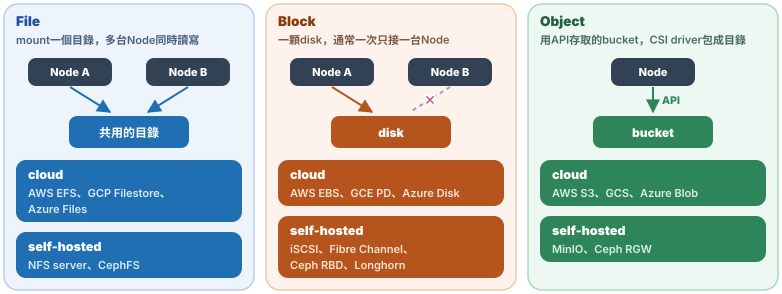
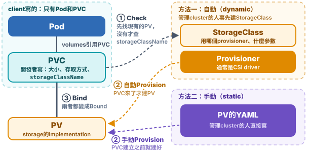
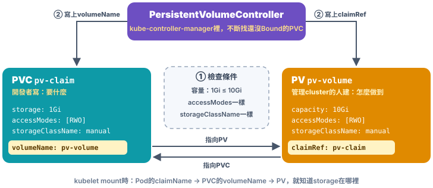
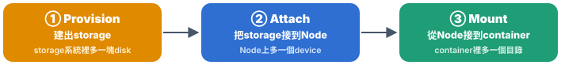
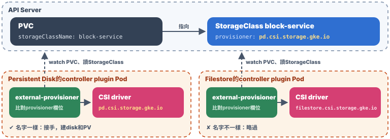
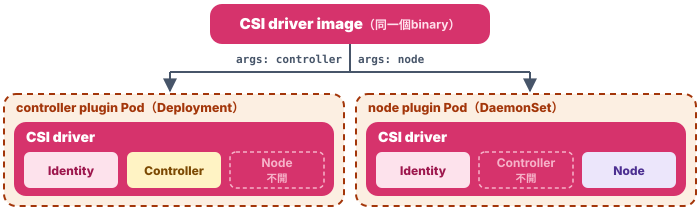

# Chap-9 Storage & Volume

**目錄**

- [Storage的分類](#storage的分類)
- [Projected Volume](#projected-volume)
- [PV、PVC、StorageClass](#pvpvcstorageclass)
- [CSI（Container Storage Interface）](#csicontainer-storage-interface)
- [Local PV](#local-pv)

## Storage的分類

*Kubernetes的volume有十幾種，怎麼分清楚？*

先問兩個問題：***資料活多久***、***資料實際存在哪裡***。依「資料活多久」可以分成**三類**，每一類再看**資料從哪裡來**：


### ⏳ 1. 跟著Pod生、跟著Pod死（ephemeral）

| 類型                                                           | 是什麼                                                                                                                                                                                                  | 資料存在哪裡                                                                                                                                                       |
| -------------------------------------------------------------- | ------------------------------------------------------------------------------------------------------------------------------------------------------------------------------------------------------- | ------------------------------------------------------------------------------------------------------------------------------------------------------------------ |
| **emptyDir**                                             | Pod建立時產生的**空目錄**，同一個Pod的container共用                                                                                                                                               | **Node的disk**；寫`medium: Memory`就放在**mem**（tmpfs）                                                                                             |
| **Secret、ConfigMap、Downward API、ServiceAccountToken** | 把Kubernetes裡的**etcd資料變成檔案**，`projected`可以合在同一個目錄                                                                                                                             | 來源在**etcd**；Node上是kubelet抄下來的複本：**Secret、Downward API和`projected`放在*mem*（tmpfs）**，單獨mount的**ConfigMap放在Node的disk** |
| **generic ephemeral volume**                             | **本質是一個PVC。像emptyDir，但多了emptyDir做不到的功能**：例如用network storage、帶initial data等。在Pod裡寫`ephemeral.volumeClaimTemplate`，參數類似PVC，Kubernetes會替這個Pod自動建一個PVC。 | StorageClass指定的**storage系統**，例如cloud disk、Ceph                                                                                                      |
| **CSI ephemeral inline volume**                          | 在Pod的`volumes`裡直接寫`csi: {driver, volumeAttributes}`（driver名字和參數）。**不建PV/PVC，kubelet直接呼叫node plugin mount**                                                               | 由CSI driver決定，例如Secrets Store CSI driver從**Vault**取secret                                                                                            |
| **image volume**                                         | 把一個**OCI image的內容**當成volume mount進來，例如模型檔                                                                                                                                         | **image registry**；Node上是container runtime拉下來的image，**read-only**                                                                              |

這一類的「ephemeral」指的是***生命週期***，不是存在mem：generic ephemeral volume用的就是**真正的disk**，只是跟著Pod一起刪掉。

### 🖥️ 2. 綁在一台Node

| 類型               | 是什麼                                                       | 資料存在哪裡                          |
| ------------------ | ------------------------------------------------------------ | ------------------------------------- |
| **hostPath** | 直接mount Node上的目錄                                       | **Node的disk**，指定的目錄      |
| **local PV** | 把Node上的disk包成PV，**scheduler會把Pod排到那台Node** | **Node上的一顆disk**或partition |

Pod刪掉，**資料還在Node上**；但Pod換到別的Node，***就看不到這些資料***。

### 💾 3. 持久化（PV / PVC）

| 類型                                            | 是什麼                                                   | 資料存在哪裡                                         |
| ----------------------------------------------- | -------------------------------------------------------- | ---------------------------------------------------- |
| **static provisioning**                   | 管理cluster的**人手動建PV**，PVC綁上去             | **remote storage**，例如NFS server、cloud disk |
| **dynamic provisioning**                  | 依PVC和StorageClass**自動建disk和PV**              | StorageClass的provisioner建出的**remote disk** |
| **StatefulSet的`volumeClaimTemplates`** | **每個replica**自動建自己的PVC，例如`data-web-0` | 每個PVC各自一塊remote disk                           |
| **snapshot、擴容、clone**                 | 對已經存在的PV做操作，**由CSI driver執行**         | storage系統裡，例如cloud的snapshot                   |

Pod刪掉、換到別的Node，***資料都還在***：資料在**remote storage**上，**哪台Node都能接上**。這一章後面的[PV、PVC、StorageClass](#pvpvcstorageclass)和[CSI](#csicontainer-storage-interface)講的就是這一類。

**PV背後是什麼storage**：上面的表是從***Kubernetes這一側***分類，看PV怎麼建、怎麼用；從***storage這一側***看，**PV背後的storage依存取方式分成三種**，每一種都有cloud和self-hosted可以選。兩種分類可以任意搭配，例如同一種AWS EBS，可以手動建PV，也可以用StorageClass自動建。generic ephemeral volume背後也是這些storage。



| 類型             | 是什麼                                                    | cloud                               | self-hosted                              |
| ---------------- | --------------------------------------------------------- | ----------------------------------- | ---------------------------------------- |
| **File**   | 透過network mount一個目錄，**可以多台Node同時讀寫** | AWS EFS、GCP Filestore、Azure Files | NFS server、CephFS                       |
| **Block**  | 一顆disk，通常**一次只能接到一台Node**              | AWS EBS、GCE PD、Azure Disk         | iSCSI、Fibre Channel、Ceph RBD、Longhorn |
| **Object** | 用API存取的bucket，由CSI driver包成目錄                   | AWS S3、GCS、Azure Blob             | MinIO、Ceph RGW                          |

- **cloud和self-hosted的差別只在誰管storage**：在Kubernetes裡的用法一樣，都是裝CSI driver、建StorageClass，再用PVC要。
- **Ceph三種都有**：同一個Ceph cluster可以同時提供file（CephFS）、block（RBD）和object（RGW），在Kubernetes上通常用Rook這個Operator deploy。
- **Longhorn**：把每台Node上的disk組成分散式的block storage，專門為Kubernetes設計，適合沒有外部storage的self-hosted cluster。
- **選哪一種**：***一般DB用block***，效能好；多個Pod要***同時讀寫同一份檔案用file***；***大量檔案、備份、模型用object***。

> [!TIP]
> 💡 **一句話總結**
>
> ***選volume先問資料活多久***：跟著Pod的用ephemeral volume；只要留在這台Node的用hostPath或local PV；換Node也要在的用PV/PVC。

## Projected Volume

*有些volume不是用來存資料的，而是把etcd中存的object，例如：config、password等，「project」進container。它們怎麼運作？*

### 📽️ 1. 什麼是Projected Volume

大部分volume是用來***存資料***的，例如[chap-4的emptyDir、hostPath、PVC](chap-4-container-orchestration-pod.md#emptydir跟著pod生跟著pod死)。另外有幾種volume，作用是***把Kubernetes裡事先定義好的資料提供給container***：從container來看，這些檔案像是被Kubernetes「project」進來的，所以叫**Projected Volume**。

| 來源                          | 提供什麼                                                                                      |
| ----------------------------- | --------------------------------------------------------------------------------------------- |
| **Secret**              | password、token、certificate這類敏感資料                                                      |
| **ConfigMap**           | 一般的config                                                                                  |
| **Downward API**        | Pod自己的資訊：名稱、namespace、label、資源上限                                               |
| **ServiceAccountToken** | 存取API Server用的token，見[ServiceAccountToken](#-6-serviceaccounttokenpod怎麼存取api-server) |

這幾種都可以單獨當volume用（`secret`、`configMap`、`downwardAPI`），也可以用[`projected`](https://kubernetes.io/docs/concepts/storage/projected-volumes/)把好幾個來源***合併到同一個目錄***。

### 🔐 2. 例子：用Secret存DB的username和password

先把username、password各存成一個Secret：

```bash
kubectl create secret generic user --from-file=./username.txt
kubectl create secret generic pass --from-file=./password.txt
```

再用`projected`把兩個Secret mount到同一個目錄：

```yaml
apiVersion: v1
kind: Pod
metadata:
  name: test-projected-volume
spec:
  containers:
    - name: test-secret-volume
      image: busybox
      args: ["sleep", "86400"]
      volumeMounts:
        - name: mysql-cred
          mountPath: /projected-volume
          readOnly: true
  volumes:
    - name: mysql-cred
      projected:
        sources:
          - secret:
              name: user
          - secret:
              name: pass
```

```bash
kubectl exec -it test-projected-volume -- ls /projected-volume/
# → password.txt  username.txt
```

- **Secret的每個key，變成目錄裡的一個檔案**：key是檔名，value是檔案內容。
- **app只要讀檔案**：不用在程式裡寫死password，也不用呼叫Kubernetes API。
- **Secret更新後，檔案會自動更新**：kubelet定期同步，會有一點延遲。改用env var inject的話，要重建Pod才會更新，見[env var還是volume](#-5-env-var還是volume)。

> [!WARNING]
> [Secret](https://kubernetes.io/docs/concepts/configuration/secret/) default***只做base64編碼，沒有加密***，etcd裡存的內容可以直接還原。要真的加密，要另外設定 [encryption at rest](https://kubernetes.io/docs/tasks/administer-cluster/encrypt-data/)，或改用Vault這類外部的secret管理系統。

### ⚙️ 3. ConfigMap：一般的config

ConfigMap和Secret的用法幾乎一樣，差別在於它存的是***不敏感***的config，例如DB的位址、log等級、feature flag。

例如一個app的config file：

```bash
cat app.properties
# → db.host=mysql.default.svc.cluster.local
#   db.port=3306
#   log.level=info
#   feature.new-checkout=true

kubectl create configmap app-config --from-file=app.properties
kubectl get configmap app-config -o yaml        # -o yaml：把這個API object以YAML印出來
```

```yaml
apiVersion: v1
kind: ConfigMap
metadata:
  name: app-config
data:
  app.properties: |                             # key是檔名，value是整個檔案內容
    db.host=mysql.default.svc.cluster.local
    db.port=3306
    log.level=info
    feature.new-checkout=true
```

Pod裡用`configMap` volume把它mount進來，app照樣讀`/etc/app/app.properties`：

```yaml
spec:
  containers:
    - name: app
      image: example/my-app:1.0
      volumeMounts:
        - name: config
          mountPath: /etc/app
  volumes:
    - name: config
      configMap:
        name: app-config
```

- **建立方式**：`kubectl create configmap`可以從檔案（`--from-file`）、整個目錄，或直接給key=value（`--from-literal`）建立，也可以直接寫ConfigMap的YAML。
- **也可以變成env var**：用`envFrom`或`valueFrom.configMapKeyRef`，適合少量的值；但env var不會自動更新，見[env var還是volume](#-5-env-var還是volume)。

和Secret比較：

|                         | ConfigMap      | Secret                                         |
| ----------------------- | -------------- | ---------------------------------------------- |
| **存什麼**        | 不敏感的config | password、token、certificate                   |
| **存在etcd裡**    | 明文           | base64編碼，可另外設定encryption at rest       |
| **mount到Node上** | 一般的disk     | ***tmpfs（mem）***，不會寫進Node的disk |
| **權限**          | 通常大家都能讀 | 可以用RBAC限制，只讓需要的人和Pod讀            |
| **大小上限**      | 1MiB           | 1MiB                                           |

### 🪪 4. Downward API：讓container知道自己是誰

**Downward API**讓container***不用呼叫API Server***，就能拿到***自己這個Pod***的資訊：名稱、namespace、IP、所在的Node、label、資源上限。

下面的Pod同時用了***2種辦法***，把Pod的資訊給container：***給法一：env var***（`env`），***給法二：volume***（`downwardAPI`）。

```yaml
apiVersion: v1
kind: Pod
metadata:
  name: web-7d4f9
  labels:                                   # ① 來源：Pod自己的label
    app: web
    version: v2
spec:
  containers:
    - name: app
      image: busybox
      command: ["sleep", "3600"]
      env:                                  # 給法一：env var，啟動時給一次
        - name: MY_POD_NAME                 # → MY_POD_NAME=web-7d4f9
          valueFrom:
            fieldRef:
              fieldPath: metadata.name
        - name: MY_NODE_NAME                # → MY_NODE_NAME=worker1
          valueFrom:
            fieldRef:
              fieldPath: spec.nodeName
        - name: MY_POD_IP                   # → MY_POD_IP=10.244.1.5
          valueFrom:
            fieldRef:
              fieldPath: status.podIP
      resources:
        limits:
          memory: 128Mi
      volumeMounts:
        - name: podinfo
          mountPath: /etc/podinfo           # ③ mount到container裡的/etc/podinfo
  volumes:
    - name: podinfo
      downwardAPI:                          # 給法二：volume，每個欄位一個檔案
        items:
          - path: labels                    # ② kubelet把①寫成檔案labels：
            fieldRef:                       #    每行一個key="value"
              fieldPath: metadata.labels
          - path: mem_limit                 # 檔案mem_limit：上面的limits.memory
            resourceFieldRef:
              containerName: app
              resource: limits.memory
```

```bash
# 給法一：env var
kubectl exec web-7d4f9 -- env | grep MY_
# → MY_POD_NAME=web-7d4f9
#   MY_NODE_NAME=worker1
#   MY_POD_IP=10.244.1.5

# 給法二：volume，downwardAPI的每個item變成一個檔案
kubectl exec web-7d4f9 -- ls /etc/podinfo
# → labels  mem_limit

kubectl exec web-7d4f9 -- cat /etc/podinfo/labels
# → app="web"            ← 來自metadata.labels的 app: web
#   version="v2"         ← 來自metadata.labels的 version: v2

kubectl exec web-7d4f9 -- cat /etc/podinfo/mem_limit
# → 134217728            ← 來自limits.memory的128Mi，單位是byte（128 × 1024 × 1024）
```

- **兩種給法**：
  - env var（`fieldRef`）：適合名稱、IP、Node名稱這類固定的值；
  - volume（`downwardAPI`）：每個欄位變成一個檔案，適合label、annotation，***它們改了，檔案會跟著更新***。
- **常見用途**：
  - log和metrics裡帶上Pod名稱和Node名稱，方便追查；
  - app依資源上限調整自己，例如JVM依`limits.memory`決定heap大小。
- **限制：只拿得到container啟動前就確定的資訊**：Downward API拿得到的，都是Pod object上***container啟動前就確定***的欄位，例如名稱、IP、label、資源上限。container執行後才出現的資訊，例如container裡process的PID，Downward API拿不到，要在Pod裡另外放一個sidecar來取得；sidecar要看得到app的process，Pod要設定`shareProcessNamespace: true`。另外，它也只拿得到***這個Pod自己***的資訊；其他Pod或Service的資訊，還是要呼叫API Server，見[ServiceAccountToken](#-6-serviceaccounttokenpod怎麼存取api-server)。

### 🔄 5. env var還是volume

Secret、ConfigMap和Downward API的資訊，大多也可以用env var給container：

|                      | env var                              | volume（檔案）                                            |
| -------------------- | ------------------------------------ | --------------------------------------------------------- |
| **寫法**       | `env`、`envFrom`、`valueFrom`  | `secret`、`configMap`、`downwardAPI`、`projected` |
| **來源更新後** | ❌ ***不會更新***，要重建Pod | ✅ kubelet定期同步，檔案自動更新（會有一點延遲）          |
| **app怎麼讀**  | 啟動時讀一次`getenv()`             | 讀檔案；要即時生效，app要重新讀檔或監看檔案變化           |
| **適合**       | 少量、啟動後不會變的值，例如Pod名稱  | config file、certificate、會變的label和config             |

***一般建議用volume（檔案）的方式***，因為來源更新後，container裡看到的內容會跟著更新。

> [!NOTE]
> 用`subPath`把volume裡的單一檔案mount到某個路徑時，這個檔案***不會***自動更新，和env var一樣要重建Pod。

### 🎫 6. ServiceAccountToken：Pod怎麼存取API Server

有些Pod裡的程式要***操作Kubernetes API***，例如[controller](chap-5-container-orchestration-controller.md#控制器模式)、CI的agent、[Headlamp](chap-3-kubernetes-architecture-operations.md#-step-7deploy-dashboardheadlamp)這類web UI。API Server收到request時，要先回答兩個問題：

| 問題                                  | 誰負責                                                                                                   |
| ------------------------------------- | -------------------------------------------------------------------------------------------------------- |
| **你是誰**（authentication）    | ***ServiceAccount***：Pod的身分，用token證明                                                     |
| **你能做什麼**（authorization） | ***RBAC***：Role / ClusterRole定義權限，RoleBinding / ClusterRoleBinding把權限綁到ServiceAccount |

***ServiceAccount本身只是身分，不帶任何權限***。權限要另外用RBAC綁上去。

#### ① Pod怎麼自動拿到token

每個namespace都有一個叫`default`的ServiceAccount。Pod沒有指定`serviceAccountName`時就用它，而且Kubernetes會自動替Pod加上一個**projected volume**，mount到每個container的`/var/run/secrets/kubernetes.io/serviceaccount/`：

```bash
kubectl describe pod web-7d4f9
```

```
Containers:
  app:
    Mounts:
      /var/run/secrets/kubernetes.io/serviceaccount from kube-api-access-7xk2q (ro)
Volumes:
  kube-api-access-7xk2q:
    Type:                    Projected (a volume that contains injected data from multiple sources)
    TokenExpirationSeconds:  3607
    ConfigMapName:           kube-root-ca.crt
    ConfigMapOptional:       <nil>
    DownwardAPI:             true
```

`kube-api-access-7xk2q`就是用[`projected`](#-1-什麼是projected-volume)把三個來源合併到同一個目錄，等於自動加了這段YAML：

<!-- hl: 4 5 6 -->

```yaml
volumes:
  - name: kube-api-access-7xk2q
    projected:
      sources:
        - serviceAccountToken:          # 來源一：token
            expirationSeconds: 3607
            path: token
        - configMap:                    # 來源二：ConfigMap
            name: kube-root-ca.crt
            items:
              - key: ca.crt
                path: ca.crt
        - downwardAPI:                  # 來源三：Downward API
            items:
              - path: namespace
                fieldRef:
                  fieldPath: metadata.namespace
```

| 檔案                    | 來源                                                        | 用途                                                         |
| ----------------------- | ----------------------------------------------------------- | ------------------------------------------------------------ |
| **`token`**     | `serviceAccountToken`                                     | 證明身分，放在HTTP header：`Authorization: Bearer <token>` |
| **`ca.crt`**    | ConfigMap `kube-root-ca.crt`（每個namespace都自動有一份） | 驗證API Server的certificate                                  |
| **`namespace`** | [`downwardAPI`](#-4-downward-api讓container知道自己是誰)   | 這個Pod所在的namespace                                       |

#### ② token的特性

- **不存在Secret裡**：kubelet透過API Server的***TokenRequest API***替這個Pod申請token，直接寫進volume。[Headlamp登入用的`kubectl create token`](chap-3-kubernetes-architecture-operations.md#-step-7deploy-dashboardheadlamp)，走的也是同一個API。
- **有期限**：大約1小時。kubelet會在到期前申請新的token、更新檔案（volume會自動更新，見[env var還是volume](#-5-env-var還是volume)），所以app要定期重新讀檔，不能啟動時讀一次就一直用。官方的client lib（例如Go的client-go）已經處理好了。
- **綁定這個Pod**：Pod刪掉，token馬上失效，就算外洩也用不了多久。

#### ③ 在Pod裡存取API Server

client-go的`rest.InClusterConfig()`做的事情，就是讀上面三個檔案，再用env var `KUBERNETES_SERVICE_HOST`、`KUBERNETES_SERVICE_PORT`找到API Server。用`curl`手動做一次（container裡要有`curl`）：

```bash
SA=/var/run/secrets/kubernetes.io/serviceaccount
curl --cacert $SA/ca.crt \
  -H "Authorization: Bearer $(cat $SA/token)" \
  https://kubernetes.default.svc/api/v1/namespaces/$(cat $SA/namespace)/pods
# → "message": "pods is forbidden: User \"system:serviceaccount:default:default\"
#   cannot list resource \"pods\" in API group \"\" in the namespace \"default\""
```

- **`kubernetes.default.svc`**：`default` namespace裡叫`kubernetes`的Service，就是API Server的固定入口，見[Service的DNS](chap-5-container-orchestration-controller.md#-2-怎麼存取servicevip和dns)。
- **403 Forbidden**：API Server認出了身分`system:serviceaccount:default:default`（namespace `default`裡的`default` ServiceAccount），但***它沒有權限list Pod***。`default` ServiceAccount幾乎沒有權限。

#### ④ 用RBAC給權限

建一個只能讀Pod的ServiceAccount：

<!-- hl: 13 -->

```yaml
apiVersion: v1
kind: ServiceAccount
metadata:
  name: pod-reader
---
apiVersion: rbac.authorization.k8s.io/v1
kind: Role
metadata:
  name: pod-reader
rules:
  - apiGroups: [""]                   # ""：core API group，Pod在這裡
    resources: ["pods"]
    verbs: ["get", "list", "watch"]   # 只能讀，不能改或刪
```

<!-- hl: 5 6 7 8 -->

```yaml
apiVersion: rbac.authorization.k8s.io/v1
kind: RoleBinding
metadata:
  name: pod-reader
subjects:                             # 綁給誰：ServiceAccount pod-reader
  - kind: ServiceAccount
    name: pod-reader
    namespace: default
roleRef:                              # 給什麼權限：Role pod-reader
  kind: Role
  name: pod-reader
  apiGroup: rbac.authorization.k8s.io
```

Pod用`serviceAccountName`指定它：

<!-- hl: 2 -->

```yaml
spec:
  serviceAccountName: pod-reader
  containers:
    - name: app
      image: example/my-app:1.0
```

再跑一次上面的`curl`，就會return這個namespace裡的Pod清單；要刪Pod的話，一樣回403。

- **Role、ClusterRole的差別和更多用法**：見[Chap-6的RBAC](chap-6-declarative-api.md#rbac)。
- **權限給最小就好**：只給程式真正需要的resource和verb。

#### ⑤ 不需要就不要mount

大部分app根本不會呼叫API Server，但token還是會被mount進去；container被入侵時，token就可能被拿去用。不需要的話，在Pod或ServiceAccount上關掉：

```yaml
spec:
  automountServiceAccountToken: false
```

> [!TIP]
> 💡 **一句話總結**
>
> ***ServiceAccount是Pod的身分，RBAC決定它能做什麼***。Kubernetes自動把token、`ca.crt`、`namespace`用projected volume mount進`/var/run/secrets/kubernetes.io/serviceaccount/`；token有期限、綁定Pod，由kubelet自動更新。

## PV、PVC、StorageClass

*一個PVC，怎麼變成container裡的持久化目錄？*

我們在Chap-5已經看過PVC和PV的基本用法：

- **PVC是開發者寫的**：***PVC 是 Pod 所希望使用的持久化volume的属性描述***。只寫要多大、怎麼存取（`accessModes`），Pod的`volumes`用`claimName`引用它，見[Chap-5的PVC](chap-5-container-orchestration-controller.md#pvc開發者只要兩步)。
- **PV是管理cluster的人提供的**：***PV是持久化volume實現***。寫清楚storage怎麼做到，例如用哪個CSI driver、哪個pool、Volume 的类型、挂载目录、远程存储服务器地址等。其中**CSI（Container Storage Interface）**是Kubernetes和storage系統之間的**標準介面**，每種storage各自implement一個**CSI driver**，見[Chap-5的PV](chap-5-container-orchestration-controller.md#pv管理cluster的人提供implementation)。
- **StorageClass是管理cluster的人建的**：***StorageClass是建PV的template***。PVC和PV靠同一個`storageClassName`配對；Kubernetes還能依PVC和StorageClass自動建PV（dynamic provisioning），實務上大多這樣用。大多數cluster安裝時就帶一個default StorageClass（例如kind的`standard`），PVC沒寫`storageClassName`就用它，見[StorageClass](#-3-如何使用storageclass自動建立pv)。

> [!NOTE]
> **PVC和PV像interface和implementation**：**PVC說「需要什麼」，PV說「怎麼做到」**，由Kubernetes把兩個綁在一起；開發者不用知道storage的細節。

這一節接著看三件事：***PV和PVC怎麼綁定、PV怎麼變成host上的目錄、PV怎麼自動建立***。

**PV有兩種建立方法**：**自動的用StorageClass，手動的是直接寫PV**；***client一律透過PVC使用***。



### 💞 1. Bind：PersistentVolumeController

kube-controller-manager裡有一個***PersistentVolumeController***，專門撮合PV和PVC：



- **控制循環**：不斷檢查每個PVC是不是`Bound`；不是的話，就在所有可用的PV裡找一個符合條件的綁上去。所以PVC先建、PV後建也沒關係，PV一出現就會被綁上。
- **綁定的條件**：兩個條件都要成立：
  - ① **`spec`滿足**：PV的`spec`要滿足PVC，例如容量夠大、`accessModes`對得上；
  - ② **`storageClassName`一致**：PV和PVC的`storageClassName`要一樣，見[Chap-5的NOTE](chap-5-container-orchestration-controller.md#pv管理cluster的人提供implementation)。

> [!NOTE]
> 圖裡兩邊都寫`manual`，因為這是手動建的PV。***`manual`不是default，是自己取的名字***：它只是PV和PVC上的同一個字串，cluster裡不需要真的有叫`manual`的StorageClass。PVC要是沒寫`storageClassName`，會被補上cluster的default（例如kind的`standard`），反而綁不到這個PV，見[StorageClass](#-3-如何使用storageclass自動建立pv)。

#### 🔗 「綁定」是什麼

不是什麼特別的連線，只是PersistentVolumeController在兩個object上***各寫一個欄位，互相指向對方***：

<!-- hl: 3 7 8 -->

```yaml
# PVC（開發者寫的pv-claim）
spec:
  volumeName: pv-volume     # controller寫上：綁到哪個PV
---
# PV（管理cluster的人建的pv-volume）
spec:
  claimRef:                 # controller寫上：被哪個PVC綁走
    name: pv-claim
    namespace: default
```

- **為什麼要寫`volumeName`和`claimRef`**：Pod只寫了PVC的名字（`claimName: pv-claim`）。kubelet要mount時，順著Pod → PVC的`volumeName` → PV，就知道storage實際在哪裡。PV這邊的`claimRef`則讓這個PV不會再被別的PVC綁走。

### 📂 2. 從PV到container裡的目錄：CSI plugin的Attach和Mount

**一個volume要出現在container裡，要經過三步**：**Provision建出storage，Attach把storage接到Node，Mount再從Node接到container**。***Provision只做一次***；Attach和Mount跟著Pod，Pod換Node就在新的Node上重做。



***container的volume，本質上就是把host上的一個目錄，[bind mount](chap-2-container-fs-security.md#mount---bind技術)到container裡***。所謂「**持久化volume**」，指的是這個host目錄裡的內容，***不會因為container刪除而消失，也不和這台host綁死***。

[emptyDir和hostPath](chap-4-container-orchestration-pod.md#emptydir跟著pod生跟著pod死)做不到：***emptyDir跟著Pod刪除；hostPath的資料雖然留在Node上，但只在那一台***，Pod換到別的Node就找不到。所以持久化volume通常靠**remote storage**：**remote file storage**（例如NFS），或**remote block storage**（例如cloud的disk、Ceph RBD）。

#### 🔌 把remote storage變成Node上的目錄

kubelet替Pod準備的volume目錄在：

```
/var/lib/kubelet/pods/<Pod的UID>/volumes/kubernetes.io~<volume類型>/<volume名字>
```

要把remote storage變成持久化目錄，需要一個元件：**CSI plugin**。它分成兩個部分：[controller plugin和node plugin](#-2-csi-driver和sidecar)，也就是CSI driver deploy成的兩種Pod，下一節詳細介紹。

> [!NOTE]
> **CSI plugin和PV、PVC、StorageClass的安裝順序**：***CSI plugin要最先裝好***，因為後面兩步都要用到它：StorageClass的`provisioner`填的是CSI driver的名字；PVC建好之後，也是CSI plugin建disk和PV（external-provisioner呼叫CSI driver建disk，再建PV代表這顆disk）：
>
> ），PV自動和PVC綁定" width="100%">
>
> 圖中的3 steps做完，只是完成了**Provision**：有了一個和PVC綁在一起的PV。但disk還沒接到任何Node，還需要**Attach**和**Mount**，這兩步***要等Pod排程到Node之後才做***，因為要先知道是哪台Node。

CSI plugin接下來要做**Attach**和**Mount**兩個步驟，才能把remote storage真正變成container能用的持久化目錄。***Kubernetes的元件只決定要不要做，實際動手的是CSI plugin***：

| 階段                        | 做什麼                                           | 誰決定                               | 誰執行                          | 需要的參數                                                                                                                                                          |
| --------------------------- | ------------------------------------------------ | ------------------------------------ | ------------------------------- | ------------------------------------------------------------------------------------------------------------------------------------------------------------------- |
| **① Attach**         | 把remote disk接到Pod所在的Node，像替VM加一顆disk | ***AttachDetachController*** | ***controller plugin*** | Node名稱，例如：`nodeName: node-a`{ .nowrap }                                                                                                                     |
| **② Format + Mount** | 沒有file system就先format，再mount到volume目錄   | kubelet的***VolumeManager*** | ***node plugin***       | volume目錄，例如：`target_path:/var/lib/kubelet/pods/`{ .nowrap }`<Pod的UID>/volumes/`{ .nowrap }`kubernetes.io~csi/`{ .nowrap }`<PV名字>/mount`{ .nowrap } |

/volumes/…/<volume名字>；③ 建立container，④ bind mount到container裡的mountPath" width="90%">

1. **Attach：control plane決定，controller plugin執行**：kube-controller-manager裡的AttachDetachController決定disk要接到哪台Node後，會透過API Server建立一個VolumeAttachment（寫明`nodeName`）。***VolumeAttachment是一個API object，像一張工作單，記錄「哪個PV要接到哪台Node」***，和其他object一樣存在etcd裡。[CSI driver的controller plugin](#-2-csi-driver和sidecar)（一個Deployment，負責建立和attach disk）Pod裡的external-attacher看到它，呼叫CSI driver（`ControllerPublishVolume`），由driver呼叫storage API把remote disk接到Node上，完成後把VolumeAttachment標成`attached: true`。credentials只放在CSI controller Pod裡，不用每台Node都有；Node掛掉時也有人能detach。
2. **Format + Mount：kubelet決定，node plugin執行**：`mount`只能在Node上做，所以由kubelet負責觸發，但不在kubelet的主控制循環（SyncLoop，負責依Pod的變化建立、刪除container）裡做。mount remote disk可能要好幾秒，如果在主循環裡等，***其他Pod也會跟著卡住***。所以交給**VolumeManager**：它在kubelet裡跑在***獨立的goroutine***，用自己的循環，透過gRPC呼叫這台Node上node plugin的CSI driver，分兩步完成：

- **`NodeStageVolume`**：format；
- **`NodePublishVolume`**：bind mount。

#### 📦 把這個目錄掛進container

目錄準備好之後，要讓container用到這個volume，也是兩步：

<ol start="3" markdown>
<li markdown="span">**建立container**：kubelet的主循環等volume目錄準備好，透過CRI呼叫container runtime建立container，request裡帶著「Node上的volume目錄 → container裡的`mountPath`」。</li>
<li markdown="span">**bind mount**：runtime建立container時，把volume目錄bind mount到`mountPath`。CRI只負責傳遞，真正做bind mount的是runtime；disk只在Node上mount一次，container看到的是同一個目錄。</li>
</ol>

> [!NOTE]
> **NFS這類file storage不需要Attach**：沒有disk要接到Node上，Node透過網路直接mount遠端的file system。CSI driver會宣告自己不需要attach，AttachDetachController就不建VolumeAttachment，直接進第2步；NFS本身就是file system，也不用format，由CSI driver的node plugin執行`mount -t nfs`。

刪除時反過來：先**Unmount**，再**Detach**。

### 🏭 3. 如何使用StorageClass自動建立PV

PV靠人手動建立屬於**static provisioning**，在大cluster裡做不到：可能有上千個PVC，每個都要先有一個符合的PV。所以Kubernetes提供**dynamic provisioning**：***StorageClass，就是建立PV的template***，它會義兩件事：

- **用哪個provisioner**：填***CSI driver的名字***，每種storage各有一個。例如GKE的Persistent Disk填`pd.csi.storage.gke.io`，AWS的EBS填`ebs.csi.aws.com`，[Chap-3用Rook裝的Ceph](chap-3-kubernetes-architecture-operations.md#建立storageclass再測一次pvc)（RBD block storage）填`rook-ceph.rbd.csi.ceph.com`。

  CSI driver通常有兩種來源：

  - **cloud provider預先裝好**：例如GKE的`pd.csi.storage.gke.io`，建好cluster就有。
  - **管理cluster的人自己裝**：例如[Chap-3的Rook-Ceph](chap-3-kubernetes-architecture-operations.md#建立storageclass再測一次pvc)，或NFS的csi-driver-nfs。
- **PV的參數**：寫在`parameters`裡，key由各家driver決定。例如GKE的***disk類型***`type: pd-ssd`；Longhorn（一種開源的block storage）的***replica數***`numberOfReplicas: "3"`。

```yaml
apiVersion: storage.k8s.io/v1
kind: StorageClass
metadata:
  name: block-service
provisioner: pd.csi.storage.gke.io    # GKE的Persistent Disk CSI driver
parameters:
  type: pd-ssd                        # SSD類型的disk
```

管理cluster的人用`kubectl apply -f sc.yaml`建立這個StorageClass，***每個cluster只要建一次***，之後所有PVC都能用。

**CSI driver和StorageClass都準備好之後**，就輪到開發者：在PVC裡寫`storageClassName: block-service`。建立PVC之後，這個CSI driver的[external-provisioner](#-1-整體架構)（和driver一起deploy的sidecar，負責watch PVC）會看到這個PVC，呼叫driver建出一塊SSD disk，再自動建立對應的PV並綁上。自動建立的PV名字是`pvc-<uid>`，`storageClassName`和PVC一樣，`Reclaim Policy` default是`Delete`：PVC刪掉，disk也會一起刪除。

> [!TIP]
> **🔀 PVC的`storageClassName`四種寫法**
>
> | PVC的寫法                          | 結果                                                                                                                       |
> | ---------------------------------- | -------------------------------------------------------------------------------------------------------------------------- |
> | **沒寫，cluster有default**   | 建立時，`DefaultStorageClass`這個admission plugin自動補上default StorageClass，走dynamic provisioning                    |
> | **沒寫，cluster沒有default** | 欄位維持沒有值，只能綁沒有StorageClass的PV。之後cluster新增了default，PersistentVolumeController會回頭補上                 |
> | **寫`""`**                 | 明確表示不要StorageClass，永遠不會被補上，只綁沒有StorageClass的PV                                                         |
> | **寫一個名字**               | 照寫的用。手動建PV時，PV和PVC都寫同一個名字（例如`manual`）就能配對，***cluster裡不需要真的有這個StorageClass*** |
>
> - **default StorageClass**：StorageClass上有`storageclass.kubernetes.io/is-default-class: "true"` annotation的，就是default。
> - **「沒寫」和「`""`」意思不同**：沒寫是「用default就好」；`""`是「我不要dynamic provisioning」，手動配對PV時用它，避免PVC被補上default、跑去建新的PV。

> [!TIP]
> 💡 **一句話總結**
>
> ***PVC是需求，PV是implementation，StorageClass是建PV的template***。
>
> - **Bind**：PersistentVolumeController把PVC和PV綁在一起。
> - **Attach + Mount**：AttachDetachController和kubelet的VolumeManager決定要不要做，CSI plugin實際執行，把remote storage變成Node上的目錄，再bind mount進container。
> - **Dynamic provisioning**：管理cluster的人裝好CSI driver、建好StorageClass；開發者只寫PVC，external-provisioner自動建disk和PV。

## CSI（Container Storage Interface）

*Kubernetes怎麼接上各家不同的storage？*

### 🗺️ 1. 整體架構

[PV、PVC、StorageClass](#pvpvcstorageclass)裡的Bind、Attach、Mount和dynamic provisioning，「**要不要做**」都由Kubernetes的**controller**和**kubelet**決定；但「**實際怎麼做**」，例如呼叫cloud API建disk、把disk接到Node、format和mount，每種storage都不一樣。CSI的設計，就是***把這些實際操作從Kubernetes的主程式拆出來，單獨包裝成外部元件（external-XXX sidecars）***：Kubernetes只建立、更新API object；external-XXX外部元件watch這些object，再透過gRPC呼叫各家storage寫的CSI driver。

> [!NOTE]
> **為什麼要把CSI driver和external-XXX拆出來**：
>
> - **不用重新compile Kubernetes**：要支援新的storage，只要裝它的CSI driver，***不用改Kubernetes的code，也不用等Kubernetes發新版***。
> - **storage提供者自己發佈**：driver的版本、bug fix由storage提供者自己決定，和Kubernetes的release分開。
> - **external-XXX的code大家共用**：watch API object、建PV、重試這些和storage無關，社群寫一次就好；***每個driver的Pod裡各放一份***，storage提供者不用自己寫。
> - **external-XXX要貼著driver跑**：它要呼叫driver的unix socket，只有同一個Pod裡的container才連得到；放在control plane的kube-controller-manager裡就連不到。


### 🧩 2. CSI driver和sidecar

圖中間那條橘色長短虛線就是CSI：左邊是**Kubernetes社群維護**的***external* *****sidecar元件***，右邊是**storage提供者寫**的***CSI driver***。

#### 🧩 External sidecars

Kubernetes社群（SIG Storage）維護的container，和CSI driver放在**同一個Pod**裡。**sidecar透過unix socket呼叫CSI driver**：

- **external-provisioner**：**建立disk和PV**。Watch PVC，***只處理StorageClass的`provisioner`是自己driver名字的PVC***，呼叫CSI driver建立disk（`CreateVolume`），再建立對應的PV，見[dynamic provisioning](#-3-如何使用storageclass自動建立pv)；
- **external-attacher**：**把disk接到Node**。Watch VolumeAttachment，呼叫CSI driver把disk接到Node（`ControllerPublishVolume`），見[Attach和Mount](#-2-從pv到container裡的目錄csi-plugin的attach和mount)；
- **external-resizer**：**擴容PVC**。Watch PVC，PVC要求的容量變大時，呼叫CSI driver擴容（`ControllerExpandVolume`）；
- **external-snapshotter**：**建立snapshot**。Watch VolumeSnapshotContent，呼叫CSI driver建立snapshot（`CreateSnapshot`）；
- **node-driver-registrar**：**登記driver**。向這台Node的kubelet登記這個CSI driver，讓kubelet知道這台Node上有這個driver，以及它的socket在哪裡。它**不做任何storage操作**。

> [!NOTE]
> 例如GKE上同時裝了Persistent Disk和Filestore兩個CSI driver，就有兩個external-provisioner（同一份binary 不同參數）。PVC寫`storageClassName: block-service`，這個StorageClass的`provisioner`是`pd.csi.storage.gke.io`，所以只有Persistent Disk的external-provisioner接手，Filestore的那個會略過。
>
> 

#### 🧠 CSI driver

storage提供者（cloud provider、storage廠商、開源storage project）寫的程式，通常只有**一個binary**，用gRPC提供**3組service**：

| Service              | 做什麼                                                                            | 在哪個Pod開       |
| -------------------- | --------------------------------------------------------------------------------- | ----------------- |
| **Identity**   | 回報driver的名字和功能                                                            | 兩種Pod都會開     |
| **Controller** | 不需要在特定Node上做的事，例如建立 / 刪除disk、attach / detach，會呼叫storage API | controller plugin |
| **Node**       | 一定要在那台Node上做的事，例如format、mount                                       | node plugin       |

這三個service定義在CSI spec的`csi.proto`裡，***CSI driver要implement的就是它們***。`service`是一組gRPC interface，`rpc`是其中一個method，括號裡是request和response的型別（只列主要的method，其他用`…`省略）：

<!-- hl: 17 22 39 44 -->

```protobuf
// 兩種Pod都開
service Identity {
  // driver名字，例如pd.csi.storage.gke.io
  rpc GetPluginInfo (GetPluginInfoRequest)
    returns (GetPluginInfoResponse) {}
  // 有沒有Controller service等
  rpc GetPluginCapabilities (GetPluginCapabilitiesRequest)
    returns (GetPluginCapabilitiesResponse) {}
  // 健康檢查
  rpc Probe (ProbeRequest)
    returns (ProbeResponse) {}
}

// controller plugin開，由sidecar呼叫
service Controller {
  // Provision：建disk（external-provisioner）
  rpc CreateVolume (CreateVolumeRequest)
    returns (CreateVolumeResponse) {}
  rpc DeleteVolume (DeleteVolumeRequest)
    returns (DeleteVolumeResponse) {}
  // Attach（external-attacher）
  rpc ControllerPublishVolume (ControllerPublishVolumeRequest)
    returns (ControllerPublishVolumeResponse) {}
  // Detach
  rpc ControllerUnpublishVolume (ControllerUnpublishVolumeRequest)
    returns (ControllerUnpublishVolumeResponse) {}
  // 擴容（external-resizer）
  rpc ControllerExpandVolume (ControllerExpandVolumeRequest)
    returns (ControllerExpandVolumeResponse) {}
  // snapshot（external-snapshotter）
  rpc CreateSnapshot (CreateSnapshotRequest)
    returns (CreateSnapshotResponse) {}
  …
}

// node plugin開，由kubelet直接呼叫
service Node {
  // Mount第1步：format + mount到staging目錄
  rpc NodeStageVolume (NodeStageVolumeRequest)
    returns (NodeStageVolumeResponse) {}
  rpc NodeUnstageVolume (NodeUnstageVolumeRequest)
    returns (NodeUnstageVolumeResponse) {}
  // Mount第2步：bind mount到Pod的volume目錄
  rpc NodePublishVolume (NodePublishVolumeRequest)
    returns (NodePublishVolumeResponse) {}
  rpc NodeUnpublishVolume (NodeUnpublishVolumeRequest)
    returns (NodeUnpublishVolumeResponse) {}
  // 回報Node ID和topology
  rpc NodeGetInfo (NodeGetInfoRequest)
    returns (NodeGetInfoResponse) {}
  …
}
```

- **driver怎麼implement**：`csi.proto`會產生Go的`IdentityServer`、`ControllerServer`、`NodeServer` interface。driver implement完，用`csi.RegisterIdentityServer()`這類函數註冊到一個gRPC server上，監聽一個unix socket。
- **不一定每個method都要implement**：driver用`GetPluginCapabilities`、`ControllerGetCapabilities`、`NodeGetCapabilities`宣告自己支援哪些功能。例如NFS沒有disk要接，就不需要Attach和Stage。



這個binary會deploy成**兩種Pod**，只是開的service和搭配的sidecar不一樣：

- **controller plugin**：Deployment，同時只有**一個**在工作。裡面的sidecar（external-provisioner、external-attacher）watch PVC、VolumeAttachment這些API object，有變化就呼叫CSI driver建立disk、把disk attach到Node。這些都是呼叫storage API，在哪台Node上做都一樣，所以不用每台Node都跑；storage的**credentials**也只放在這裡，***不用發到每台Node上***。
- **node plugin**：DaemonSet，**每台Node一個**，搭配node-driver-registrar。它不watch API object，而是由kubelet直接呼叫，負責把disk format、mount到Node上。這些***一定要在disk接上的那台Node上做***，所以每台Node都要有一個。
- **例子**：[Chap-3裝的Rook-Ceph](chap-3-kubernetes-architecture-operations.md#建立ceph-cluster)就是這樣，`…-ctrlplugin-…`是controller plugin，`…-nodeplugin-…`是node plugin。

> [!TIP]
> 💡 **一句話總結**
>
> ***Kubernetes決定要做什麼，CSI driver負責怎麼做***。controller plugin（Deployment）裡的sidecar watch PVC和VolumeAttachment，呼叫driver建disk、attach；node plugin（DaemonSet）在每台Node上，由kubelet直接呼叫，負責format和mount。

## Local PV

*不走網路，可以直接用Node自己的disk當持久化volume嗎？*

前面的PV都靠**remote storage**：資料在網路另一端，Pod換到哪台Node都能attach回來。但remote storage每次讀寫都要走網路，效能比不上Node自己的**local disk**，尤其是NVMe SSD。用physical machine自建的cluster，Node上通常都有大容量的local disk。

**Local PV**（Local Persistent Volume）就是***把Node上的local disk包成PV***：開發者一樣只寫PVC，資料直接存在Node的disk上。

### 🆚 1. 和hostPath差在哪

[hostPath](chap-4-container-orchestration-pod.md#emptydir跟著pod生跟著pod死)也是用Node上的目錄，***Pod刪掉後資料還留在那台Node上***；但它寫在Pod裡，***Kubernetes不知道這個目錄只在某台Node上***：Pod被排到別台Node，看到的是另一個空目錄。於此對應：**Local PV把「disk在哪台Node」寫進PV**，scheduler會照這個資訊排Pod。

|                          | hostPath                                              | Local PV                        |
| ------------------------ | ----------------------------------------------------- | ------------------------------- |
| **寫在哪**         | Pod的`volumes`                                      | PV                              |
| **知道在哪台Node** | 不知道                                                | 知道，寫在PV的`nodeAffinity`  |
| **scheduler**      | 不管，Pod可能排到別台                                 | 只把Pod排到有這顆disk的Node     |
| **存在哪**         | Node上的一個目錄，通常在root disk                     | **一個PV一顆專用的disk**  |
| **容量和I/O**      | 沒有限制，可能把整台Node寫滿；**I/O和別人共用** | 就是那顆disk，**I/O獨佔** |
| **適合**           | 讀Node的系統檔案，例如log agent                       | 存app的資料                     |

### 📍 2. PV：寫明disk在哪台Node

<!-- hl: 13 19 -->

```yaml
apiVersion: v1
kind: PersistentVolume
metadata:
  name: local-pv-node-a
spec:
  capacity:
    storage: 100Gi
  accessModes: ["ReadWriteOnce"]
  persistentVolumeReclaimPolicy: Retain
  storageClassName: local-storage
  local:
    path: /mnt/disks/ssd1            # Node上已經mount好的disk
  nodeAffinity:                      # 一定要寫：這個PV只在node-a上
    required:
      nodeSelectorTerms:
      - matchExpressions:
        - key: kubernetes.io/hostname
          operator: In
          values: ["node-a"]
```

- **`local.path`**：Node上已經mount好的disk，***一個PV一顆專用的disk，不能是Node的root disk***。***Kubernetes不會幫你format、mount這顆disk***，要管理cluster的人事先準備。
- **`nodeAffinity`**：***local PV一定要寫***。PVC綁到這個PV以後，用這個PVC的Pod只能排到node-a。
- **`Retain`**：PVC刪掉以後資料還在，由管理cluster的人清理。

### ⏳ 3. StorageClass：等Pod排程時才綁定

```yaml
apiVersion: storage.k8s.io/v1
kind: StorageClass
metadata:
  name: local-storage
provisioner: kubernetes.io/no-provisioner   # 不自動建PV
volumeBindingMode: WaitForFirstConsumer     # 等Pod排程時才綁定
```

- **`no-provisioner`**：disk要先實際裝在Node上，Kubernetes沒辦法自動建出來，所以PV要事先建好，屬於**static provisioning**。
- **`WaitForFirstConsumer`**：***PVC要等到有Pod用它、scheduler替這個Pod選Node時才綁定***。default的`Immediate`是PVC一建立，[PersistentVolumeController](#-1-bindpersistentvolumecontroller)就馬上綁定。

> [!TIP]
> **為什麼要等？** 假設node-a和node-b各有一個local PV，Pod要4 CPU，只有node-b有空：
>
> - **`Immediate`**：PVC先綁到node-a的PV，Pod就只能排到node-a，但node-a的CPU不夠，Pod卡在`Pending`。
> - **`WaitForFirstConsumer`**：scheduler同時看CPU和PV的`nodeAffinity`，選了node-b，再把PVC綁到node-b的PV。

### 📝 4. PVC和Pod：開發者照常寫

開發者的寫法和remote storage一樣，只要指定`storageClassName`：

<!-- hl: 7 -->

```yaml
apiVersion: v1
kind: PersistentVolumeClaim
metadata:
  name: data
spec:
  accessModes: ["ReadWriteOnce"]
  storageClassName: local-storage     # 指到上面的StorageClass
  resources:
    requests:
      storage: 100Gi
---
apiVersion: v1
kind: Pod
metadata:
  name: app
spec:
  containers:
  - name: app
    image: nginx
    volumeMounts:
    - name: data
      mountPath: /data
  volumes:
  - name: data
    persistentVolumeClaim:
      claimName: data
```

***PVC和Pod都沒有寫node-a***：

- **PVC**：只寫要多大、用哪個StorageClass，不知道disk在哪台Node。
- **Pod**：只寫用哪個PVC，不用寫`nodeSelector`或`nodeName`。
- **誰決定去node-a**：scheduler排Pod時，發現它用的PVC要綁local PV，就照PV的`nodeAffinity`把Pod排到node-a。

開發者完全不用管disk在哪裡：換一個cluster，或管理cluster的人把disk換到別台Node，yaml都不用改。

只建PVC、還沒建Pod時，PVC會停在`Pending`。這不是錯誤，而是在***等第一個使用它的Pod***：

```bash
kubectl get pvc data
# → NAME   STATUS    VOLUME   CAPACITY   STORAGECLASS
#   data   Pending                       local-storage

kubectl describe pvc data
# → Events:
#   Normal  WaitForFirstConsumer  waiting for first consumer to be created before binding
```

建立Pod以後，scheduler把Pod排到node-a，PVC才綁到`local-pv-node-a`：

```bash
kubectl get pvc data
# → NAME   STATUS   VOLUME            CAPACITY   STORAGECLASS
#   data   Bound    local-pv-node-a   100Gi      local-storage
```

### 🗂️ 5. StatefulSet：每個Pod自動回到自己的Node

DB這類app通常用StatefulSet跑好幾個Pod，每個Pod用[volumeClaimTemplates](chap-5-container-orchestration-controller.md#volumeclaimtemplates每個pod一個固定的pvc)各拿一個PVC。搭配local PV時，***每個Pod第一次排到哪台Node，之後就一直回到那台***，靠的是這條鏈：

```
Pod名字固定 → PVC名字固定 → PVC綁著同一個PV → PV的nodeAffinity固定在那台Node
```

- **Pod名字固定**：例如`db-1`，Pod刪掉重建，名字還是`db-1`。
- **PVC名字固定**：`<template名字>-<Pod名字>`，例如`data-db-1`。新的`db-1`找到***同一個PVC***，不會建新的。
- **PVC和PV的綁定固定**：第一次[Bind](#-1-bindpersistentvolumecontroller)之後就不會換。
- **PV的`nodeAffinity`固定**：scheduler只能把`db-1`排回那台Node。

所以***StatefulSet的template裡不能寫`nodeSelector`***：template是所有Pod共用的，寫了會讓每個Pod都擠到同一台Node。每個Pod該去哪台Node，第一次由scheduler選（`WaitForFirstConsumer`），之後由PV決定；template裡只寫分散的規則，例如`podAntiAffinity`（一台Node只放一個Pod）。

> [!NOTE]
> **Node不夠資源時，Pod寧可等，也不換Node**：資料只在那台Node上，所以`db-1`會一直`Pending`，等那台Node有空或回來。要換Node，只能刪掉它的PVC，讓StatefulSet建一個新的PVC、綁到別台Node的空local PV，再由app自己把資料複製過去，見[⚠️ 代價](#-8-代價pod被綁在node上)。

### 🔌 6. Attach和Mount：Pod跟著disk走

和[remote storage的Attach和Mount](#-2-從pv到container裡的目錄csi-plugin的attach和mount)比，local PV***沒有Attach，也不需要CSI driver***：remote storage是***disk跟著Pod走***，Pod排到哪台Node，就把disk attach到哪台；local PV是***Pod跟著disk走***，disk固定在一台Node上，由scheduler照`nodeAffinity`把Pod排過去。

/volumes/…/<PV名字>；③ 建立container，④ bind mount到mountPath" width="90%">

- **事先準備**：管理cluster的人在Node上format disk，mount到`local.path`（例如`/mnt/disks/ssd1`）。
- **Mount**：Pod排到node-a以後，kubelet做的事等於`mount --bind /mnt/disks/ssd1 <Pod的volume目錄>`。
- **掛進container**：和remote storage一樣，container runtime再把volume目錄bind mount到`mountPath`。

> [!TIP]
> **🔧 不想手寫PV**
>
> 一台Node可能有好幾顆disk，一個一個手寫PV很麻煩，常見的做法：
>
> - **local static provisioner（DaemonSet）**：project名稱是`sig-storage-local-static-provisioner`。它在每台Node上掃描指定的目錄（例如`/mnt/disks/`），替每顆mount好的disk自動建一個local PV；PVC刪掉以後，會清空disk、重新建PV。***還是static provisioning***，只是不用手寫。
> - **CSI driver做dynamic provisioning**：例如OpenEBS LocalPV、TopoLVM，用LVM從Node的disk切出PVC要的大小，PVC建立時才建，搭配`WaitForFirstConsumer`。
> - **local-path-provisioner**：kind和k3s的default StorageClass。它在Node上建一個目錄當volume，default建的是帶`nodeAffinity`的hostPath PV，不是`local` type，適合開發和測試。

### ✅ 7. 適合的app

適合Local PV的app，要同時符合三個條件：***自己會在多台Node上複製資料***、***對I/O敏感***、***資料要撐過Pod重啟***。例如：

- **分散式DB**：Cassandra、MongoDB、CockroachDB、etcd
- **分散式storage和message queue**：Ceph（[Rook](chap-3-kubernetes-architecture-operations.md#建立ceph-cluster)的OSD直接用Node的disk）、MinIO、Kafka
- **在local disk上放大量cache的app**：例如CI的build cache、ML的dataset cache

### ⚠️ 8. 代價：Pod被綁在Node上

- **資料只在一台Node上**：不會自己複製資料的app（例如單台MySQL）不適合，應該用remote storage，見[Chap-3的storage選擇](chap-3-kubernetes-architecture-operations.md#-業界常見的做法ceph不是所有stateful-app的最佳選擇)。
- **Node永久壞掉時**：Pod會一直`Pending`，要刪掉PVC（和PV），讓Pod重新排到別台Node，再由app自己把資料複製回來。所以需要在app層做backup 或 replication防止數據丟失。

> [!TIP]
> 💡 **一句話總結**
>
> ***Local PV用Node自己的disk，一個PV一顆，沒有Attach***。`WaitForFirstConsumer`讓scheduler選好Node才綁定，之後***Pod跟著disk走***。
