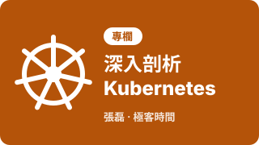
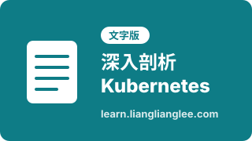

# Reference

**目錄**

- [課程](#課程)
- [影片](#影片)
- [進階主題](#進階主題)
- [簡寫對照](#簡寫對照)

## 課程

| 縮圖 | 資料 | 說明 |
| --- | --- | --- |
| [{ .ref-thumb }](https://time.geekbang.org/column/intro/100015201) | [深入剖析Kubernetes（極客時間）](https://time.geekbang.org/column/intro/100015201) | 張磊的專欄，K8S Deep Dive的主要參考，[Chap-1](chap-1-container-namespace-cgroups.md)、[Chap-2](chap-2-container-fs-security.md)的內容來自這裡 |
| [{ .ref-thumb }](https://learn.lianglianglee.com/%E4%B8%93%E6%A0%8F/%E6%B7%B1%E5%85%A5%E5%89%96%E6%9E%90Kubernetes) | [深入剖析Kubernetes（learn.lianglianglee.com）](https://learn.lianglianglee.com/%E4%B8%93%E6%A0%8F/%E6%B7%B1%E5%85%A5%E5%89%96%E6%9E%90Kubernetes) | 同一個專欄的文字版 |

## 影片

| 縮圖 | 影片 | 頻道 | 說明 |
| --- | --- | --- | --- |
| [{ .ref-thumb }](https://www.youtube.com/watch?v=TlHvYWVUZyc) | [Kubernetes Explained in 6 Minutes](https://www.youtube.com/watch?v=TlHvYWVUZyc) | [ByteByteGo](https://www.youtube.com/@ByteByteGo) | 6分鐘介紹Kubernetes的架構：control plane和worker node上的元件，搭配[Chap-3 Kubernetes的架構](chap-3-kubernetes-architecture-operations.md#kubernetes的架構)看 |
| [{ .ref-thumb }](https://www.youtube.com/watch?v=16fgzklcF7Y&t=445s) | [Istio & Service Mesh - simply explained in 15 mins](https://www.youtube.com/watch?v=16fgzklcF7Y&t=445s) | [TechWorld with Nana](https://www.youtube.com/@TechWorldwithNana) | 15分鐘介紹service mesh和Istio的架構，搭配[用Istio理解聲明式API](chap-6-declarative-api.md#用istio理解聲明式api)看 |
| [{ .ref-thumb }](https://www.youtube.com/watch?v=x_HRl-Ehvb8) | [Istio Service Mesh (sidecar-based) - Intro](https://www.youtube.com/watch?v=x_HRl-Ehvb8) | [The Learning Channel](https://www.youtube.com/@TheLearningChannel-Tech) | Istio的sidecar mode入門，搭配[Istio是什麼](chap-6-declarative-api.md#-1-istio是什麼)看 |
| [{ .ref-thumb }](https://www.youtube.com/watch?v=WPLVvwPGJvw) | [Istio Ambient Service Mesh](https://www.youtube.com/watch?v=WPLVvwPGJvw) | [The Learning Channel](https://www.youtube.com/@TheLearningChannel-Tech) | Istio的ambient mode：ztunnel和waypoint，搭配[Istio是什麼](chap-6-declarative-api.md#-1-istio是什麼)看 |
| [{ .ref-thumb }](https://www.youtube.com/watch?v=GFXjlPBsykM) | [Istio Service Mesh – Securing Kubernetes Workloads](https://www.youtube.com/watch?v=GFXjlPBsykM) | [The Learning Channel](https://www.youtube.com/@TheLearningChannel-Tech) | 用Istio保護Kubernetes的workload |

## 進階主題

*學完K8S Deep Dive之後，還有哪些比較難的主題？*

依照對AI infra的重要度排列（⭐越多越重要），右欄是本站可以先複習的章節：

| 主題 | 難在哪裡 | AI infra | 本站相關 |
| --- | --- | --- | --- |
| **Operator** | 入門容易，難在***領域知識和邊界情況***：reconcile要能重複執行、中途重啟要能接著做、版本升級 | ⭐⭐⭐ | [Chap-7 Operator](chap-7-crd-operator.md#operator) |
| **Scheduler內部** | scheduling framework的plugin、preemption、topology spread；gang scheduling、Kueue、DRA都建在它上面 | ⭐⭐⭐ | [Chap-3 架構](chap-3-kubernetes-architecture-operations.md#kubernetes的架構) |
| **Node上的資源管理** | cgroup v2、QoS class、eviction、CPU Manager / Topology Manager / NUMA；GPU要和同一個NUMA的CPU、網卡對齊 | ⭐⭐⭐ | [Chap-1 cgroups](chap-1-container-namespace-cgroups.md#cgroups) |
| **CSI plugin** | 碰的是***真實的資料***：device、filesystem、mount；Node掛掉時disk還接在上面；寫錯會遺失資料 | ⭐⭐ | [Chap-8 Attach和Mount](chap-8-volume.md#-2-從pv到container裡的目錄csi-plugin的attach和mount) |
| **CNI plugin** | 下面是整套Linux networking：network namespace、veth、bridge、routing、iptables / nftables、eBPF、overlay、IPAM；***最難debug*** | ⭐⭐ | [Chap-1 network namespace](chap-1-container-namespace-cgroups.md#-3-加入container的network-namespace) |
| **大規模的control plane** | etcd的效能和容量、API Server的watch cache、API Priority and Fairness | ⭐⭐ | [Chap-6 API Server](chap-6-declarative-api.md#api-server怎麼處理request) |
| **Service和網路的實作** | kube-proxy的iptables / IPVS / nftables、eBPF取代kube-proxy、CoreDNS的`ndots`、Gateway API、service mesh | ⭐⭐ | [Chap-5 Service](chap-5-container-orchestration-controller.md#service) |
| **安全和多租戶** | admission policy（CEL）、Pod Security、image簽章；強隔離要靠gVisor、Kata這類sandbox runtime | ⭐⭐ | [Chap-6 RBAC](chap-6-declarative-api.md#rbac) |
| **升級和API演進** | API deprecation、CRD多版本和conversion webhook、不停機升級cluster | ⭐ | [Chap-6 multi-version](chap-6-declarative-api.md#multi-version) |

- **CNI、CSI、Operator誰最難**：CNI > CSI ≈ Operator。CNI需要最深的底層知識；Operator入門最簡單，但難度取決於它管的系統有多複雜。
- **對AI infra的投資順序剛好相反**：Operator最常要自己寫；CSI要懂原理，才能處理模型權重和checkpoint的效能；CNI通常不用自己寫，但要能debug RDMA和多網卡。
- **建議的學習順序**：Operator → Scheduler → Node上的資源管理，接著再看CSI、CNI。

## 簡寫對照

全站（Tutorials和K8S Deep Dive）的技術名詞統一用簡寫，複數加s（libs、deps、pkgs、vars）。程式碼、命令參數和專有名詞不改：

| 全寫 | system call | memory | library | dependency | package | variable | environment variable |
| --- | --- | --- | --- | --- | --- | --- | --- |
| **簡寫** | sys call | mem | lib | dep | pkg | var | env var |
