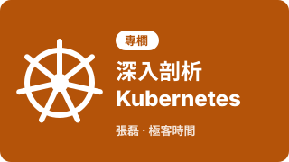
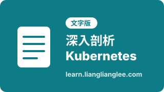

# Reference

**目錄**

- [課程](#課程)
- [影片](#影片)
- [簡寫對照](#簡寫對照)

## 課程

| 縮圖 | 資料 | 說明 |
| --- | --- | --- |
| [{ .ref-thumb }](https://time.geekbang.org/column/intro/100015201) | [深入剖析Kubernetes（極客時間）](https://time.geekbang.org/column/intro/100015201) | 張磊的專欄，K8S Deep Dive的主要參考，[Chap-1](chap-1-container-namespace-cgroups.md)、[Chap-2](chap-2-container-fs-security.md)的內容來自這裡 |
| [{ .ref-thumb }](https://learn.lianglianglee.com/%E4%B8%93%E6%A0%8F/%E6%B7%B1%E5%85%A5%E5%89%96%E6%9E%90Kubernetes) | [深入剖析Kubernetes（learn.lianglianglee.com）](https://learn.lianglianglee.com/%E4%B8%93%E6%A0%8F/%E6%B7%B1%E5%85%A5%E5%89%96%E6%9E%90Kubernetes) | 同一個專欄的文字版 |

## 影片

| 縮圖 | 影片 | 頻道 | 說明 |
| --- | --- | --- | --- |
| [{ .ref-thumb }](https://www.youtube.com/watch?v=TlHvYWVUZyc) | [Kubernetes Explained in 6 Minutes](https://www.youtube.com/watch?v=TlHvYWVUZyc) | [ByteByteGo](https://www.youtube.com/@ByteByteGo) | 6分鐘介紹Kubernetes的架構：control plane和worker node上的元件，搭配[Chap-3 Kubernetes的架構](chap-3-kubernetes-architecture-operations.md#kubernetes的架構)看 |
| [{ .ref-thumb }](https://www.youtube.com/watch?v=16fgzklcF7Y&t=445s) | [Istio & Service Mesh - simply explained in 15 mins](https://www.youtube.com/watch?v=16fgzklcF7Y&t=445s) | [TechWorld with Nana](https://www.youtube.com/@TechWorldwithNana) | 15分鐘介紹service mesh和Istio的架構，搭配[用Istio理解聲明式API](chap-6-declarative-api.md#用istio理解聲明式api)看 |
| [{ .ref-thumb }](https://www.youtube.com/watch?v=x_HRl-Ehvb8) | [Istio Service Mesh (sidecar-based) - Intro](https://www.youtube.com/watch?v=x_HRl-Ehvb8) | [The Learning Channel](https://www.youtube.com/@TheLearningChannel-Tech) | Istio的sidecar mode入門，搭配[Istio是什麼](chap-6-declarative-api.md#-1-istio是什麼)看 |
| [{ .ref-thumb }](https://www.youtube.com/watch?v=WPLVvwPGJvw) | [Istio Ambient Service Mesh](https://www.youtube.com/watch?v=WPLVvwPGJvw) | [The Learning Channel](https://www.youtube.com/@TheLearningChannel-Tech) | Istio的ambient mode：ztunnel和waypoint，搭配[Istio是什麼](chap-6-declarative-api.md#-1-istio是什麼)看 |
| [{ .ref-thumb }](https://www.youtube.com/watch?v=GFXjlPBsykM) | [Istio Service Mesh – Securing Kubernetes Workloads](https://www.youtube.com/watch?v=GFXjlPBsykM) | [The Learning Channel](https://www.youtube.com/@TheLearningChannel-Tech) | 用Istio保護Kubernetes的workload |

## 簡寫對照

K8S Deep Dive的技術名詞統一用簡寫，複數加s（libs、deps、pkgs、vars）：

| 全寫 | system call | memory | library | dependency | package | variable | environment variable |
| --- | --- | --- | --- | --- | --- | --- | --- |
| **簡寫** | sys call | mem | lib | dep | pkg | var | env var |
